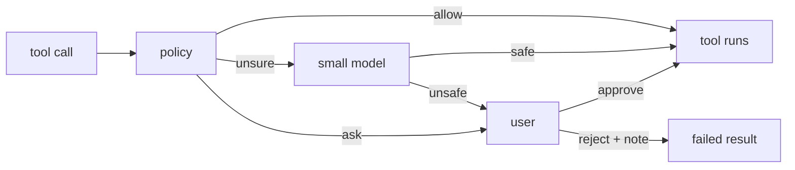

# Plan: milestone 3 step 5, approvals

Part of milestone 3, overview in [coding.md](coding.md).

Today every call runs: `ToolCall` (the pipeline every tool call takes) hands it straight to the tool. Step 3 gives the pieces approvals needs. `Questions.ask` waits on the user inside a call, its cover shows waiting asks one at a time, oldest first, so calls in one reply ask in turn, and `Models.generateObject` runs one-off calls on the `small` model.

The chain the work file sets, as a `ToolCall` wrap:



## Prior art

| | What decides | Answers | Grants kept | No one to ask |
| --- | --- | --- | --- | --- |
| DeepSeek | An OS sandbox mode per session (read-only, workspace-write, full access) and an approval policy, `ask` or `never`. Experimental Auto review sends every call to a reviewer model; a denial goes to the user with the reviewer's reason; a reviewer failure denies | Allow once, reject | None; `allow_always` deferred because scope and revocation need design | `never` rejects; no answerer is `unavailable` and fails closed |
| OpenCode | Rules `{ action, resource, effect: allow \| ask \| deny }`, last match wins, default `ask`; each tool asks with the paths or patterns its call touches | Once, always, reject with a message; a reject fails every waiting ask in the session | `always` saved per project | |
| Crush | Per tool, action and path; `allowed_tools` in config | Allow, allow for the session, deny | Session | `--yolo` skips asking |
| Pi | Nothing built in; an example extension matches dangerous bash patterns | Yes, no | None | Blocks |
| Tau (main) | Only `bash` and `eval` are reviewed. Parsed read-only bash commands skip review; a Jev or Luna classifier approves routine local requests at face value (3 s limit); the rest go to a reviewer model that may ask the host to read up to 4 referenced files, then decides; then the user | Approve, reject, a note on either | None | |
| archive `approval` | Modes `auto`, `ask`, `full`; safe and ask command prefix lists; a decision model, then a reviewer, then the user | Approve, reject | | |

Sources: Tau `packages/agent/extensions/tool-approval/` (`index.ts`, `decision.ts`, `evidence.ts`, `allowlist.ts`) and `extensions/decisions/classifier.ts`; DeepSeek `.agents/notes/implemented/feature/2026-07-06-approval-seam.md`, `2026-08-28-auto-review.md`, `2026-09-24-auto-review-user-approval-fallback.md`, `packages/interaction/permission-presets/README.md`; OpenCode `packages/core/src/permission.ts`; Crush `internal/permission/permission.go`; Pi `examples/extensions/permission-gate.ts`; `archive/packages/plugins/approval`.

- DeepSeek's reviewer sees a fixed policy, the folder, the project instructions, the user's messages, earlier calls with their input, and the pending call with its schema. It leaves out the main model's text and every tool result, so a file the model read cannot talk the reviewer into a yes.
- DeepSeek keeps approvals apart from its questions seam because an approval is a closed outcome tied to one call and must fail closed. `defineQuestion` already gives a closed answer schema, logs the ask and the answer, and ties the ask to its call, so approvals is a question kind, as the work file says.

- Tau's classifier asks three questions: does the request run code it does not show (`hidden`), where is the most consequential change (`none`, `workspace`, `user_home`, `system`, `remote`, `exposure`), and is it a normal step toward the user's request (`intent`). It approves when `hidden` ≤ 0.5, `none` + `workspace` ≥ 0.8, and either `none` ≥ 0.8 or `intent` ≥ 0.5. Its state is the tool, the folder, the latest user request (last 800 characters) and the last four assistant messages (4,000 characters in all).
- Classifier guidance (Pydantic, Cloudflare and community guides on Jev; OpenAI's Decisions API on `gpt-6-luna`): state each condition exactly, keep a question and its criteria saying the same thing, describe situations rather than degrees, and trim the state to what the question needs. Probabilities are not calibrated until tested on known inputs.
- Claude Code's auto mode (Anthropic, "Claude Code auto mode" engineering post) lets reads and searches run, lets edits inside the project run unreviewed, and sends everything else to a classifier in two stages: a fast yes or no filter that leans toward blocking, then reasoning only on what it flags, which cut false positives from 8.5% to 0.4%. The classifier sees the user's messages and the agent's tool calls; the agent's own text is stripped so the agent cannot argue its case, and tool results are stripped as the main defense against injected instructions. Most misses saw the danger but took a vague request, such as "clean up the PR", as consent for a larger action, such as a force-push.
- What an ask shows. Tau and the archive show the reviewer's plain-words summary and its reason, not the raw call; Tau's reviewer writes "for a junior engineer": the main real-world effect and who or what it touches, then why approval is needed, what could be lost and how hard it is to recover. Claude Code's Bash tool and OpenCode's `shell` take a short `description` the agent writes; Codex takes a `justification` when a command asks to leave its sandbox. Warning research (Bravo-Lillo et al., "Improving Computer Security Dialogs", INTERACT 2011; "Your attention please", SOUPS 2013) says name the specific risk and its consequence, keep it short and nontechnical, and draw the eye to the critical part, which cut unsafe clicks. Hermes issue #6959 proposes a short structure: likely action, risk to the user, why it was flagged. The NHI Mgmt Group write-up on approval prompts warns that a summary the agent shapes turns approval into a formality, so the summary should come from somewhere independent and what was shown should be logged.
- Decision model guides (OpenRouter on Jev, inovex, OpenAI Decisions write-ups) add: give a choice question an unknown option so the model is not forced to pick, and set thresholds from what each kind of error costs.
- An independent test of Claude Code's auto mode (arXiv 2604.04978) found most missed risks were file edits the classifier never saw, since agents reach the same effect by editing files when a command is missing.

## Agreed

- Approvals work as Tau's main branch does: a classifier first, then a small reviewer model, then the user. No approve-once or remembered grants; the user approves or rejects, with a note.
- The classifier approves what it can judge at face value; the rest goes to the reviewer. Its state is the tool and its input, the folder, the allowed folders, the latest user request (last 800 characters) and the turn's earlier tool calls by name and input, trimmed. Neither the classifier nor the reviewer sees the agent's own text or any tool result, as Claude Code's auto mode strips them: the agent cannot argue its case, and injected instructions arrive through tool results.
- The classifier asks three questions, from Tau's:
  - `hidden`: does the call run code it does not show?
  - `impact`: where is the most consequential change: `none`, `workspace` (the workspace, the allowed folders or the system temp folder), `user_home`, `system`, `remote`, `exposure` or `unknown`.
  - `asked`: did the user ask for this action, or for a task it is plainly part of? Its criteria say a vague request does not cover a destructive or remote action, the miss Anthropic found most often.
- It approves when `hidden` ≤ 0.5, `none` + `workspace` ≥ 0.8, and either `none` ≥ 0.8 or `asked` ≥ 0.5, Tau's thresholds, kept until the test milestone checks them on known inputs. An input over 6,000 characters, no answer within 3 seconds, a classifier error or no connected classifier sends the call to the reviewer.
- The reviewer has read-only tools, so it can open a script the agent wrote to a temp folder before it runs, and query the current session for context in few tokens.
- `read` and other read tools fail outside the workspace and the folders allowed beside it, such as references. The reviewer is told the same folders, so it sees when a call reaches outside them. The model can ask to allow a folder or a file, choosing the highest level it needs so one ask covers several files.
- `tools-shell` is built before approvals, so approvals is shaped around a real command tool; it joins the CLI composition together with approvals. The order becomes shell, approvals, then `edit` and `write`.
- The reviewer is one `Models.generateObject` call given tools: an optional `tools` and `maxSteps`. The schema becomes an `answer` tool, every step must call a tool (`toolChoice: { mode: "required" }`), and the call ends when `answer` decodes; an answer that fails to decode goes back to the model and counts as a step. Each step goes through `ModelCall`; the tools run directly, not through `ToolCall`. The steps are not logged; approvals logs its verdict, who decided and which files the reviewer read. Pi's standalone `agentLoop` and Tau's `submit_tool_review` are the prior art; a child session was rejected as heavier than a read-only reviewer needs.
- An access request is judged like any other call: the classifier or the reviewer allows it when the user clearly asked for that place, else it goes to the user.
- A tool says what each call touches through an optional `access` function on `Tool`, worked out from the call's params, in place of the work file's read-only and destructive hints. A tool without one counts as `run`. Approvals only checks the paths of `read` and `write` calls against the allowed folders and fails a call outside them; edits inside the workspace are not reviewed, since git undoes them. `run` calls go to the classifier, the reviewer, then the user.

  ```ts
  type Access =
    | { kind: "read"; paths: ReadonlyArray<string> }
    | { kind: "write"; paths: ReadonlyArray<string> }
    | { kind: "run" }
  readonly access?: (params: Schema.Json) => Access
  ```

- The allowed folders are the workspace, the folders other plugins add to approvals' `AllowedFolders` registry, each for reading or for changing, such as a references plugin's repos, and the system temp folder. An allowed access request lasts for the session and is saved as a session event, so it survives a restart.
- Tau's list of read-only commands lives in `tools-shell`, as the work file's shell safety rules on `unbash`: `shell`'s `access` returns `read` for a command the parser proves read-only and `run` for the rest. `unbash` needs approval as a new dependency when `tools-shell` is planned.
- The reviewer's tools are `session_search` and the registered `read` tool. `session_search` is a literal search over the current session's user messages and earlier tool-call inputs, returning about ten short excerpts and never tool results, as DeepSeek leaves them out so a file the agent read cannot talk the reviewer into a yes. The reviewer runs `read` directly after checking its `access` paths against the allowed folders, so a replaced `read` tool is the one the reviewer uses.
- When the reviewer fails, from a provider error or no valid answer within `maxSteps`, the user is asked and told the review failed, as Tau does. DeepSeek fails the call instead, since a technical failure says nothing about risk; a person is there to decide here. Print mode denies unless `--yolo` is passed.
- The user never reads the command or script. The reviewer, not the agent, writes what an ask shows, since a summary the agent shapes turns approval into a formality. When it sends a call to the user its answer is:

  ```ts
  type Verdict =
    | { decision: "allow" }
    | {
        decision: "ask"
        summary: string                    // one sentence, plain words, starts with a verb
        effects: ReadonlyArray<{           // at most 5
          kind: "creates" | "changes" | "deletes" | "sends" | "installs" | "starts"
          target: string                   // a path, host or named thing, short: build/, ~/.zshrc, github.com
        }>
        risk: string                       // why it needs the user: what could be lost, and whether it can be undone
      }
  ```

- The ask shows the tool, the summary, one line per effect with `deletes` and `sends` in the warning color, and the risk, then Approve and Reject with a note on Reject. When the review failed it says so in the summary's place: "The review failed: <error>. No one checked this call." The raw input stays in the call's transcript row.

  ```text
  △ Run shell?                                          1 more waiting
    Clears the project's build output and rebuilds it.
    deletes   build/
    creates   build/
    Can be undone by running the build again.

    ▸ Approve
      Reject
  ```

- The model asks for a folder with `request_access({ path, write, reason })`, judged by the same chain. When the classifier and the reviewer cannot tell whether the user wants it, the ask shows the folder, reading or changing, and the agent's reason labelled as the agent's; the folder is shown exactly, so the reason cannot hide what is granted. A write grant allows reads too, and changes inside that folder then go unreviewed, as in the workspace.

  ```text
  △ Allow reading outside the workspace?
    ~/dev/other-repo
    The agent says: "You asked me to match the router in other-repo."

    ▸ Approve
      Reject
  ```

## Code plan

Mechanisms: approvals Wraps `ToolCall`, Adds the `request_access` tool, Adds two question kinds through `defineQuestion`, owns the `AllowedFolders` registry other plugins Add to, and its `tui` entry Adds two views to `AskViews`. `tools`, `tools-files`, `tools-shell`, `tools-processes` and `questions` each gain `access`; `model` gains tools on `generateObject`.

### Contract change: `Tool.access` (`tools`)

```ts
type Access =
  | { readonly kind: "read"; readonly paths: ReadonlyArray<string> }
  | { readonly kind: "write"; readonly paths: ReadonlyArray<string> }
  | { readonly kind: "run" }

interface Tool {
  // ...existing fields
  readonly access?: (params: Schema.Json) => Access // no access: run
}

// defineTool takes access typed by the tool's own params;
// params that fail to decode count as run
defineTool({ ..., access?: (input: S["Type"]) => Access })
```

| Tool | Access |
| --- | --- |
| `read` | `read [path]` |
| `shell` | `read [path-like args]` when `unbash` proves the command read-only, else `run` |
| `process_start`, `process_input` | `run` |
| `process_output`, `process_stop`, `ask_question`, `request_access` | `read []` |

A path-like argument is one that is absolute, starts with `~` or contains `..`; relative paths without `..` stay in the workspace. `unbash` 6.0.1 moves from `tools/planned` into `tools-shell`. The read-only rules port Tau's `allowlist.ts`: its always-safe commands, the read verbs of `git`, `find` without `-exec`, `-delete` or `-fprint`, and no write redirects.

### Contract change: tools on `generateObject` (`model`)

```ts
interface StepTool {
  readonly definition: ToolDefinition // name, description, JSON schema
  readonly run: (params: Schema.Json) => Effect.Effect<string>
}

interface GenerateOptions {
  readonly model?: ModelRole | ModelPick
  readonly prefix?: ...
  readonly system?: string // new
  readonly prompt: string
}

generateObject<T>(options: GenerateOptions & {
  readonly schema: Schema.Codec<T>
  readonly tools?: ReadonlyArray<StepTool> // new
  readonly maxSteps?: number // new, default 6
}): Effect.Effect<T, AiError>
```

Without `tools` it works as today. With them, the schema becomes an `answer` tool, each step goes through `ModelCall` with `toolChoice: { mode: "required" }`, tool calls run and their results join the next step's prompt, and the call ends when `answer` decodes. A bad answer goes back as a tool error and counts as a step; running out of steps fails with `AiError` `StructuredOutputError`.

### `approvals` contract

```ts
// attribute on the input message; print mode sets it from --yolo
const Unattended = Attribute.make("approvals/unattended", Schema.Struct({ yolo: Schema.Boolean }))

// logged once per run call
const Decided = defineEvent("approvals/decided", {
  callId: string
  allowed: boolean
  by: "classifier" | "reviewer" | "user" | "unattended"
  scores?: { hidden: number; impact: Record<Impact, number>; asked: number }
  review?: { read: ReadonlyArray<string>; failed?: string; verdict?: Verdict }
  note?: string // the user's note
})

// logged when an access request is allowed; replayed on session open
const Granted = defineEvent("approvals/granted", AllowedFolder)

const callQuestion = defineQuestion("approvals/call", {
  tool: string
  review: Verdict & { decision: "ask" } | { failed: string }
}, Answer)

const accessQuestion = defineQuestion("approvals/access", {
  path: string
  write: boolean
  reason: string
  review?: { failed: string }
}, Answer)

const Answer = Schema.Struct({ decision: Schema.Literals(["approve", "reject"]), note: Schema.optional(Schema.String) })

// folders readable beside the workspace; a plugin that depends on approvals adds to it
// a folder and everything under it; write allows reads too
const AllowedFolder = Schema.Struct({ path: Schema.String, access: Schema.Literals(["read", "write"]) })
class AllowedFolders extends Registry.Service<AllowedFolders, AllowedFolder>()("approvals/AllowedFolders") {}
```

### Call path

```text
ToolCall wrap (request, next)
  Unattended.yolo?                              log Decided(unattended, allowed) ; next
  tool = last tool in Tools named request.call.name; none: next
  access = tool.access?.(request.call.params) ?? run
  read  -> every path inside readable folders?  next : failed "outside the allowed folders; ask with request_access"
  write -> every path inside writable folders?  next : same failure
  run   -> judge(request, tool)                 allowed: next
                                                 denied: failed result with the reason

judge
  classify(state)          approves: Decided(classifier)
                           over 6,000 chars, 3 s, error or no classifier: on to review
  review(state)            allow: Decided(reviewer)
                           ask or failed: on to the user
  no Unattended attribute in a frontend:  callQuestion.ask(asker, data) -> Decided(user, note)
  Unattended.yolo false (print mode):     Decided(unattended, denied)
```

The reasons a call fails are distinct: outside the allowed folders, rejected by the user (with the note), and denied in print mode ("run with --yolo to allow"). `--yolo` skips every check, folders included, as Crush's `--yolo` does. `request_access` runs the same `judge` with its own state, asks with `accessQuestion`, and on approve appends `Granted`.

### Folders

- One list holds every allowed folder: the `AllowedFolders` entries, then the session's grants, which share the `AllowedFolder` shape. Approvals adds the workspace and the system temp folder to its own registry as `write` entries, so they need no special case.
- A `read` call passes when every path is inside some entry; a `write` call when every path is inside a `write` entry.
- Entries are folders, not globs: a folder check is a prefix test after `realpath`, which a symlink cannot slip past, and grants are folders already. No settings: a user who wants a folder every session adds a plugin, or asks once per session.
- A path is resolved against the workspace, `~` expanded, then the nearest existing ancestor is resolved with `realpath`, so a symlink cannot lead outside.
- Grants are a `Ref` per session, loaded from `Granted` events on the first call in that session.

### Files

| File | Holds |
| --- | --- |
| `src/contract.ts` | `Unattended`, `Decided`, `Granted`, the two question kinds, `Answer`, `Verdict`, `requestAccessName` |
| `src/index.ts` | `definePlugin`: wraps `ToolCall`, adds `request_access`, provides `AllowedFolders` and adds the workspace and the system temp folder to it; `entries: { tui }` |
| `src/folders.ts` | Allowed folders, path resolution, grants per session |
| `src/state.ts` | The state the classifier and reviewer see: tool, input, folder, allowed folders, latest user request, the turn's earlier calls |
| `src/classify.ts` | The three questions and Tau's thresholds on `Models.classify` |
| `src/review.ts` | The reviewer's system prompt and its `generateObject` call with `session_search` and `read` |
| `src/search.ts` | `session_search` over user messages and earlier tool-call inputs |
| `src/judge.ts` | The chain, logging `Decided` |
| `src/tui/index.tsx` | Adds `CallAsk` and `AccessAsk` to `AskViews` |
| `src/tui/CallAsk.tsx`, `src/tui/AccessAsk.tsx` | The two asks, ported from the gallery's `Approval` sketch |

### CLI

- The composition adds `tools-shell`, `tools-processes` and `approvals`.
- Print mode takes `--yolo` and sets `Unattended` on the input message; without it, `Unattended` is set with `yolo: false`, and the TUI sets nothing.

### `tool-output`

- Spills move from the global folder to the system temp folder, which approvals already allows, so `read` can open them.

Settled while building:

- `Verdict` is one flat object, with empty summary, effects and risk for `allow`: provider tool schemas need an object at the top level, so a union cannot be the `answer` tool.
- `callQuestion` carries a `Review` union: the reviewer's verdict, or the message of its failure, so the ask can say no one checked the call.
- `request_access` lives in `src/access.ts`. Under `--yolo` it grants at once.
- Under `--yolo`, `Decided` is logged only for `run` calls; reads and writes run without a record.
- The classifier's impact question has an `unknown` label, so it can say it cannot tell.
- `Choose.tsx` is the frame both asks share. `useHintsWithin` in `packages/tui` gives the hints only while focus is inside the ask, for both questions' form and approvals.
- `generateObject` takes the schema's own codec, `Codec<T, JsonObject>`; a plain struct such as `Verdict` passes as is.
