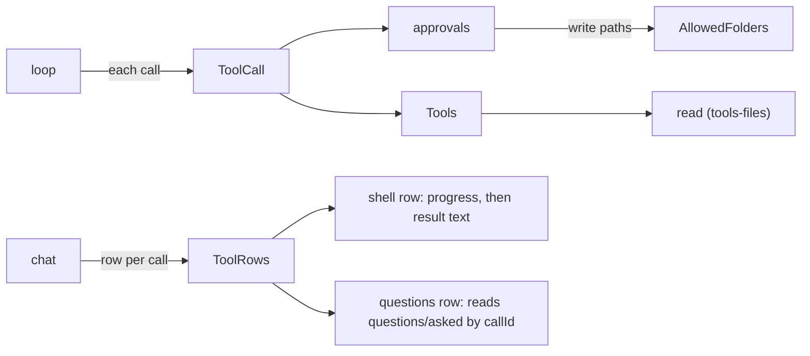
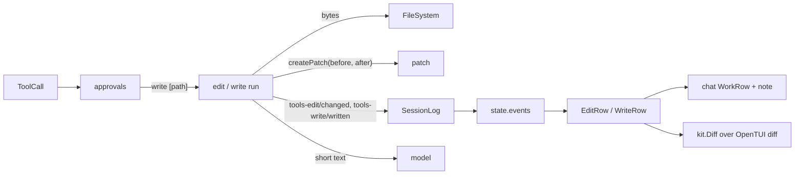

# Plan: milestone 3 step 6, edit and write

Part of milestone 3, overview in [coding.md](coding.md).

Today one plugin, `tools-files`, adds `read` (`src/read.ts`; `src/contract.ts` holds `pageOf`, `entriesOf`, `isBinary`, `MAX_LINES`). `tags` imports `@shanepadgett/liminal-tools-files/contract` for file listing, and the CLI composition adds the plugin. Nothing changes files.



What the step reuses:

| Need | Reuse |
| --- | --- |
| Approve writes outside allowed folders | `Tool.access` as `write [path]`; approvals already checks write paths against `AllowedFolders` |
| Two calls on one file in a reply | `sequential` mark: the reply's calls run one after another |
| Data a row shows but the model does not see | A tool appends its own session event keyed by `callId`, as `questions/asked` does; the row finds it in `state.events` |
| Diff drawing | OpenTUI `<diff>` (`DiffRenderable`: unified diff text, `view` unified or split, `filetype`, line numbers, added and removed colours); theme syntax covers diffs |
| Patch text | `diff` 9.0.0 (`structuredPatch`, `formatPatch`), pinned in `tools/planned` |
| Row while params stream | `loop/src/partial-json.ts` already gives partial params to rows |

## Prior art

| | Params | Matching | Line endings, BOM | Display data | Many calls on one file |
| --- | --- | --- | --- | --- | --- |
| Pi `edit.ts`, `edit-diff.ts` | `path`, `edits: [{oldText, newText}]`, each matched against the original file, no overlaps | Exact, then fuzzy: NFKC, trailing whitespace, smart quotes, dashes, spaces; fails on none or many | Strips BOM, detects CRLF and restores it | `details {diff, patch, firstChangedLine}` beside the model's text | Per-file queue |
| OpenCode `edit.ts`, `write.ts`, `patch.ts` | `path`, `oldString`, `newString`, `replaceAll`; a separate `apply_patch` tool | Exact, then a chain of replacers (trailing whitespace, typographic) | Edits in LF, keeps the file's endings and BOM | `metadata.files` diff; the ask shows the diff | Per-path lock |
| DeepSeek `tool-fs` `edit.ts`, `diff.ts` | `file_path`, `old_string`, `new_string`, `replace_all` | Exact | | Output `{path, before, after}`; model text from `render`, hunks from `presentationMeta`; a diff card from the params while the call runs | |
| Crush `edit.go`, `multiedit.go`, `write.go` | Single edit, and a multi-edit tool with `edits[]` | Exact | Keeps CRLF | Diff in metadata | Read-before-edit check |
| archive `tools-edit` | `path`, `oldText`, `newText` | Exact, once only | | None; row says `Edit <path>` | |

Sources: Pi `packages/coding-agent/src/core/tools/{edit,edit-diff,write,file-mutation-queue}.ts`; OpenCode `packages/core/src/tool/plugin/{edit,write,patch,file-diff}.ts`; DeepSeek `packages/fs/tool-fs/src/{edit,write,diff}.ts`; Crush `internal/agent/tools/{edit,multiedit,write}.go`; `archive/packages/plugins/tools-edit`.

## Agreed

1. **Split.** `tools-files` becomes `tools-read` with its contract unchanged; `tags` and the CLI import the new name. New `tools-edit` adds `edit`, new `tools-write` adds `write`; each has a `tui` entry that adds its `ToolRows` row.
2. **`edit` params.** Pi's `{path, edits: [{oldText, newText}]}`: several changes to one file in one call, each matched against the file as it was. No `replaceAll`; the model lists each place.
3. **Matching.** Exact first, then one fuzzy pass (trailing whitespace, smart quotes, dashes, odd spaces), as Pi. The file keeps its BOM and line endings. Fails with a message the model can act on: no match, more than one match, overlapping edits, empty `oldText`, nothing changed, file missing ("use `write`").
4. **Display data.** Each tool appends its own saved event after it changes the file: `tools-edit/changed` and `tools-write/written` (event kinds start with the plugin's name, as `questions/asked`), each `{callId, path, patch}`. The row decodes it from `state.events`, as the questions row does. No base contract change; if later tools need the same, it becomes `ToolOutput.details` then.
5. **Diff view.** One `Diff` in the `packages/tui` kit over OpenTUI `<diff>`, used by both rows. Rows start closed, as the questions row does, so the chat stays clean: `Edit <path>` or `Write <path>` with a `+N -M` note, as the gallery's sample. Opening the row shows the unified diff with line numbers. `diff` moves from `tools/planned` to `tools-edit` and `tools-write`.
6. **While params stream.** The row shows the path and the number of edits; the diff is there to open once the call has run. A live diff from streaming params is under Later.
7. **Two calls on one file.** Mark `edit` and `write` `sequential`, reusing the mark. Cost: a reply holding an edit runs its reads one after another too.
8. **Access and `write`.** Both declare `write [path]`. `write` creates missing folders and overwrites. No read-before-edit check; it is under Later.
9. **What the model sees.** Short text: `Edited <path>: 2 changes`, `Wrote <path>: 40 lines`. No diff in the result; the model wrote the change.

## Code plan



### `tools-read` (renamed from `tools-files`)

- `git mv packages/plugins/tools-files packages/plugins/tools-read`; package `@shanepadgett/liminal-tools-read`, plugin name `tools-read`. Code unchanged.
- Updates: `tags` (`src/workspace.ts`, `package.json`, `README.md`), `apps/cli` (`composition.ts`, `package.json`), `bun.lock` through `bun install`, docs that name `tools-files`.

### `tools-edit`

```ts
// src/contract.ts
export const Changed = defineEvent("tools-edit/changed",
  Schema.Struct({ callId: Schema.String, path: Schema.String, patch: Schema.String }))

// src/match.ts: pure, no Effect
type Edit = { oldText: string; newText: string }
type Applied =
  | { kind: "applied"; text: string }
  | { kind: "failed"; message: string }
export const applyEdits = (text: string, edits: ReadonlyArray<Edit>): Applied

// src/edit.ts
Input = Struct({ path: String, edits: NonEmptyArray(Struct({ oldText: String, newText: String })) })
makeEdit = Effect.gen: fs, path, workspace, log
  run(input, { session, callId }):
    target = path.resolve(workspace, input.path)
    bytes  = fs.readFile(target)                      // missing: "Nothing is at <path>; use write to make a file."
    binary, folder                                    // fail
    { bom, eol, text } = textOf(bytes)                // BOM off, CRLF to LF
    applied = applyEdits(text, input.edits)           // failed: ToolFailed(message)
    fs.writeFileString(target, bom + withEol(applied.text, eol))
    log.append(session, [Changed.make({ callId, path: input.path, patch: createPatch(input.path, text, applied.text) })])
    return text(`Edited ${input.path}: ${n} changes`)
  defineTool({ name: "edit", sequential: true, access: write [path], ... })

// src/index.ts: Tools.add(makeEdit); requires Tools, Directories, SessionLog, FileSystem, Path
// src/tui/index.tsx: ToolRows.add({ tool: "edit", component: EditRow })
```

`applyEdits`, after Pi's `edit-diff.ts`:

1. Each edit's `oldText` and `newText` to LF. An empty `oldText` fails.
2. Each edit is found in the original text. Exact first; found more than once fails ("found 3 times; add surrounding lines"). Found nowhere, the fuzzy pass: the text and `oldText` with each line's trailing whitespace dropped and smart quotes, dashes and odd spaces made plain; again exactly once. A fuzzy match changes only the lines it covers; every other line stays as it was.
3. Matches sorted by position; two that overlap fail, naming both edits by number.
4. Applied from the last to the first, so earlier positions hold. A result equal to the original fails ("nothing changed").

Messages name the edit by number when there are several ("edit 2 of 3: ...").

### `tools-write`

```ts
// src/contract.ts
export const Written = defineEvent("tools-write/written", Struct({ callId, path, patch }))

// src/write.ts
Input = Struct({ path: String, content: String })
run:
  before = text at target, or "" when nothing is there   // a folder fails
  fs.makeDirectory(dirname(target), { recursive: true })
  fs.writeFileString(target, input.content)
  log.append(session, [Written.make({ callId, path, patch: createPatch(path, before, content) })])
  return text(`Wrote ${path}: ${lines} lines`)
defineTool({ name: "write", sequential: true, access: write [path], ... })
```

`content` is written as given; the model chooses the line endings.

### Rows

```ts
// packages/tui/src/kit/Diff.tsx
/** A unified patch with line numbers, coloured by the file's type. */
export function Diff(props: { path: string; patch: string })
  // <diff diff={patch} view="unified" filetype={pathToFiletype(path)} syntaxStyle={useSyntax()()}
  //  showLineNumbers addedBg={feedback.success.subtle} removedBg={feedback.danger.subtle} ... />
/** Lines a patch adds and removes, its headers left out. */
export const changesOf = (patch: string): { added: number; removed: number }

// packages/plugins/chat/src/tui/WorkRow.tsx: WorkRowProps gains
/** A short fact after the input, such as `+3 -1`; faint, as the gallery's rows. */
readonly note?: string | undefined

// tools-edit/src/tui/EditRow.tsx (WriteRow the same with Written)
EditRow(props: ToolRowProps):
  change = createMemo(() => first Changed in props.state.events with callId === props.item.id)
  path   = change()?.path ?? writtenParam(props.item.params, "path")
  note   = change() ? `+${added} -${removed}` : running ? `${editCount(params)} edits` : ""
  <WorkRow item={{ ...props.item, params: { path } }} note={note}
    details={change() && (() => <kit.Diff path={change.path} patch={change.patch} />)} />
```

The row is closed until clicked; a failed call has no event, so nothing opens.

### Dependencies and docs

- `diff` 9.0.0 moves from `tools/planned/package.json` into `tools-edit` and `tools-write`; `docs/reference/sources.json` already lists it; `mise run docs` after.
- `docs/status.md` ticks step 6; `docs/architecture.md` plugins rows; `docs/plugins/coding.md` drops the section; `docs/usage/cli.md` and `docs/guides/plugins.md` where they name `tools-files`; READMEs for the three plugins, `chat` (row note) and `packages/tui` (`Diff`).
- The composition adds `tools-edit` and `tools-write` with their `tui` entries.

### Files

| File | Lines, about |
| --- | --- |
| `tools-edit/src/{contract,match,edit,index}.ts`, `src/tui/{EditRow,index}.tsx` | 300 |
| `tools-write/src/{contract,write,index}.ts`, `src/tui/{WriteRow,index}.tsx` | 150 |
| `packages/tui/src/kit/Diff.tsx` | 50 |
| `chat/src/tui/WorkRow.tsx` | +10 |

Hand-check: print mode in a temp workspace runs an edit with two changes, a CRLF file, a fuzzy match, a duplicate match, and a write into a new folder; the TUI shows closed rows with `+N -M` and the diff on click.

Settled while building:

- `applyEdits` returns an `Effect` that fails with `ToolFailed`, so each step's failure reads in sequence; it stays free of services.
- The edit row counts edits only while the call streams and only when there are more than one.
- `kit.Diff` tints changed lines by mixing the success and danger colors into the background; the palette has no diff roles.
