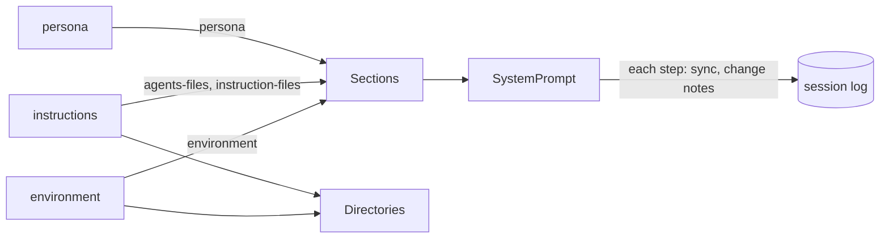

# Plan: milestone 3 step 1, prompt sections

Part of milestone 3, overview in [coding.md](../coding.md). Work list: [plugins/coding.md](../../plugins/coding.md).



The system prompt, in order:

| Order | Section | Plugin | Text |
| --- | --- | --- | --- |
| -100 | `persona` | `persona` | `You are Liminal…`, `<communication>`, `<discussion>`, and now `<execution>` |
| 0 | `agents-files` | `instructions` | Each `AGENTS.md` in `<instructions path="…">`, most shared first |
| 10 | `instruction-files` | `instructions` | The `always: true` files' text, then `<instruction_files>`: one intro line and `` - `path`: situation `` per `read-when` file |
| 100 | `environment` | `environment` | `<environment>`: workspace, Git branch or none, platform, date, the workspace root's entries |

Stable text first and per-day text last, so sessions in one repository share the longest prompt prefix.

## Where each piece comes from

| Piece | Read from | References |
| --- | --- | --- |
| `<execution>` | Copied from `archive/packages/plugins/system-prompt/src/server/base.ts` into `persona`; `<reminders>` dropped, nothing sends reminders | Pi `core/system-prompt.ts` keeps rules in its base prompt |
| `AGENTS.md` | `~/.agents/AGENTS.md`, `~/.liminal/AGENTS.md`, then each folder from the repository root down to the workspace; outside a repository, the workspace only | OpenCode `config/plugin/instruction.ts` walks up to the worktree root; Pi `core/resource-loader.ts` walks to the filesystem root |
| Instruction files | `.md` files in `~/.liminal/instructions/` and `<workspace>/.liminal/instructions/`; a project file replaces a global one of the same name | `archive/packages/plugins/instruction-files`; Pi lists skills by path and description for the model to read |
| Environment | `Directories`, `process.platform`, `process.arch`, the clock; the root's entries from `git ls-files` in a repository (what Git ignores left out), else the folder's visible names; capped at 200 lines | Crush `templates/coder.md.tpl` `<env>`; `archive/packages/plugins/environment` |

- An instruction file's front matter is `always: true` or `read-when: <situation>`.
- Instruction files are Liminal's way to give the model instructions. Reading `AGENTS.md` is opt-in: `{ "instructions": { "agentsFiles": true } }` in the global or project `settings.json`, read on each step; off by default. When off, the `agents-files` section is empty and left out.
- A file without valid front matter, and any `AGENTS.md` or instruction file that fails to read, is left out with a warning notice in the session.
- Sections read the files again on every step; `system-prompt` already turns a changed section into a change note.
- Nothing is gated on a trusted workspace yet; Pi and OpenCode read `AGENTS.md` without asking. Trust arrives with `loader`.

## Contract change: `Section`

A notice needs a session, so a section's text is read for one.

```ts
interface Section {
  name: string
  text: (session: SessionId) => Effect<string>
}
```

`SystemPrompt.sync` and `fold` already have the session and pass it; `persona` ignores it.

## Contract change: `Directories`

`AGENTS.md` and `environment` both need the repository root, and `environment` needs the branch the sidebar already reads.

```ts
interface Directories {
  global: string
  workspace: string
  project: string
  /** The folder holding `.git`, found once at start by walking up from the workspace. */
  repository: Option<string>
  /** The checked-out branch, or a short commit id; read on each call. */
  branch: Effect<Option<string>>
}
```

`directories/workspace` reads `branch` too, so a workspace in a subfolder of a repository shows its branch.

## Moving `docs/instructions/`

```text
docs/instructions/*.md  ->  .liminal/instructions/*.md   (git mv; front matter from the AGENTS.md table)
```

- Each file gains `read-when:` with the text of its row in the `AGENTS.md` table.
- The `AGENTS.md` table stays, with the new paths, for agents that read only `AGENTS.md`. Liminal leaves `AGENTS.md` off here and reads the front matter instead. Revisit at step 8.
- Links in `AGENTS.md`, `docs/_index.md`, `docs/status.md`, `docs/plans/` and the instruction files themselves change to the new paths.
- Exact text for `AGENTS.md` and the instruction files goes to the user before the edit.

The shell line in `environment`, and the command-line tools found on the machine, land with `tools-shell`.
