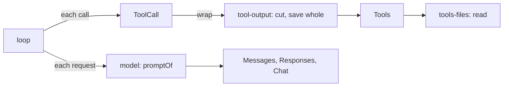

# Plan: milestone 3 step 2, read and tool output

Part of milestone 3, overview in [coding.md](coding.md).



## Contract change: results are text and images

```ts
// model contract
ToolResult = { type: "tool-result"; callId; name; content: Array<Text | Image>; isFailure; loads? }
// tools contract
interface ToolOutput { content: ReadonlyArray<Text | Image>; loads?: ReadonlyArray<string> }
```

- `content` replaces `result: Json`. A failure is one text part. Pi (`ai/src/types.ts`) and OpenCode (`tool/plugin/read.ts`, `toModelContent`) use the same shape.
- Provider plugins do not change. Effect AI 4.0.5 sends a tool result only as a string on all three wires (`AnthropicLanguageModel.ts` `tool_result.content`, `OpenAiLanguageModel.ts` `function_call_output.output`, compat `role: "tool"`). So `model`'s `promptOf` sends the text parts as the result and puts a run of results' images in one user message after the run, as Pi does for Chat Completions (`api/openai-completions.ts`, "Attached image(s) from tool result"). One message after the run, not one per result: Chat Completions refuses a user message between tool messages. Anthropic's encoder folds it into the same user turn (`groupMessages`).
- For a model whose catalog details say no images, `promptOf` leaves images out and says so in the result's text, as Pi's `read` notes (`getNonVisionImageNote`). `call.ts` already has the details and passes them in.
- Logged results change shape, so the database is reset when this lands.

| Builds a result today | Change |
| --- | --- |
| `tools/src/index.ts` (run, failed) | `content` from `ToolOutput`; failures as one text part |
| `loop/src/recovery.ts` (stand-ins, cancelled) | Reason as one text part |
| `model/src/prompt.ts` | As above |
| `chat/src/view/index.ts` | Reads only `isFailure`; no change |

## `read` in `tools-files`

| Behaviour | Liminal | Pi `tools/read.ts` | OpenCode `read.ts`, `read-filesystem.ts` | Crush `view.go` |
| --- | --- | --- | --- | --- |
| Params | `path`, `offset` (from 1), `limit` | same | same | same |
| Page | 2,000 lines or 50 KB, footer included | 2,000 / 50 KB | 2,000 / 50 KB | 200 lines, 200 KB file cap |
| Line numbers | `12: text` | none | `12: text` | `12\|text` |
| More follows | `[lines 1-2000 of 5120; read on with offset 2001]` | same idea | same idea | same idea |
| Long line | cut at 2,000 characters | no | 2,000 | 2,000 |
| Binary | NUL in the first 8 KB fails the call | no check | fails the call | |
| Images | PNG, JPEG, GIF, WebP by their first bytes; over 5 MB as base64 fails | resizes (`processImage`) | 5 MB, 2000×2000 limit (`image.ts`) | sniffs type |
| Folder | sorted entries, `/` after folders | separate `ls` | entries, paged | separate `ls` |
| Path | any path, relative to the workspace or absolute; `approvals` decides later whether outside paths ask | anywhere | asks outside the workspace | |

- Line numbers let the model point at lines and match `edit` later; the description says the prefix is not part of the file, as OpenCode's does.
- No resizing: Pi's needs an image library. Resizing and PDFs go under Later.
- `tags` already pages a file for `@` (`windowOf`, 2,000 lines, 50 KB) and spots binaries (`isBinary`). Both move to `tools-files/contract` as `pageOf` and `isBinary`; `tags` imports them, so an `@` file reads the same as `read`. `read` is the base way to see a file and `tags` builds on it, so the import runs that way.

## `tool-output`

A `ToolCall` wrap. When a result's text is over 2,000 lines or 50 KB, the model gets the first and last halves and a line between them:

```text
[Output cut: 12,480 lines, 1.2 MB. Whole output: ~/.liminal/tool-output/<session>/<call>.txt; read it with offset.]
```

| Choice | Liminal | Reference |
| --- | --- | --- |
| Kept | first and last halves: the start says what ran, the end holds the error | `archive/packages/plugins/tool-output` (halves); OpenCode `tool-output.ts` keeps the head; Pi's `bash` keeps the tail |
| Limits | 2,000 lines or 50 KB | OpenCode, Pi |
| Whole output | `<global>/tool-output/<session>/<callId>.txt`, folder `0700`, file `0600`; folders older than 7 days removed at start | OpenCode keeps 7 days in its data folder; the archive used a temp folder |
| Images | passed through | OpenCode |
| Failures | cut the same way | archive |

`read` pages within the same limits, so its results pass through uncut. No contract until a second plugin needs the cut.

## No `grep` or `find` tools

The model searches files through `shell` (step 6). `environment` then lists the command-line tools found on the machine that the model should use, such as `rg` and `jq`, beside the shell line. Pi, OpenCode and Crush ship separate search tools; Liminal does not. Until step 6, the model finds files through `read` on folders and the root listing in `environment`.

## Files

```text
packages/plugins/model/src/contract.ts      ToolResult.content
packages/plugins/model/src/prompt.ts        results as text; images after the run; none for models without images
packages/plugins/model/src/call.ts          passes details to promptOf
packages/plugins/tools/src/contract.ts      ToolOutput.content
packages/plugins/tools/src/index.ts         content and text failures
packages/plugins/loop/src/recovery.ts       stand-ins as text
packages/plugins/tools-files/               new: read; contract: pageOf, isBinary
packages/plugins/tags/src/                  windowOf and isBinary deleted; imports tools-files/contract
packages/plugins/tool-output/               new: the wrap, the saved files, the 7-day sweep
apps/cli                                    composition and dependencies
```

Deleted: `ToolResult.result`, `ToolOutput.result`, `tags`' `windowOf` and `isBinary`.
