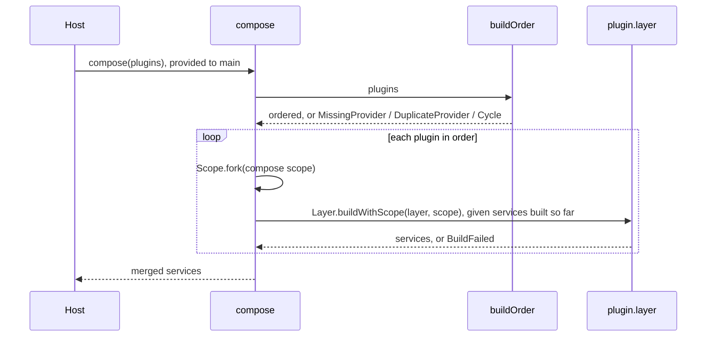

# Plan: `packages/core`

Core composes plugins: `definePlugin`, `compose`, `Registry`, `Pipeline`, `Attribute`. It depends only on `effect` and knows nothing about agents. Design: [architecture.md](../../architecture.md#core).

## Systems

| System | Change |
| --- | --- |
| `packages/core` | Adds the package |
| Archive kernel (`archive/packages/kernel/src/graph`, `src/host`) | Carried over: graph checks, a scope per plugin. Left out: inactive plugins, concurrent builds, graph versions |
| Archive SDK (`archive/packages/sdk/src/core`) | Carried over: `definePlugin` type check, `Registry.Service`. Left out: `uses`, `enabledByDefault`, `Registry.layer`, build-number visibility, input-less `next` |

## Files

```text
packages/core/
  package.json              depends only on effect
  src/index.ts              public exports
  src/plugin.ts             Plugin, definePlugin
  src/build-order.ts        dependency order and graph checks; builds nothing
  src/compose.ts            compose: order, then build each plugin in its own scope
  src/composition-error.ts  CompositionError and its reasons
  src/registry.ts           Registry
  src/pipeline.ts           Pipeline, built on Registry
  src/attribute.ts          Attribute, Attributes, AttributeInvalid
```

## Plugins

```ts
type ServiceTags = ReadonlyArray<Context.Key<any, any>>
type Ids<Tags extends ServiceTags> = Context.Service.Identifier<Tags[number]>   // union of the tags' identifiers
type Entries = { readonly [frontend: string]: () => Promise<unknown> }

interface Plugin<Provides extends ServiceTags, Requires extends ServiceTags, E> {
  readonly name: string
  readonly provides: Provides
  readonly requires: Requires
  readonly layer: Layer.Layer<Ids<Provides>, E, Ids<Requires>>
  readonly entries?: Entries
}

definePlugin<const Provides, const Requires, E>(plugin: Plugin<Provides, Requires, E>): Plugin<Provides, Requires, E>
```

- `provides` and `requires` are service tags, so `compose` can check the graph and name plugins at runtime; a Layer's services exist only in its types.
- `Layer` is contravariant in what it provides and covariant in what it needs, so the `layer` type alone fails a layer that misses a `provides` tag or needs something outside `requires`.
- `layer` is a value. Core never imports an entry; each frontend kit defines what its module exports.
- Host services, such as a SQL driver or a platform `FileSystem`, enter as plugins too, so `compose` needs nothing from outside.

## Compose

```ts
compose<const Plugins extends ReadonlyArray<AnyPlugin>>(plugins: Plugins):
  Layer.Layer<ProvidedBy<Plugins>, CompositionError>
```

A host runs its program with `Effect.provide(main, compose(plugins))` or `ManagedRuntime.make(compose(plugins))`.



```text
buildOrder(plugins):
  index providers by tag key; a second provider of a key → DuplicateProvider
  every required key has a provider, or → MissingProvider
  depth-first in list order, providers before dependents; a plugin already on the current path → Cycle
```

- Ordering is our own depth-first walk, not `Graph.topo`, so ties keep list order and a cycle reports its path.
- `compose` stops at the first problem.
- Plugins build one at a time. A parent scope runs its finalizers in reverse, one at a time, so closing `compose`'s scope closes dependents first.

```ts
class CompositionError extends Schema.TaggedError<CompositionError>()("CompositionError", {
  reason: Schema.Union([
    MissingProvider,    // { plugin, service }        "approvals requires Models; add a plugin that provides it"
    DuplicateProvider,  // { service, plugins }       "keep one of model-a, model-b"
    Cycle,              // { plugins }                the path: a → b → a
    BuildFailed,        // { plugin, cause: Defect }  a failure or a defect while the layer builds
  ]),
})
```

## Registry and Pipeline

```ts
interface Registry<T> {
  readonly add: (item: T, options?: { readonly order?: number }) => Effect<void, never, Scope.Scope>
  readonly list: Effect<ReadonlyArray<T>>
}
Registry.Service<Self, T>()(key): Context.Service<Self, Registry<T>>
Registry.make<T>(): Effect<Registry<T>>

type Middleware<In, Out, E> = (input: In, next: (input: In) => Effect<Out, E>) => Effect<Out, E>
interface Pipeline<In, Out, E> {
  readonly wrap: (middleware: Middleware<In, Out, E>, options?: { readonly order?: number }) => Effect<void, never, Scope.Scope>
  readonly run: (input: In) => Effect<Out, E>
}
Pipeline.Service<Self, In, Out, E = never>()(key): Context.Service<Self, Pipeline<In, Out, E>>
Pipeline.make<In, Out, E>(terminal: (input: In) => Effect<Out, E>): Effect<Pipeline<In, Out, E>>
```

- The owning plugin makes the tag, builds the service in its own layer (`Layer.effect(Tools, Registry.make())`) and lists the tag in `provides`. A pipeline's terminal step closes over the owner's services.
- Plugins that add or wrap list the tag in `requires`.
- Ordering, both: `order`, default 0, lowest first; ties keep the order items were added in, which is build order.
- In a `Pipeline`, lower `order` runs outer: it sees the input first and the output last. Middleware may rewrite the input it passes on.
- A `Registry` lists its items. Lookup by name and what a duplicate name means belong to the owner.
- `add` and `wrap` are scoped: an addition is removed when the scope that made it closes. Inside a plugin's layer, that is the plugin's scope.

## Attribute

```ts
interface Attribute<T> { readonly key: string; readonly schema: Schema.Codec<T, Schema.Json> }
type Attributes = { readonly [key: string]: Schema.Json }   // schema-encoded values by key

Attribute.make<T>(key, schema): Attribute<T>               // e.g. Attribute.make("actors/Actor", ActorSchema)
Attribute.get<T>(attributes, attribute): Effect<Option<T>, AttributeInvalid>
Attribute.set<T>(attributes, attribute, value: T): Effect<Attributes>   // an encode failure is a defect

class AttributeInvalid extends Schema.TaggedError<AttributeInvalid>()("AttributeInvalid", { key, message })
```

- `session` puts `Attributes` on sessions, inputs and events; the log stores the record as it is.
- Keys no plugin in the composition knows survive a round trip, so a saved session outlives a removed plugin.
