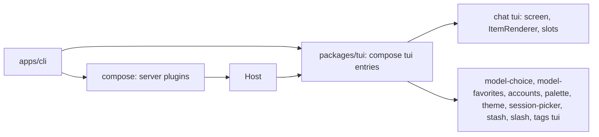
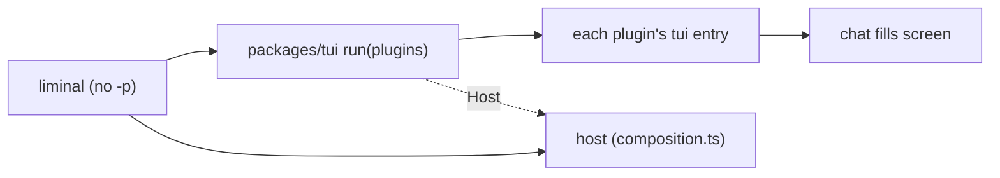
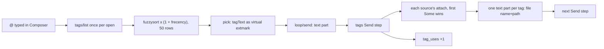
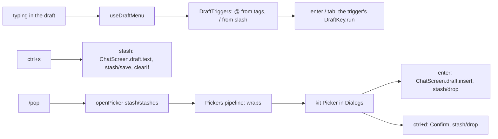
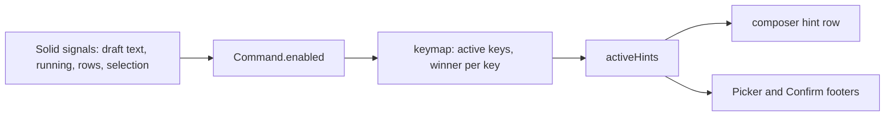
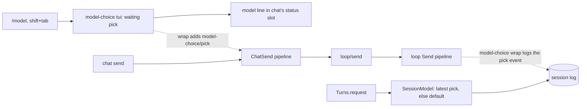

# Plan: milestone 2, the TUI

The session view, `packages/tui`, and the `tui` entries of `chat`, `palette`, `theme`, `model` and `accounts`. Milestone 2 in [status.md](../../status.md). Designs: `apps/gallery`, plan in [gallery.md](gallery.md).

## Systems

| System | Change |
| --- | --- |
| `packages/client` | Expands: the session view beside `Host` |
| `packages/tui` | Adds the renderer, slots, the bridge between Effect and Solid, and the UI kit |
| `packages/plugins/chat` | Adds the chat screen as a `tui` entry |
| `packages/plugins/{palette,theme}` | Adds the command palette and theme switching |
| `packages/plugins/{model,accounts,loop,session}` | Expands: `tui` entries for the model picker and `/connect`; RPC for paging, loop state with the queue, and the session list |
| `apps/cli` | Expands: the TUI by default, `--model`, `--session` |

## Today

How a frontend reads a session now (`apps/cli/src/print.ts`):

| Step | What does it |
| --- | --- |
| Open a session | `SessionRpc` `session/open` |
| Send input | `LoopRpc` `loop/send` with a `session/message` event |
| Follow it | `SessionRpc` `session/live`: saved events after a `seq`, then deltas and new events |
| Know the turn ended | A `loop/turn-end` event |
| Show text | Decode each item with its kind's `EventKind.decode` |

Event kinds a viewer sees today: `session/message`, `session/notice`, `loop/turn-start`, `loop/step-start`, `loop/step-end`, `loop/turn-end`, `loop/interrupted`, and the records `system-prompt` and `tool-definitions` log. Deltas: `loop/reply` (text, reasoning, tool input, tool calls, retries) and `loop/tool-done`.

Prior art:

| Source | How it turns events into state, and loads screens |
| --- | --- |
| `archive/packages/frontend` | Its own slot tree and part loader, about 700 lines; each part declared the slots it needed |
| `archive/packages/plugins/chat/src/tui/transcript-state.ts` | The chat screen's own fold: entries into transcript items, tool runs grouped |
| OpenCode `packages/client/src/solid/data.ts` | One 2,000-line switch over every event kind into a Solid store with `reconcile`; closed to plugins |
| OpenCode `packages/tui/src/plugin/` | Its own plugin API and loader for TUI plugins |

## Decisions

- **The session view is generic.** It keeps the saved events in order, the reply streaming now and whether a turn runs. Screens decode the kinds they need; `chat` builds the transcript itself, and a plugin that owns questions or actors builds those in its own `tui` entry. Plugins add event kinds, so code in `client` cannot know them all.
- **The session view is Effect-native.** Sending, cancelling and answering stay RPC calls on `LoopRpc`. `packages/tui` turns `state.changes` into a Solid store, reconciled by `seq` so unchanged rows stay mounted.
- **`running` comes from `loop`.** `loop/state` streams whether a turn runs in the session, from `loop`'s own state. The events a view holds may not reach back to the turn's start, and after a crash the log shows a turn open that nothing runs. OpenCode asks the server for active sessions the same way.
- **One `loop/state` stream.** It holds `running` now; step 7 adds the queued inputs to it instead of a separate queue RPC. Both are live state `loop` keeps per session.
- **`streaming` is every delta since the last saved event.** The view keeps them as they come, of any kind; `chat` drops the reply items before a retry. The view stays a plain list that knows nothing of how `loop` replies.
- **A failed live stream stops the view.** It logs the error and stops updating. Reconnecting from the last `seq` comes with the IPC and HTTP hosts, where connections drop.
- **The view keeps what it loads.** It opens with the latest page, adds every new event, and `loadOlder` adds the page before the oldest held, back to the first. Nothing held is dropped.
- **The transcript opens at the bottom.** Its first frame shows the latest items; it never scrolls down after loading.
- **`loop/turn-start` marks a turn's start.** It is saved in the same write as the input the turn takes; the model never sees it. Any event kind can be an input, so the log alone cannot say when a turn starts.
- **`loop/reply` streams tool input.** A `tool-input` variant carries a call's params so far, parsed from the unfinished JSON in Effect AI's `tool-params-start` and `tool-params-delta`, so a tool row draws its input as it is written with the same params shape as the finished call. Pi does the same.
- **`loop` logs steps.** `loop/step-start` (with the model id) and `loop/step-end` are saved around each model call; the model never sees them. Every step start gets an end: `finished`, `failed`, `cancelled`, or `interrupted` when Liminal stopped, as OpenCode, deepseek-harness and Pi each close every model call.
- **Frontend code shared by `tui` and `web` lives in `view.ts`.** A plugin's `src/view.ts` or `src/view/` uses no UI framework; its `tui` and `web` entries import it and the server never does. `chat`'s holds the code that builds the transcript, so the desktop app reuses it. The plugin anatomy check and lint rules learn the new fixed file.
- **Plugins add frontend exports.** Beside `./contract`, a plugin exports `./view` (no UI framework) and `./tui` (OpenTUI), later `./web`. `/contract` is importable anywhere, `/view` from `view`, `tui` and `web` code, `/tui` from `tui` code only. `contract.ts` cannot hold a tag typed with a Solid component, since servers import it.
- **Chat builds the transcript; plugins draw their own kinds.** `chat`'s `view/` builds turns and items from `session/*` and `loop/*` events in one closed function, as OpenCode's client store does; its `tui` entry holds `ItemRenderer`, keyed by event kind, as Pi's `registerMessageRenderer` is. A saved event of a kind with a renderer is an item that renderer draws. Streamed deltas show as live items until the next saved event.
- **Tool rows are not grouped.** A tool call and its result make one single-line row; consecutive tool rows sit next to each other, as in the gallery.
- **TUI and desktop share colors.** `packages/client` holds the role names, so the UI kits and `theme` import them without importing each other. `theme`'s contract holds the `Palette` type, the setting and `theme/get`, `theme/set`; its `view.ts` holds the OKLCH math, ramps, palettes and the palette-to-role mapping. Its `tui` entry builds OpenTUI's `SyntaxStyle` and fills the UI kit's color context; a later `web` entry turns role colors into CSS variables. The UI kit owns `useColor` and that context. Spacing, borders, glyphs, fonts and syntax styles belong to each frontend. OpenCode keeps separate theme code for its TUI and web app, and their theme sets have drifted.
- **Slots.** `packages/tui` has one `screen` slot (`single_winner`) that `chat` fills. `chat` has `sidebar` (`append`, sections by `order`, its own Session section first) and `composer` (`replace`). A notifications slot comes with the first plugin that fills it.
- **Dialogs are a service, not a slot.** The UI kit's `Dialogs` is a stack with `open` and `close`, drawn above the screen with the dim. `model`, `accounts` and `palette` open their pickers through it from commands.
- **`ctrl+b` toggles the sidebar below 110 columns.** It is a named command, "Toggle sidebar", listed in the palette; `escape` closes the drawer, and a footer hint shows while the sidebar is hidden. It takes `ctrl+b` from OpenTUI's textarea, where the arrow keys do the same. Crush binds `ctrl+b`; OpenCode binds `ctrl+x b`.
- **`loop/step-end` carries token usage.** A finished one holds the finish reason and the call's token counts from Effect AI's `finish` part. The sidebar's context share is the latest step's tokens over the model's `contextWindow` from the catalog. `usage` in milestone 4 prices step-ends instead of attaching counts.
- **`tui` entries are plugins.** A plugin's `tui` module default-exports a plugin made with `definePlugin`; `packages/tui` composes them with `compose` over a base layer that provides `Host`, the renderer and the slot registry. `compose` gives the load order, missing-piece errors and cleanup, so `chat` provides `ItemRenderer` and `approvals` requires it.

```ts
// packages/client
interface ViewState {
  readonly events: ReadonlyArray<SessionEvent>   // saved, oldest first
  readonly streaming: ReadonlyArray<Delta>       // every delta since the last saved event
  readonly running: boolean
}
SessionView.open(session): Effect<{ state: SubscriptionRef<ViewState>; loadOlder: Effect<void> }, E, Host | Scope>
```

```ts
// chat/src/view/index.ts
export const buildTranscript: (state: ViewState, drawn: ReadonlySet<string>) => ReadonlyArray<Turn>

// chat/src/tui/index.tsx
export const ItemRenderer: Registry<{ kind: string; component: (props: { event: SessionEvent }) => JSX.Element }>
```



| Gallery piece | Goes to |
| --- | --- |
| Primitives, `Dialog`, `Picker` | `packages/tui` UI kit |
| Header, sidebar, composer, transcript, notifications, draft menu, landing | `chat` |
| Slash menu rows | `slash` |
| Sessions picker | `session-picker` |
| Models picker, model line | `model-choice` |
| Connect dialog | `accounts` |
| Commands picker | `palette` |
| `useColor` | `packages/tui` UI kit |
| `oklch.ts`, `ramp.ts`, `palettes.ts`, `roles.ts` | `theme` `view.ts`; role names in `packages/client` |
| `syntax.ts`, `theme.tsx` | `theme` `tui` entry |

## Build order

1. `loop` events. 2. Session view in `packages/client`. 3. Plugin anatomy: `./view`, `./tui`, `view.ts`. 4. `packages/tui`. 5. `theme`. 6. `chat`, with `liminal` opening the TUI: 6a the screen, 6b `@` tags and saving stashes. 7. `palette`, model picker, `/connect`, saved sessions, queue and pull-back, the stash list.

## Step 1: `loop` events

Print mode's `--json` shows the new events with no change to `apps/cli`.

```text
packages/plugins/loop/
  README.md            the new events and the tool-input delta
  src/contract.ts      TurnStarted, StepStarted, StepEnded; ReplyDelta gains tool-input
  src/sessions.ts      a write that opens a turn puts TurnStarted first
  src/turn.ts          logs StepStarted, then the reply with StepEnded; a failed or cancelled step's end
  src/reply.ts         keeps the finish part and each call's input text; publishes tool-input
  src/partial-json.ts  new: best-guess params from unfinished JSON text
  src/recovery.ts      closes a step a crash left open
```

```ts
// contract.ts; Response is effect/ai's
export const TurnStarted = defineEvent("loop/turn-start", Schema.Struct({}))
export const StepStarted = defineEvent("loop/step-start", Schema.Struct({ model: ModelId }))
export const StepEnded = defineEvent("loop/step-end", Schema.Union([
  Schema.Struct({ outcome: Schema.Literal("finished"), reason: Response.FinishReason, usage: Response.Usage }),
  Schema.Struct({ outcome: Schema.Literals(["failed", "cancelled", "interrupted"]) }),
]))
// ReplyDelta gains; id is the tool call's id, params the input so far, whole
Schema.Struct({ type: Schema.Literal("tool-input"), id: Schema.String, name: Schema.String, params: Schema.Json })

// partial-json.ts
export const parsePartial: (text: string) => Schema.Json  // {} until something parses
```

None of the three events has a converter, so the model never sees them.

| Where a turn opens (`sessions.ts`) | Write |
| --- | --- |
| `send` on an idle session | `[TurnStarted, input]` |
| `release` after `Turns.fold`, inputs waiting | `[TurnStarted, ...inputs]` |
| `endTurn`, not answered, inputs waiting | `[TurnEnded]`, then `[TurnStarted, ...inputs]` |
| `endTurn`, answered, inputs waiting | `[...inputs]`: the same turn goes on |
| `takeSteers` | `[...steers]` |

`take` gains `opens: boolean`, which puts `TurnStarted` first.

```text
step (turn.ts)
  sync system prompt and tool list; run BeforeCall hooks
  request = request(session)
  append [StepStarted { model: request.model }]
  reply = streamReply(request), on failure append [StepEnded failed], on interrupt [StepEnded cancelled]
  append [message when it has parts, StepEnded finished { reason, usage }]
  no calls: run TurnEnd hooks, answered
  reason is length: fail the calls, else run them

streamReply (reply.ts), state { reply, inputs: call id -> { name, text }, finish: Option<FinishPart> }
  tool-params-start: inputs += id -> { name, text: "" }
  tool-params-delta: text += delta; publish tool-input { id, name, params: parsePartial(text) }
  finish: finish = the part
  retry: state starts over
  returns { message, finish }

parsePartial (partial-json.ts)
  scan text, tracking open strings, objects and arrays
  cut a half-written key or a value with no start, and a trailing comma or colon
  close the open string, then each open object and array, innermost first
  JSON.parse; {} when it still fails

closeUnfinished (recovery.ts)
  a turn is open when a TurnStarted follows the last TurnEnded
  a StepStarted after the last StepEnded since the last TurnEnded: StepEnded interrupted before the notice
```

- A reply that ends with no finish part logs `StepEnded` finished with reason `unknown` and empty usage.
- On a cancel, `reply.ts` logs `loop/interrupted` first, then the step logs `StepEnded` cancelled.
- `truncated` goes: it is `finish.reason === "length"`.
- `reply.ts`'s private `fold` becomes `addDelta`, so "fold" means only `Turns.fold`.
- Pi parses with the `partial-json` package; OpenCode keeps a 280-line copy of it. Ours covers what a tool's params need: objects, arrays, strings, numbers, `true`, `false`, `null`.

## Step 2: session view

No screen uses it until step 4; a scratch script checks it by hand.

```text
packages/client/
  README.md               the session view
  src/host.ts             Host and inMemory, moved from index.ts
  src/session-view.ts     new: open, ViewState, addItem, addOlder
  src/index.ts            exports Host, inMemory, SessionView
packages/plugins/session/src/{contract,index}.ts   session/page RPC
packages/plugins/loop/src/
  contract.ts             LoopState, Inbox.state, the loop/state RPC
  sessions.ts             states in a SubscriptionRef; state(session) stream
  index.ts                the loop/state handler
```

```ts
// session contract: SessionRpc gains
Rpc.make("session/page", {
  payload: { session: SessionId, before: Schema.optional(Seq) },
  success: Schema.Array(SessionEvent),
  error: Schema.Union([SessionNotFound, SessionStoreFailed]),
})

// loop contract: LoopRpc gains; the current state first, then each change
export const LoopState = Schema.Struct({ running: Schema.Boolean })
Rpc.make("loop/state", { payload: { session: SessionId }, success: LoopState, stream: true })

// packages/client/src/session-view.ts, exported as SessionView
export interface ViewState {
  readonly events: ReadonlyArray<SessionEvent>  // saved, oldest first: the latest page and older pages loaded
  readonly streaming: ReadonlyArray<Delta>      // every delta since the last saved event
  readonly running: boolean
}
export interface SessionView {
  readonly state: SubscriptionRef<ViewState>
  readonly loadOlder: Effect<void, SessionNotFound | SessionStoreFailed>
}
export const open: (session: SessionId) =>
  Effect<SessionView, SessionNotFound | SessionStoreFailed, Host | Scope>
```

```text
open(session)
  sessionRpc, loopRpc = host.client(SessionRpc), host.client(LoopRpc)
  latest = session/page { session }
  state = SubscriptionRef { events: latest, streaming: [], running: false }
  fork in scope: session/live { session, after: last seq or 0 }, each item: state = addItem(state, item)
  fork in scope: loop/state { session }, each: state.running = running
  a forked stream that fails logs the error; the view stops updating

addItem(state, item)                  pure
  saved event, seq above the last held: events += item, streaming = []
  saved event, seq held already: state
  delta: streaming += item

loadOlder
  first held seq is 1, or nothing held: done
  older = session/page { session, before: first seq }
  events = older with seq below the first held, then events

loop/state (sessions.ts)
  SubscriptionRef.changes(states), running = Option.isSome(state.running), Stream.changes
```

- `live` after the page's last `seq` catches up on events saved between the two calls, so nothing is lost.
- `streaming` matches the deltas `session` keeps for a viewer that joins mid-reply, so a view opened late sees the same.
- A screen knows there is more history when `events[0].seq` is above 1.

## Step 3: plugin anatomy

Tooling only; the first `view.ts` and `tui` entry come with `theme` in step 5.

```text
tools/lint/plugin-entries.ts     PluginEntry gains "view"; src/view.ts file, src/view/ folder
tools/lint/plugin-rules.ts       plugin-imports by entry; entry-isolation by table; new view-imports
tools/lint/plugin-rules.test.ts  cases for each
.oxlintrc.json                   turns on liminal/view-imports
tools/checks/plugin-anatomy.ts   "./view" export; folder targets
tools/checks/fixtures/           good: a ./view export, a tui folder; broken: messages updated
.liminal/instructions/plugins.md Checked section
```

Which other plugins' exports each importer may use (`plugin-imports`):

| Importer | `/contract` | `/view` | `/tui` | `/web` |
| --- | --- | --- | --- | --- |
| contract, plugin, test, other files | yes | | | |
| view code | yes | yes | | |
| tui code | yes | yes | yes | |
| web code | yes | yes | | yes |
| `packages/client`, `packages/tui` | yes | | | |

Which of its own entries a file may import with a relative path (`entry-isolation`):

| From | May import |
| --- | --- |
| plugin | plugin; tui and web only with `import()` |
| view | view |
| tui | tui, view |
| web | web, view |

Contract and test files stay outside the table, as now.

```ts
// plugin-rules.ts
const allowedSubpaths: ReadonlyMap<PluginEntry, ReadonlySet<string>>  // the first table
const reaches: ReadonlyMap<PluginEntry, ReadonlySet<PluginEntry>>      // the second table

/** View code uses no UI framework. */
export const viewImports  // in view code: bans solid-js, @opentui/*, @shanepadgett/liminal-tui

// plugin-anatomy.ts: each export and the files it may point to
const entryFiles = new Map([
  [".", ["./src/index.ts"]],
  ["./contract", ["./src/contract.ts"]],
  ["./view", ["./src/view.ts", "./src/view/index.ts"]],
  ["./tui", ["./src/tui.tsx", "./src/tui/index.tsx"]],
  ["./web", ["./src/web.tsx", "./src/web/index.tsx"]],
])
```

- A folder entry's export points to its `index` file.
- The guide in `docs/guides/plugins.md` gains `tui` entries in step 4, when a plugin can ship one.

## Step 4: `packages/tui`

One step: the runtime (renderer, entries, slots, bridge, dialogs) and the UI kit copied from the gallery, checked by hand with a scratch `tui` entry.

```text
packages/tui/
  package.json        exports "."; dependencies @opentui/core, @opentui/solid, @opentui/keymap, solid-js;
                      peers effect, liminal-core, liminal-client
  README.md
  src/index.ts        run, Slots, defineSlot, SlotView, screen, Dialogs, Colors, useColor, useRun, useWatch, useSessionView, kit
  src/run.ts          loads tui entries, composes them over the base, renders the root, waits for quit
  src/base.ts         the base plugin: Host, Renderer, Slots, Dialogs
  src/root.tsx        the root plugin: requires Colors, renders screen slot and dialog layer
  src/slots.tsx       SlotHandle, defineSlot, Slots, SlotView over OpenTUI's registry
  src/dialogs.tsx     the Dialogs stack and its layer
  src/bridge.ts       useRun, useWatch, useSessionView: Effect into Solid
  src/colors.ts       Colors, useColor, useSyntax, useMix
  src/kit/            primitives, Overlay, Dialog, Picker, copied from apps/gallery
packages/plugins/theme/
  package.json, README.md, src/contract.ts   Palette types only; the rest in step 5
  src/index.ts        a plugin with no services, since every plugin package has one
```

```ts
// run.ts
export const run: (plugins: ReadonlyArray<AnyPlugin>) =>     // AnyPlugin now exported from core
  Effect<void, CompositionError | EntryInvalid, Host>          // own scope: the terminal is restored first
class EntryInvalid extends Schema.TaggedError  // { plugin }: its tui entry does not default-export a plugin

// slots.tsx
interface SlotHandle<Props> { readonly name: string; readonly mode: SlotMode }
const defineSlot: <Props extends object>(name: string, mode: SlotMode) => SlotHandle<Props>
class Slots extends Context.Service<Slots, {
  readonly fill: <P>(slot: SlotHandle<P>, component: (props: P) => JSX.Element, order?: number) =>
    Effect<void, never, Scope>   // unregisters when the scope closes
}>
function SlotView<P>(props: { slot: SlotHandle<P>; children?: JSX.Element } & P): JSX.Element
const screen: SlotHandle<{}>    // "screen", single_winner

// dialogs.tsx: sync, since key handlers open them
class Dialogs extends Context.Service<Dialogs, {
  readonly open: (dialog: () => JSX.Element) => () => void   // returns close
  readonly close: () => void                                 // closes the top one
}>

// colors.ts: provided by theme's tui entry
type RoleColor = (role: RoleName) => string     // RoleName from liminal-client
class Colors extends Context.Service<Colors, {
  readonly color: Accessor<RoleColor>; readonly syntax: Accessor<SyntaxStyle>
  readonly mix: (from: string, to: string, amount: number) => string  // OKLCH math stays in theme
}>

// bridge.ts: in components
useRun(): <A, E>(effect: Effect<A, E, Host | Dialogs>) => void            // failure logged
useWatch<A>(stream: Stream<A>, initial: A): Accessor<A>                   // stops with the component
useSessionView(session): { state: ViewState (Solid store, reconciled by seq), loadOlder: () => void }
```

```text
run(plugins)
  entries = each plugin with entries.tui: import it, default export must be a plugin, else EntryInvalid
  renderer = acquireRelease(createCliRenderer({ exitOnCtrlC: false }), destroy)
  compose([base(host, renderer), ...entries, root]) missing Colors: CompositionError
  wait until the renderer is destroyed

base(host, renderer)                                plugin, provides Host, Renderer, Slots, Dialogs
  registry = createSolidSlotRegistry(renderer, {})

root                                                plugin, requires Host, Colors, Slots, Dialogs, Renderer
  runner = FiberSet.makeRuntime, in the composition's scope
  render(<Services runner colors dialogs><KeymapProvider>
           <SlotView slot={screen}>no screen</SlotView>
           <DialogLayer />          top dialog in an Overlay; escape closes it
         </KeymapProvider></Services>)
  ctrl+c: "Quit", destroys the renderer; chat takes it over in step 6

a tui entry (tui.tsx)
  export default definePlugin({ name, provides, requires: [Slots, ...], layer: Layer.effectDiscard(
    Effect.gen: slots = yield* Slots; yield* slots.fill(screen, () => <ChatScreen />)) })
```

- The gallery keeps its own code and stays free to change; `packages/tui` copies what it takes, and neither imports the other.
- A component reaches its plugin's services through its layer's closure, and the base's through `useRun`.
- `root` is the last plugin, so it renders after every entry fills its slots, and a composition without a theme fails to start.
- `liminal` loads `packages/tui` with `import()` after `@opentui/solid/preload`, so `.tsx` compiles wherever it runs; that wiring comes with step 6.

## Step 5: `theme`

The theme plugin's server, its shared color code and its `tui` entry, which provides `Colors`.

```text
packages/plugins/theme/src/
  contract.ts       Palette, Step, RampSpec, RampName (exist); ThemeSetting, ThemeRpc, ThemeFailed
  index.ts          the plugin: declares the setting, serves ThemeRpc
  view/index.ts     PALETTES, DEFAULT_PALETTE, paletteOf(id), roleColors(palette), mixHex
  view/oklch.ts     copied from apps/gallery/src/theme/oklch.ts
  view/ramp.ts      copied from ramp.ts, its types now from the contract
  view/palettes.ts  copied from palettes.ts: liminal, afterhours, heure-bleue, conservatory, barbican
  view/roles.ts     copied from roles.ts: each RoleName's ramp and step
  tui/index.tsx     the tui entry: provides Colors
  tui/syntax.ts     copied from syntax.ts
```

```ts
// contract.ts
const ThemeSetting = Setting.make("theme", Schema.Struct({ palette: Schema.optionalKey(Schema.String) }))
class ThemeFailed extends Schema.TaggedError  // { message }: settings unreadable or unwritable
const ThemeRpc = RpcGroup.make(
  Rpc.make("theme/get", { success: Schema.UndefinedOr(Schema.String), error: ThemeFailed }),
  Rpc.make("theme/set", { payload: { palette: Schema.String }, error: ThemeFailed }),  // global file
)

// view/index.ts: framework-free, shared with a later web entry
const paletteOf: (id: string | undefined) => Palette     // unknown or missing id: DEFAULT_PALETTE
const roleColors: (palette: Palette) => (role: RoleName) => string
```

```text
theme plugin                      requires Settings, DeclaredSettings; serves ThemeRpc

theme tui entry                   requires Host, Renderer; provides Colors
  saved = theme/get               a failure logs a warning and uses DEFAULT_PALETTE
  palette = signal(paletteOf(saved))
  Colors.of({
    color:  () => roleColors(palette()), cached per palette id
    syntax: () => SyntaxStyle per palette id, made on first use, destroyed when the scope closes
    mix:    mixHex
  })

apps/cli composition              gains theme, so theme/get answers once the TUI opens in step 6
```

- `RoleName` moves from theme's contract to `packages/client/src/colors.ts`. `packages/tui` imported it from theme while theme's `tui` entry imported `packages/tui`, a package cycle.
- Plugins may import `packages/client`, so a `tui` entry reaches `Host` and the role names; `.fallowrc.jsonc` allows it.
- The gallery keeps its theme files; `theme` copies them.
- The theme picker comes in step 7, with the command palette and an interactive `Picker`; step 7 also settles how a pick reaches `Colors`.

## Step 6: `chat`

Two commits. 6a: the chat screen, transcript, sidebar, a plain composer and `liminal` opening the TUI. 6b: `@` file tags with `git ls-files` completion, and stashes. Slash commands come in step 7.



- `liminal` with no `-p` opens the TUI; `--help` prints help. `composition.ts` exports its plugin list beside `host`, and `run(plugins)` gets `Host` from `host`.
- The screen starts on Landing. The first send calls `session/open`, then `loop/send`, and the screen switches to the header and transcript. Quitting before a send saves nothing.
- Composer keys: `enter` sends and `shift+enter` adds a line. While a turn runs, `enter` steers, `tab` queues a follow-up (both `loop/send` with its `mode`) and `esc` stops it (`loop/cancel`).
- `ctrl+c` clears the draft when there is one, and quits otherwise. Chat's binding replaces the root's "Quit".
- No model line under the composer until step 7, when frontends can ask for the main model.
- Chat builds and draws the transcript for `session/*` and `loop/*` events in one closed function, as OpenCode's client store does; base plugins stay free of frontend code. Other plugins draw their own saved event kinds by adding an `ItemRenderer` for the kind, as Pi's `registerMessageRenderer` does.
- The transcript shows inputs, replies, tool rows and notices, never reasoning. While a turn runs and nothing is inking in (no reply text or tool input streaming), the kit's `Spinner` shows under the turn: the face with the scrambled words stands in for thinking and other work.
- Replies draw Mermaid code blocks as diagrams: chat copies the gallery's `diagrams.ts` and depends on `beautiful-mermaid`.

### 6a code

```text
packages/plugins/chat/
  package.json, README.md      exports ., ./view, ./tui; entries.tui; no contract, nothing imports one
  src/index.ts                 the plugin: no services, so its tui entry loads
  src/view/index.ts            Item, Turn, buildTranscript, contextUsed, isWriting
  src/tui/index.tsx            the tui entry: provides ItemRenderer; fills screen, sidebar, composer
  src/tui/slots.ts             ItemView, ItemRenderer, the sidebar and composer slots
  src/tui/ChatScreen.tsx       screen state, session view, turns, ctrl+c and ctrl+b
  src/tui/Layout.tsx           layout, copied from gallery screens/Chat.tsx
  src/tui/Landing.tsx, Header.tsx, Sidebar.tsx, Composer.tsx    copied from gallery components/chat; Composer binds its keys
  src/tui/Turn.tsx, Reply.tsx, WorkRow.tsx, Notice.tsx, stream.ts, diagrams.ts   copied from gallery components/transcript; Turn draws each item kind
packages/tui/src/root.tsx      keeps ctrl+c "Quit" only while no plugin fills the screen
packages/tui/src/slots.tsx     a fill's component runs untracked
apps/cli/src/composition.ts    exports plugins beside host; gains chat
apps/cli/src/tui.ts            registers Solid's transform, then run(plugins) with host
apps/cli/src/main.ts           no flags: tui
apps/cli/package.json          gains @opentui/solid, liminal-tui, liminal-chat
packages/plugins/directories/  DirectoriesRpc: directories/workspace
packages/plugins/model/        ModelRpc: model/main
```

```ts
// view/index.ts: framework-free; decodes with Schema.decodeOption, skipping data its schema rejects
type Item =
  | { kind: "input"; id: string; text: string }                          // a steer or later input in the turn
  | { kind: "reply"; id: string; text: string; isLive: boolean }
  | { kind: "tool"; id: string; name: string; params: Json; status: "running" | "done" | "failed"; isLive: boolean }
  | { kind: "notice"; id: string; level: "info" | "warning" | "error"; text: string }
  | { kind: "event"; id: string; event: SessionEvent }                    // another plugin's kind, drawn by its ItemRenderer
interface Turn { readonly id: string; readonly input: string | undefined; readonly items: ReadonlyArray<Item> }
const buildTranscript: (state: ViewState, drawn: ReadonlySet<string>) => ReadonlyArray<Turn>   // drawn: kinds with a renderer
const contextUsed: (state: ViewState) => number | undefined   // input tokens of the latest finished loop/step-end
const isWriting: (state: ViewState) => boolean                // the last delta is reply text or tool input

// tui/index.tsx
interface ItemView { readonly kind: string; readonly component: (props: { event: SessionEvent }) => JSX.Element }
class ItemRenderer extends Registry.Service<ItemRenderer, ItemView>()("chat/ItemRenderer") {}
```

```text
buildTranscript(state, drawn): one closed switch, saved events first, then deltas
  loop/turn-start               → start a Turn
  session/message user          → the Turn's input, or an input item when it has one
  session/message assistant     → reply per text part (id seq:index); tool per tool-call part (id call id)
  loop/interrupted              → the same, for the reply a cancel cut short
  session/message tool results  → the tool (id call id): done or failed
  session/notice                → notice
  loop/turn-end cancelled       → stopped
  a kind in drawn               → event item
  loop/reply text delta         → live reply (id key), its text appended
  loop/reply reasoning delta    → nothing
  loop/reply tool-input, call   → live tool (id call id), its params inking in
  loop/reply retry              → drops the live items; a retry notice
  loop/tool-done                → the tool (id call id): done or failed
  anything else                 → nothing; kinds such as loop/step-start never show
  an item with an id seen before in its Turn replaces it in place; a saved event clears the deltas, so live items go
```

```mermaid
sequenceDiagram
  participant cli as liminal
  participant tui as packages/tui run
  participant chat as chat tui entry
  participant host as Host
  cli->>tui: run(plugins), host provided
  tui->>chat: build entry: provide ItemRenderer, fill screen
  chat->>chat: Landing until the first send
  chat->>host: session/open, then loop/send
  chat->>host: SessionView.open(session) via useSessionView
  host-->>chat: ViewState; buildTranscript; draw each Turn
```

- Screen state: `{ kind: "landing" } | { kind: "session"; session: SessionId }`.
- Header: the wordmark and diagonals; a title shows once `session-name` (milestone 4) sets one.
- Sidebar Session section: the folder, the Git branch and the context share, through two new RPCs:

```ts
// directories contract: the branch is read from <workspace>/.git/HEAD; none outside a repository
Rpc.make("directories/workspace", { success: Schema.Struct({ folder: Schema.String, branch: Schema.optional(Schema.String) }) })
// model contract: the main role's model and its window; step 7's model picker builds on this group
Rpc.make("model/main", { success: Schema.Struct({ model: ModelId, contextWindow: Schema.optional(Schema.Int) }), error: ModelNotFound | SettingsInvalid })
```

- Context share: input tokens from the latest `loop/step-end` over `contextWindow`; no percentage without a window.
- Sidebar and composer slots: `defineSlot<{ session: SessionId; state: ViewState }>("chat/sidebar", "append")` and `defineSlot<{ running: boolean; send(text, mode?); cancel(); screenHints }>("chat/composer", "replace")`, exported from chat's `./tui`. Chat fills them with its own Session section and Composer.
- The chat screen returns one `<box>` around its landing-or-session switch: OpenTUI's `Slot` draws a fill again from fresh state whenever the element it returns changes.
- Spinner: under the last Turn while `running` and the last delta is not a reply text or tool-input delta.
- Quit: chat's `ctrl+c` calls `renderer.destroy()` through `Renderer`, which `run` waits on.
- Deletes: the root's `ctrl+c` "Quit" while a plugin fills the screen; `liminal` with no flags no longer prints help.

### 6b

Three commits: the drawer fix, `@` tags, stashes.

- Drawer: `escape` closes the sidebar drawer, through the drawer's own binding as `Shown` in `dialogs.tsx` does. While the drawer is closed on a narrow screen, the composer hints add `ctrl+b sidebar`.
- A tag sends the file's contents with the message, as OpenCode (`core/src/session/prompt.ts` `readFileAttachment`) and Crush (`ui.go` `insertFileCompletion`) do. Long files are cut to a window with a note on how much is left, as Pi's `read` does (2000 lines or 50 KB, `[Showing lines X-Y of Z…]`) and the archive's `tools-read` `lineWindow` did. The message gains a text part per tag: `model`'s `Part` has no file part.
- The `@` list shows files and folders, with folders taken from the file paths (OpenCode `filesystem/search.ts`, archive `files/server/tags.ts`); picking a folder inserts `@dir/`, `tab` opens it.
- Files the user tags often and recently rank higher (OpenCode `prompt/frecency.tsx`).
- Tag sources are a registry, so later features such as references add their own `@` rows (archive `TagSources`, deepseek-harness `InputTriggerSource`).
- Stashes: a SQLite table with one list per workspace folder, behind chat RPCs (archive `inbox/server/stashes.ts`). `ctrl+s` stashes the draft and clears the composer.
- 6b builds the stash table, the chat RPCs that save, list and delete stashes, and `ctrl+s`. The stash list, picking and `ctrl+d` come in step 7 with the palette and `/pop`, the only ways to open the list. Picking a stash replaces an empty draft and is added after a draft with text, then leaves the list. `ctrl+d` deletes a stash after a confirm dialog, which the kit gains (OpenCode `dialog-stash.tsx`, archive `inbox/tui/stash.tsx`).
- The list comes from `git ls-files --cached --others --exclude-standard`, ranked with `fuzzysort`; frecency is a SQLite table, scored as OpenCode does: uses / (1 + days since last use), multiplying the match score.
- A new `tags` plugin owns the registry, the list RPC, frecency and the `loop/Send` step that adds file contents; workspace files are its first source. Print mode expands tags too. Chat imports `tags/contract`; stashes stay in chat.
- A file tag sends at most 2000 lines or 50 KB, with a note such as `[lines 1-2000 of 5400 not all shown]`; milestone 3's `read` reuses the same window function. A binary file sends a one-line note. A folder tag sends a listing one level deep, at most 200 names.
- Later: line ranges such as `@file#10-20` (OpenCode only) and picture tags (need milestone 3's image results).

### 6b tags code

```text
packages/plugins/tags/
  package.json        peers: core, effect, loop, session, directories, sqlite
  README.md
  src/contract.ts     TagRow, TagSource, TagSources, TagsRpc, tagText, tagsIn, windowOf
  src/index.ts        plugin: registry, rpc, Send step, workspace source
  src/workspace.ts    git ls-files, folders, attach (window, binary note, listing)
  src/uses.ts         frecency table and score
  src/migrations.ts   tags_migrations: 0001 tag_uses
packages/plugins/chat/src/tui/
  TagMenu.tsx         the @ list under the composer, from the gallery's SlashMenu
  tags.ts             useTagList: tag at the cursor, ranking, keys, extmarks
  Composer.tsx        opens TagMenu on @, inserts picks as virtual extmarks
apps/cli/src/composition.ts   adds tags
```

```ts
// tags/contract.ts
export const TagRow = Schema.Struct({
  kind: Schema.Literals(["file", "folder"]),
  tag: Schema.String,            // text after @; a folder ends in /
})
export const ListedTag = Schema.Struct({ ...TagRow.fields, frecency: Schema.Number })  // 0 when never sent
export interface TagSource {
  readonly rows: Effect.Effect<ReadonlyArray<TagRow>>
  /** The text part `tag` adds to a message; none when this source does not know it. */
  readonly attach: (tag: string) => Effect.Effect<Option.Option<string>>
}
export class TagSources extends Registry.Service<TagSources, TagSource>()("tags/TagSources") {}
export class TagsRpc extends RpcGroup.make(
  Rpc.make("tags/list", { success: Schema.Array(ListedTag) }),
) {}
export const Attached: Attribute<number>                 // tags/attached: parts the tags added
export const attachedOf: (attributes: Attributes) => number
export const tagText: (tag: string) => string          // @path, or @"path" with spaces
export const tagsIn: (text: string) => ReadonlyArray<string>
export const windowOf: (content: string) => string     // 2000 lines or 50 KB, then the note
```



- The Send step reads only user `session/message` inputs. Each distinct tag found by `tagsIn` in its text parts adds one text part `<file name="path">\n…\n</file>`, as Pi's `file-processor.ts` does. A tag no source knows stays plain text. A read failure adds `<file name="path">could not be read</file>`, so the step never fails the send.
- Workspace source: `git ls-files` runs in the workspace folder through `ChildProcessSpawner` on each `rows`; folders come from the file paths. Outside a git repository it has no rows, and `attach` still reads any path under the folder.
- Binary: a NUL byte in the first 8 KB, as git checks.
- `tag_uses (folder, tag, uses, last_used)`; the Send step updates it, so frecency counts tags actually sent.
- Composer keys while the list is open: up and down move, enter tags the row, tab opens a folder or tags anything else, esc closes the list until the cursor leaves the tag (archive `inbox/tui/tags.ts`). The list opens on `@` at the start or after whitespace (Crush `ui.go`).
- The step sets `tags/attached` on the message to the number of parts it added; `buildTranscript` leaves those parts out of the shown input.
- Folder tags add `<folder name="path/">` with one name per line, folders ending in `/`, up to 200.
- Docs: `docs/plugins/coding.md` and the `tools-files` row in `architecture.md` lose `@` tags; `architecture.md` gains a `tags` row.

### 6b stashes code

```text
packages/plugins/chat/
  package.json         ./contract export
  src/contract.ts      Stash, StashesFailed, ChatRpc
  src/index.ts         plugin: migrate, ChatRpc handlers over SqlClient, per workspace folder
  src/migrations.ts    chat_migrations: 0001 stashes
  src/tui/Composer.tsx ctrl+s: chat/stash, then clears the draft
```

```ts
// chat/contract.ts
export const Stash = Schema.Struct({ id: Schema.Int, text: Schema.String, createdAt: Schema.Int })
export class StashesFailed extends Schema.TaggedError<…>()("StashesFailed", { message: Schema.String }) {}
export class ChatRpc extends RpcGroup.make(
  Rpc.make("chat/stash", { payload: { text: Schema.String }, error: StashesFailed }),
  Rpc.make("chat/stashes", { success: Schema.Array(Stash), error: StashesFailed }),  // newest first
  Rpc.make("chat/unstash", { payload: { id: Schema.Int }, error: StashesFailed }),
) {}
```

- `stashes (id, folder, text, created_at)`, unique on `(folder, text)`: stashing the same text again keeps one row (archive `stashes.ts`).
- `ctrl+s` with a blank draft declines, so the key passes on. The draft clears only once `chat/stash` succeeds; a failure is logged and the draft stays.
- The hints gain `ctrl+s stash`.

## Step 7: commands, pickers, saved sessions, queue

7a is five commits, 7b one:

1. 7a-1: the four shared extension points, and moving stashes, `@` and `/` into `stash`, `tags` and `slash`.
2. 7a-hints: hints follow the UI's state.
3. 7a-2: `model-choice` and `model-favorites`.
4. 7a-3: the palette, `/theme`, `/connect`, `session-picker` and print mode's `--session`.
5. 7a-4: one hint line, `ctrl+g` to show them all, no hints for keys every user expects.
6. 7b: queued inputs in `loop/state` and pulling one back.

- TUI commands are OpenTUI keymap commands with extra fields: `title`, `category`, `slash: { name, aliases? }`. The palette and the `/` menu read `keymap.getCommandEntries()`, which gives the commands reachable now and their keys (OpenCode `tui/src/context/keymap.tsx` and `component/prompt/autocomplete.tsx`, archive `sdk/src/tui/commands.ts`).
- `loop`'s `Commands`, slash commands that run on the agent side, waits for milestone 5, where `/commit` and `/compact` first need it. Every step 7 command is a TUI action.
- The sessions list shows each session by the first line of its first user message, as Pi's `session-manager.ts` `firstMessage` does. The header shows no title until `session-name` sets one.
- `packages/tui`'s base makes the keymap and provides it as a `Keymap` service; `root.tsx` uses the same one. A plugin's `tui` layer adds its commands with `keymap.registerLayer`, removed when the TUI's scope closes (archive `sdk/src/tui/commands.ts` `register`). Components keep `useBindings` for keys that belong to them.
- The kit's `Picker` keeps its own query and selection, handles up, down and enter, and takes `onSelect`, `onMove` and `actions`, extra keys such as `ctrl+d` (archive `SelectDialog`, OpenCode `DialogSelect`).
- Theme picker: moving the selection previews the palette, enter saves it with `theme/set`, esc puts back the one before (OpenCode `dialog-theme-list.tsx`). Switching stays inside `theme`'s `tui` entry.
- Keys: `ctrl+p` opens the palette (OpenCode, Crush, the gallery's landing). The `/` menu opens only when `/` is the draft's first character (OpenCode `autocomplete.tsx`). `ctrl+o` opens the sessions list and `ctrl+n` starts a new session (gallery). `/model` has no key: most terminals send `ctrl+m` as enter.
- "New session" (`ctrl+n`, `/new`) goes back to the landing screen; the next send starts a session.

| Command | Added by | Gallery design |
| --- | --- | --- |
| Palette (`ctrl+p`) | `palette` `tui` entry | `Commands.states.tsx` |
| `/theme` | `theme` `tui` entry | none |
| `/model`, the model line | `model-choice` `tui` entry, new plugin | `Models.states.tsx`, `Composer.tsx` |
| Favorites, `ctrl+f` in `/model` | `model-favorites` `tui` entry, new plugin | none |
| `/connect` | `accounts` `tui` entry, new | `Connect.states.tsx` |
| `/sessions` (`ctrl+o`) | `session-picker` `tui` entry, new plugin | `Sessions.states.tsx` |
| `ctrl+s`, `/pop` | `stash` `tui` entry, new plugin, moved out of `chat` | none |
| `/new`, Toggle sidebar | `chat` `tui` entry | none |
| The `/` trigger | `slash` `tui` entry, new plugin | `SlashMenu.tsx` |
| The `@` trigger | `tags` `tui` entry, moved out of `chat` | none |

- Choosing a model is its own plugin, `model-choice`: the per-session pick, the default, the `/model` picker and the model line. The `main` role moves out of `model` into it as its default; `model` keeps `small` and the classifier, and loses `model/main` and `RoleModel`. `loop` builds each request's model from it the way it builds the system prompt, tool list and messages from `system-prompt`, `tool-definitions` and `history`.
- Each session has its own model, kept as an event in the session log; a turn uses the session's latest pick (DeepSeek `session-controller/src/model-selection-projection.ts` `model/selection`, Pi `model_change`). A pick waits in `model-choice`'s `tui` entry until the next send, which carries it as a `model-choice/pick` attribute through chat's send pipeline; `model-choice` wraps `loop`'s `Send` and logs a `model-choice/pick` event before that input, then drops the attribute. Print mode's `--model` sets the same attribute. Only a send writes to the database (archive `agent-loop` `pick`, held in memory until a turn starts; DeepSeek `pending`). The model line shows the waiting pick, else the session's model.
- `ctrl+d` in the model picker makes the selected model the default, saved at `model-choice.default` in the global settings file. Every new session starts on the default; with no default, a new session starts on the model the newest turn in any session used (archive `agent-loop` `defaults`).
- `shift+tab` moves the session's thinking level to the next one its model takes (`ModelDetails.thinking`), as a pick that waits for the next send like a `/model` pick; the model line shows it (archive `agent-loop` `ctrl+t`). It lives in `model-choice`, because a thinking level is part of a `ModelChoice`.
- Favorites are their own plugin, `model-favorites`, which wraps the `/model` picker's rows. `ctrl+f` in the model picker adds the selected model to `model-favorites` in the global settings file, or takes it out, and the picker stays open. Favorites sit in a Favorites section above the providers, each with its provider's name in the detail; the default model's row is tagged `default` (archive `agent-loop/src/tui/models.ts` `modelOptions`, `server/favorites.ts`).
- A command's picker is data: the command gives its rows and what a pick does, and `packages/tui` draws the dialog (DeepSeek `ui-commands/src/client/contract.ts` `PopupSelectSpec`). Multi-step flows such as `/connect` keep their own dialog.
- `@` and `/` share one list of draft triggers: each trigger is a character, its rows for the typed query and what a pick does; the draft menu draws whichever trigger is open (DeepSeek `ui-input-trigger`).
- Each feature someone might drop or do differently is its own plugin: `model-choice`, `model-favorites`, `stash`, `session-picker`, `slash`, and the `@` trigger in `tags`.
- Shared extension points that connect them:
  - Picker rows pipeline in `packages/tui`, keyed by picker name; any plugin can wrap a picker's rows and actions to reorder, regroup or add keys.
  - Draft trigger list in chat's `/tui` export; plugins add triggers.
  - Chat screen service in chat's `/tui` export: the session on screen or none, showing a session, reading and inserting the draft.
  - Send pipeline in chat's `/tui` export; plugins wrap an outgoing input to attach attributes, as `model-choice` and `tags` do.

### 7a-1 code

Built. The keymap service, the picker pipeline, the draft trigger list and the chat screen service, and the three plugins that use them first: `stash`, `slash` and `tags`' `@` trigger.

```text
packages/tui/src/
  base.ts             makes the keymap and the Pickers pipeline; provides Keymap and Pickers
  commands.ts         Command fields (title, category, slash, hint), registerCommands, slashCommands, hints
  pickers.tsx         PickerSpec, Pickers, openPicker
  dialogs.tsx         open remembers the focused renderable; closing focuses it again
  root.tsx            uses Keymap from base
  kit/Picker.tsx      keeps query and selection; up, down, enter, esc and the spec's actions
  kit/Confirm.tsx     a question; enter confirms, esc cancels
packages/plugins/chat/src/
  index.ts            no layer of its own; tui entry only
  contract.ts, migrations.ts   deleted: stashes move to stash
  tui/screen.ts       ChatScreen service: the session on screen, show, start new, the draft
  tui/triggers.ts     DraftTrigger, DraftTriggers registry
  tui/draft-menu.ts   useDraftMenu: finds the open trigger's token, loads it, keys, picks
  tui/DraftMenu.tsx   TagMenu made general: label, detail, matches, the trigger's hints
  tui/Composer.tsx    attaches its textarea to ChatScreen; draws DraftMenu; loses ctrl+s
  tui/ChatScreen.tsx  screen state from ChatScreen; chat.new (ctrl+n, /new)
  tui/tags.ts, TagMenu.tsx     deleted: ranking moves to tags, the menu to DraftMenu
packages/plugins/tags/src/
  tui/index.tsx       adds the @ trigger
  tui/rank.ts         fuzzysort times one plus frecency, from chat's tags.ts
  tui/marks.ts        a picked tag becomes a virtual extmark, from chat's tags.ts
packages/plugins/stash/   new
  src/contract.ts     Stash, StashesFailed, StashRpc (stash/save, stash/list, stash/drop)
  src/index.ts        stashes table per workspace folder; tui entry
  src/migrations.ts   stash_migrations
  src/tui/index.tsx   ctrl+s saves the draft; /pop opens the stashes picker
packages/plugins/slash/   new, tui entry only
  src/tui/index.tsx   adds the / trigger over slashCommands(keymap)
apps/cli/src/composition.ts   adds stash and slash
```

```ts
// packages/tui/src/pickers.tsx
export interface PickerAction {
  readonly key: string; readonly label: string
  readonly run: (row: PickerRow) => void
  readonly keepsOpen?: boolean            // ctrl+f keeps the picker open; the rest close it
}
export interface PickerSpec {
  readonly name: string                   // what a wrap matches on: "stash/stashes", "model-choice/models"
  readonly title: string; readonly placeholder: string; readonly empty: string
  readonly rows: Accessor<ReadonlyArray<PickerRow>>   // a wrap may derive new rows from a signal
  readonly initial?: string
  readonly actions: ReadonlyArray<PickerAction>
  readonly onSelect: (row: PickerRow) => void
  readonly onMove?: (row: PickerRow) => void
  readonly onClose?: () => void           // closed without a pick
}
/** Every picker's spec passes through it before it opens; the terminal returns it as is. */
export class Pickers extends Pipeline.Service<Pickers, PickerSpec, PickerSpec>()("tui/Pickers") {}
export const openPicker: (spec: PickerSpec) => Effect.Effect<void, never, Pickers | Dialogs>

// packages/plugins/chat/src/tui/triggers.ts
export interface DraftToken { readonly query: string; readonly start: number; readonly end: number }
export interface DraftRow { readonly id: string; readonly label: string; readonly detail?: string; readonly matches: ReadonlyArray<number> }
export interface DraftKey {
  readonly key: string                       // keymap syntax: "return", "tab"
  readonly keys: string; readonly label: string   // the hint: "enter run"
  /** Edits the draft itself: tags puts an extmark in place of the token, slash clears it. */
  readonly run: (row: DraftRow, draft: TextareaRenderable, token: DraftToken) => void
}
export interface OpenTrigger {
  readonly rows: (query: string) => ReadonlyArray<DraftRow>
  readonly keys: ReadonlyArray<DraftKey>     // enter and tab; up, down and esc belong to the menu
  readonly empty: string                     // shown when no row matches
}
export interface DraftTrigger {
  readonly char: string
  readonly where: "any-word" | "draft-start"  // @ anywhere a word starts; / only as the draft's first character
  /** Called each time the menu opens; tags loads its list here. */
  readonly open: Effect.Effect<OpenTrigger>
}
export class DraftTriggers extends Registry.Service<DraftTriggers, DraftTrigger>()("chat/DraftTriggers") {}

// packages/plugins/chat/src/tui/screen.ts
export class ChatScreen extends Context.Service<ChatScreen, {
  readonly session: Accessor<SessionId | undefined>   // undefined on the landing screen
  readonly show: (session: SessionId) => void
  readonly startNew: () => void                       // back to landing; nothing is saved
  readonly draft: {
    readonly text: Accessor<string>
    readonly insert: (text: string) => void           // after the draft, a blank line between
    readonly clearIf: (text: string) => void          // clears only if the draft still holds text
  }
  /** The composer in the slot hands over its textarea; the last attach wins. */
  readonly attach: (draft: TextareaRenderable) => void
}>()("chat/Screen") {}
```



- `ChatScreen` is made in chat's `tui` layer with Solid signals; the screen component reads and sets the same signals, so `show` and `startNew` work from any plugin's command.
- `ctrl+s` and `/pop` are `stash`'s commands through `registerCommands`; `ctrl+s` declines with an empty draft, so the key passes on.
- Commands gain a `hint` field, a short label. The hints under the draft are the composer's own (`enter`, `shift+enter`), then each command reachable now that has a `hint`, in the order `keymap.getCommandEntries()` gives them: layer order, as `@opentui/keymap` `createCommandCatalogService` builds it. A hint goes away when its command cannot run.
- A trigger's key edits the draft itself through the textarea and the token's place.
- `stash` takes the `stashes` table from chat under its own `stash_migrations`; the local database is deleted once.
- `fuzzysort` moves from chat to `tags` and `slash`; chat's `tags` and `model` dependencies go if nothing else uses them.
- `tags/attached` becomes `loop`'s `loop/added` (`Added`, `addedOf`): chat reads it from `loop`, so chat no longer imports `tags`, and `tags`' `tui` entry can import chat without a package cycle. A `Send` wrap that appends parts adds its count to the one set.

### 7a-hints

A hint shows only for a key that does something now, on every hint line: the composer, pickers, `Confirm` and the draft menu. The keymap holds the rule; no component lists its hints by hand.

- A command that cannot act now is disabled with the keymap's `enabled` field, from a Solid accessor through `reactiveMatcherFromSignal` (`@opentui/keymap/solid`). A disabled command neither runs nor shows a hint. `run` no longer declines by returning `false`. OpenCode does the same: `component/prompt/index.tsx` enables stash only with prompt text, and the stash list only with stashes.
- Hints come from `keymap.getActiveKeys()`: each active key whose winning command has a `hint`. A higher-priority layer's command wins its key, so with the `@` menu open Enter shows `tag`, not `send`.
- Commands that act on the chat screen are active only while the draft has focus: their layer targets the composer's textarea with `focus-within`. An open dialog takes focus, so they stop working and their hints go. App-wide commands, such as the palette's `ctrl+p`, have no target.
- A hint may set its own key text for keys shown together: up carries `{ label: "choose", keys: "↑↓" }` and down has no hint.
- Order: higher-priority layers first, such as an open menu; within a priority, the newer layer first, as the keymap sorts layers (`compareLayers` in `@opentui/keymap`). A key shows once, beside the first command it runs; a command bound to a key another command holds shows no hint.
- Its own commit before 7a-2, so `model-choice`'s `shift+tab` and model line are built on it.

| Key | Shows when |
| --- | --- |
| enter send, shift+enter new line, ctrl+s stash | The draft has text |
| ctrl+c clear | The draft has text; with none, ctrl+c quits, with no hint |
| tab follow-up | A turn runs and the draft has text |
| esc stop | A turn runs |
| ctrl+b sidebar | The screen is narrow and the sidebar closed |
| picker enter, ctrl+d drop | A row is selected |
| ↑↓ | More than one row |
| draft menu enter, tab | A row matches; tab `open folder` only on a folder |
| `/pop` in the `/` menu | Stashes exist |

### 7a-hints code

Built.

```text
packages/tui/src/
  commands.ts       Command gains enabled and a CommandHint; keymapCommand exported; activeHints, useHints
  base.ts           registers the hint command field
  kit/Picker.tsx    bindings target the picker's input; enabled per key; footer from useHints
  kit/Confirm.tsx   enabled hints; footer from useHints
  kit/Hints.tsx     columns: drops the hints that do not fit, from the end
  dialogs.tsx       opening a dialog takes focus from the draft
packages/plugins/chat/src/tui/
  screen.ts         draft.text read live from the textarea; registerDraftCommands
  Composer.tsx      its keys as commands with hints and enabled, targeting the textarea; hint row from useHints
  ChatView.tsx      ctrl+b with enabled; screenHints goes
  slots.ts          ComposerProps loses screenHints
  draft-menu.ts     menu keys target the textarea; enabled while a row matches, and per row
  triggers.ts       DraftKey gains enabled(row), loses keys
  index.tsx         chat.new through registerDraftCommands
packages/plugins/stash/src/tui/index.tsx   ctrl+s enabled with draft text; /pop enabled with stashes
packages/plugins/tags/src/tui/index.tsx    tab enabled only on a folder
```

```ts
// packages/tui/src/commands.ts
export interface CommandHint { readonly label: string; readonly keys?: string }   // keys: "\u2191\u2193"
export interface Command {
  readonly name: string; readonly title: string
  readonly category?: string; readonly slash?: Slash
  readonly hint?: CommandHint
  /** While false the command neither runs nor shows its hint; always on without one. */
  readonly enabled?: Accessor<boolean>
  readonly run: () => void
}
/** The keymap's form: enabled through reactiveMatcherFromSignal. useBindings layers use it too. */
export const keymapCommand: (command: Command) => KeymapCommand
export const registerCommands: (commands, keys) => Effect<void, never, Keymap | Scope>   // app-wide, no target
/** Each active key whose winning command has a hint, higher priority first. */
export const activeHints: (keymap) => ReadonlyArray<Hint>
export const useHints: () => Accessor<ReadonlyArray<Hint>>   // useKeymapSelector(activeHints)

// packages/plugins/chat/src/tui/screen.ts
readonly draft: { readonly text: Accessor<string>; insert; clearIf }   // reads the textarea; tracks an edit counter
/** Commands active only while the draft has focus: registered on each attached textarea, focus-within. */
readonly registerDraftCommands: (commands: ReadonlyArray<Command>, keys: ReadonlyArray<CommandKey>) =>
  Effect<void, never, Scope>

// packages/plugins/chat/src/tui/triggers.ts
export interface DraftKey { key; label; run; readonly enabled?: (row: DraftRow) => boolean }
```



- The composer's hint row shows only while the draft has focus; behind a dialog it is empty. A dialog's footer shows the active keys, which are its own and the app-wide ones.
- Picker binds with its input as target and `focus-within`, so its keys stop when it loses focus. Confirm has no input and binds without a target.
- `stash` keeps its stash list in a signal, set from `stash/list` on start and after each save and drop.
- `getActiveKeys` returns keys by layer priority, and a disabled command drops out of the keymap's reachable commands, so out of `slashCommands` and the palette.
- A draft menu with no matching row disables its Enter and Tab, so they reach the composer: Enter sends.

### 7a-2

`model-choice` and `model-favorites`. Built.

| System | Change |
| --- | --- |
| `model` (base) | Loses the `main` role: `ModelSetting.main`, `model/main` and `RoleModel` go. `Models.resolve` takes `small` or a model id. `ModelProvider.defaults.main` stays, as `model-choice`'s last fallback. Gains `model/list` (every signed-in provider's models, for the picker) and `model/details` (one model, for the model line, `shift+tab` and the sidebar) |
| `session` (base) | `SessionLog.latest(kind)`: the newest event of a kind in any session |
| `loop` (base) | Its contract gains `SessionModel`, a pipeline from a session's events to the model its next call runs; `Turns.request` runs it instead of `models.resolve("main")`. `loop` provides it, ending at the first signed-in provider's `defaults.main`, and requires `ModelProviders` instead of `Models` |
| `model-choice` (new) | Wraps `SessionModel`: the latest pick, else the default, else the newest pick anywhere. Wraps `loop`'s `Send`: a `model-choice/pick` attribute on an input becomes a `model-choice/pick` event logged before it. The `model-choice.default` setting. Its `tui` entry: `/model`, `shift+tab`, the waiting pick, the model line, and a wrap of chat's send pipeline |
| `model-favorites` (new) | The `model-favorites` setting and its RPCs. Its `tui` entry wraps the `model-choice/models` picker: a Favorites section and `ctrl+f` |
| `chat` `tui` | Gains `ChatSend`, a pipeline every send from the screen passes through, and a `status` slot on the left of the hint row, where the gallery's `Composer.tsx` draws the model line. The sidebar's context share reads the window of the latest step's model through `model/details` |
| `apps/cli` | Composes both plugins; print mode's `--model` sets the `model-choice/pick` attribute |



`SessionModel` is a pipeline `loop` provides and `model-choice` wraps. Provided by `model-choice`, it made a plugin cycle: `loop` would require it while `model-choice` requires `loop`'s `Send`, and plugins build after what they require. `model-choice` cannot be a base plugin: base code imports only `core`, and its `tui` entry needs `client` and `tui`. A host without `model-choice` runs every session on the first signed-in provider's default.

- Every session logs its model on its first input, and again on each pick that changes it, so a session keeps its model when the default changes. OpenCode keeps the model on every user message (`schema/src/v1/session.ts`); Pi logs `model_change` (`session-manager.ts` `appendModelChange`).
- A session's model: its latest `model-choice/pick` event. A new session's: the `model-choice.default` setting, else the newest `model-choice/pick` in any session (`SessionLog.latest`, as archive `defaults.ts` `newestTurn`), else the first signed-in provider's `defaults.main`.
- The `Send` wrap never fails a send over the model: when no default resolves, it logs no pick, and the turn fails with today's "No model provider is connected" notice.
- A pick sent with a steer is logged before it, so the running turn's next model call uses it.
- The waiting pick belongs to the screen it was made on: the session on screen, or the landing. It shows and is sent only there. Chat sends through `ChatSend` before it shows a new session, so a pick made on the landing goes with the first send.
- The sidebar's share uses the latest `loop/step-start` model: the model that spent those tokens, and chat never imports `model-choice`.
- Picker rows: one section per provider, the title the model id without its provider, the detail its context window (`200k`) and `default` on the default. Favorites move to a Favorites section above, their detail led by the provider's name (archive `agent-loop/tui/models.ts`). The list loads when the TUI starts and again on each open; the picker opens at once with the rows known, selecting the shown model.
- A pick keeps the thinking level when the new model takes it, else the model's own default. `shift+tab` steps through `ModelDetails.thinking`, from the model's default to the first level; its hint shows only for a model with two or more levels.
- `ctrl+d` saves the selected model as the default and keeps the picker open, so the `default` tag moves. `ctrl+f` adds or removes a favorite and keeps it open.
- The model line: `◇ model • thinking`, the waiting pick, else the screen session's model, else the default. Nothing shows while no model resolves.
- Print mode's `--model provider/model` sets `model-choice/pick` on its input.

### 7a-2 code

```text
packages/plugins/model/src/
  contract.ts   ModelListing; ModelRpc: model/list, model/details; Role, RoleModel, model/main go
  setting.ts    main goes
  models.ts     resolve: small or an id
  index.ts      the two RPCs
packages/plugins/session/src/   SessionLog.latest; store query
packages/plugins/loop/src/
  contract.ts       SessionModel pipeline
  session-model.ts  providerDefault, its end
  turn.ts           makeRequest runs SessionModel(events)
packages/plugins/model-choice/   new
  src/contract.ts    ModelPick attribute, Picked event, ModelChoiceSetting, ModelChoiceRpc, MODELS_PICKER
  src/index.ts       the SessionModel and Send wraps, the RPCs; tui entry
  src/defaults.ts    the SessionModel wrap: the session's model and a new session's
  src/tui/index.tsx  waiting pick, ChatSend wrap, /model, shift+tab, status fill
  src/tui/picker.ts  rows and actions of model-choice/models
  src/tui/state.ts   the waiting pick and what the line shows, as signals
  src/tui/ModelLine.tsx
packages/tui/src/bridge.ts   makeEntryRun: a tui entry's run-and-log, shared with stash
packages/plugins/model-favorites/   new
  src/contract.ts    FavoritesSetting, FavoritesRpc
  src/index.ts       the RPCs; tui entry
  src/tui/index.tsx  Pickers wrap of model-choice/models
packages/plugins/chat/src/
  view/index.ts      stepModel(state)
  tui/slots.ts       status slot; ChatSend
  tui/ChatView.tsx   sends through ChatSend before show
  tui/Composer.tsx   status slot left of the hints
  tui/Sidebar.tsx    model/details of stepModel
apps/cli/src/   composition adds both; main.ts and print.ts --model
```

```ts
// model/contract.ts
export const ModelListing = Schema.Struct({
  id: ModelId, name: Schema.String,
  provider: Schema.String,                       // the provider's name: "Anthropic"
  contextWindow: Schema.optionalKey(Schema.Int),
  thinking: Schema.Array(Schema.String),         // empty when it does not think
})
ModelRpc: "model/list" -> Array(ModelListing); "model/details" { model } -> ModelListing, ModelNotFound

// session/contract.ts
readonly latest: (kind: string) => Effect<Option<SessionEvent>, SessionStoreFailed>

// loop/contract.ts
export class SessionModel extends Pipeline.Service<
  SessionModel, ReadonlyArray<SessionEvent>, ModelChoice,
  ModelNotFound | SettingsInvalid | SessionStoreFailed
>()("loop/SessionModel") {}

// model-choice/contract.ts
export const ModelPick = Attribute.make("model-choice/pick", ModelChoice)
export const Picked = defineEvent("model-choice/pick", ModelChoice)
export const ModelChoiceSetting = Setting.make("model-choice", Struct({ default: optionalKey(ModelChoice) }))
export const MODELS_PICKER = "model-choice/models"
ModelChoiceRpc:
  "model-choice/session" { session?: SessionId } -> ModelChoice      // the session's, or a new one's
  "model-choice/default" -> UndefinedOr(ModelChoice)                 // the saved default
  "model-choice/set-default" { choice } -> void, SettingsWriteFailed

// chat/tui/slots.ts
export interface ChatSendRequest { readonly session: SessionId; readonly input: NewEvent; readonly mode?: SendMode }
export class ChatSend extends Pipeline.Service<ChatSend, ChatSendRequest, void, SendError>()("chat/Send") {}
export const status = defineSlot<{ readonly session: SessionId | undefined }>("chat/status", "append")

// model-favorites/contract.ts
export const FavoritesSetting = Setting.make("model-favorites", Struct({ models: optionalKey(Array(ModelId)) }))
FavoritesRpc: "model-favorites/list" -> Array(ModelId); "model-favorites/toggle" { model } -> Array(ModelId)
```

```mermaid
sequenceDiagram
  participant UI as chat ChatView
  participant MC as model-choice tui
  participant L as loop Send
  participant W as model-choice Send wrap
  UI->>UI: session on screen, or session/open
  UI->>MC: ChatSend wrap: waiting pick for chat.session()
  MC->>L: loop/send, input with model-choice/pick
  L->>W: wrap: pick, or the default on a first input
  W->>W: log Picked when it changes the session's model; drop the attribute
  W->>L: next
  UI->>UI: show(session)
  MC->>MC: clear the pick, read model-choice/session again
```

### 7a-3 code

```text
packages/tui/src/kit/SecretInput.tsx   typed and pasted text drawn as dots, read with useKeyboard and usePaste
packages/plugins/palette/            new, tui entry only
  src/tui/index.tsx   ctrl+p: openPicker over listCommands(keymap); enter runs the command
packages/plugins/theme/src/tui/
  index.tsx           palette signal gains its setter; registers /theme
  picker.ts           preview on move, theme/set on enter, restore on close
packages/plugins/accounts/src/
  sign-in.ts          openUrl opens the browser, then sends OpenUrl
  tui/index.tsx       registers /connect: vendor picker, login picker
  tui/SignIn.tsx      the sign-in dialog
packages/plugins/session/src/
  contract.ts         SessionSummary, SessionLog.list, session/list
  migrations.ts       sessions.folder, edited in place
  store.ts            open stores the workspace folder; list query
packages/plugins/session-picker/     new, tui entry only
  src/tui/index.tsx   ctrl+o, /sessions: openPicker over session/list; a pick runs ChatScreen.show
  src/tui/when.ts     the section and detail of a session's last activity
apps/cli/src/connect.ts   loses openBrowser; OpenUrl only prints the link
apps/cli/src/print.ts     --session <id>
```

```ts
// session/contract.ts
export const SessionSummary = Schema.Struct({
  id: SessionId,
  title: Schema.String,            // first line of the first user message's first text part
  updatedAt: Schema.DateTimeUtc,   // the latest event
})
SessionLog.list: Effect.Effect<ReadonlyArray<SessionSummary>, SessionStoreFailed>  // this folder's, latest first, 100
Rpc.make("session/list", { success: Schema.Array(SessionSummary), error: SessionStoreFailed })
```

| Command | Registered with | Category | Key |
| --- | --- | --- | --- |
| Commands (palette) | `registerCommands`, on while no dialog shows | none | `ctrl+p` |
| `/sessions` | `ChatScreen.registerDraftCommands` | Session | `ctrl+o` |
| `/new` | `ChatScreen.registerDraftCommands` | Session | `ctrl+n` |
| `/model`, thinking | as built in 7a-2 | Model | `shift+tab` for thinking |
| `/connect` | `registerCommands` | Model | none |
| Stash draft, `/pop` | as built in 7a-1 | Draft | `ctrl+s` |
| `/theme` | `registerCommands` | Liminal | none |
| Show and hide sidebar, Quit | chat's screen keys | Liminal | `ctrl+b`, `ctrl+c` |

- The palette lists the commands reachable now that have a category; a command without one, such as Send or a picker's keys, is a key only. Rows sit under their category, in the order the keymap gives them; the detail is the command's keys, else its `/name` (OpenCode `command-palette.tsx` lists the commands marked `palette`, grouped by `group`; here the category is both; gallery `Commands.states.tsx`).
- The palette reads the commands when it opens, while the composer still has focus. The picker closes before its `onSelect` runs, so focus is back on the composer when `keymap.runCommand` runs the pick.
- `ctrl+p` is app-wide but off while a dialog shows, so it never opens over another picker. `ctrl+o` is a draft command like `ctrl+n`.
- Theme picker (`theme/palettes`): rows from `PALETTES`, by name, the one on screen selected. `onMove` sets the palette signal; enter runs `theme/set` and keeps the shown palette; `onClose` puts the saved palette back (OpenCode `dialog-theme-list.tsx`).
- `/connect`: `accounts/methods`; a vendor picker (`accounts/vendors`, detail `connected` when any of its logins is), then one picker of each login and way (`accounts/logins`, the ways as rows under a section per login). A list of one is skipped, as `liminal connect` does.
- The sign-in dialog, titled `Connect <vendor>`, follows `accounts/sign-in` with `useWatch`, so closing it stops the sign-in. It keeps what the steps said so far: the link and code from `OpenUrl` and `ShowCode`, the latest `Waiting` or `Told` text, and the open `Ask` as an input, `SecretInput` when secret. Enter sends `accounts/answer`; a later step clears the input. `Done` closes the dialog; a failure shows its message in the danger color and esc closes (gallery `ConnectKey`, `ConnectBrowser`).
- `ctrl+y` copies the code, else the link, with `renderer.copyToClipboardOSC52`. Not `c` as in OpenCode: the browser sign-in asks for the pasted address right after the link, and `c` would type into that input.
- `accounts` opens the browser itself before it sends `OpenUrl`, on the machine whose local server catches the redirect (archive `logins/server/browser.ts`); a failed open sends `Told` with "Could not open the browser; open the link above." Frontends only show the link.
- Sessions picker (`session-picker/sessions`): rows from `session/list` in sections Today, Yesterday and Earlier by local date; detail `now` or `5m ago` or `2h ago` today, `18:20` yesterday, `Oct 14` before (gallery `Sessions.states.tsx`). The session on screen is selected. Sessions with no user message stay out of the list.
- `session` stores the workspace folder from `Directories` on each `open`, and `list` shows only that folder's sessions (archive `session-store` `listSessions(workspace)`, Pi per working folder, Crush per project). `session` gains `Directories` in `requires`.
- `session/list` query: `sessions` joined to `session_events` for the latest `at`, and a subquery for the data of the first `session/message` whose `json_extract(data, '$.role')` is `user`, decoded in TypeScript for its title; ordered by the latest activity (Pi `session-manager.ts` sorts by `modified`).
- Print mode `--session <id>`: reads `session/page` for the session's last seq, which also fails with `SessionNotFound` for an unknown id (its message on stderr, exit code 1), sends there, and follows `session/live` after that seq so an earlier turn's end does not stop it.
- Docs: `docs/usage/cli.md` keys and commands; READMEs of `palette`, `theme`, `accounts`, `session`, `session-picker`, `packages/tui`; `architecture.md` gains `palette` and `session-picker` rows; `docs/plugins/tui.md` and `status.md` check off what 7a-3 builds.

### 7a-4

A hint line shows only keys a user would not guess, on one line. When they do not fit, the important ones stay and `ctrl+g` shows the rest.

- No hints for keys that act as every user expects: up, down, enter and esc in pickers, the draft menus, `Confirm` and the sign-in dialog. The keys still work. Chat keeps `enter send`. Tab in the draft menus, picker actions such as `ctrl+d` and `ctrl+f`, and `ctrl+y` keep theirs. A dialog with no hints left has no hint line (OpenCode `ui/dialog-select.tsx` shows only a dialog's actions).
- A hint is `important` or not. Collapsed, a line places important hints first, then the rest, each group in keymap order, and only whole hints. When any are left off, the line ends with `ctrl+g more`.
- `ctrl+g` toggles one expanded state for the app. Expanded, a line that overflows grows to a grid of every hint, with `ctrl+g less` in the last cell; a line that fits looks the same either way. The grid fills top to bottom, then left to right; each column aligns its keys, then its labels, and as many columns as fit are drawn (Crush `model/ui.go` `FullHelp`, bubbles `help.FullHelpView`; Crush groups columns by meaning, here they follow hint order).
- The line adds `ctrl+g more` or `ctrl+g less` itself, only when it overflows, so the hint shows only where pressing it changes something. A dialog whose hints fit never shows it because the composer behind it overflows.
- `Hints` measures its own width; no caller passes `columns`.
- A picker action's label is a string or a function of the selected row: `model-favorites` shows `ctrl+f favorite` or `ctrl+f unfavorite` (OpenCode `component/dialog-model.tsx`).
- `esc stop` while a turn runs is important; which other hints are is settled in the code plan.

### 7a-4 code

```text
packages/tui/src/commands.ts   CommandHint gains important; activeHints puts important hints first
packages/tui/src/kit/Hints.tsx  measures its width; one line or the grid; HintsExpanded context
packages/tui/src/root.tsx       holds the expanded signal, provides it, binds ctrl+g
packages/tui/src/kit/Dialog.tsx no hint line without hints
packages/tui/src/kit/Picker.tsx no hints on up, down, enter, esc; action labels follow the row
packages/tui/src/kit/Confirm.tsx keeps enter confirm and esc cancel
packages/plugins/chat/src/tui/  Composer: send, steer, stop important; HintRow loses its measuring
                                draft-menu.ts: no hints on up, down, esc; DraftKey title and hint
packages/plugins/slash, tags    enter keys lose their hint; tab keeps it
packages/plugins/accounts       sign-in: enter and esc lose their hint
packages/plugins/model-favorites ctrl+f favorite or unfavorite
packages/plugins/model-choice   the model line keeps its own width, so the hints get the rest
```

```ts
// commands.ts
interface CommandHint { label: string; keys?: string; important?: boolean }
// kit/Hints.tsx
interface Hint { keys: string; label: string }
const HintsExpandedProvider: Context<Accessor<boolean>>["Provider"]  // root provides it; false without one
function Hints(props: { hints: readonly Hint[]; end?: boolean })   // end: right-aligned, as the composer
// layout: columns of hints; one line is columns of one hint each
const layoutOf = (hints, width, expanded): ReadonlyArray<ReadonlyArray<Hint>>
// kit/Picker.tsx
interface PickerAction { key; label: string | ((row: PickerRow) => string); run; keepsOpen? }
// chat triggers.ts
interface DraftKey { key; title: string; hint?: string; enabled?; run }
```

- `layoutOf`: everything fits on one line, so one line. Collapsed: the leading hints that fit with `ctrl+g more` after them. Expanded: the hints and `ctrl+g less` in as many columns as fit, filled top to bottom; one column when none fit. A column's width is its widest key, a space and its widest label; columns sit three cells apart, as hints on a line do.
- `ctrl+g` is bound in `root.tsx` with no target, so it works under dialogs too. It always toggles; a line that fits does not change. Making it act only while some line overflows would need every line to report its overflow, for a key that does nothing visible either way.
- `Confirm` keeps its hints: `enter confirm` and `esc cancel` are the answers to its question, and nothing else on it says how to give them.
- A picker reads an action's label for the selected row inside its bindings, so the hint follows the selection; the command's title is that label too.
- `Hints` takes the width its parent gives it and clips what does not fit. In the composer the `status` fills keep their own width and the hints get the rest, three cells after them; the hints' box has no width of its own (`flexBasis` 0), so what they show never changes the room they get.
- Important: `enter send`, `enter steer`, `esc stop`. The rest keep keymap order after them.
- Docs: `packages/tui` README (hints, `ctrl+g`, action labels), `chat` README if it lists `DraftKey`, `docs/usage/cli.md` (`ctrl+g`, hints).

### 7b

Inputs sent while a turn runs show above the draft until the turn takes them, and the user can pull them back into the draft to edit.

```text
chat composer ──loop/state──▶ loop sessions     queued: [{ mode, input }] now in the state
      │       ──loop/pull-back▶ empties the queue, the turn runs on; returns the inputs
      │       ──loop/cancel──▶ empties the queue, stops the turn; returns the inputs
      ▼
draft: the inputs' text, oldest first, then the draft, blank lines between
```

| Reference | Shows the queue | Gets it back |
| --- | --- | --- |
| Pi `interactive-mode.ts` `restoreQueuedMessagesToEditor` | `Steering:` and `Follow-up:` lines above the editor | `alt+up` puts all of it in the editor, before the draft; abort does the same |
| OpenCode `routes/session/index.tsx`, `config/keybind.ts` | `N queued · next` dock | a picker: `ctrl+u` back to the draft, `ctrl+d` delete |
| Crush `ui/model/pills.go` | `N Queued` pill, expands to a list | clear only |
| Gallery `components/chat/Composer.tsx`, archive `inbox` | one line each above the draft, `↳` steer, `↓` follow-up | none |

- The queue shows as the gallery draws it: one line per input above the draft, `↳` in the accent for a steer, `↓` muted for a follow-up, the first line of what the user wrote in faint text, cut at the width.
- `alt+up` pulls back every queued input, oldest first, into the draft before what is there, blank lines between, and the turn runs on (Pi `app.message.dequeue`). Its hint, `alt+up edit queued`, shows only while inputs wait; the hint names the key itself, since the keymap would show `meta+up`.
- A line shows what the user wrote: a message's text without the parts plugins added (`addedOf`), as the transcript shows it.
- `esc` stops the turn and puts the queued inputs back into the draft, as Pi does. Today chat drops what `loop/cancel` returns, so those inputs are lost.
- It stays in `chat`: the lines, the key and putting text back into the draft are one feature of the composer, and `esc` needs the same putting back.
- A pick or tagged files already went through the send pipeline with the input. Putting the text back keeps the `@path` marks, so sending again attaches the files again; a logged `model-choice/pick` stays, as the session's model.
- No schema change: the queue lives in memory.
- Once taken, a steer shows in its turn where it joined. Every input sits at the left edge in the order sent, the latest at the bottom. Once an input scrolls up past the top of the transcript, a copy stays there until the next input pushes it out; the transcript checks row positions before each frame, as OpenTUI has no scroll event. Replies, tools and notices sit three columns in.

### 7b code

```text
packages/plugins/loop/src/contract.ts  Queued schema; LoopState gains queued; Inbox.pullBack; loop/pull-back
packages/plugins/loop/src/sessions.ts  queue holds contract Queued; pullBack; state compares the queue
packages/plugins/loop/src/index.ts     Inbox.pullBack, the loop/pull-back handler
packages/client/src/session-view.ts    ViewState gains queued
packages/plugins/chat/src/view/        draftTextOf(input): what the user wrote, for the lines and the draft
packages/plugins/chat/src/tui/         slots.ts ComposerProps; screen.ts Draft.prepend; ChatView pullBack
                                       and cancel put text back; Composer draws the lines, binds the key
```

```ts
// loop contract.ts
const Queued = Schema.Struct({ input: NewEvent, mode: SendMode })
const LoopState = Schema.Struct({ running: Schema.Boolean, queued: Schema.Array(Queued) })
Inbox.pullBack: (session) => Effect<ReadonlyArray<Input>>   // oldest first; the turn runs on
Rpc.make("loop/pull-back", { payload: { session }, success: Schema.Array(NewEvent) })
// client session-view.ts
interface ViewState { running; queued: ReadonlyArray<Queued>; events; streaming }
// chat slots.ts
interface ComposerProps { running; queued: ReadonlyArray<Queued>; send; cancel; pullBack: () => void }
// chat screen.ts
interface Draft { text; insert; prepend: (text: string) => void; clearIf }
```

- `sessions.state` compares states before it maps them to the view: same `running` and the same queue array, so a turn's step change sends nothing.
- `pullBack` and `cancel` share one function that empties the queue under the lock; `cancel` also returns the step to interrupt.
- ChatView: `pullBack` and `cancel` run the RPC, then `screen.draft.prepend` the returned texts joined by blank lines; inputs with no text the user wrote are left out.
- Landing screen: `queued` is empty and `pullBack` does nothing.
- Docs: `loop` and `chat` READMEs, `docs/usage/cli.md` (the key, the lines, `esc`), `docs/architecture.md` if its `loop/state` line differs, `docs/plugins/tui.md` and `docs/status.md`.

### 7c turn end line

Every closed turn ends in one line: a square, how it ended, then the model and how long the turn ran, in faint text. The gallery's `Turn end` entry draws it.

```text
■ Done · claude-sonnet-4.5 · 38s        square text.accent, word text.muted
■ Stopped · claude-sonnet-4.5 · 14s     square and word feedback.danger, word bold
```

- The data is already saved; no schema change and no change to `loop`. The time is `loop/turn-end`'s `at` less `loop/turn-start`'s. The model is the turn's latest `loop/step-start` model, shown without its provider as the composer's model line shows it.
- A running turn has no line; it shows once `loop/turn-end` is saved.
- A turn whose start lies before the loaded events shows no time; a turn that ended before any model call shows no model.
- Times read `14s`, `2m 05s`, `1h 02m`.
- A failed turn gets no line: its error notice already ends it. A turn a crash left unfinished ends in `■ Interrupted · model` in quiet colours with no time, as its time would count the crash.

### 7c code

```text
packages/plugins/chat/src/view/index.ts  Building gains startedAt and model; turn-start sets startedAt,
                                         step-start sets model; the "stopped" item becomes
                                         { kind: "end", id, ending: "done" | "stopped" | "interrupted",
                                         model, ran: Duration };
                                         addEvent splits out the loop/turn and step events to stay under
                                         the complexity limit
packages/plugins/chat/src/tui/TurnEnd.tsx  the line, copied from the gallery; elapsedOf(millis)
packages/plugins/chat/src/tui/Turn.tsx   ItemBody draws "end" with TurnEnd; Stopped goes
packages/plugins/chat/README.md          buildTranscript's items: a turn's end
docs/usage/cli.md                        each turn ends with how it ended, the model and the time
```

### 7d smooth streaming

Providers send text in bursts, so an ink head set to the received length jumps a burst at a time and the end of a reply snaps to full color. The gallery's sample looks smooth because `useStream` moves its head on a clock. Pi, OpenCode and Crush show text as it arrives, with no pacing.

- A shown head moves on every frame toward the received length: 200 cells a second when caught up, faster the further behind (backlog over 0.5 s), so it trails by about half a second at most.
- When the stream ends, the head writes out the rest and warms it up, then the reply settles into Markdown.
- The fade is 24 cells, eased slow at both ends (smoothstep).
- A reply keeps one id while it streams and once saved: the latest step's seq and the text part's place among that step's text parts. The TUI keeps one `Reply` across the save, so the ink finishes instead of snapping.
- Tool inputs on work rows use the same head.

### 7d code

```text
packages/tui/src/kit/Ink.tsx               useInkHead(length, isLive): number | undefined (undefined when
                                           settled), on renderer.requestAnimationFrame; FRESH_CELLS 24;
                                           warmthAt eased
packages/plugins/chat/src/view/index.ts    Building gains step; stepWith(step, model); textId(index),
                                           liveTextId(key), forgetLiveTexts() on retry; reply ids
                                           `<step>:text:<n>` for saved and live
packages/plugins/chat/src/tui/Reply.tsx    takes isLive; useInkHead drives splitAt
packages/plugins/chat/src/tui/Turn.tsx     passes isLive
packages/plugins/chat/src/tui/WorkRow.tsx  useInkHead for the input
```

## Events in the references

| Signal | Pi | OpenCode | deepseek-harness | Liminal |
| --- | --- | --- | --- | --- |
| Turn start and end | `turn_start`, `agent_end` | `execution.started`, `.succeeded` | `turn/start`, `turn/end` | `loop/turn-start`, `loop/turn-end` |
| Step: one model call | `turn_start` per response | `step.started`, `.ended`, `.failed` | `step/start`, `step/end` | `loop/step-start`, `loop/step-end` |
| Text and reasoning as written | `message_update` | `text.delta`, `reasoning.delta` | `agent/assistant-stream` | `loop/reply` |
| Tool input as written | `message_update` with `toolcall_delta` | `tool.input.delta` | in the stream | `loop/reply` `tool-input` |
| Tool output as it runs | `tool_execution_update` | `tool.progress` | no | none |
| Retry | `auto_retry_start` | `retry.scheduled` | `assistant/attempt` | `loop/reply` retry |
| Queue | `queue_update` | `inbox.enqueued`, `.delivered`, `.cancelled` | `agent/inbox/*` | planned in `loop/state` |
| Model change | `model_change` | `model.selected` | no | none |
| Usage | `usage` | `usage.updated` | `token-meter` | `loop/step-end` |
| Compaction, rename, fork | yes | yes | yes | milestones 4 and 5, Later |

Effect AI streams tool input as `tool-params-start`, `tool-params-delta` and `tool-params-end` (`effect/ai` `Response`); `loop` publishes the first two as `tool-input`.

## deepseek-harness frontends

- Browser plugins use the same plugin framework (Cordis) as the server, and the desktop app loads the same web app.
- Framework-free layers sit under the renderer: `client/store` for state, `client/ui-slots` for slot definitions, `client/ui-conversation` for a target-neutral conversation built from events by a registry of event definitions. Only `client/ui-renderer` knows React.
- One root slot; its occupant owns the layout.

## Open

None.
