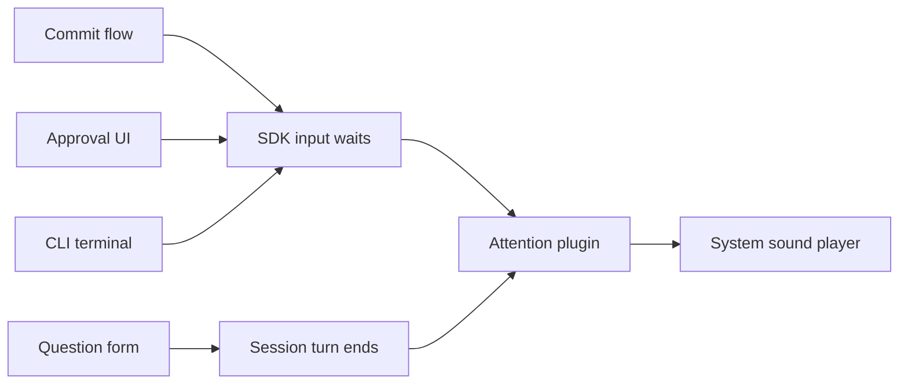

# Attention for input waits

Commit review, push confirmation and future input requests notify through one frontend service. Sound remains in the replaceable `attention` plugin.

## Boundaries

**Pattern: scoped registrations and a stream of active waits.** Explicit waits beat dialog-open hooks: the commit dialog opens before it needs input. A scoped registration survives redraws and disappears on answer, cancellation or plugin unload.

| System | Today | Change |
| --- | --- | --- |
| SDK TUI services | Commands, dialogs and toasts | Add `TuiInputWaits`; no audio or server dependency |
| CLI terminal | Supplies shared services to every TUI part | Supply one input-wait service per terminal |
| Commit flow | `Review` and `Push` await `steps.ask` | Wrap both waits; preserve the existing state machine |
| Approval UI | Watches pending asks for the on-screen session | Register pending asks through their existing stream |
| Attention | Watches turn ends and approval RPCs directly | Watch turn ends and shared waits; remove approval coupling |
| Questions | Form ends the turn | Keep the single turn-end sound |



## Contracts and injection

Local TypeScript contracts, exported from `@liminal/sdk/tui`:

```ts
interface InputWait {
  readonly sessionId: SessionId;
  readonly source: string; // Plugin name.
  readonly id: string;     // Stable within the source and session while pending.
}
interface TuiInputWaitsService {
  readonly register: (wait: InputWait) => Effect.Effect<void, never, Scope.Scope>;
  readonly changes: Stream.Stream<ReadonlyArray<InputWait>>;
  readonly waitForUser: <A, E, R>(
    wait: InputWait,
    answer: Effect.Effect<A, E, R>,
  ) => Effect.Effect<A, E, R>;
}
// TuiInputWaits: Context.Service tag for TuiInputWaitsService.
// makeTuiInputWaits: Effect.Effect<TuiInputWaitsService>.
```

Reuse `Registry` in `packages/sdk/src/core/registry.ts`: export its existing `make` factory, compose a registry with order zero, and expose only the methods above. Its identity-based finalizers safely remove overlapping registrations. The notification identity is the tuple `(sessionId, source, id)`, not the registration object.

`waitForUser` opens a child scope, registers the wait, runs `answer`, and closes that scope on every exit. It preserves the answer's value, error and required services. No new error type, RPC, schema or dependency is needed.

Production: `makeTerminal` creates the service; `tuiServices` supplies it to every plugin. Tests use the same factory and registry. Commit receives the service's `waitForUser` function through `FlowDeps`; tests inject that same function and record its public `changes` stream. Attention's stream consumer receives playback as an effect: production passes `playWith`, tests pass a recording effect.

## Call paths and logic

```mermaid
sequenceDiagram
    participant F as Commit flow
    participant W as Input waits
    participant N as Attention
    participant P as Sound player
    participant U as User
    F->>F: Show Review; install answer callback
    F->>W: Register commit/review while awaiting answer
    W->>N: Active waits changed
    N->>P: Play for a new on-screen wait
    U->>F: Answer
    F->>W: Release review wait
    F->>F: Commit; show Push; install answer callback
    F->>W: Register commit/push while awaiting answer
    W->>N: Active waits changed
    N->>P: Play again
```

```text
Shared wait wrapper
  Open a child scope
  Register the request
  Run the answer effect
  Close the scope on success, failure or interruption

Commit
  Inject waitForUser through FlowDeps
  Install the answer callback before registering the request
  Wrap Review's answer with source commit, id review
  Wrap Push's answer with source commit, id push
  Clear the answer callback when the wait exits, including interruption

Approval pending-stream adapter
  Own a child-scope map keyed by pending ask id
  For each existing pending-list update
    Close scopes for asks no longer present
    Open scopes and register newly present asks with source approval
    Retain scopes for unchanged asks
    Forward the pending list to the existing UI
  Close every remaining scope when the stream stops

Attention
  Filter active waits to the on-screen session
  Compare request identity sets between snapshots
  Play once if the snapshot contains any newly present identity
  Ignore removals and repeated snapshots
  Merge these chimes with existing non-cancelled live turn endings
```

The approval adapter wraps the existing `LabelDeps.pending` stream before `bridge.watch`; it does not open a second pending subscription or depend on dialog rendering. Use child scopes tied to that stream, not the entire terminal. Session-component disposal and plugin unload stop the stream and release its registrations.

The first active-wait snapshot can sound for an already pending on-screen request, matching current approval behavior. Other sessions stay silent; returning to a session with pending input can sound. Multiple new waits in one snapshot produce one sound, matching the existing approval-list behavior. Review and push are separate waits separated by work, so each sounds. Questions do not register an additional wait. No focus gating or time-based debounce is added.

## File layout

```text
packages/sdk/src/
  core/registry.ts                 Export existing registry factory
  tui/input-waits.ts              New service, factory and scoped wait wrapper
  tui/{host.ts,index.ts}           Include service in TuiServices; export contracts
apps/cli/src/tui/run.tsx           Create and inject terminal-owned input waits
packages/plugins/commit/src/
  tui.tsx                         Inject waitForUser into the flow
  tui/flow.ts                     Wrap Review/Push; finalize answer callbacks
packages/plugins/approval/src/
  tui.tsx                         Wrap the existing pending stream
  tui/input-waits.ts              New scoped pending-ask reconciliation adapter
packages/plugins/attention/
  plugin.ts                       Remove Approval from requires
  package.json                    Remove approval peer dependency
  src/tui.tsx                     Consume shared waits instead of approval RPCs
  src/tui/chimes.ts               Replace newAsks with generic new-wait detection
packages/sdk/test/input-waits.test.ts          New lifecycle tests
packages/plugins/approval/test/input-waits.test.ts  New adapter tests
packages/plugins/commit/test/flow.test.ts      New injected flow tests
packages/plugins/attention/test/attention.test.ts  Generic waits and playback checks
apps/cli/test/tui.test.tsx         Shared-service injection regression
```

## Verification and documentation

| Boundary | Required checks |
| --- | --- |
| SDK service | Visible only while waiting; preserves answer/error; failure and interruption release; overlapping registrations release independently |
| Commit flow | No wait during checks/planning/committing/pushing; distinct review and push waits; No/Esc and interruption clear waits and answer callbacks |
| Approval adapter | Initial asks register; unchanged lists do not churn; added/removed asks reconcile; stream failure, disposal and unload release all waits |
| Attention | Same identity does not repeat; source/session identities cannot collide; removals are silent; off-screen waits are silent; returning to pending input can sound |
| Integration | Shared service reaches plugin setup; review and push each invoke recorded playback; Q&A's ended-by-plugin turn produces one chime; cancelled/replayed turns remain silent |

Run targeted SDK, approval, commit, attention and CLI tests, then `mise run check`. Use deterministic gates rather than sleeps; do not invoke the native sound player in automated tests.

Update `docs/guides/tui.md`: the setup-services table and a new **Request user attention** section covering scoped waits, stable identities, pending streams, injection and turn-ending forms. Update `docs/plugins/attention.md` and its catalog description to describe shared input waits and remove `Approval` from Requires when implementation changes the runtime contract.

Grounding: existing SDK `Registry`, `makeBridge`, CLI `makeTerminal`/`tuiServices`, commit `makeFlow`, approval `LabelDeps.pending`, and attention `turnEnds`/`newAsks`; Tau `src/tui/Notifications.ts` (`waitForUser`) and `src/tui/internal/commit-flow.ts`. Effect 4.0.5's copied README/API index and installed `Effect.scoped`, `Effect.acquireRelease`, `Scope.fork`/`close`, and `Stream.unwrap` provide lifecycle primitives. The terminal-notifier package research concerns desktop delivery, not input-wait ownership; retain the existing player and add no dependency.
