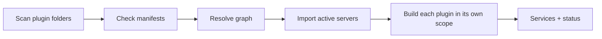

# Plugin foundation

Step 1 of [milestones](../milestones.md): the SDK plugin definition, its test harness and the kernel host, proven by booting `session-store` and `session-log` from their manifests. Requirements are in [02-architecture](../../requirements/02-architecture.md), [03-plugin-model](../../requirements/03-plugin-model.md) and [07-repository](../../requirements/07-repository.md).

## Rounds

| Round | Covers | State |
| --- | --- | --- |
| 1 | SDK authoring: `definePlugin`, contracts, registries, pipelines | Agreed |
| 2 | Kernel host: load built-ins, resolve the graph, build each plugin in its own scope | Agreed |
| 3 | SDK test harness and conformance suites | Agreed |

The event bus, protocol, supervisor, reload and stable handles belong to later milestones.

## Prior art

| Harness | Plugin unit | Provides and requires | Extension points | Unwinding |
| --- | --- | --- | --- | --- |
| DeepSeek Harness (Cordis) | Every part, the agent loop included | `Service` classes on `ctx`; `static inject` lists requirements | Registries (`ctx.tools.register`), waterfall events with `next()` | Every registration is an effect that unwinds when its plugin unloads |
| OpenCode 2.0 (`packages/plugin/src/effect`) | `define({ id, effect })` | Fixed core domains passed in a `Context` | Hooks and transforms per domain | Registrations need `Scope`; closing it disposes them |
| Pi (`docs/extensions.md`) | An extension function | Fixed core API | `pi.on(event)`, `registerTool` and similar | Reload replaces the extension |
| Tau | Effect services | Layers | Replace a service, such as `ContextMethod` | Layer scope |

Liminal follows DeepSeek's shape (everything a plugin, replaceable services, registries that unwind) with OpenCode's mechanism (Effect services, registrations tied to a `Scope`).

## Round 1: authoring surface

The SDK gives authors two extension primitives, `Registry` and `Pipeline`. Step 1 builds `definePlugin` and `Registry`; `Pipeline` is built in step 4 with `tool-pipeline`, its first user. Observe-only events come from the kernel event bus in a later milestone, exposed through the SDK.

A web search found no TypeScript package combining a provides/requires manifest, graph resolution and scoped cleanup; Cordis is excluded by [02-architecture](../../requirements/02-architecture.md). Liminal owns the plugin system on Effect parts.

### Files

```text
sdk/src/core/
  index.ts        re-exports the root `@liminal/sdk` surface
  plugin.ts       definePlugin and the manifest types
  registry.ts     Registry: ordered collections plugins add to
  pipeline.ts     Pipeline: ordered middleware with next()   (step 4)
  directories.ts  Directories: global, project and data folders, supplied by the host
```

### Effect parts reused

| Need | Effect API |
| --- | --- |
| Registry list and change stream | `SubscriptionRef.make`, `update`, `get`, `changes` |
| Remove a registration when its plugin's scope closes | `Effect.acquireRelease` |
| Registry as a service tag | `Context.Service` |
| Boot order and cycle errors (round 2) | `Graph.directed`, `addNode`, `addEdge`, `topo`, `findCycle` |

Effect's middleware types are tied to HTTP and RPC (`http/HttpMiddleware`, `rpc/RpcMiddleware`), so `Pipeline` is Liminal's own.

### Manifest

```ts
// plugins/session-log/plugin.ts — imports only contracts
export default definePlugin({
  name: "session-log",
  provides: [SessionLog, EntryKinds],
  requires: [SessionStore],
  uses: [],                                  // optional services, read with Effect.serviceOption
  enabledByDefault: true,
  server: () => import("./src/server.ts"),   // loaded only after the graph resolves
})

// plugins/session-log/src/server.ts
export const layer: Layer.Layer<SessionLog | EntryKinds, never, SessionStore> = ...
```

`definePlugin` fails to type-check unless `server`'s `layer` outputs exactly the `provides` tags and needs no service outside `requires` and `uses`.

### Contract

```ts
// plugins/session-log/src/contract.ts — imports only Effect and the SDK
export class SessionLog extends Context.Service<SessionLog, { ... }>()("liminal/session-log/SessionLog") {}
export class EntryKinds extends Registry.Service<EntryKinds, EntryDefinition>()("liminal/session-log/EntryKinds") {}
export class SessionNotFound extends Schema.TaggedError<SessionNotFound>()("SessionNotFound", { ... }) {}
```

### Registry and Pipeline

```ts
interface Registry<A> {
  // Removed when the caller's Scope closes: the plugin is disabled, replaced or reloaded
  register(item: A, options: { order: number }): Effect<void, never, Scope>
  list: Effect<ReadonlyArray<A>>            // sorted by order
  changes: Stream<ReadonlyArray<A>>
}

type Middleware<I, O, E> = (input: I, next: (input: I) => Effect<O, E>) => Effect<O, E>
interface Pipeline<I, O, E> {
  use(middleware: Middleware<I, O, E>, options: { order: number }): Effect<void, never, Scope>
  run(input: I, last: (input: I) => Effect<O, E>): Effect<O, E>
}
```

`Registry.Service` returns a `Context.Service` tag whose implementation is `Registry<A>`, so registries go in `provides` and `requires` like any service. The owning plugin's server creates it empty with `Registry.layer(EntryKinds)`.

A plugin that adds to another plugin's registry lists that registry's tag in `requires`, so the graph orders them.

```text
host builds session-log's Layer        -> EntryKinds exists, empty
host builds questions' Layer           -> EntryKinds.register(Asked, { order: 100 }) in its scope
questions disabled                     -> its scope closes -> Asked removed
```

## Round 2: kernel host

The host turns plugin folders into running services and a status per plugin. Step 1 loads built-ins only; user and project folders, settings, readiness and swaps come later. The kernel (`kernel/`) never imports plugins statically; it imports manifests and servers by path at runtime.

Prior art: DeepSeek composes profile bundles' `cordis.patch.yml` entry lists, and a Cordis plugin waits until its `inject` services exist (`packages/boot/app-boot/README.md`, `docs/cordis-primer.md`); every plugin gets ambient `logger`, `timer`, `events` without declaring them (`docs/cordis-api/inherited.md`). OpenCode imports built-ins from a static list (`core/src/plugin/internal.ts`), reads external plugins from config and `plugin/` folders, resolves entry points by package subpath (`packages/plugin/src/host.ts`), and forces plugins onto the host's `effect` with a Bun plugin (`runtime.ts`). Pi scans folders and reports a failing extension without stopping. A web search found no package for plugin graph resolution worth adding.



### Files

```text
kernel/src/host/
  discover.ts   read each package.json `liminal` key, import the manifests it lists
  manifest.ts   check a manifest's runtime shape with Schema
  resolve.ts    providers per tag, missing services, duplicates, cycles
  build.ts      import servers, build plugins concurrently, each in a child scope
  host.ts       boot: discover, resolve, build; returns services and status
```

### Types

```ts
type InactiveReason =
  | { _tag: "Disabled" }
  | { _tag: "MissingService"; service: string }
  | { _tag: "DuplicateProvider"; service: string; plugins: ReadonlyArray<string> }
  | { _tag: "Cycle"; plugins: ReadonlyArray<string> }
  | { _tag: "DependencyInactive"; plugin: string }
  | { _tag: "ImportFailed"; cause: Cause<unknown> }
  | { _tag: "BuildFailed"; cause: Cause<unknown> }

type PluginStatus = { name: string; state: "active" } | { name: string; state: "inactive"; reason: InactiveReason }

interface Booted {
  services: Context<unknown>             // every active plugin's services merged
  status: ReadonlyArray<PluginStatus>
}

type BaseServices = FileSystem | Path | ChildProcessSpawner | Directories

// apps/cli passes the built-in folder; plugins never see the kernel
boot(options: { folders: ReadonlyArray<string> }): Effect<Booted, never, Scope | BaseServices>
```

### Logic

```text
boot
  manifests = discover(folders)                    each checked by Schema; a bad one is inactive
  drop plugins not enabledByDefault                Disabled
  map each provided tag to its plugin              two providers -> both inactive, DuplicateProvider
  build Graph with an edge per requires and uses
  findCycle -> cycle members inactive              Cycle
  repeat until stable: a plugin missing a required provider is inactive
                                                   MissingService or DependencyInactive
  for every active plugin, concurrently:
    wait for the Deferreds of its requires and present uses
    import server                                  failure -> ImportFailed, Deferred fails
    scope = Scope.fork(root)
    context = Layer.buildWithScope(layer + base services + deps' contexts, scope)
                                                   failure -> BuildFailed, scope closed
    complete its Deferred with context
  services = Context.merge of every built context
```

Agreed:

- The host scans plugin folders and reads each `package.json` `liminal` key. The CLI passes the built-in folder path; user and project folders use the same scan later.
- Each plugin builds concurrently in its own child scope with `Layer.buildWithScope`.
- A plugin that fails, or whose required provider is missing, duplicated or in a cycle, becomes inactive with a reason, its dependents become inactive, and boot continues.
- The host gives every plugin base services without listing them: `FileSystem`, `Path` and child processes from `BunServices.layer`, and the SDK's `Directories` (global, project, data folders). `definePlugin`'s type check allows these tags.

A dependent whose dependency fails waits on a failed `Deferred` and becomes `DependencyInactive`. Concurrent builds with a `Deferred` per plugin give the graph order without a separate topological sort; `Graph.findCycle` runs first so no build waits forever.

### Effect parts reused

| Need | Effect API |
| --- | --- |
| Edges and cycle detection | `Graph.directed`, `addNode`, `addEdge`, `findCycle` |
| One scope per plugin | `Scope.fork`, `Scope.close` |
| Build a plugin into its scope | `Layer.buildWithScope` |
| Hand dependencies' services to a plugin | `Layer.succeedContext`, `Context.merge` |
| Wait for dependencies | `Deferred` |
| Read folders | `FileSystem`, `Path`; `BunServices.layer` from `@effect/platform-bun` |

### Proof

```text
test: boot plugins/ with a temp data folder
  status: session-store active, session-log active
  append an entry, close the root scope
  boot again, read -> the entry is there
test: fixture plugins for each InactiveReason
```

## Round 3: test harness and conformance suites (agreed)

Lets a plugin author test one plugin in milliseconds with fakes for its `requires`, and lets a contract hold every provider to the same behavior. The scripted model (step 2), recorded provider responses (step 3) and transport end-to-end tests (step 5) come with their steps.

Prior art: Tau runs `bun:test` with its own Effect helpers (`tests/support/agent-harness.ts`, `withHarness`) and `TestClock` from `effect/testing`. DeepSeek's shared suites are a function each backend's spec calls with a factory and a `reopen()` for restart simulation (`packages/storage/storage/tests/contract.ts`). OpenCode's host tests use temp plugin folders whose entry points throw when run, proving resolution never executes plugin code (`packages/plugin/test/host.test.ts`). Packages: `@effect/vitest` is Effect's official helper but needs Vitest; `@effect/bun-test` is only a proposal (Effect issue #5964); community `effect-bun-test` and `@domir/bun-test` are unverified for Effect 4.

### Files

```text
sdk/src/testing/
  index.ts       re-exports `@liminal/sdk/testing`
  effect-test.ts effectTest(name, effect): runs a scoped Effect under bun:test, TestClock provided
  plugin.ts      testPlugin(plugin, fakes): the plugin's server Layer with fakes and test base services
  base.ts        test base services: temp Directories removed on scope close, real FileSystem and Path
plugins/<owner>/test/conformance.ts   the contract's suite, exported as `./conformance`
kernel/test/host.test.ts              fixture plugin folders, servers that throw if imported early
```

### Types

```ts
effectTest(name: string, effect: Effect<void, unknown, Scope | TestClock>): void

// fails to type-check unless `fakes` covers the plugin's requires
testPlugin<P extends Plugin>(plugin: P, fakes: Layer<Requires<P>>): Layer<Provides<P>, BuildError>

// in the contract-owning plugin
interface ConformanceHarness<S> {
  layer: Layer<S, never, BaseServices>   // a fresh provider over an empty medium
  reopen?: Layer<S, never, BaseServices>  // a new instance over the same medium, as after a restart
}
sessionStoreConformance(label: string, make: () => ConformanceHarness<SessionStore>): void
```

Agreed:

- Plugin tests run on the real file system in a temp folder per test; `Directories` points there and the folder is deleted when the test's scope closes.
- A contract's conformance suite lives in its owning plugin as `test/conformance.ts`, exported as `./conformance`, imported only from other plugins' `test/` folders, with `reopen` for restarts.
- Tests run under `bun:test` with an owned `effectTest` helper, on the same runtime Liminal ships on.

Not used:

- `@effect/vitest`: adds Vitest and Vite; under Node it tests `node:sqlite` instead of the shipped `bun:sqlite`, and under `bun --bun vitest` it has reported fork-pool stalls, SQLite locks and interop bugs (Bun #27002, OpenClaw #145198, Vitest #10359). Its extras (module mocking, browser mode, V8 coverage) are unneeded or broken on Bun.
- `effect-bun-test`, `@domir/bun-test`: unverified on Effect 4, and the owned helper is about 30 lines.

### Proof

```text
session-store: sessionStoreConformance("sqlite", ...) passes, including reopen
session-log:   testPlugin(sessionLog, fake SessionStore) appends, reads, subscribes
kernel:        host tests pass without importing any fixture server early
```
