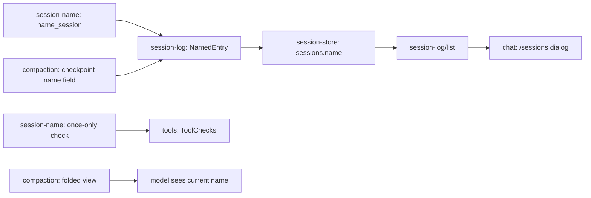

# Session name

Lets the agent give a session a short name, once through a `name_session` tool and later through an optional field on `checkpoint`. The session dialog shows the name; a session with none still shows its first user message. A name is one plain sentence of about 10 words.

## How it works today

| Part | Where | Today |
| --- | --- | --- |
| Title | `session-store` `sessions.title`; set by `nameAfter` in `session-log/src/server/entries-log.ts` | The first line of the first user message, written once (`WHERE title = ''`); a fork copies it |
| Session list | `session-log/list` returns `SessionSummary.title`; `chat/src/tui/sessions.tsx` `optionOf` | Shows `title`, or "Untitled session" when empty |
| `checkpoint` tool | `compaction/src/server/checkpoint.ts` | Called alone; appends the checkpoint entry, then the handoff entry |
| Folded view | `compaction/src/server/view.ts` `foldAt` | After a checkpoint, the model sees memories, notes, recent entries, then the handoff |
| Tool checks | `tools` `ToolChecks`; `compaction` `forcedCheck` | A check returns `Allow` or `Deny`. The tool stays in the request's tool list, so the cached prefix is unchanged |
| Placeholder | `docs/plugins/_index.md` row `session-title` | Listed as to plan |

## Round 1: architecture

One new plugin, `session-name`. `session-log`, `session-store`, `compaction` and `chat` each gain a small piece. The new plugin replaces the `session-title` placeholder row.



| System | Change | Does |
| --- | --- | --- |
| `session-log` | expands | Resolves `SessionSummary.title` as the name, else the title, so the dialog needs no change. Owns `session-log/named` (`{ name }`; not shown to the model; debug view only) and the `SessionName` schema. `nameAfter` also reads this entry and updates the session's name |
| `session-store` | expands | A `name` column beside `title` (migration 0003); `setName` always overwrites; a fork copies it; `listSessions` returns both |
| `session-name` | adds | The `name_session` tool with its `guidance`, and a once-only tool check |
| `compaction` | expands | `checkpoint` takes an optional `name`; the folded view adds the current name |
| `chat` | none | `optionOf` is unchanged; the transcript draws no row for `session-log/named`; `session-name`'s TUI part registers the `name_session` tool as `ToolRows.Hidden` |

### Name once, then checkpoints

- Chosen: a `ToolChecks` check in `session-name` denies `name_session` once the session has a `session-log/named` entry. The tool stays in the request's tool list, so the cached prefix is unchanged. This is how `compaction`'s forced check refuses tools. Beats removing the tool from the list, which would change the cached prefix.
- A denied call returns "This session already has a name. It changes at your next checkpoint."
- A fork starts with its parent's name, so `name_session` is denied there too; the fork's name changes at its first checkpoint.
- The guidance is written for one call: name the session once, only after the topic is clear, never in the first turn when the request is still vague; the name changes later through the checkpoint's `name` field, only when the chat's focus has changed.
- The `checkpoint` field has no once-only limit. Checkpoints are rare, so they cap renames without a check.

### The model sees the current name

- `name_session` returns the name it set, so the model sees it until the first checkpoint.
- After a checkpoint, `foldAt` adds one built message, `Session name: …`, after the handoff, taken from the newest `session-log/named` entry in the whole log. No name, no message. The system prompt is not touched.
- The `checkpoint` field's description tells the model to fill it only when the current name no longer describes the chat.

## Round 2: code

```
packages/plugins/session-log/
  src/contract.ts            SessionName schema, NamedEntry
  src/server/entries-log.ts  nameAfter also handles NamedEntry
  src/server.ts              toSummary resolves the title from name, else title
packages/plugins/session-store/
  src/contract.ts            SessionStore.setName(id, name)
  src/server/migrations.ts   0003: sessions.name TEXT NOT NULL DEFAULT ''
  src/server/queries.ts      setName; fork copies name
  src/server/session-index.ts listSessions returns name
packages/plugins/session-name/
  plugin.ts                  requires SessionLog, Tools, ToolChecks
  package.json               exports . and ./contract
  src/contract.ts            nameTool = "name_session"
  src/server.ts              registers the tool and the check
  src/server/tool.ts         the tool: appends NamedEntry
  src/server/once.ts         the check: denies when a NamedEntry exists
  src/tui.tsx                hides the name_session call's row
  test/session-name.test.ts  tool, once-only check, fork, checkpoint field, listing
packages/plugins/compaction/
  src/server/checkpoint.ts   optional `name` param; appends NamedEntry in the same batch as the handoff
  src/server/view.ts         foldAt adds the Session name message
```

```ts
// session-log contract
export const SessionName: Schema.Schema<string>  // trimmed, one line, 1 to 80 characters
export const NamedEntry: EntryDefinition<{ name: string }>  // kind "session-log/named", model: false, user: "debug"

// session-store contract
setName: (id: string, name: string) => Effect.Effect<void, SessionNotFound | StoreError>

// session-name contract
export const nameTool = "name_session"
const Params = Schema.Struct({ name: SessionName.annotate({ description: "…about 10 words" }) })

// compaction checkpoint params
const Params = Schema.Struct({ handoff: …, name: Schema.optionalKey(SessionName) })
```

```
name_session(name):
  entries = log.read(session)
  if any entry is NamedEntry: fail ToolFailed(already named)   // backstop; the check normally denies first
  log.append(session, [NamedEntry { name }])
  return "Session named: {name}"

nameAfter(session, drafts):
  user = first UserEntry draft          -> store.nameSession(session, firstLine)   // unchanged
  named = last NamedEntry draft         -> store.setName(session, named.name)

once check(call, tool):
  if tool is not name_session: Allow
  if log.read(call.sessionId) has a NamedEntry: Deny(reason)
  else Allow

checkpoint(handoff, name?):
  existing checks and appends
  append [Checkpoint, Handoff] + (name given ? [NamedEntry { name }] : [])   // one batch

foldAt(entries, checkpoint, stored):
  latestName = newest NamedEntry in entries
  built messages = memories, notes, kept entries, handoff, "Session name: {latestName}" if any, later entries
```

Tests: the tool names the session and the list shows the name; a second call is denied; a session with no name lists its first prompt; a fork lists its parent's name and is denied; `checkpoint` with `name` renames, without leaves it; a name over 80 characters or with a newline fails; the folded view carries the name line only when a name exists. The store conformance suite covers `setName`.

Guide sections changed: `docs/guides/plugins.md` "Register a tool" gains the once-only check as an example of a check that keeps the tool in the list.

## Decided

- No `/rename` yet; the entry has no author field until it is built
- A rename shows only in the debug view; the `/sessions` dialog shows the name
- Guidance only; no nudge and no background namer
- Tool name `name_session`
