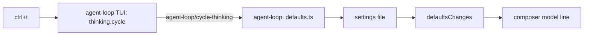
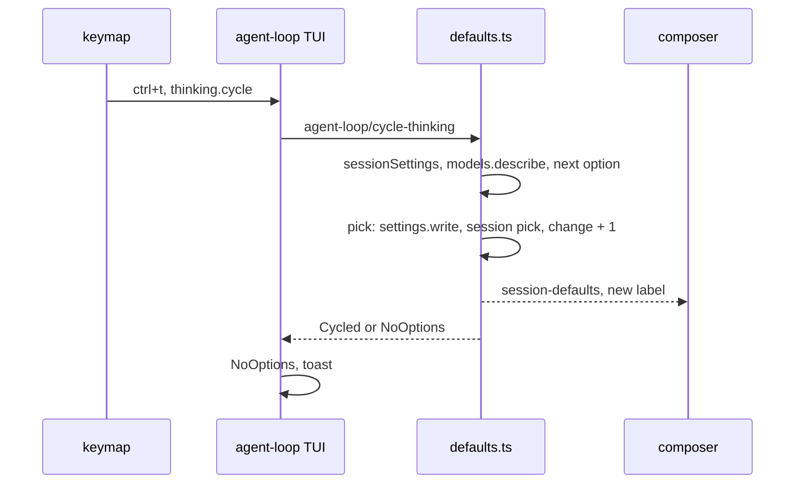

# Session polish

Five small changes: `ctrl+t` cycles the thinking option of the session's model, the sidebar opens with a Session section (folder and git branch), `/qna` and `/commit` run on `enter` in the slash menu, the `shell` and `process_start` tools state the folder they run in, and the approval dialog shows the reviewer's plain-words summary instead of the command.

## How it works today

| Part | Where | Today |
| --- | --- | --- |
| Composer model line | `inbox/src/tui.tsx` `modelLine` | Watches `agent-loop/session-defaults`; shows `model (thinking label)` |
| Session model and thinking | `agent-loop/src/server/defaults.ts` | `pick` holds the session's next-turn settings in memory, writes the global default and re-emits the session's stream |
| Approval dialog | `approval/src/tui/ApprovalDialog.tsx` | Heading is the command or path; the reviewer's summary is a second line |
| Model's thinking options | `ModelInfo.thinking`, `thinkingOptionOf` in `@liminal/sdk` | Ordered list; `models.describe` returns it on the server |
| Sidebar sections | `ChatSlots.sidebar` `{ id, order }` | Context 0, Cost 10, Compaction 20, Processes, References 40 |
| Workspace folder, git | `environment/src/server/workspace.ts` | Prompt sections only; no RPC, no TUI part |
| `shell` and `process_start` text | `tools-shell/src/server.ts`, `processes/src/server/tools.ts` | Say "in the workspace" without the path; every call is a fresh `/bin/sh` in `Directories.workspace`, so a `cd` does not carry to the next call |
| Slash menu pick | `inbox/src/tui/slash.ts` `pick` | A command with `slash.arguments` only fills `/name `; a second `enter` runs it |

## Round 1: architecture

Five independent changes; none adds a system. `environment` grows an RPC and a TUI part; `agent-loop` and the SDK's `Slash` each gain one member.



### 1. `ctrl+t`: the server picks the next option

- Chosen: `AgentLoop.cycleThinking(session)` reads the session's settings, finds the model's options with `models.describe`, and calls `pick` with the next option's id. Beats a client-side cycle, which fetches every provider's model list on each keypress.
- The composer needs no change: `pick` re-emits the session's stream, and the line shows the new `thinkingLabel`.
- Same scope as `/model`: the session's next turn and the global default; a running turn keeps its option.
- The next option follows the model's own order, wraps at the end, and includes `Off` where the model offers it. From a saved id the model does not offer, the cycle starts at the model's default and moves on.
- A model with fewer than two options: nothing is written; the TUI toasts `This model has no thinking options to cycle`.

### 2. Session section: `environment` serves it

- Chosen: `environment` (already holds the folder and git access) adds an `environment/session` RPC and a TUI part that registers the section. Beats `chat` (should not run git) and a new plugin (a plugin for one section).
- The section shows the folder Liminal runs in (`Directories.workspace`, home as `~`) and the branch.
- Branch: `git branch --show-current`; on a detached HEAD, `git rev-parse --short HEAD`; outside a repository the branch row is left out.
- The stream emits the value on subscribe, then re-reads every 5 seconds and emits only a change. Beats watching `.git/HEAD`, which breaks in worktrees where `.git` is a file.
- Registered at order `-10` so it sits above Context.

### 3. Slash menu: `arguments: "optional"`

- Chosen: `Slash.arguments` becomes `true | "optional"`. `true` keeps today's pick (fills `/name `). `"optional"` runs the command on `enter` with empty arguments. Beats a second flag next to `arguments`: both say how the command takes text, so they are one setting.
- Typing arguments still works: `tab` completes `/qna `, the menu closes on the space, and `enter` goes through `submit` with the text after the name.
- `/qna` and `/commit` become `"optional"`. Skills stay `true`.

### 4. Approval dialog: no command

- Chosen: the dialog's heading line is the reviewer's summary; the command or path is not drawn. The reviewer's prompt and the `summary` field description tell it to write for someone who will not read the command and never to quote it. Beats truncating the command, which still shows the part nobody reads.
- When a review wrote no summary (no model, or a failed review) the heading falls back to the command or path, so the user is never asked to approve a blank line.

### 5. Tools name their folder

- Chosen: each tool's description and guidance carry the path, filled in when the tool registers. `Directories.workspace` is fixed for a run, so the text is stable and keeps the prompt cache. Beats the `environment` facts line alone, which models skip past, and beats prepending the folder to every result, which spends tokens on every call.
- `shell` description: `Runs a command line with /bin/sh in <workspace> and returns its output.`
- `shell` guidance adds: `Every command starts in <workspace> in a fresh shell; do not cd into it. A cd does not carry over to the next call.`
- `process_start` gets the same path in its description and the same `cd` line.

## Round 2: code

### File layout

```
packages/sdk/src/tui/commands.ts                  Slash.arguments: true | "optional"
packages/plugins/inbox/src/tui/slash.ts           pick: fill only when arguments === true
packages/plugins/questions/src/tui.tsx            slash arguments: "optional"
packages/plugins/commit/src/tui.tsx               slash arguments: "optional"
packages/plugins/tools-shell/src/server.ts        description and guidance name the workspace and say cd is not needed
packages/plugins/processes/src/server/tools.ts    same for process_start
packages/plugins/agent-loop/src/contract.ts       AgentLoop.cycleThinking, agent-loop/cycle-thinking, CycleResult
packages/plugins/approval/src/tui/ApprovalDialog.tsx summary as the heading; command only without one
packages/plugins/approval/src/server/review.ts    reviewer prompt and summary description: plain words, no command
packages/plugins/agent-loop/src/server/defaults.ts cycleThinking
packages/plugins/agent-loop/src/server.ts         expose it on the service and the RPC handler
packages/plugins/agent-loop/src/tui.tsx           thinking.cycle command with ctrl+t, toast
packages/plugins/environment/src/contract.ts      EnvironmentRpcs, SessionInfo
packages/plugins/environment/src/server/session.ts folder and branch stream
packages/plugins/environment/src/server.ts        RPC handler beside the prompt sections
packages/plugins/environment/src/tui.tsx          registers the sidebar section at order -10
packages/plugins/environment/plugin.ts            rpcs, tui; requires Directories if not a base service
packages/plugins/environment/package.json         peers: chat, @opentui/solid, solid-js
apps/gallery/src/chat/Sidebar.tsx                 Session section, built and reviewed first
```

### Types at each boundary

```ts
// @liminal/sdk/tui
interface Slash { name; aliases?; arguments?: true | "optional" }

// agent-loop/contract.ts
cycleThinking: (session) => Effect<CycleResult, DefaultSetFailed>
type CycleResult = { _tag: "Cycled"; label: string } | { _tag: "NoOptions" }
Rpc.make("agent-loop/cycle-thinking", { payload: { session }, success: CycleResult, error: DefaultSetFailed })

// environment/contract.ts
const SessionInfo = Schema.Struct({ folder: Schema.String, branch: Schema.optionalKey(Schema.String) })
Rpc.make("environment/session", { success: SessionInfo, stream: true })
```

### Call paths



### Logic

```
cycleThinking:
  turn = sessionSettings(session)
  info = models.describe(turn.model)
  if info.thinking has fewer than 2 options: return NoOptions
  current = thinkingOptionOf(info, turn.thinking)
  next = info.thinking[(indexOf(current) + 1) % length]
  pick(session, turn.model, next.id)
  return Cycled { label: next.label }

sessionInfo stream:
  every 5 seconds, starting now:
    folder = Directories.workspace, home as ~
    branch = git branch --show-current
    if branch is empty: branch = git rev-parse --short HEAD
    if git fails: no branch
  emit only when folder or branch changed

pick (slash menu):
  match = matches[selected]
  if match.slash.arguments === true: fill "/name "
  else: clear input, run(match.command.name, "")
```

## Tests

| Where | Case |
| --- | --- |
| `agent-loop/test` | cycle moves to the next option, wraps, starts at the default from an unknown id; fewer than two options gives none |
| `apps/cli/test/tui.test.tsx` | `ctrl+t` changes the composer's `(label)` with the composer focused |
| `environment/test` | branch, detached HEAD, no repository, `~` for the home folder |
| `apps/cli/test/tui.test.tsx` | the `/qna` and `/commit` tests press `enter` once instead of twice; `/qna text` and `/commit text` still pass the text |
| `tools-shell/test`, `processes/test` | the registered tool's description contains the workspace path and the guidance says not to `cd` |
| `apps/cli/test/commands.test.ts` | an `"optional"` command found by name and alias |

## Deleted or replaced

- The second `enter` in the `/qna` and `/commit` tests.

## Guides changed

- `docs/guides/tui.md`: the `slash` row (`arguments`), the sidebar section line (order below 0 is allowed; Session is first).
- `docs/guides/plugins.md` if it describes environment as server-only.

## Build order

0. Tool text: the workspace path in `shell` and `process_start`.
1. Slash `"optional"` (SDK, inbox, two plugins, tests).
2. `cycleThinking` and `ctrl+t`.
3. Session section in the gallery for review, then the `environment` RPC and TUI part.
4. Approval dialog summary.

## Open

- Whether Session shows the session's own folder (`session-store` `workspace`) instead of the folder Liminal runs in; this plan shows the folder Liminal runs in.
- Whether the composer hints list `ctrl+t`.
- Whether the slash menu row for an `"optional"` command shows a `tab args` hint.
- Whether the approval dialog should keep a way to see the command (a key that toggles it).
