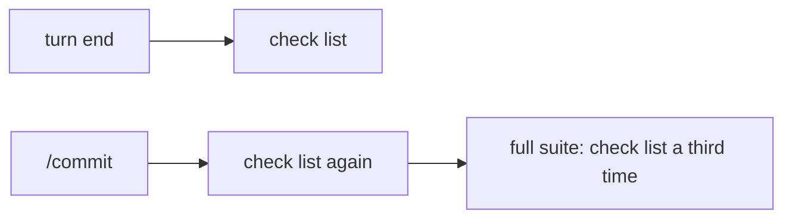
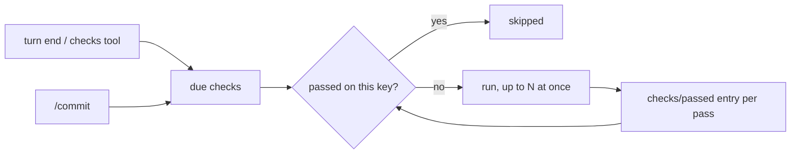

# Shared checks

Makes `/commit` stop re-running checks that already passed, and runs the checks that are due in parallel. Lives in `packages/plugins/checks` ([docs/plugins/checks.md](../../plugins/checks.md)); `/commit` reads it through `CommitChecks`.

State: decisions agreed; built.

## How it works today

| When | Runs | On which files | Skips a pass? |
| --- | --- | --- | --- |
| After each writing call | `fix` list | that call's changed files | no |
| Turn would end, or the `checks` tool | `check` list, one at a time | files changed this turn | only by "no change after the last report" |
| `/commit` | `check` list, then `commit` list, one at a time | files `/commit` will commit | never |

The `commit` list holds `full suite` (`mise run check`). That task runs every `check` entry again, so a turn that passed its checks runs all of them a second time at `/commit`, one after another.



## Proposed shape



- One list of checks runs at both moments. `check` already is that list; `/commit` already runs it.
- A pass is recorded per check as a hidden session entry `checks/passed`, holding one key: a hash of the check's definition (command, include, exclude, env), the repository's HEAD, and the path and version of each file the run covered. `snapshot.ts` already makes the per-file versions.
- A check is skipped when the latest `checks/passed` entry for its name has the same key as the key computed now. Any edit, commit, or change to `checks.json` changes the key.
- A check whose command takes `{files}` covers only the files it was given; a whole-project check covers every changed file its globs match. A `/commit` that includes files from earlier turns therefore reruns `{files}` checks and skips whole-project ones.
- Unknown changes (no git) never skip.
- Due checks all run at once; the report keeps the order of the file, not of completion.
- Both the `checks` tool and turn-end settling write `checks/passed`, so the work done by one is seen by the other and by `/commit`.

## Decisions

| Question | Answer |
| --- | --- |
| `full suite` | Deleted from `checks.json`; the `commit` list stays for `/commit`-only commands |
| Name of the shared list | `check` |
| Parallel limit | None: every due check starts at once; fixers stay one at a time because a later fixer works on an earlier one's output |
| HEAD in the key | Yes |
| `checks` tool | Records passes and names the checks it skipped |

## Code touched

```
packages/plugins/checks/
  src/contract.ts          PassedEntry (checks/passed, hidden); `skipped` in CheckReport; CommitChecks.due takes the session
  src/server/passed.ts     new: key of a check on a snapshot, latest pass of each name from the log, `plan` that drops passed checks, runs the rest together and saves passes
  src/server/run.ts        runChecks takes a concurrency
  src/server/snapshot.ts   headOf
  src/server/commit.ts, settle.ts, tool.ts   go through `plan`
packages/plugins/commit   `commit/start` takes the session and passes it to CommitChecks.due
.liminal/checks.json       `full suite` and the empty `commit` list removed
docs/plugins/checks.md     requirements updated to match
```

Guide sections: none change.
