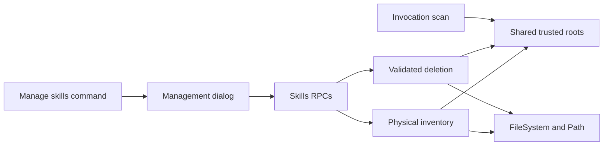

# Skill management

The gallery design is `Components → Dialogs → Manage skills`. The existing `skills` plugin provides live inventory and deletion across all discovery roots, including Liminal folders and trusted ancestors. No dependency is added.

## Architecture

Physical entries have path identity, not skill-name identity. Inventory includes overridden copies, malformed folders and dangling symlinks; invocation keeps its name precedence and existing model/tag behavior.



```text
packages/plugins/skills/
  src/contract.ts                  # Inventory schemas, deletion modes and errors
  src/server.ts                    # RPC handlers and service injection
  src/server/folders.ts            # Shared root policy and Finder dependencies
  src/server/find.ts               # Invocation scan and skill parsing
  src/server/inventory.ts          # Physical entries, targets and scan problems
  src/server/remove.ts             # Serialized snapshots and validated deletion
  src/tui.tsx                      # Manager command and slash command setup
  src/tui/commands.ts              # Refreshable, collision-aware slash commands
  src/tui/SkillsDialog.tsx         # Inventory, filter, selection and refresh
  src/tui/DeleteSkillDialog.tsx    # Cancel-first confirmation and pending guard
  src/tui/details.tsx              # Description and symlink target
  test/management.test.ts          # Inventory and deletion RPCs
  test/dialog.test.tsx             # Confirmation rendering and keyboard behavior
  test/manager-flow.test.tsx       # Filter, selection and error/retry flows
  test/fixtures.ts                 # Temporary filesystem fixtures
  test/stack.ts                    # Plugin test layers
packages/sdk/src/tui/SelectDialog.tsx # Categories, footer and external filter
apps/cli/test/select-dialog.test.tsx # Shared selector regressions
apps/cli/test/tui.test.tsx           # Slash commands and palette integration
apps/gallery/src/chat/SkillsManager.tsx # Sample management states
```

## Boundary

`src/contract.ts` defines the schema-backed types and RPCs. Existing `skills/list` and `skills/use` remain intact.

```ts
type SkillLocation =
  | { readonly _tag: "Folder" }
  | { readonly _tag: "Symlink"; readonly target: string }
  | { readonly _tag: "MissingTarget"; readonly target: string };
type ManagedSkill = {
  readonly id: string;
  readonly revision: string;
  readonly name: string;
  readonly path: string;
  readonly description: string;
  readonly location: SkillLocation;
};
type SkillFolder = {
  readonly path: string;
  readonly isGlobal: boolean;
  readonly entries: ReadonlyArray<ManagedSkill>;
  readonly problem: string | null;
};
type DeleteSkillRequest = {
  readonly id: string;
  readonly revision: string;
  readonly mode: "folder" | "symlink-only" | "symlink-and-target";
};
// skills/inventory: () => ReadonlyArray<SkillFolder>
// skills/delete: (request: DeleteSkillRequest) => void
// Both fail with SkillManagementFailed: changed | forbidden | io | partial.
```

## Inventory and deletion

```text
Inventory
  discover roots with Directories, ProjectTrust and shared foldersOf
  invalidate older snapshots before scanning
  enumerate roots without deduplicating skill names
  readLink before stat; retain dangling links
  resolve targets and parse SKILL.md with parseSkill
  return empty folders and scan problems explicitly
  retain server snapshots of root, entry and target identities

Delete
  serialize requests with inventory; accept only a current server snapshot
  consume the snapshot before filesystem changes
  recheck trust, root membership, entry identity, link text and target
  refuse stale selections, invalid modes and protected targets
  folder: remove the selected directory recursively
  symlink-only: remove the link without removing its target
  symlink-and-target: remove the resolved target, then the selected link
  retain the link if target removal fails
  report partial completion if target removal succeeds but link removal fails
  finish deletion and cleanup without interruption
```

Target deletion requires a readable skill directory with `SKILL.md`. Protected targets include filesystem roots, home/workspace directories, skill roots and ancestors containing the selected link. Explicitly confirmed skill targets outside discovery roots remain eligible. Portable path-based filesystem operations do not provide hostile-race isolation.

Production injects `FileSystem.FileSystem`, `Path.Path`, `Directories` and `ProjectTrust` through `Finder` in `server.ts`. Tests use `testBaseServices`, temporary folders and symlinks, and RPC calls through `RpcTest`; injected filesystem layers cover failure and partial-completion cases. No new public service is needed.

## Dialog behavior

- The palette has one Manage skills command; individual skills remain slash commands. Refreshing inventory rebuilds scoped slash-command registrations while preserving other plugins' command names and aliases.
- `SelectDialog` uses explicit `categories` for source folders, `trailing` for symlink status, `footer` for details and an external `filter` to retain the query. It omits `onSelect`; enter does not dismiss the browser.
- `ctrl+x` opens confirmation through `TuiDialogs`; Cancel is selected initially. Folder deletion is permanent. Valid links offer Delete symlink only and Delete symlink and target; missing targets offer only link deletion. Global entries show a global-scope warning. No extra warning appears beneath target deletion.
- Deletion freezes confirmation and blocks duplicate requests. Success and failure both refresh inventory and slash commands, retain the query and select the nearest remaining matching entry. `ctrl+r` retries loading. Descriptions appear beside names in muted, ellipsized single-line text. The manager is 90 columns wide like Sessions, capped by the terminal. Selected-link details show only the target without repeating the source folder.

## Verification

| Area | Coverage |
| --- | --- |
| Inventory | Existing discovery roots, trust, overridden copies, empty roots, malformed folders and dangling links |
| Deletion | All modes, link-only target preservation, external targets, forged/stale revisions, retargeting, trust loss, protected roots, filesystem failure and partial completion |
| Regression | Invocation precedence and exposure of a farther copy after deleting a nearer copy |
| TUI / SDK | Slash commands without palette entries, manager entry, filter and neighbor selection, Cancel default, missing-target choices, pending guard, error/retry, empty categories and footer |

Plugin requirements live in `docs/plugins/skills.md`; SDK usage lives in `docs/guides/tui.md`. Verification uses project checks and temporary test skills, not real user skills.
