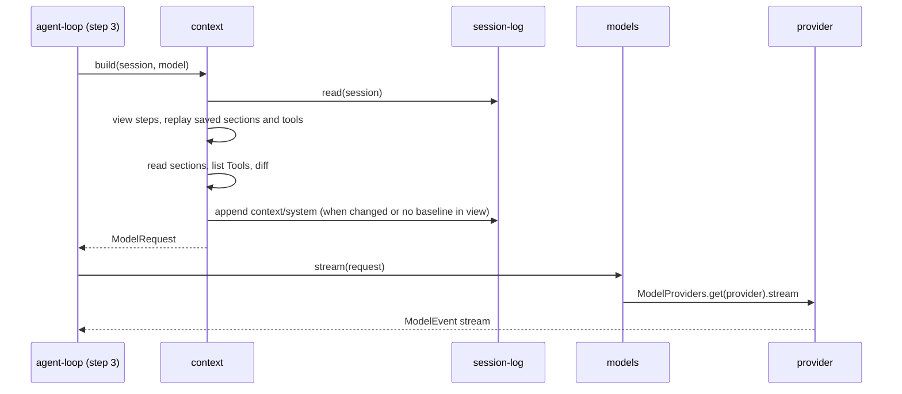

# Step 2: Round 8 changes, `models`, scripted provider, `tool-registry`, `context`

Builds step 2 of [milestones.md](../milestones.md) behind [core-contracts.md](../core-contracts.md). Proves: the scripted provider streams a reply, and `context` rebuilds the same request from a saved log.

## Round 8 changes (built)

| Piece | Change |
| --- | --- |
| `sdk/src/core/keyed-registry.ts` | New `KeyedRegistry<A>`: `register(item)`, `get(name)`, `list` (newest per name, sorted by name), `changes` |
| `session-store` contract | `saveEntries` and `lastSeq` replaced by `appendEntries(sessionId, NewEntry[])`, which numbers inside the write transaction (`BEGIN IMMEDIATE`) and returns the stored rows |
| `session-log` contract | `EntryDraft<A>` carries `entry: EntryDefinition<A>`; `draft(Def, fields)` builds one; `UnknownEntryKind` deleted; `EntryKinds` is a `KeyedRegistry` |
| `session-log` server | Write lock deleted; live watchers reread the store on each signal |

## Packages

```text
packages/sdk/src/core/
  model.ts           model seam Schemas
  session.ts         SessionId, Seq, Entry, EntryDraft, defineEntry, errors
packages/plugins/
  models/            contract.ts  ModelProvider, ModelProviders, Models, ProviderNotFound; server.ts
  model-scripted/    contract.ts  ScriptedModel control service; server.ts  provider "scripted"
  tool-registry/     contract.ts  Tool, defineTool, Tools (KeyedRegistry); server.ts
  context/           contract.ts  PromptSection, PromptSections, ViewSteps, Context, entry kinds; server/*
```

## Types at the boundaries

```ts
// session-log contract: one new part, system messages only
ModelPart |= { type: "tool-change"; change: "offer" | "withdraw"; tool: ToolSpec }

// SDK core model.ts (models contract holds ModelProvider, ModelProviders, Models, ProviderNotFound)
ModelRef        { provider: string; id: string }
ThinkingLevel   "off" | "minimal" | "low" | "medium" | "high" | "xhigh"
ToolSpec        { name; description; parameters: Json /* JSON Schema */ }
ModelTool       ToolSpec & { offered: boolean }
ModelRequest    { model; messages: ModelContent[]; tools: ModelTool[]; thinking; maxOutputTokens?; cacheKey?; providerOptions? }
ModelEvent      Start | PartStart{index, part: text | reasoning | tool-call{id, name}} | Delta{index, text} | PartEnd{index, part: ModelPart} | Finish{reason, usage}
Usage           { input; output; cacheRead; cacheWrite; reasoning }
ProviderNotFound { provider }   // Models.stream and listModels
ModelError      { reason: rate-limit | quota | auth | context-overflow | invalid-request | provider | network | empty-response; message; status?; retryAfter?; requestId? }
ModelInfo       { id; name; contextWindow; maxOutput; thinking: ThinkingLevel[]; input: ("text"|"image")[]; price? }
ModelProvider   { id; name; models: Effect<ModelInfo[], ModelError>; stream(req): Stream<ModelEvent, ModelError>; nativeToolChanges: boolean }
ModelProviders  KeyedRegistry<ModelProvider> by id
Models          { stream(req); listProviders; listModels(provider) }

// tool-registry contract
Tool            { spec: ToolSpec; offeredAtStart; hints: ToolHints; runAlongside; safeToRerun; run(params: Json, {sessionId, callId}): Effect<ToolOutput, ToolFailed> }
ToolOutput      { result: Json; details?: Json }
ToolFailed      { message; details? }   // wrong params or the tool's own failure
defineTool<S>   { name; description; parameters: Schema; hints?; offeredAtStart?; runAlongside; safeToRerun; run(params: S["Type"], ctx) } -> Tool
Tools           KeyedRegistry<Tool> by spec.name

// context contract
PromptSectionDefinition<A> { key; order; codec; read({sessionId, model}) -> present(A) | unavailable | removed; render.initial(a); render.changed(before, a); render.removed?(before) }
definePromptSection(def) -> PromptSection   // value type erased to JSON
PromptSections  KeyedRegistry<PromptSection> by key, sorted by order then key
ViewStep        (sessionId, entries) => Effect<Entry[]>
ViewSteps       Registry<ViewStep>
Context         { build(sessionId, model); preview(sessionId, model) } -> ContextRequest { model; messages; tools }
Entry kinds     context/system baseline { sections: {key, value, text}[]; tools: ModelTool[] }
                             | update { sections: (set {key, value, text} | removed {key, text})[]; tools: {offer | withdraw, ToolSpec}[] }
                context/message { label; text }, user per entry, sent as a user message (contextMessage)
```

## Call path



## Folding entries to messages

```text
the first baseline in view leads as the system prompt and declares the request's tools
then each other entry in view, in seq order -> its saved ModelContent (none: nothing)
  context/system update -> system message: changed section texts, then tool-change parts
messages with no parts are dropped
```

## Injection

| Service | Production | Tests |
| --- | --- | --- |
| `ModelProviders` entry | provider plugins (step 4) | `model-scripted` |
| `SessionStore` | `session-store` (SQLite) | in-memory store or SQLite in a temp folder |

## Deletes

- `SessionStore.saveEntries`, `SessionStore.lastSeq`, `UnknownEntryKind`, the `session-log` write lock

## Open

- `RpcGroup`s for `models` and `context` are added with the protocol server in step 5
- `Context.build` takes the model so sections can vary by model; thinking level, output limit and cache key are set by `agent-loop`
- `PromptSections` is a `KeyedRegistry` (newest build per key wins, as for tools and entry kinds), sorted by order then key; core-contracts Round 4 named the plain `Registry`
- `Tool` carries `run` so step 3's `tool-pipeline` needs no second registry; params are checked by `defineTool`, and a check failure is a `ToolFailed`
- A tool's offered state is `offeredAtStart` only; how a plugin offers a tool declared as not offered (such as `ask_question` in a `/qna` run) is settled with the first plugin that needs it
- The first baseline leads the request even when it was saved after earlier entries (the first prompt is saved before the first build); a view holding two baselines sends the first one's tools
- A section whose plugin is gone is saved as removed with no text; a saved value its codec no longer reads renders as new
- `context/message` is sent as a user message
- Shared seam types (session ids, entries, model content, model request, events and errors, `ToolSpec`) live in SDK core `model.ts` and `session.ts`, because contracts import only Effect and the SDK
- The scripted provider registers id `scripted` with one model `scripted`, `nativeToolChanges: true`; a call with no script is a defect
