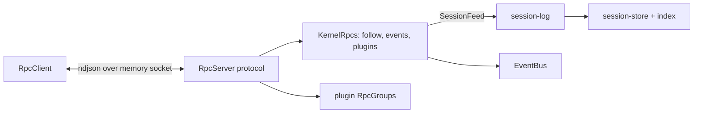
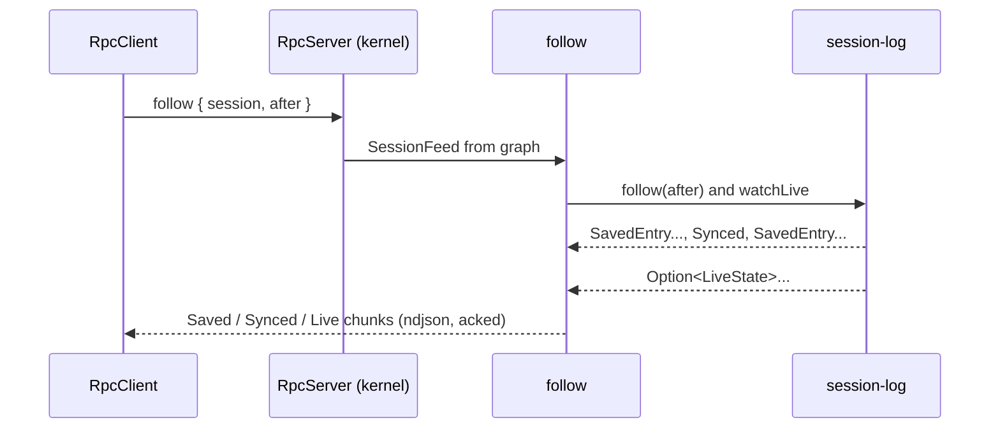

# Step 5: protocol server, event bus, session following

Builds step 5 of [milestones.md](../milestones.md) behind Round 2 of [core-contracts.md](../core-contracts.md), except the TUI on a live session, which waits for the user. Proves: a client connected over the in-memory socket follows a live session, sees saved entries, `Synced` and the live slot, calls plugin commands and receives bus events, with every message serialized as ndjson.

## Systems

| System | Change | Where |
| --- | --- | --- |
| SDK core | Adds `protocol.ts`: wire schemas, `SessionFeed`, `EventBus`, `KernelRpcs`; `Plugin` gains `rpcs` | `packages/sdk/src/core/` |
| Kernel | Adds the protocol server, the in-memory transport, session following and the bus; boot keeps each active plugin's `RpcGroup` | `packages/kernel/src/server/` |
| `session-log` | Provides `SessionFeed`; moves `Synced` and `LiveState` to the SDK; adds `SessionLogRpcs` (`create`, `list`); publishes `SessionsChanged` | `packages/plugins/session-log/` |
| `session-store` | Adds the session index and `listSessions` | `packages/plugins/session-store/` |
| `context` | Adds `ContextRpcs` (`preview`) | `packages/plugins/context/` |
| `apps/cli` | Starts the kernel, connects in memory, prints plugin states through the protocol | `apps/cli/src/main.ts` |



- Pattern: the kernel reads session-log through `SessionFeed`, a tag in SDK core, because the kernel may import only SDK core (`.fallowrc.jsonc` boundaries)
- Pattern: one `RpcServer` per graph, over the merge of `KernelRpcs` and the active plugins' groups (Effect `RpcServer.make`); step 6 feeds per-graph servers from one transport, so this server is unchanged
- Beat: one server with proxy handlers that look up the current graph per call, which cannot add a new plugin's group

## Types at the boundaries

```ts
// SDK core protocol.ts
SavedEntry = Struct{ sessionId, seq, kind, at: DateTimeUtc, data: Json, model?: ModelContent[], text, user }
Synced = TaggedClass{ seq?: Seq }                    // moved from session-log
LiveState = Struct{ kind, data: Json }               // moved from session-log
FollowEvent = Saved{ entry: SavedEntry } | Synced | Live{ live?: LiveState }
SessionFeed { follow(session, { after? }): Stream<SavedEntry | Synced, SessionNotFound | StoreError>
              watchLive(session): Stream<Option<LiveState>, SessionNotFound | StoreError> }
BusEvent = Struct{ name, data: Json }
defineEvent<A>({ name, data: Codec<A, Json> }): EventDefinition<A>
EventBus { publish<A>(event: EventDefinition<A>, value: A): Effect<void>; events: Stream<BusEvent> }   // base service
KernelRpcs = follow({ session, after? }) stream FollowEvent, error SessionNotFound | StoreError | FeedMissing
           | events() stream BusEvent
           | plugins() → PluginState[]       // Active{ name } | Inactive{ name, reason: string }
Plugin.rpcs?: RpcGroup<Rpcs>                 // server layer must provide Rpc.ToHandler<Rpcs>

// kernel
start({ folders }): Effect<Kernel, never, BaseServices without EventBus | Scope>
Kernel { connect: Effect<RpcClient.Protocol, never, Scope>; status; services }

// session-store
SessionSummary = { id, parentId: string | null, createdAt, updatedAt, lastSeq }
listSessions(): Effect<SessionSummary[], StoreError>
// session-log
SessionLogRpcs = create({ session }) | list() → SessionSummary[]
SessionsChanged = defineEvent("session-log/sessions-changed", {})
// context
ContextRpcs = preview({ session, model }) → ContextRequest
```

## Files

```text
packages/sdk/src/core/protocol.ts         wire schemas, SessionFeed, EventBus (+ PubSub layer), KernelRpcs
packages/sdk/src/core/plugin.ts           Plugin.rpcs; EventBus joins BaseServices
packages/sdk/src/testing/base.ts          testBaseServices adds EventBus.layer
packages/kernel/src/host/manifest.ts      Manifest.rpcs (optional RpcGroup)
packages/kernel/src/host/build.ts, host.ts  Booted.rpcs: active plugins' groups
packages/kernel/src/server/memory.ts      in-memory SocketServer and client sockets (Queue pairs)
packages/kernel/src/server/follow.ts      FollowEvent stream: entries then live, merged
packages/kernel/src/server/serve.ts       RpcServer.make over KernelRpcs + plugin groups
packages/kernel/src/kernel.ts             start: EventBus, boot, serve in memory, connect
packages/plugins/session-store/src/server/{migrations,queries}.ts   session_index table, index_version, listSessions
packages/plugins/session-log/src/server.ts        SessionFeed beside SessionLog; SessionLogRpcs handlers
packages/plugins/session-log/src/server/entries-log.ts   one follow loop for decoded entries and SavedEntry rows
packages/plugins/context/src/server.ts            ContextRpcs handlers
```

## Call path



```text
follow(session, after)
  feed = graph SessionFeed, else fail FeedMissing
  entries = feed.follow(session, after) mapped to Saved | Synced
  live = feed.watchLive(session) mapped to Live, started after the first Synced
  merge entries and live

session index (store)
  migration 0002 adds session_index(session_id, parent_id, created_at, updated_at, last_seq) and meta(key, value)
  on open: if meta.index_version != INDEX_VERSION: delete index, rebuild from sessions and entries, set version
  createSession, forkSession: insert index row
  appendEntries: update updated_at and last_seq inside the write transaction
```

## Tests

- `kernel/test/protocol.test.ts`: fixture plugins served in memory; a plugin RPC answers; a `Schema.TaggedError` crosses; `events` delivers a published event
- `apps/cli/test/session.test.ts`: built-in plugins; a client creates a session through `SessionLogRpcs` and follows it; the kernel's process appends a user entry and sets the live slot; the client sees `Synced`, the empty slot, the entry and the new slot; `context/preview` shows the message; `list` shows the session
- `session-store` conformance: `listSessions` after create, fork and append; the index rebuilds when its version changes

## Deletes

- `Synced` and `LiveState` in the session-log contract (now from the SDK)

## Open

- Reconnect resumes from the `after` the client sends, not a kernel record of what it sent; only the client knows what arrived
- The local socket for other clients opens with the TUI step; `serve` already takes any `SocketServer`
- Commands that start and cancel turns (the inbox plugin) come with the TUI session
- Sessions need no grace period yet: turns run in the server whether or not a client is connected
- The client session test writes from the kernel's process; a turn started by a client waits for the inbox commands
- The host recognises a manifest's `rpcs` by shape (a function with a `requests` Map and `toLayer`), since Effect's `RpcGroup` carries no runtime type id
- The server runs with `disableFatalDefects`, so a plugin handler's defect fails only that call, not the client's connection
- `kernel/plugins` sends an inactive plugin's reason as one line of text, with the pretty-printed cause for load and build failures
