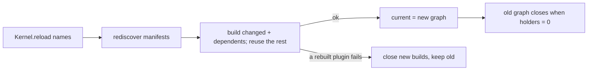

# Step 6: graph swap, supervisor, resume after restart

Builds step 6 of [milestones.md](../milestones.md) behind Round 1 of [core-contracts.md](../core-contracts.md). Proves: a graph change rebuilds a plugin and its dependents beside the running graph and swaps them in; a step in flight finishes on the old graph; a running turn resumes after the process restarts.

## Decision

The kernel holds immutable graphs by reference count. Each plugin build is shared by every graph that kept it; a graph change rebuilds only the changed plugins and their dependents. Requests, steps and kernel-held work each hold the graph current when they start. The protocol routes each request to the graph current when it arrives; session following runs on every live graph's feed and delivers each `Seq` once. Turns run as kernel-held work that reads the current graph each step; a hidden `turn-started` entry without a later `turn-ended` marks a turn to resume at boot.



## Kernel

```text
PluginBuild  { manifest, services, scope }                   closed when no graph uses it
Graph        { status, services, rpcs, builds, providers, scope, closed: Deferred }
Graphs       hold(f)          holds the current graph while f runs
             work             the Work service over the current graph
             acquire/release  holds a graph across a request
             changes          the current graph, then each one that replaces it
             reload(names)    rediscover → resolve → build aside → swap or keep
Kernel       { status: Effect, use(f), reload(names), connect }
```

- Rebuilt: named plugins, plugins whose resolution changed (new, removed, enabled, disabled, new provider), and every dependent of those, transitively. Others reuse their `PluginBuild`.
- A change fails with `ChangeFailed { failed: [{ name, reason }] }` when a plugin active in the current graph ends `ImportFailed` or `BuildFailed`; resolution reasons (`Disabled`, `MissingService`) are part of the new graph.

## Protocol routing

```text
transport Protocol ──run──► router
  Request kernel/*        → kernel server (KernelRpcs, lives with the kernel)
  Request other           → current graph's server; route (client, id) → graph, hold graph
  Ack | Interrupt         → the routed graph
  Ping                    → kernel server
  Eof | disconnect        → every server holding the client; releases its holds
  Exit sent for (client, id) → release that hold
```

Each graph serves its own `RpcGroup`s through a per-graph `RpcServer` over a virtual `Protocol` the router feeds.

`kernel/follow` follows every distinct `SessionFeed` of the graphs current since it started, each until its graph closes; a saved entry goes out only when its `Seq` is above the last sent; `Synced` goes out once.

## SDK `Work` (base service)

```ts
class Work {
  /** Runs f with tag's service from the graph current now; the graph stays open until f ends. */
  use<S, A, E>(tag: Context.Key<any, S>, f: (s: S) => Effect<A, E>): Effect<A, E | ServiceMissing>
  /** Runs task in the kernel's scope, one per key; a running key is left alone. */
  start(key: string, task: Effect<void>): Effect<void>
  /** Interrupts the task under key and waits for it. */
  stop(key: string): Effect<void>
}
```

The test harness provides a `Work` that reads services from the caller's context and forks into the test scope.

## agent-loop and session-log

```text
AgentLoop.start(session, settings)   append turn-started; Work.start("agent-loop/turn/<id>", drive)
AgentLoop.cancel(session)            Work.stop(key); append turn-ended { end: cancelled }
drive = loop: Work.use(AgentLoop, l => l.step(...)) until not Continue
        then Work.use(SessionLog, append turn-ended { end })
boot  = SessionLog.lastOfKinds([turn-started, turn-ended]) → start each turn-started
```

- `turn-started { model, thinking, maxOutputTokens? }` and `turn-ended { end }` are hidden, carry no model content.
- `session-store` gains `lastEntriesOfKinds(kinds)` (per session, the newest entry among the kinds; migration 0003 indexes `entries(kind, session_id, seq)`) and retries a busy database asynchronously like `credential-store` (`busyTimeout: 0`, every 20 ms up to 30 s).

## Supervisor

`apps/cli/src/supervisor.ts` runs `main.ts` as a child process; exit code 75 (`restartExitCode`) starts it again, any other code ends the supervisor with that code. The `liminal` bin points at the supervisor.

## Changes

- `Kernel.status` and `Kernel.services` become `status: Effect` and `use(f)`; `apps/cli` and tests move to them.
- `serve.ts` splits into the kernel server and a per-graph server (`router.ts`); `host.ts` `boot` and `Booted` are deleted, `load` resolves and the first graph builds through `makeGraphs`.

## Open

- Fresh code for edited plugin files: Bun caches each module by path, and `Bun.ModuleGraph` (experimental) gives a plugin its own `effect`; waits for the host copies of shared modules topic. `reload` rebuilds from the loaded code and picks up new plugin packages.
- Nothing calls `reload` or restarts the process yet: the dev file watcher and the kernel-change trigger come with that topic.
- A turn that stops on an error saves `turn-ended { end: stopped }` so a restart does not rerun it; nothing about the error is saved.
- Interrupting the kernel leaves running turns marked running, so a graceful restart resumes them like a crash.
- `Eof` from a client goes to every graph server holding it; the transport ends the client once the kernel server ends it.
- After a rebuild, the live slot of an older feed may still reach a follower until that feed's build closes.
- `cancel` finds a running turn by scanning `lastOfKinds` across every session.
- A defect in a turn ends its task without `turn-ended`; the turn resumes on the next boot.
- A failure while resuming turns fails the agent-loop build.
- A graph server whose plugins add no `RpcGroup`s answers non-kernel tags as unknown.
- Nothing writes `restartExitCode` yet; the kernel-change trigger comes with the dev watcher topic.
