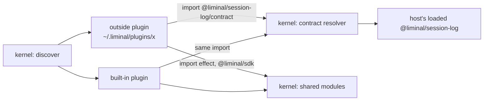

# Third-party parity

Status: built.

Lets someone outside this repository write a plugin package that imports built-in contracts, installs into a user or project folder, and loads, reloads, extends and replaces exactly as a built-in does. The built-ins become the proof: each one is packaged and depends on the others the way a third party would.

## Today

| Piece | Where | What it does now |
| --- | --- | --- |
| Plugin packages | `packages/plugins/*/package.json` | All 26 are `"private": true`; none can be published |
| Plugin-to-plugin dependencies | same files | 42 `@liminal/*` entries in `dependencies` (`workspace:*`), 0 in `peerDependencies`; a published plugin would install its own copies of other plugins |
| Host peers | same files | `effect`, `@liminal/sdk`, OpenTUI and `solid-js` are already peers (`workspace:*` or pinned) |
| Shared modules | `apps/cli/src/boot.ts` `sharedModules`, `packages/kernel/src/host/modules.ts` `serveShared` | One host instance of `effect`, `@liminal/sdk`, OpenTUI, `solid-js`, served to every graph through `Bun.plugin` `builder.module` |
| Plugin graphs | `packages/kernel/src/host/packages.ts` | Each package loads in its own `Bun.ModuleGraph`; a contract imported by two plugins loads twice, and services, registries and slots still match because they key by string |
| Plugin folders | `apps/cli/src/main.ts` | `folders: [pluginsFolder(path)]`, the repo's `packages/plugins` only; `discover` and the reload watcher already take a list |
| Anatomy check | `tools/checks/plugin-anatomy.ts` | Checks exports, `src` entries, host peers, no kernel import; says nothing about `private` or plugin dependencies |
| Toggles | `packages/kernel/src/host/resolve.ts` | Only `enabledByDefault`; no user or project config can enable, disable or replace a plugin yet |

Requirements this serves: `07-repository.md` ("Plugin contracts are published; plugins import other plugins' contracts and get the host's copy at runtime", "Built-in plugins use the same SDK and loader as third-party plugins", "Local plugin folders hot reload the same way built-ins do"); `03-plugin-model.md` (an annex is an npm, git or local package; the app supplies the built-in folder).

Prior art: DeepSeek publishes every `@deepseek-ai/dsh-*` package and extension plugins peer-depend on Service Definition packages, never on providers (`deepseek-harness/packages/README.md`, `.agents/notes/implemented/architecture/2026-06-13-capability-seams.md`). OpenCode serves its own `effect` and `@opencode/plugin` to plugins (`opencode/packages/plugin/src/runtime-modules.ts`), but its core features are not plugins, so it never faces plugin-to-plugin contracts.

## Shape



| System | Change |
| --- | --- |
| Plugin packages | Change: publishable; other plugins become peers |
| `tools/checks/plugin-anatomy.ts` | Expands: fails on `private` and on plugin dependencies outside `peerDependencies`/`devDependencies` |
| Kernel host (`contracts.ts`) | New: serves each plugin package's exports from the folder the host loaded it from |
| `apps/cli` boot | Expands: user and project plugin folders beside the built-in one |
| Tests | New: a kernel test with an outside plugin and a decoy own copy; a TUI test with a third-party plugin |

## Decision: where an outside plugin's contract import lands

**The host's loaded package, loaded into the importing plugin's own graph.** When a package is found, the kernel claims its name and registers a `Bun.plugin` `builder.module` for each of its exports other than `.`; the module is `export * from "<owner's file>"`, so each graph loads its own instance of the owner's files, as built-ins did before, and a reload of the owner reaches its dependents. The plugin's own installed copy is never read. Bun 1.4.3 never calls `onResolve` for bare imports such as `@acme/owner/contract` (spike), so `builder.module` is the hook.

Alternative: serve contracts as shared host instances, like `effect`. Rejected: a shared instance outlives a reload of the plugin that owns it.

Names are claimed in folder order before any manifest loads. Bun plugins are process-wide, so the claims are one process-wide record; a name whose owner has no loads left can move to another folder, as tests need.

## Files

```text
packages/plugins/*/package.json        no "private"; @liminal/<plugin> deps in peerDependencies ("workspace:*", packed as 0.1.0)
tools/checks/plugin-anatomy.ts         fails on "private" and on @liminal/* in dependencies or optionalDependencies
packages/kernel/src/host/contracts.ts  claimPackage: claims a package name, serves its contracts; PackageNameTaken, SharedPackageName
packages/kernel/src/host/modules.ts    exports ExportTarget, targetOf, isServedShared
packages/kernel/src/host/discover.ts   claims every fresh package in folder order, then loads them
packages/kernel/src/host/packages.ts   loadPackage releases the claim on dispose; brokenPackage
apps/cli/src/boot.ts                   pluginFolders: built-in, <global>/plugins, <project>/plugins
apps/cli/src/main.ts, reload.ts        boot and watch every existing plugin folder
packages/kernel/test/contracts.test.ts outside plugin gets the host's contract over its own copy; a taken name does not load
apps/cli/test/plugins/pins/            @acme/liminal-pins: entry kind via session-log, drawn via chat's entry slot
apps/cli/test/tui.test.tsx             pins saves a pin and the transcript draws it
```

## Types

```ts
// packages/kernel/src/host/contracts.ts
/** Claims the package name in `dir` and serves its contracts; returns the release for its load. */
export const claimPackage: (dir: string) =>
  Effect.Effect<Effect.Effect<void>, PackageNameTaken | SharedPackageName, FileSystem | Path>;
```

A refused claim makes the package one broken plugin (`ImportFailed`) in the status.

## Call path

```text
discover(folders)
  for each fresh package dir, in folder order
    claimPackage(dir)                 // owners[name] = dir; builder.module per export
  load all packages concurrently
    graph.import(plugin.ts)
      import "@liminal/session-log/contract"
        builder.module -> export * from "<owner dir>/src/contract.ts"   // in this graph
package dispose -> graph.dispose, release claim
```

## Deletes or replaces

- `"private": true` in all 26 plugin packages.
- 42 `@liminal/*` entries in `dependencies`, moved to `peerDependencies`.
- `main.ts`'s single-folder list.

## Open

- Replace and disable from outside need user and project config toggles (`03-plugin-model.md`); the kernel has only `enabledByDefault`. Next plan.
- An import of a package no plugin folder holds still resolves the importer's own copy.
- Project plugins run code from a cloned repository on start; trust stays with the "Trust boundaries" topic in `docs/status.md`.
- Installing an annex from npm or git into a plugin folder is later.
