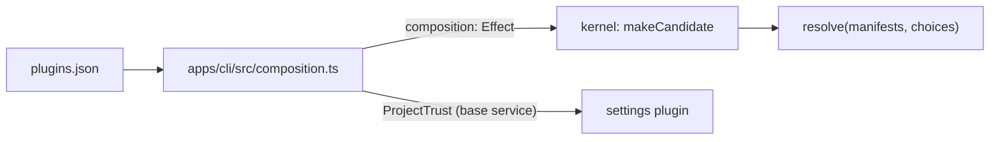

# Plugin toggles

Lets the user turn any plugin on or off and replace a built-in with another plugin, in `~/.liminal/plugins.json` or `<project>/.liminal/plugins.json`, applied as a graph change without a restart. Lets the project folder's plugins load only once the user trusts the folder.

## Round 1: architecture

### 1. A composition file, read by the host

```mermaid
flowchart LR
  comp["plugins.json<br/>global, project"] --> choices["app: readComposition"]
  choices --> kernel["kernel: resolve(manifests, choices)"]
  kernel --> graph["plugin graph"]
  graph --> settings["settings plugin<br/>settings.json sections"]
```

```jsonc
// ~/.liminal/plugins.json
{
  "plugins": { "tools-shell": false, "acme-shell": true },
  "trustedFolders": ["/Users/shane/dev/liminal"]
}

// <project>/.liminal/plugins.json, read only in a trusted folder
{ "plugins": { "agents-files": false } }
```

- `plugins.json` holds which plugins run and which folders are trusted; `settings.json` holds only plugin sections.
- The app reads it before any plugin is built; `BootOptions` gains `composition: Effect<Composition>`; tests pass a fixed value.
- `plugins` is keyed by manifest `name`; the project file overrides the global file key by key; a missing key keeps the manifest's `enabledByDefault`.
- `trustedFolders` is read only from the global file.
- The app parses it with `jsonc-parser` and writes it in place, keeping comments; a later `/plugins` dialog writes it through a kernel RPC.

### 2. Competing providers: a choice beats a default; no choice keeps the earlier folder

| Providers of one service | Result |
| --- | --- |
| One set `true`, others on by default | The one set `true` is active; the others are inactive, `Replaced { by }` |
| None chosen | The one from the earliest folder is active; the others are inactive, `Competing { service, active }` |
| Two set `true` | Both inactive, `DuplicateProvider`, as today |

### 3. Trust gates the project's plugins and choices

- An untrusted project: `<project>/.liminal/plugins/` is not loaded and the project `plugins.json` is ignored.
- Trust is the base service `ProjectTrust`, which reads and writes `trustedFolders` in the global `plugins.json`.
- The `trust` plugin asks the user to trust the folder ([trust.md](trust.md)).

### 4. A composition change is a graph change

The app watches both `plugins.json` files. `classify` turns an edit to either into a plugin change with no package reloaded: the kernel reads the composition again and resolves the loaded manifests again; the swap waits for the `TurnGate`. Trusting a folder loads its plugins the same way. `settings.json` edits never change the graph.

## Round 2: code

The app owns `plugins.json`: it reads the composition for the kernel and gives every plugin trust as a base service. The `settings` plugin reads trust from that service instead of its own section.



### sdk

```ts
// packages/sdk/src/core/jsonc.ts, moved from settings' files.ts; sdk takes jsonc-parser 3.3.1
export type JsonObject = Readonly<Record<string, Schema.Json>>;
export const parseJsonObject: (text: string) => Result<JsonObject, string>; // empty text is {}
export const editJson: (text, path: ReadonlyArray<string>, value: Schema.Json | undefined) => string;

// packages/sdk/src/core/composition.ts
export class CompositionInvalid extends Schema.TaggedError("CompositionInvalid", { file, message })
export class CompositionWriteFailed extends Schema.TaggedError("CompositionWriteFailed", { file, message })
/** A base service: whether the user trusts the workspace, and trusting it. */
export class ProjectTrust extends Context.Service<ProjectTrust, {
  readonly trusted: Effect<boolean, CompositionInvalid>;
  readonly trust: Effect<void, CompositionInvalid | CompositionWriteFailed>;
}>()("liminal/sdk/ProjectTrust") {}
```

- `BaseServices` gains `ProjectTrust`; `testBaseServices` gives an in-memory one, untrusted until `trust` runs.

### kernel

```ts
// packages/kernel/src/kernel.ts
export interface Composition {
  readonly folders: ReadonlyArray<string>;           // plugin folders, earliest first
  readonly choices: ReadonlyMap<string, boolean>;   // plugin name to on or off
}
BootOptions { composition: Effect<Composition, CompositionInvalid>; shared; parts; reload? }  // `folders` removed
ReloadOptions gains pluginFolders (every folder that may load, watched) and compositionFiles
```

- `makeCandidate` reads `composition` on every build; `load(composition, reuse)` discovers `composition.folders` and calls `resolve(manifests, composition.choices)`.
- `start` fails with `CompositionInvalid` when the first read fails; a later failed read fails the check, and the current graph stays.
- `discover` sorts package folders inside each folder, so "earliest" is stable.

```ts
// resolve.ts
enabled(plugin) = choices.get(plugin.name) ?? plugin.enabledByDefault
off -> Disabled({ by: choices.has(name) ? "choice" : "default" })
per service with several enabled providers:
  chosen = providers set true
  chosen.length > 1  -> every provider DuplicateProvider({ service, plugins: chosen }); no provider
  chosen.length == 1 -> it provides; others Replaced({ service, by })
  none chosen        -> first in discovery order provides; others Competing({ service, active })
```

- A plugin that loses one service and is picked for another stays inactive; its dependents get `DependencyInactive`, as today.

```ts
// reload/changes.ts
classify: a file in compositionFiles, or in a plugin package -> Plugins({ packages }), packages may be empty
```

- `runCheck` skips the typecheck when no package changed; `prepare` with no packages re-reads the composition and keeps every build whose inputs did not change.

### app

```ts
// apps/cli/src/composition.ts
const PluginsFile = Schema.Struct({ plugins: Record(String, Boolean) = {}, trustedFolders: Array(String) = [] })
export const compositionFiles: Effect<{ global; project }, never, Path | Directories>
export const readComposition: Effect<Composition, CompositionInvalid, FileSystem | Path | Directories>
  // project file and <project>/plugins read only when trustedFolders (global) holds the workspace
export const projectTrust: Layer<ProjectTrust, never, FileSystem | Path | Directories>
  // trust adds the workspace to the global trustedFolders with editJson, one write at a time
```

- `boot.ts` `pluginFolders` becomes every folder that may load; `main.ts` passes `composition: readComposition` and provides `projectTrust` with `Directories`.
- `reload.ts` also watches `<global>` and `<project>` without recursion, for the two `plugins.json` files.

### settings

- `Settings` loses `projectTrusted` and `trustProject`; the server reads `ProjectTrust.trusted`, a failure becoming `SettingsInvalid`.
- `files.ts` keeps `merge` and `mergeSection`; parsing and editing come from the sdk; the package drops `jsonc-parser`.

### Tests

- kernel: `resolve` cases for `Replaced`, `Competing`, two choices and an off choice; a reload test where a `plugins.json` edit turns a plugin off with no package reloaded.
- app: `readComposition` with and without trust, and `trust` keeping comments.
- settings: trust through `ProjectTrust`.

## Deletes or replaces

- `BootOptions.folders` is replaced by `composition`.
- `InactiveReason.Disabled` covers off by default and off in `plugins.json`; its text names which.
- `DuplicateProvider` applies only to two explicit choices.
- `settings` plugin: `OwnSection.trustedFolders`, `projectTrusted` and `trustProject` are replaced by `ProjectTrust` and the global `plugins.json`.
- `pluginFolders` no longer decides what loads; the composition does.

## Open

- A `/plugins` dialog to list, toggle and replace plugins: after this plan, designed in the gallery first.
