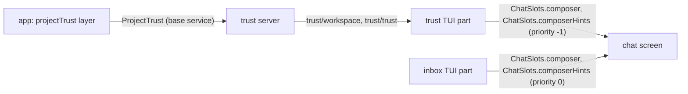

# Trust prompt

In an untrusted workspace, a prompt takes the composer's place and asks the user to trust the folder. Trust saves the folder in the global `plugins.json`; "not now" brings the composer back for the rest of the run. Requirements are in [03-plugin-model.md](../../requirements/03-plugin-model.md).

## Shape

A new plugin `trust` owns the prompt. Its server reads and writes trust through the `ProjectTrust` base service; its TUI part takes chat's composer slot while the workspace is untrusted and unanswered.



- Trusting writes the global `plugins.json`. The app already watches it, so the project's plugins and `plugins.json` load as a plugin graph change; project settings apply on the next read, since `settings` reads trust on each call.
- The "not now" answer is TUI-only state kept with `host.keep`, so it survives reloads and restarts in the same run and is gone at the next launch.

## Changes

### Subfolder trust (app)

`readComposition` and `projectTrust` match the workspace exactly today. Both use one helper instead:

```ts
/** Whether `workspace` is `folder` or inside it. */
const isWithin = (path: Path.Path, folder: string, workspace: string) => {
  const relative = path.relative(path.resolve(folder), workspace);
  return relative === "" || (!relative.startsWith("..") && !path.isAbsolute(relative));
};
const trustedIn = (path, folders, workspace) => folders.some((folder) => isWithin(path, folder, workspace));
```

`trust` skips the write when a trusted folder already covers the workspace.

### Chat: composer hints follow the composer

The composer's key hints must change with whoever holds the composer, or inbox's `enter send` shows under the prompt. Chat gains a chain slot drawn first in the hints row:

```ts
/** The composer's key hints, first in the hints row; the first registration whose `select` matches. */
composerHints: Slot.chain<TurnProps, true, "session">("chat/composer-hints", { scope: "session" }),
```

- `ChatScreen` draws `<SlotView of={ChatSlots.composerHints}>` before `<SlotView of={ChatSlots.hints}>` in the same row.
- inbox registers its hints on `composerHints` at priority 0, `select: () => true`, in place of `ChatSlots.hints`. `cancel` stays on `ChatSlots.hints`.

### Plugin `trust`

```text
packages/plugins/trust/
  package.json      @liminal/trust, peers: chat, sdk, effect, solid-js, @opentui/*
  plugin.ts         provides [], requires [], rpcs TrustRpcs, server, tui
  src/contract.ts   TrustState, TrustRpcs
  src/server.ts     RPCs over ProjectTrust and Directories
  src/tui.tsx       composer and hints registrations
  src/tui/TrustPrompt.tsx
  test/trust.test.ts
```

```ts
// contract.ts
export const TrustState = Schema.Struct({ workspace: Schema.String, trusted: Schema.Boolean });
export class TrustRpcs extends RpcGroup.make(
  Rpc.make("trust/workspace", { success: TrustState, error: CompositionInvalid }),
  Rpc.make("trust/trust", { error: Schema.Union([CompositionInvalid, CompositionWriteFailed]) }),
) {}

// server.ts
export const layer = TrustRpcs.toLayer(Effect.gen(function* () {
  const trust = yield* ProjectTrust;
  const { workspace } = yield* Directories;
  return TrustRpcs.of({
    "trust/workspace": () => Effect.map(trust.trusted, (trusted) => ({ workspace, trusted })),
    "trust/trust": () => trust.trust,
  });
}));
```

TUI part:

```ts
const answered = host.keep("answered", Schema.Boolean, () => false);   // "not now" or trusted, this run
const [isAnswered, setAnswered] = createSignal(answered.get());
const state = bridge.watch(Stream.fromEffect(client["trust/workspace"]()).pipe(Stream.map(Option.some)), Option.none());
const asking = () => !isAnswered() && Option.exists(state(), (each) => !each.trusted);
const select = () => (asking() ? true : undefined);

answer(trusted):  trusted ? run trust/trust → onSuccess setAnswered, onFailure setProblem(message)
                          : setAnswered
host.register(ChatSlots.composer, { select, priority: -1 }, makePrompt(deps));
host.register(ChatSlots.composerHints, { select, priority: -1 }, TrustHints);
```

Until `trust/workspace` answers, the composer shows; a failed read logs and leaves the composer.

`TrustPrompt`: the composer's raised surface holding "Trust this folder?", the workspace path in the accent color, and a muted line: "Trusting it loads the settings and plugins in its `.liminal/`, which can run code. Its subfolders are trusted too." A failed write shows its message in the danger color. Enter trusts, esc answers "not now"; both bindings are off while a dialog is open. Hints: `enter trust • esc not now`.

### Gallery

`apps/gallery/src/chat/TrustPrompt.tsx`, its own component, with states "Asking" and "Couldn't save" under Components, Chat.

## Tests

- `packages/plugins/trust/test/trust.test.ts`: `trust/workspace` reports untrusted with the workspace; after `trust/trust` it reports trusted.
- `apps/cli/test/composition.test.ts`: a trusted parent folder trusts the workspace; a sibling with a shared prefix (`/a/b` and `/a/bc`) does not; `trust` under a trusted parent writes nothing.
- `apps/cli/test/tui.test.tsx`: existing tests boot trusted (base services with trust applied); new tests boot untrusted: the prompt shows instead of "Ask anything"; esc brings the composer back; enter trusts and brings the composer back.
- `apps/cli/test/restart.test.ts`: the active plugin list gains `trust`.

## Docs

- `docs/plugins/trust.md`, and a row in `docs/plugins/_index.md` under Settings.
- `docs/plans/toggles.md` Open item removed.
