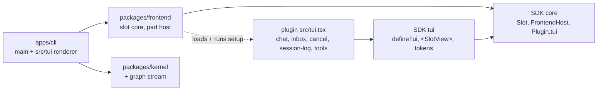
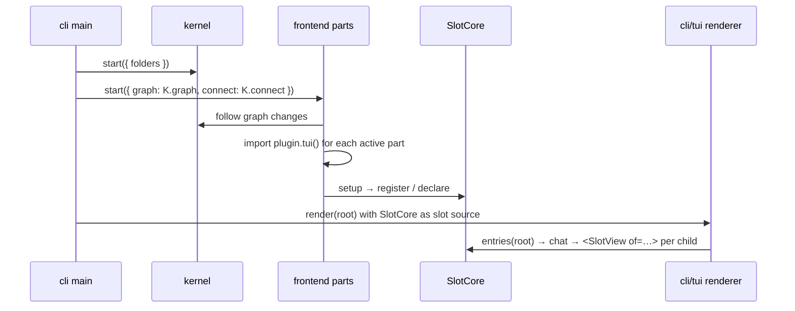

# TUI session

`liminal` opens a chat screen on a live session. You type a prompt, watch the reply and its work rows stream in, steer or queue follow-ups while a turn runs, and press Esc to cancel. Every part of the screen is a plugin UI part registered into the slot tree. When the kernel swaps its graph, the matching UI parts reload in place.

This finishes milestone step 5 ("TUI on a live session"). Agreed requirements: [05-frontends](../../requirements/05-frontends.md), [06-tui-design](../../requirements/06-tui-design.md), [07-repository](../../requirements/07-repository.md).

## Systems



| System | Change |
| --- | --- |
| `packages/kernel` | Expands: `Kernel.graph` streams the active plugins and their build numbers; `kernel/graph` does the same over the protocol |
| SDK core (`packages/sdk/src/core`) | Expands: `Slot` handles, `FrontendHost<Component>`, `Plugin.tui` |
| SDK `tui` (`packages/sdk/src/tui`, new code) | Adds: `defineTui`, `TuiHost`, the Solid `<SlotView>` element, tokens, primitives, ornament (copied from the gallery) |
| `packages/frontend` | New: the renderer-free slot core and the host that loads and reloads UI parts |
| `apps/cli/src/tui` | New: the OpenTUI renderer and keymap; `main.ts` launches it in place of printing plugin states |
| `chat` plugin | New: frame (header, transcript, live tip), work folding, chat slots |
| `inbox` plugin | New: composer, sending, steering and follow-up queue |
| `cancel` plugin | New: `cancel/turn` RPC and the Esc binding |
| `agent-loop` | Expands: owns the `agent-loop` settings section (`model`, `thinking`, default `medium`) and exposes `defaults` (fails `NoDefaultModel` or `DefaultsInvalid`); a `src/tui.tsx` draws its live kinds `agent-loop/reply` and `agent-loop/retry` |
| `Plugin` | Expands: `server` is optional; `definePlugin` requires it once the plugin provides a service or serves a command, so UI-only `chat` has none |
| `session-log`, `tools-file`, `tools-shell` | Expand: a `src/tui.tsx` that draws their entry kinds and tool rows |

**Pattern.** Slots use claim-by-declaration composition (DeepSeek `ui-slots`). The alternative was OpenTUI's own `SlotRegistry` (`@opentui/core` `plugins/registry`): it has flat named slots with `append`/`replace`/`single_winner` modes. It has no declaration ownership, keyed or chain kinds, or scopes, and it needs a `CliRenderer`, so it cannot be renderer-free.

## Shape

| Area | Shape |
| --- | --- |
| User input | `inbox` owns the composer and all sending: idle → append `session-log/user` and `AgentLoop.start`; running → queue a steer (drained by a before-call hook) or a follow-up (drained by a turn-ending hook) |
| Turn defaults | `agent-loop` section `{ model, thinking }`, read by `AgentLoop.defaults`; the composer's model line reads it over `agent-loop/defaults` |
| Which UI parts load | In process, `Kernel.graph` streams `{ name, build, plugin }` for each active plugin; on the wire, `kernel/graph` sends `{ name, build }` |
| Queued input | Kept in memory, lost on restart; shown through `inbox/queue`, a stream |
| Inbox ordering | One lock covers sending and both hooks. Steers left when the turn would end join the follow-ups. Input sent once the turn-ending hook found nothing waits for the turn's end entry, then starts the next turn; a new turn saves anything still queued before the new text |
| Components and Effect | `makeBridge` (SDK tui) runs a part's commands and reads streams as Solid signals, in the part's Scope |
| Opened session | `chat` picks it: the most recent from `session-log/list`, or a new one |
| Composer takeover | `chat/composer` is a chain slot: `inbox` registers at priority 0 and always matches; `questions` later registers lower and matches while a form is open (DeepSeek's `conversation.composer` chain) |

## Files

```text
packages/sdk/src/core/slot.ts          Slot handles, kinds, scopes, SlotConflict, SlotUndeclared
packages/sdk/src/core/frontend.ts      FrontendHost<Component>, FrontendPart, SessionState
packages/sdk/src/core/plugin.ts        + tui?: () => Promise<{ default: FrontendPart }>
packages/sdk/src/tui/                  defineTui, TuiHost, <SlotView>, makeBridge, tokens/, ornament/ (moved from the gallery, which imports them)
packages/frontend/src/core.ts          SlotCore: declare, register, collapse, entries, subscribe
packages/frontend/src/parts.ts         loads parts per graph build, runs setup in a scope, re-runs dropped registrants
packages/frontend/src/connect.ts       one kernel connection and RpcClient per part
packages/kernel/src/kernel.ts          + graph stream (from Graphs.changes)
packages/sdk/src/core/protocol.ts      + kernel/graph rpc
apps/cli/src/tui/                      render root, keymap, slot source context
apps/cli/src/main.ts                   starts kernel + frontend + renderer
packages/plugins/chat/                 plugin.ts, src/{contract,tui}.tsx, test/
packages/plugins/inbox/                plugin.ts, src/{contract,server,tui}, test/
packages/plugins/cancel/               plugin.ts, src/{contract,server,tui}, test/
```

## Types at the boundaries

```ts
// SDK core
type SlotKind = "single" | "list" | "keyed" | "chain"
type SlotScope = "root" | "session"
interface Slot<K extends SlotKind, S extends SlotScope, Owner, Extra = never> { readonly name: string; readonly kind: K; readonly scope: S }
Slot.single<Owner>(name, { scope }) · Slot.list<Owner>(…) · Slot.keyed<Owner, Meta>(…) · Slot.chain<Owner, Matched>(…)
type RegisterOptions<S> = single: { priority? } | list: { id, order?, priority? } | keyed: { key, meta: Meta, priority? } | chain: { select: (owner) => Matched | undefined, priority? }
class SlotConflict extends Schema.TaggedError { slot, cell, priority, holder }
class SlotUndeclared extends Schema.TaggedError { slot }

interface FrontendHost<Component> {
  register<S>(slot: S, options: RegisterOptions<S>, component: Component, declares?: ReadonlyArray<Slot.Any>): Effect<void, SlotConflict | SlotUndeclared, Scope>
  client<R>(group: RpcGroup<R>): Effect<RpcClient<R | KernelRpcs>, never, Scope>
  follow(session: SessionId): Stream<FollowEvent, FollowError>
  sessionState<A>(initial: () => A): SessionState<A>     // one A per session id, kept by the host
}

// SDK tui
type TuiHost = FrontendHost<SolidComponent>
defineTui({ setup: Effect<void, E, TuiHost | Scope> }): FrontendPart
<SlotView of={handle} cell?={key} owner={…} fallback?={…} />   // props: Owner & { sessionId } when session-scoped & { matched } on chain

// chat contract
ChatSlots.header   = Slot.list<{}>("chat/header", { scope: "root" })
ChatSlots.entry    = Slot.keyed<{ entry: SavedEntry }, {}>("chat/entry", { scope: "session" })
ChatSlots.tool     = Slot.keyed<{ call; result? }, { fold: (call) => WorkRow }>("chat/tool", { scope: "session" })
ChatSlots.live     = Slot.keyed<{ live: LiveState }, {}>("chat/live", { scope: "session" })
ChatSlots.composer = Slot.chain<{ running: boolean }, true>("chat/composer", { scope: "session" })
type WorkRow = { group: string; verb: string; target: string; detail?: string; failed: boolean }
```

## Call path



```text
on graph change(next):
  for each part whose build changed or that left: close its scope   // disposes registrations, collapses declared slots
  for each part that is new or rebuilt: open a scope, run setup
  after each declaration: re-run setup of parts whose entries that slot dropped

register(slot, options, component, declares):
  fail SlotUndeclared unless slot is declared
  fail SlotConflict if the cell holds the same priority
  fail SlotConflict if a declared child is already declared
  add the entry, sorted by priority (list: then order); declare children
  on scope close: remove the entry; collapse each declared child, recording who it dropped
```

## Injection and tests

| Piece | Production | Tests |
| --- | --- | --- |
| Slot core | `packages/frontend` | Pure tests: kinds, conflicts, collapse, re-run (prior art: OpenCode `structure.ts` tests) |
| Part host | `Kernel.graph`, `Kernel.connect` | Kernel booted on test folders with `model-scripted`; swap via `reload` |
| Renderer | `render` (`@opentui/solid`) | `testRender` frames: prompt → streamed reply → folded work rows → cancel |
| Inbox | `AgentLoop` hooks | scripted provider gate: steer lands after the tool round, follow-up starts the next turn |

## Replaces

- `apps/cli/src/main.ts` printing plugin states is replaced by the TUI launch
- The `steering` catalog row: `inbox` covers steering
- The milestone step 5 row's TUI cell points here

## Open

- Code hot reload (re-importing changed files) is not built in the kernel or the frontend; graph swaps re-run setup with the same module; [reload.md](../reload.md) plans reload at turn end
- Session picker and new-session flow: the first session opens the most recent session or creates one
- Tokens, ornament, `Hints`, `Tail` and the markdown style moved from the gallery into `@liminal/sdk/tui` rather than copied; the gallery imports them, so fallow sees no duplicates
- Entry kinds of `session-log` and live states of `agent-loop` are drawn by `chat` (`src/tui/entries.tsx`, `src/tui/live.tsx`), not by their own plugins, so neither depends on `chat`
- The Solid slot element is `SlotView`, apart from the SDK core `Slot` handles
- `FrontendPart.setup` fails with `Cause.YieldableError`; each plugin's own tagged errors
- Each UI part opens its kernel connection on first use through `host.client` or `host.follow`
- `cancel`'s Esc binding lives in its own UI part; the composer does not know about `cancel`
- Composer keys: enter sends as a steer while a turn runs, tab queues a follow-up
- Hint groups are separated by a gap, not `•`
- The live reply drops finished parts once they are saved
- A tool call with no `chat/tool` registration shows its tool name
