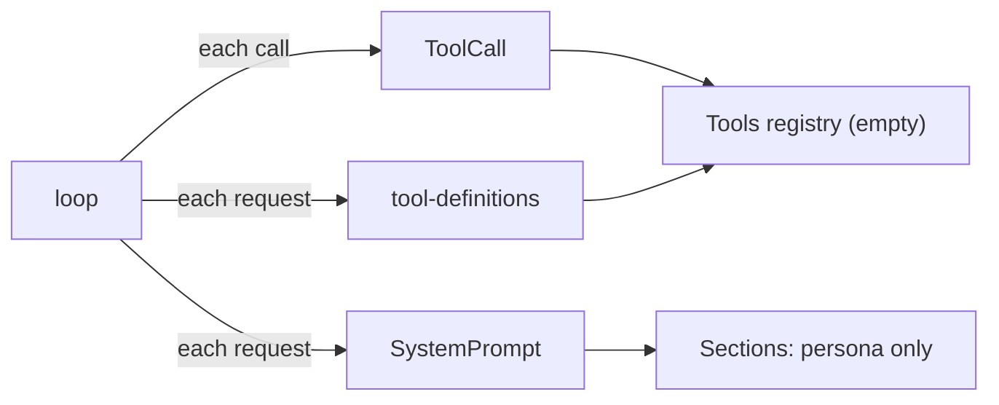
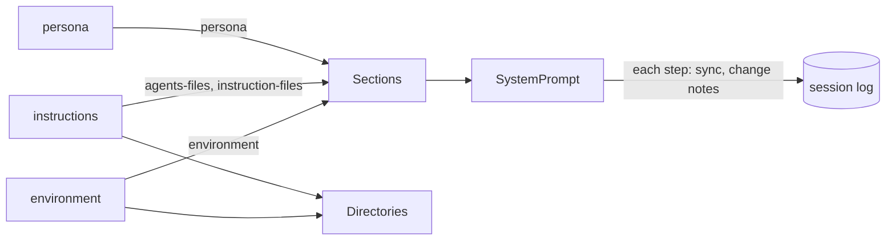
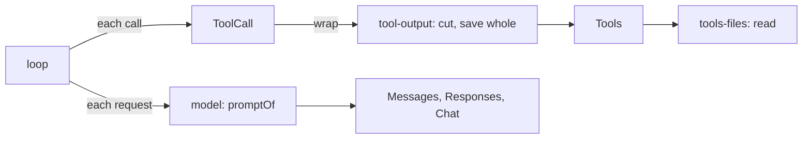
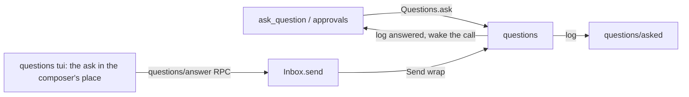
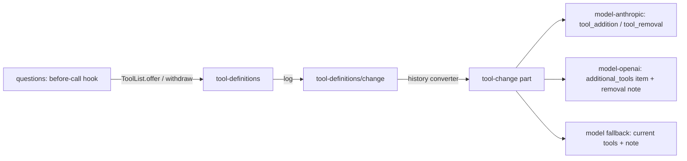
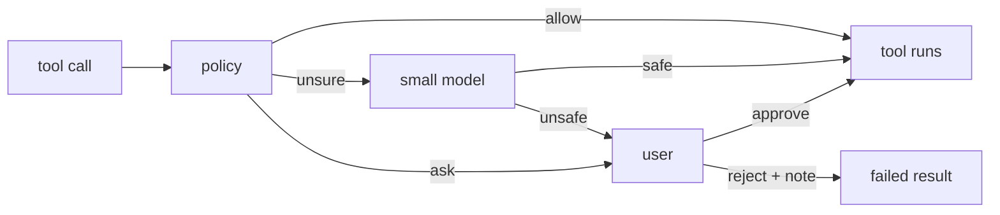

# Plan: milestone 3, the coding agent

Tools that read, edit and run things, the prompt that tells the model where it is, and the questions and approvals that keep the user in charge. Work list: [plugins/coding.md](../plugins/coding.md).

## Systems

| System | Change |
| --- | --- |
| `packages/plugins/tools-files` | Adds `read`, `edit`, `write` |
| `packages/plugins/tools-shell` | Adds `shell` and background processes |
| `packages/plugins/tools-web` | Adds `websearch`, `webfetch` |
| `packages/plugins/tool-output` | Adds a `ToolCall` wrap that cuts large results and saves the whole output |
| `packages/plugins/instructions`, `environment` | Adds prompt sections: the base prompt, `AGENTS.md`, `.liminal/instructions/`, workspace facts |
| `packages/plugins/questions`, `approvals` | Adds questions as events and answers as inputs; a `ToolCall` wrap that asks before risky calls |
| `model` contract | Changes `ToolResult`: text and image parts, not only JSON |
| `tools` contract | Expands `Tool` with hints (read-only, destructive) and `ToolContext` with progress |
| `chat` | Expands: diffs for edits, shell output as it runs, the question in the composer's place |
| `.liminal/`, `docs/instructions/` | Recreates `.liminal/`; moves the instruction files into it with `read-when` front matter |
| Database | Settles the schema; a later change adds a migration |

## Today



`tools`, `tool-definitions` and `loop` already run calls, save results and send the tool list; no plugin adds a tool. `system-prompt` has one section, `persona`.

## Build order

```text
1. instructions, environment       prompt sections; .liminal/ and docs/instructions/ move
2. tools-files read, tool-output   ToolResult gains text and image parts
3. questions                       questions as events, answers as inputs
4. tools-shell, tools-processes    ToolContext gains progress; output as it runs; shell lists found tools (rg, jq); processes on a pseudo-terminal
5. approvals                       Tool gains access; asks before risky calls; shell joins the CLI with it
6. tools-read, tools-edit,         tools-files splits one plugin per tool; diffs in chat
   tools-write
7. tools-web                       websearch, webfetch
8. Liminal on its own repository; settle the database schema
```

- Nothing that changes files or runs commands exists before the user can approve it. Pi runs every call with the process's permissions and leaves confirmation to extensions that read MCP-style hints (`readOnlyHint`, `destructiveHint`; Pi `docs/extensions.md`); OpenCode (`core/src/permission`) and Crush (`internal/permission`) ask before risky calls.
- Each tool is its own plugin, so one can be swapped, such as an OpenAI patch tool for `edit` and `write`. `tools-files` splits into `tools-read`, `tools-edit` and `tools-write` before `edit` and `write` are built.
- Each contract change lands with its first user: content parts with `read`, `access` with `approvals`, progress with `shell`. Their shapes come from the code that needs them.
- Size guide from the previous code: `tools-read`, `tools-edit` and `files` about 700 lines; `tools-shell`, `command-runner`, `shell-safety` and `processes` about 2,900; `tools-web` 800; `tool-output` 260; `approval` 1,900; `questions` 2,100; `agents-files`, `instruction-files` and `environment` 1,150.

## Step 1: prompt sections



The system prompt, in order:

| Order | Section | Plugin | Text |
| --- | --- | --- | --- |
| -100 | `persona` | `persona` | `You are Liminal…`, `<communication>`, `<discussion>`, and now `<execution>` |
| 0 | `agents-files` | `instructions` | Each `AGENTS.md` in `<instructions path="…">`, most shared first |
| 10 | `instruction-files` | `instructions` | The `always: true` files' text, then `<instruction_files>`: one intro line and `` - `path`: situation `` per `read-when` file |
| 100 | `environment` | `environment` | `<environment>`: workspace, Git branch or none, platform, date, the workspace root's entries |

Stable text first and per-day text last, so sessions in one repository share the longest prompt prefix.

### Where each piece comes from

| Piece | Read from | References |
| --- | --- | --- |
| `<execution>` | Copied from `archive/packages/plugins/system-prompt/src/server/base.ts` into `persona`; `<reminders>` dropped, nothing sends reminders | Pi `core/system-prompt.ts` keeps rules in its base prompt |
| `AGENTS.md` | `~/.agents/AGENTS.md`, `~/.liminal/AGENTS.md`, then each folder from the repository root down to the workspace; outside a repository, the workspace only | OpenCode `config/plugin/instruction.ts` walks up to the worktree root; Pi `core/resource-loader.ts` walks to the filesystem root |
| Instruction files | `.md` files in `~/.liminal/instructions/` and `<workspace>/.liminal/instructions/`; a project file replaces a global one of the same name | `archive/packages/plugins/instruction-files`; Pi lists skills by path and description for the model to read |
| Environment | `Directories`, `process.platform`, `process.arch`, the clock; the root's entries from `git ls-files` in a repository (what Git ignores left out), else the folder's visible names; capped at 200 lines | Crush `templates/coder.md.tpl` `<env>`; `archive/packages/plugins/environment` |

- An instruction file's front matter is `always: true` or `read-when: <situation>`.
- Instruction files are Liminal's way to give the model instructions. Reading `AGENTS.md` is opt-in: `{ "instructions": { "agentsFiles": true } }` in the global or project `settings.json`, read on each step; off by default. When off, the `agents-files` section is empty and left out.
- A file without valid front matter, and any `AGENTS.md` or instruction file that fails to read, is left out with a warning notice in the session.
- Sections read the files again on every step; `system-prompt` already turns a changed section into a change note.
- Nothing is gated on a trusted workspace yet; Pi and OpenCode read `AGENTS.md` without asking. Trust arrives with `loader`.

### Contract change: `Section`

A notice needs a session, so a section's text is read for one.

```ts
interface Section {
  name: string
  text: (session: SessionId) => Effect<string>
}
```

`SystemPrompt.sync` and `fold` already have the session and pass it; `persona` ignores it.

### Contract change: `Directories`

`AGENTS.md` and `environment` both need the repository root, and `environment` needs the branch the sidebar already reads.

```ts
interface Directories {
  global: string
  workspace: string
  project: string
  /** The folder holding `.git`, found once at start by walking up from the workspace. */
  repository: Option<string>
  /** The checked-out branch, or a short commit id; read on each call. */
  branch: Effect<Option<string>>
}
```

`directories/workspace` reads `branch` too, so a workspace in a subfolder of a repository shows its branch.

### Moving `docs/instructions/`

```text
docs/instructions/*.md  ->  .liminal/instructions/*.md   (git mv; front matter from the AGENTS.md table)
```

- Each file gains `read-when:` with the text of its row in the `AGENTS.md` table.
- The `AGENTS.md` table stays, with the new paths, for agents that read only `AGENTS.md`. Liminal leaves `AGENTS.md` off here and reads the front matter instead. Revisit at step 8.
- Links in `AGENTS.md`, `docs/_index.md`, `docs/status.md`, `docs/plans/` and the instruction files themselves change to the new paths.
- Exact text for `AGENTS.md` and the instruction files goes to the user before the edit.

The shell line in `environment`, and the command-line tools found on the machine, land with `tools-shell`.

## Step 2: read and tool output



### Contract change: results are text and images

```ts
// model contract
ToolResult = { type: "tool-result"; callId; name; content: Array<Text | Image>; isFailure; loads? }
// tools contract
interface ToolOutput { content: ReadonlyArray<Text | Image>; loads?: ReadonlyArray<string> }
```

- `content` replaces `result: Json`. A failure is one text part. Pi (`ai/src/types.ts`) and OpenCode (`tool/plugin/read.ts`, `toModelContent`) use the same shape.
- Provider plugins do not change. Effect AI 4.0.5 sends a tool result only as a string on all three wires (`AnthropicLanguageModel.ts` `tool_result.content`, `OpenAiLanguageModel.ts` `function_call_output.output`, compat `role: "tool"`). So `model`'s `promptOf` sends the text parts as the result and puts a run of results' images in one user message after the run, as Pi does for Chat Completions (`api/openai-completions.ts`, "Attached image(s) from tool result"). One message after the run, not one per result: Chat Completions refuses a user message between tool messages. Anthropic's encoder folds it into the same user turn (`groupMessages`).
- For a model whose catalog details say no images, `promptOf` leaves images out and says so in the result's text, as Pi's `read` notes (`getNonVisionImageNote`). `call.ts` already has the details and passes them in.
- Logged results change shape, so the database is reset when this lands.

| Builds a result today | Change |
| --- | --- |
| `tools/src/index.ts` (run, failed) | `content` from `ToolOutput`; failures as one text part |
| `loop/src/recovery.ts` (stand-ins, cancelled) | Reason as one text part |
| `model/src/prompt.ts` | As above |
| `chat/src/view/index.ts` | Reads only `isFailure`; no change |

### `read` in `tools-files`

| Behaviour | Liminal | Pi `tools/read.ts` | OpenCode `read.ts`, `read-filesystem.ts` | Crush `view.go` |
| --- | --- | --- | --- | --- |
| Params | `path`, `offset` (from 1), `limit` | same | same | same |
| Page | 2,000 lines or 50 KB, footer included | 2,000 / 50 KB | 2,000 / 50 KB | 200 lines, 200 KB file cap |
| Line numbers | `12: text` | none | `12: text` | `12\|text` |
| More follows | `[lines 1-2000 of 5120; read on with offset 2001]` | same idea | same idea | same idea |
| Long line | cut at 2,000 characters | no | 2,000 | 2,000 |
| Binary | NUL in the first 8 KB fails the call | no check | fails the call | |
| Images | PNG, JPEG, GIF, WebP by their first bytes; over 5 MB as base64 fails | resizes (`processImage`) | 5 MB, 2000×2000 limit (`image.ts`) | sniffs type |
| Folder | sorted entries, `/` after folders | separate `ls` | entries, paged | separate `ls` |
| Path | any path, relative to the workspace or absolute; `approvals` decides later whether outside paths ask | anywhere | asks outside the workspace | |

- Line numbers let the model point at lines and match `edit` later; the description says the prefix is not part of the file, as OpenCode's does.
- No resizing: Pi's needs an image library. Resizing and PDFs go under Later.
- `tags` already pages a file for `@` (`windowOf`, 2,000 lines, 50 KB) and spots binaries (`isBinary`). Both move to `tools-files/contract` as `pageOf` and `isBinary`; `tags` imports them, so an `@` file reads the same as `read`. `read` is the base way to see a file and `tags` builds on it, so the import runs that way.

### `tool-output`

A `ToolCall` wrap. When a result's text is over 2,000 lines or 50 KB, the model gets the first and last halves and a line between them:

```text
[Output cut: 12,480 lines, 1.2 MB. Whole output: ~/.liminal/tool-output/<session>/<call>.txt; read it with offset.]
```

| Choice | Liminal | Reference |
| --- | --- | --- |
| Kept | first and last halves: the start says what ran, the end holds the error | `archive/packages/plugins/tool-output` (halves); OpenCode `tool-output.ts` keeps the head; Pi's `bash` keeps the tail |
| Limits | 2,000 lines or 50 KB | OpenCode, Pi |
| Whole output | `<global>/tool-output/<session>/<callId>.txt`, folder `0700`, file `0600`; folders older than 7 days removed at start | OpenCode keeps 7 days in its data folder; the archive used a temp folder |
| Images | passed through | OpenCode |
| Failures | cut the same way | archive |

`read` pages within the same limits, so its results pass through uncut. No contract until a second plugin needs the cut.

### No `grep` or `find` tools

The model searches files through `shell` (step 6). `environment` then lists the command-line tools found on the machine that the model should use, such as `rg` and `jq`, beside the shell line. Pi, OpenCode and Crush ship separate search tools; Liminal does not. Until step 6, the model finds files through `read` on folders and the root listing in `environment`.

### Files

```text
packages/plugins/model/src/contract.ts      ToolResult.content
packages/plugins/model/src/prompt.ts        results as text; images after the run; none for models without images
packages/plugins/model/src/call.ts          passes details to promptOf
packages/plugins/tools/src/contract.ts      ToolOutput.content
packages/plugins/tools/src/index.ts         content and text failures
packages/plugins/loop/src/recovery.ts       stand-ins as text
packages/plugins/tools-files/               new: read; contract: pageOf, isBinary
packages/plugins/tags/src/                  windowOf and isBinary deleted; imports tools-files/contract
packages/plugins/tool-output/               new: the wrap, the saved files, the 7-day sweep
apps/cli                                    composition and dependencies
```

Deleted: `ToolResult.result`, `ToolOutput.result`, `tags`' `windowOf` and `isBinary`.

## Step 3: questions



### Contract

```ts
// questions/contract
Asked    = defineEvent("questions/asked",    { id; callId; kind: string; data: Json })   // the model never sees it; callId is the tool call that asks
Answered = defineEvent("questions/answered", { id; answer: Json })               // an input; the model reads it in the tool result
Requested = defineEvent("questions/requested", { text })                        // /qna's request; an input
Asker = { session; callId }
defineQuestion(kind, data: Codec, answer: Codec) => { kind; ask(asker, data): Effect<Answer> }
Questions.ask(asker, kind, data): Effect<Json>        // logs Asked, waits for its answer
QuestionsRpc: "questions/answer" { session; id; answer }  // sends Answered through Inbox.send
```

- `ask` waits inside the tool call, as OpenCode's `Form.ask` (`core/src/form.ts`, a `Deferred` per form). The turn stays running.
- Answers are inputs, as `docs/architecture.md` says: the RPC sends `Answered` through `Inbox.send`, so `Send` wraps such as actors see it. `questions` wraps `Send`: an `Answered` for a waiting ask is logged and wakes the call; it never queues. Any other input goes on.
- An ask is open while its turn runs and no `Answered` names it. A cancelled or crashed turn closes it: its `TurnEnded` follows. Screens build open asks from events, so nothing else is stored.
- Several open asks show one at a time, oldest first. This settles the Open item for `approvals`: parallel calls ask in turn.
- `kind` picks the screen: `questions` draws `questions/form`; `approvals` adds `approvals/approval` in step 4.

### `ask_question`

- Input: the gallery's form (`apps/gallery/src/components/asks/form.ts`), the archive's schema (`archive/packages/plugins/questions/src/contract.ts`): a title; questions of kind `select` (2 or more options), `confirm` or `input`; an optional suggested answer with its reason. The archive's checks stay: distinct ids, a suggested answer that names an option.
- Answer: `{ answers, notes }`, one answer per question in order: `picked { option, note }`, `own { text }`, `written { text }` or `skipped`; the note is the user's on the picked option, such as why they picked it. `notes` is the additional notes tab's text (the form's last tab, labelled `notes`). The result is the archive's `answersText`, reworded: each answer on its own line with `(own answer)` or `(suggested)`, then `Note:` and `Additional notes:`.
- `deferred`: declared from the session's start, offered only while a turn runs that took `/qna`'s request (see Offering a deferred tool).
- `/qna` is a `questions` tui command. A slash command takes no text, so a `ChatSend` wrap turns a sent draft that starts with `/qna` into the same call with the rest as `text`. Both call `questions/qna { session, text }`, which sends a `questions/requested { text }` event through `Inbox.send`. Inputs may be any event, so it starts or joins a turn as a message does.
- `questions/requested` shows nothing: chat draws another plugin's event only when that plugin adds a renderer (`chat/src/view/index.ts`), and `questions` adds none. A history converter turns it into the user message the model reads: the archive's request to ask its open questions with `ask_question`, then the text.
- Print mode has no `/qna`, so it never meets a question from `ask_question`.
- The tool's transcript row shows the user's answers (see TUI).

### Offering a deferred tool

Providers now offer and withdraw a declared tool partway through a conversation without touching the cached prefix:

| Provider | How | Source |
| --- | --- | --- |
| Anthropic | Declare the tool in `tools` with `defer_loading: true`; a later `role: "system"` message holds `tool_addition` / `tool_removal` blocks naming it. Beta header `inline-tools-2026-09-15`. Opus 4.8, Opus 5, 5.5, Sonnet 5.5, Haiku 5.5, Fable, Mythos; not Sonnet 5. | Claude docs, mid-conversation system messages; Pi `ai/src/api/anthropic-messages.ts` |
| OpenAI Responses | An `additional_tools` input item at the point of change; or a client `tool_search_call` + `tool_search_output` pair that carries the definitions. No removal item: a note says the tool is gone. | OpenAI tool search guide; Pi `ai/src/api/openai-responses-shared.ts` |
| DeepSeek | `tool_addition` / `tool_removal`, as Anthropic. | deepseek-harness note `2026-09-20-dynamic-tool-updates.md` |
| Others (chat completions, OpenRouter) | No native way: the request's tool list changes, which misses the cache once, plus a note. | Pi `resolveTranscriptTools` mode `none` |

Pi and deepseek-harness log tool changes once, the same for every provider, and each provider turns them into its own form. Liminal already logs them once (`tool-definitions/list`, `tool-definitions/change`); today the change reaches every provider as a user text note and a changed tool list.



Contract changes:

```ts
// model (base)
ToolChange = { type: "tool-change"; added: ToolDefinition[]; removed: string[] }  // a Part, in user messages only
ModelRequest.tools                                // the tools the last list declared; later changes are tool-change parts
ToolResult.loads                                  // removed: tools-search offers through ToolList.offer instead
ModelProvider.nativeToolChanges?(model): boolean  // the model takes tool changes mid-conversation
LanguageModelOptions.toolChanges?: { declared: ToolDefinition[]; changes: ToolChange[] }  // set when native

// tools (base)
Tool.deferred                                     // meaning: declared from the start, offered only through ToolList.offer
ToolOutput.loads                                  // removed

// tool-definitions
ToolListRecord                                    // lists offered tools only; a deferred tool is added by value when offered
ToolList.offer(session, names): Effect<void>      // logs a change adding them; nothing when already offered
ToolList.withdraw(session, names): Effect<void>   // logs a change removing them; nothing when not offered
ToolList.sync                                     // keeps registry tools in step; leaves offered deferred tools alone
ToolCall wrap                                     // a call to a tool not offered in its session fails: "not available"
```

- The converter for `tool-definitions/change` returns a `tool-change` part instead of text. The `model` fallback turns it into today's `<tool-update>` note and sends the current tools; a removed tool stays in the list until the next fold, as now.
- `ToolDefinition` gains no `deferred` flag. Both native forms carry a definition by value (`tool_addition` holds the definition, as Pi's `anthropic-messages.ts` does; `additional_tools` holds definitions), so a deferred tool is never declared up front.
- The fallback request holds tools as they stand after every change, and each change as a `<tool-update>` note in its user message. For a native model, `model` puts each change's note in a mid-conversation system message instead and passes `toolChanges`; `model-wire`'s `messagesModel` and `responsesModel` rewrite the body. The system messages after the first are only tool changes, so the rewrite pairs them with `changes` in order; when the counts differ it leaves the fallback body alone.
- `model-anthropic` maps natively for the models above (Pi's `supportsAnthropicMidConvoSystemMessages`): the declared tools plus a never-offered placeholder with `defer_loading`, which Pi measured keeps the first change from missing the cache; each change's system message becomes `tool_removal` and `tool_addition` blocks; the beta header. Effect AI does not know these blocks, so a body rewrite adds them, as the archive's `messages.ts` added `tool_reference`. With no declared tool it stays the fallback: Anthropic refuses a list of only deferred tools.
- `model-openai` maps natively for Pi's model lists (`OPENAI_ADDITIONAL_TOOLS_MODEL_IDS` for the OpenAI API and ChatGPT, `OPENAI_CODEX_ADDITIONAL_TOOLS_MODEL_IDS` for Codex). An `additional_tools` item cannot replace a top-level tool, so as in Pi every tool goes in `additional_tools` items: the declared tools in one at the head of the input, each change's added tools in one at its point, after Pi's incremental-tools notice. A withdrawal has no item, so it stays a note. The item has thin OpenAI docs; Pi reports it working on GPT models in October 2026.
- A fold lists offered tools only; the next turn's before-call hook offers again.
- `questions` adds a before-call hook: when the running turn took a `questions/requested` input, it offers `ask_question`; otherwise it withdraws it. A turn ended by Esc, a crash or a restart is covered, because the next turn withdraws.
- Cache: Anthropic never misses. OpenAI with `additional_tools` never misses. The fallback misses once, the first time a session offers the tool.

### TUI

- The open ask takes the composer's place (gallery `Ask`, `Questions`). Esc cancels the whole turn, which closes the ask.
- `chat` gains `ComposerCovers`: a registry of `{ active(props), component }`, both given `CoverProps`: the composer's props, the session and its `ViewState`. Chat draws the first active cover in the composer's place. Chat's tui exports `Gutter` and `WorkRow`, so a cover and a tool row look like the composer and the plain row. `chat/composer` is a `replace` slot, so a cover cannot be a composer fill.
- `questions` tui adds one cover. It draws the oldest open ask by `kind` through its own `AskViews` registry, which `approvals` adds to.
- The form's last tab is `notes`, for additional notes. A choice question holds one note, on the picked option, shown under it.
- `chat` gains `ToolRows`: a registry of `{ tool: string, component: (props: { item, state: ViewState }) => JSX.Element }`. Chat draws a registered tool's row with it, else the plain `WorkRow`. Step 5's diffs use it too.
- `questions` tui adds the `ask_question` row (gallery `transcript/Answers`). It finds its `Asked` by `callId` and the matching `Answered` in `state.events`:

```text
✓ ask    Before I rewrite the concurrency test  3 answered, 1 skipped
  │ How should the test tell that two plugins started together?
  │ → Spans overlap  (suggested)
  │   └ CI is slow, so no timing margins.
  │
  │ Can bootAndRecord return when each plugin finished, as well as when it started?
  │ → skipped
  │
  │ Additional notes
  │ → Keep the test under twenty lines.
```

- A click on the row opens the answers under it, and another closes them; they start closed. While the form waits the row notes `waiting for you`; a cancelled turn leaves `× … cancelled`.

### Porter's moods

Porter is the little face that murmurs words while a turn runs (the kit's `Spinner` today, renamed `kit.Porter`). While an ask waits on the user he still shows, so `questions` changes what he murmurs.

```ts
// tui kit
type Pose = { face: string; weight: number; hold: [number, number] }   // faces are seven cells
Porter(props: { words?: string[]; poses?: Pose[] })                    // missing or empty uses his own; a single word holds still

// chat/src/tui/slots.ts
type MoodProps = { session; state: ViewState }
type Mood = { active(props): boolean; words(props): string[]; poses?: Pose[]; header?: "scanning" | "still" }
Moods: Registry<Mood>   // read when the session screen first draws; the first active mood wins, else the screen's own look

// questions tui
Moods.add({ active: open asks > 0, words: ["patiently waiting", "waiting for you", "all ears"], poses: slow blinks, dozing, header: "still" })
```

- When the words or poses change, the next word and face come at once rather than after the current one's hold.
- A registry, first active wins, as `ComposerCovers`; a `Pipeline` would make the winner depend on wrap order.
- A mood is the working screen's whole look, so the header's scan is a mood field rather than a second registry with its own winner. Missing `header` scans while the turn runs.
- `approvals` adds its own mood in step 4.

### Settled while building

- The form's schemas (`Form`, `Question`, `Answer`, `Answers`), `formQuestion` and `askQuestionName` live in `questions/contract`, so the server entry and the `tui` entry share them without importing each other. `form.ts` keeps only `answersText`.
- `AskViews` entries are `{ kind, component }`, and a view gets `AskProps`: `ask` (the `Asked` data), `session`, `more` (how many asks wait after it), `answer(json)` and `cancel()`. `questions/tui` exports `AskViews`, `Ask`, `Field`, `Note` and `moreAside` for other kinds.
- The cover is active while the session view holds open asks, and draws the oldest whose kind has a view. While only asks with no view wait, the composer's place stays empty, since the turn waits on them.
- `/qna` alone is listed only in a session; `/qna text` goes through the `ChatSend` wrap from either screen.
- The row's summary is the form's title with `N answered, M skipped`.
- `WorkRow` takes optional `details`: a function that draws what a click opens under the row, called each time it opens, since OpenTUI destroys a removed node. Chat holds whether the row is open and whether the mouse is over it, in the row, not the log. Under the mouse a row with details brightens (opacity 0.3 to 0.5); a row without details never changes. `AskRow` passes the answers as details once they come; other rows have none yet. Keys cannot open a row yet.
- `ToolList.offer` takes names and reads each definition from `Tools` through `ToolDefinitions`; names that are not registered are left out.

### Files

```text
packages/plugins/questions/            new: contract, Send wrap, ask_question, RPC; tui: cover, form
packages/plugins/chat/src/tui/         ComposerCovers, ToolRows
packages/plugins/model/                tool-change part, nativeToolChanges, toolChanges, loads removed; fallback note
packages/plugins/tools/                deferred meaning, loads removed
packages/plugins/tool-definitions/     deferred tools in the list, offer, withdraw, ToolCall wrap, tool-change converter
packages/plugins/model-anthropic/      defer_loading, tool_addition / tool_removal, beta header
packages/plugins/model-openai/         additional_tools item
packages/model-wire/                   body rewrites for both native forms
docs/architecture.md                   model, tools, tool-definitions and chat contract changes
apps/cli                               composition
```

## Step 4: shell

`tools-shell` adds `shell`, so approvals is shaped around a real command tool. It joins the CLI composition together with approvals, since nothing runs commands before the user can approve them.

### Prior art

| | Tool | Runs with | Output | Timeout | Background |
| --- | --- | --- | --- | --- | --- |
| DeepSeek | `bash`: `command`, `timeout`, `run_in_background` | A fresh `bash -c`, no rc files; an executor service (`dsh-bash-local`, `dsh-bash-sandbox`) the tool talks to | stdout, stderr, exit marker; spill file on overflow | A foreground command past its timeout keeps running as a job and returns its id | Every command is a job when a job registry is composed; `job_output`, `job_kill` |
| OpenCode | `shell`: `command`, `workdir`, `timeout`, `background` | The user's shell | Merged, truncated, full output saved to a file | Default 2 minutes, `0` for none | `background` returns at once and notifies on exit |
| Pi | `bash`: `command`, `timeout` | `bash` | Merged, the tail kept | None by default | None |
| Claude Code | `Bash`: `command`, `timeout`, `description` (5 to 10 words), `run_in_background` | `bash` | Merged | Default 2 minutes | `run_in_background` |
| archive | `shell`: `command`, `timeout` required; `process_start`, `process_wait`, `process_read`, `process_write`, `process_stop`, `process_list` in `processes` | `/bin/sh` through a `command-runner` service | stdout, then stderr, then the exit line | Stopped at the timeout | A holder program kept processes alive across restarts, with a terminal for REPLs; about 1,750 lines |

Sources: DeepSeek `packages/shell/{shell,bash-local,tool-bash}/README.md`; OpenCode `packages/core/src/tool/plugin/shell.ts`; Pi `packages/coding-agent/src/core/tools/bash.ts`; Claude Code tool prompt (community extraction) and permissions docs; `archive/packages/plugins/{tools-shell,command-runner,shell-safety,processes}`.

### Settled

- `shell` runs `bash -c <command>` in the workspace with `ChildProcess` from `effect/process`: a fresh non-login shell with no rc files, so nothing carries over between calls, as DeepSeek and Pi do. The runner is a module inside `tools-shell`, not its own plugin; a sandbox would replace it later, and that is the time to pull it out.
- stdin is closed, and `PAGER=cat`, `GIT_PAGER=cat` and `GIT_TERMINAL_PROMPT=0` are set, so a command that would wait for input or a pager fails or finishes instead of hanging.
- The model reads stdout and stderr merged in the order they came, as a terminal shows them, then one line for how it ended: `[exit code 1]` or `[stopped after 120 seconds]`. A nonzero exit is a result for the model to read, not a failed call. Long output is cut by `tool-output`, which already wraps every call.
- Interrupting the call, such as Esc ending the turn, stops the command and everything it started: it runs in its own process group, which gets `SIGTERM`, then `SIGKILL` after a few seconds.
- While it runs, the command's output reaches the transcript row: `ToolContext` gains `progress`, which publishes a delta through the session log, as reply text streams today. Deltas are not saved; the finished result is. `tools-shell`'s `tui` entry adds a row to chat's `ToolRows` that shows the last lines while it runs.
- The read-only command check on `unbash` and `shell`'s `access` are built with approvals, in the same change that adds `access` to `Tool`. `unbash` 6.0.1 is already pinned in `tools/planned` and listed in `docs/reference/sources.json`.

### Agreed

- `shell` runs foreground commands only. Commands that keep going, such as dev servers, long builds and REPLs, belong to a separate `tools-processes` plugin built right after `shell`: `process_start`, `process_output`, `process_input`, `process_stop`. `shell` does not depend on it. Its processes run on a real pseudo-terminal the agent can type into, and stop when Liminal exits; keeping them alive across restarts, as the archive's holder program did, is left out.
- The pseudo-terminal is Bun's own (`Bun.spawn`'s `terminal` option, `Bun.Terminal`; openpty on macOS and Linux, ConPTY on Windows). Its output runs through `@xterm/headless` 6.0.0, a terminal emulator in plain JavaScript, so `process_output` returns the screen as a person would see it and the lines that scrolled past; menus redrawn in place, as `npm create vite` draws them, read correctly instead of as repeats. DeepSeek's `terminal-bash` strips escape codes instead and leaves full-screen programs out. `@xterm/headless` is pinned in `tools/planned` until `tools-processes` is built.
- `shell`'s `timeout` is optional: 120 seconds when left out, 3,600 at most. A command past it is stopped, and the result tells the model to use `process_start` for a command that keeps going.
- `shell` takes a required `description` of 5 to 10 words, which the transcript row shows as its label; opening the row shows the full command. It is only a label: approvals uses the reviewer's words.
- `shell`'s own description lists the command-line tools found on `PATH` at start from a fixed list (`rg`, `fd`, `jq`, `git`, `gh`, `bun`, `node`, `python3`), so they show only when `shell` is composed, in place of the work file's line in `environment`.

### Code plan

Mechanisms: `tools-shell` **Adds** `shell` to `Tools` and a row to chat's `ToolRows`. The one contract change is in the base `tools` plugin: `ToolContext` gains `progress`. `docs/architecture.md` line 209 changes in the same change.

Contract change in `packages/plugins/tools/src/contract.ts`:

```ts
export interface ToolContext {
  readonly session: SessionId;
  readonly callId: string;
  readonly attributes: Attributes;
  /** Shows the call's progress live; not saved, and only the latest one counts. */
  readonly progress: (data: Schema.Json) => Effect.Effect<void>;
}

/** A running call's latest progress, published as a delta. Each tool reads its own `data`. */
export const ToolProgress = defineEvent(
  "tools/progress",
  Schema.Struct({ callId: Schema.String, data: Schema.Json }),
);
```

`tools`' `runTool` builds `progress` as `(data) => ToolProgress.make({ callId, data }).pipe(Effect.flatMap((delta) => log.publish(session, delta)))`, so `tools` requires `SessionLog`. Each delta carries the whole current state, not an increment: the session view drops deltas whenever an event is saved, and the latest delta alone must be enough to draw.

`tools-shell`:

```ts
// src/contract.ts — what the tool takes and what its row reads
export const ShellParams = Schema.Struct({
  command: Schema.String,
  description: Schema.String,   // 5 to 10 words; the row's label
  timeout: Schema.optional(Schema.Int.check(between(1, 3600))),
});
export const ShellProgress = Schema.Struct({ tail: Schema.Array(Schema.String) }); // last 5 lines

// src/run.ts — the runner module
type Ending = { kind: "exited"; code: number } | { kind: "stopped"; seconds: number };
interface Ran { readonly output: string; readonly ending: Ending }
const run: (command: string, options: RunOptions) => Effect<Ran, PlatformError>
// RunOptions = { cwd, timeout: Duration, onTail: (lines) => Effect<void> }
```

Call path:

```
loop ─► ToolCall pipeline ─► tools.runTool (builds context with progress)
  ─► shell.run(params, context)                         src/index.ts, defineTool
       ─► run(command, { cwd: workspace, timeout, onTail: (tail) => context.progress({ tail }) })
            ChildProcess.make("bash", ["-c", command], {
              cwd, stdin: "ignore", extendEnv: true,
              env: { PAGER: "cat", GIT_PAGER: "cat", GIT_TERMINAL_PROMPT: "0" },
              killSignal: "SIGTERM", forceKillAfter: "3 seconds" })
            handle.all ─► decode text ─► keep head and tail, 10 MB at most
                       ─► onTail at most every 200 ms
            race handle.exitCode with the timeout; the scope's end kills the process group
       ◄─ text: output, then "[exit code N]" or "[stopped after N seconds]"
  ◄─ tool-output's wrap cuts long text and saves the whole to a file
```

Esc interrupts the call's fiber; the spawn's scope closes and Effect's spawner kills the group (`detached` is on by default outside Windows, so the command leads its own group). A spawn failure, such as `bash` missing, is a `ToolFailed`.

The tools list: once, when the plugin starts, `bash -c 'command -v rg fd jq git gh bun node python3'` gives the ones on `PATH`, and the description ends with `Installed: rg, git, …`. None found leaves the line out.

The row, `src/tui/ShellRow.tsx`, registered in `ToolRows` for `shell`:

- The label is the description. It reuses `AskRow`'s way: it passes `WorkRow` the item with `params: { description }`, so chat does not change.
- While the call runs, the last lines of the newest `ToolProgress` delta for its call sit under the row, dimmed. A memo keeps the last tail it saw, so the lines stay while another event's save clears the deltas.
- Opening the done row shows the command, then the last 10 lines of the result.

Files: `packages/plugins/tools-shell/{package.json, README.md}`, `src/{index.ts, contract.ts, run.ts, installed.ts}`, `src/tui/{index.tsx, ShellRow.tsx}`. `tools` changes in `src/contract.ts` and `src/index.ts`; `docs/architecture.md` gets the new `ToolContext`.

Settled while planning:

- The timeout ending stays plain, `[stopped after 120 seconds]`. `shell` cannot know `tools-processes` is composed, so `process_start`'s description tells the model to use it for commands that keep going.
- `shell` joins the CLI composition with approvals. Until then a scratch composition runs it, and the row is checked by composing it into a scratch TUI run.

Settled while building:

- A command killed by a signal has no exit code, so it ends with `[ended by a signal]`.
- After the command exits, output may keep coming for 1 second, such as from a child it left in the background; then the process group is stopped.
- `tool-output` cuts for the model; `shell` itself keeps at most the first and last 5 MB, so a command that writes without end cannot fill memory.
- The row's tail shows what a terminal would show of a line with carriage returns: the part after the last one.

### Processes code plan

Mechanisms: `tools-processes` **Adds** four tools to `Tools` and a row for `process_start` to chat's `ToolRows`. No contract changes. `@xterm/headless` moves from `tools/planned` into its `dependencies`; it is not host-supplied.

Prior art for the shape: the archive's `processes` (start waits briefly and returns the output so far; reads return what is new since the last read; ids such as `p1`) and DeepSeek's `terminal-bash` (a send returns once the terminal goes quiet, bounded by a timeout).

The tools:

```ts
process_start({ command, description, wait? })   // starts it; returns its id, then output as below
process_output({ id, wait? })                     // what is new since the last read
process_input({ id, text?, keys? })               // types text, then keys; returns what is new
process_stop({ id })                              // stops it and everything it started; returns the last output

keys: Array<"enter" | "tab" | "escape" | "backspace" | "up" | "down" | "left" | "right"
             | "ctrl+c" | "ctrl+d">            // a "\n" in text is also Enter
wait: seconds, 1 to 600                           // default 5 for start and input, 0 for output
```

Every result is the new output, then one line for where the process stands: `[p1 running]` or `[p1 exited with code N]`.

- **When a call returns.** At once when the process has exited. Otherwise once new output has come and then 1 second passes with none, or `wait` seconds pass. A dev server that prints its address and waits returns in about a second; a long build returns at `wait` with what it printed so far.
- **What is new.** The terminal remembers the screen it last returned and a marker at its top line. A read compares the lines from the marker on with that screen and returns from the first line that differs to the end. Output added below returns only the new lines; a menu redrawn in place returns from the first changed line. A program that switched between the normal and the full screen buffer returns its whole screen. When the marker's line has scrolled out of the 5,000 lines kept, the read returns all kept lines after `[earlier output dropped]`.
- **Sessions.** Each session has its own processes, numbered `p1`, `p2`, …; another session's ids are unknown to it. Processes keep running between turns and stop when Liminal exits. A call naming an unknown id fails with `No process p3 in this session. Processes stop when Liminal exits.`
- **Terminal.** 120 columns by 40 rows, `TERM=xterm-256color`, started with `bash -c` in the workspace like `shell`, with `PAGER=cat` and `GIT_PAGER=cat`.
- **Stopping.** `SIGTERM` to the process group, `SIGKILL` after 3 seconds, as `shell` does. The PTY makes the child lead its own process group, so its pid names the group: checked by hand on Bun 1.4.3, where `process.kill(-pid)` stopped `bash` and two background `sleep`s it started, and `exited` gave 143 for `SIGTERM`.

Modules:

```ts
// src/pty.ts: the one place that calls Bun
interface Pty {
  readonly write: (data: string) => void;
  readonly exited: Effect<number>;               // exit code; a signal gives 128 + n
  readonly stop: Effect<void>;                   // SIGTERM, then SIGKILL after 3 s
}
const openPty: (command, { cwd, onData }) => Effect<Pty, PtyFailed, Scope>   // closing the scope stops it

// src/screen.ts: @xterm/headless behind a small interface
interface Screen {
  readonly write: (data: Uint8Array) => Effect<void>;  // resolves once parsed
  readonly readNew: Effect<ReadonlyArray<string>>;      // what is new, and moves the mark
}

// src/processes.ts: the session's processes
interface Running { id; command; pty: Pty; screen: Screen; lastOutput: Ref<number>; exit: Ref<Option<number>> }
class Processes  // module-level service inside the plugin, not in a contract
  start(session, command): Effect<Running>
  find(session, id): Effect<Running, ToolFailed>
  settle(running, wait): Effect<string>          // waits as above, then readNew plus the state line
  stop(running): Effect<string>
```

Call path: `process_start` → `Processes.start` opens a PTY in a scope forked from the plugin's scope, so Liminal's exit closes them all. The PTY's data goes to `screen.write` and stamps `lastOutput`. `settle` then waits, and the tool returns its text. `process_stop` closes that process's scope and returns the final read.

The row: `process_start`'s row shows its description, as `shell`'s does, through a `tui` entry. The other three use chat's plain row, which shows their params, such as `p1 ctrl+c`.

Files: `packages/plugins/tools-processes/{package.json, README.md}`, `src/{index.ts, contract.ts, tools.ts, processes.ts, pty.ts, screen.ts}`, `src/tui/index.tsx`. `contract.ts` holds the tool names and `process_start`'s params for the row.

Under Later in `docs/status.md`: telling the model when a process exits on its own, without a read; a cap on how many processes run at once.

Settled while building:

- `wait` runs from 0 to 600, so `process_output`'s default of 0 can also be written. `process_input` takes `wait` too.
- "New output" means output not yet read, so what a process prints between starting and the call's wait counts.
- `Screen.write` takes Bun's output as it comes, without an effect; a read first waits for the terminal to parse everything written before it.
- The mark sits at the top of the screen after each read: lines above it have scrolled away and cannot change.
- Leaving the full-screen buffer returns the normal screen, not everything since the old mark.
- After the command exits, output may keep coming until the PTY closes, for 1 second at most.
- `process_stop` signals the process group even when the command has exited, so children it left behind stop too, and removes the id. A process that exits on its own keeps its id until stopped, so its last output can still be read.
- `tools-processes` runs commands as `shell` does, so it joins the CLI composition with approvals.

## Step 5: approvals

Today every call runs: `ToolCall` (the pipeline every tool call takes) hands it straight to the tool. Step 3 gives the pieces approvals needs. `Questions.ask` waits on the user inside a call, its cover shows waiting asks one at a time, oldest first, so calls in one reply ask in turn, and `Models.generateObject` runs one-off calls on the `small` model.

The chain the work file sets, as a `ToolCall` wrap:



### Prior art

| | What decides | Answers | Grants kept | No one to ask |
| --- | --- | --- | --- | --- |
| DeepSeek | An OS sandbox mode per session (read-only, workspace-write, full access) and an approval policy, `ask` or `never`. Experimental Auto review sends every call to a reviewer model; a denial goes to the user with the reviewer's reason; a reviewer failure denies | Allow once, reject | None; `allow_always` deferred because scope and revocation need design | `never` rejects; no answerer is `unavailable` and fails closed |
| OpenCode | Rules `{ action, resource, effect: allow \| ask \| deny }`, last match wins, default `ask`; each tool asks with the paths or patterns its call touches | Once, always, reject with a message; a reject fails every waiting ask in the session | `always` saved per project | |
| Crush | Per tool, action and path; `allowed_tools` in config | Allow, allow for the session, deny | Session | `--yolo` skips asking |
| Pi | Nothing built in; an example extension matches dangerous bash patterns | Yes, no | None | Blocks |
| Tau (main) | Only `bash` and `eval` are reviewed. Parsed read-only bash commands skip review; a Jev or Luna classifier approves routine local requests at face value (3 s limit); the rest go to a reviewer model that may ask the host to read up to 4 referenced files, then decides; then the user | Approve, reject, a note on either | None | |
| archive `approval` | Modes `auto`, `ask`, `full`; safe and ask command prefix lists; a decision model, then a reviewer, then the user | Approve, reject | | |

Sources: Tau `packages/agent/extensions/tool-approval/` (`index.ts`, `decision.ts`, `evidence.ts`, `allowlist.ts`) and `extensions/decisions/classifier.ts`; DeepSeek `.agents/notes/implemented/feature/2026-07-06-approval-seam.md`, `2026-08-28-auto-review.md`, `2026-09-24-auto-review-user-approval-fallback.md`, `packages/interaction/permission-presets/README.md`; OpenCode `packages/core/src/permission.ts`; Crush `internal/permission/permission.go`; Pi `examples/extensions/permission-gate.ts`; `archive/packages/plugins/approval`.

- DeepSeek's reviewer sees a fixed policy, the folder, the project instructions, the user's messages, earlier calls with their input, and the pending call with its schema. It leaves out the main model's text and every tool result, so a file the model read cannot talk the reviewer into a yes.
- DeepSeek keeps approvals apart from its questions seam because an approval is a closed outcome tied to one call and must fail closed. `defineQuestion` already gives a closed answer schema, logs the ask and the answer, and ties the ask to its call, so approvals is a question kind, as the work file says.

- Tau's classifier asks three questions: does the request run code it does not show (`hidden`), where is the most consequential change (`none`, `workspace`, `user_home`, `system`, `remote`, `exposure`), and is it a normal step toward the user's request (`intent`). It approves when `hidden` ≤ 0.5, `none` + `workspace` ≥ 0.8, and either `none` ≥ 0.8 or `intent` ≥ 0.5. Its state is the tool, the folder, the latest user request (last 800 characters) and the last four assistant messages (4,000 characters in all).
- Classifier guidance (Pydantic, Cloudflare and community guides on Jev; OpenAI's Decisions API on `gpt-6-luna`): state each condition exactly, keep a question and its criteria saying the same thing, describe situations rather than degrees, and trim the state to what the question needs. Probabilities are not calibrated until tested on known inputs.
- Claude Code's auto mode (Anthropic, "Claude Code auto mode" engineering post) lets reads and searches run, lets edits inside the project run unreviewed, and sends everything else to a classifier in two stages: a fast yes or no filter that leans toward blocking, then reasoning only on what it flags, which cut false positives from 8.5% to 0.4%. The classifier sees the user's messages and the agent's tool calls; the agent's own text is stripped so the agent cannot argue its case, and tool results are stripped as the main defense against injected instructions. Most misses saw the danger but took a vague request, such as "clean up the PR", as consent for a larger action, such as a force-push.
- What an ask shows. Tau and the archive show the reviewer's plain-words summary and its reason, not the raw call; Tau's reviewer writes "for a junior engineer": the main real-world effect and who or what it touches, then why approval is needed, what could be lost and how hard it is to recover. Claude Code's Bash tool and OpenCode's `shell` take a short `description` the agent writes; Codex takes a `justification` when a command asks to leave its sandbox. Warning research (Bravo-Lillo et al., "Improving Computer Security Dialogs", INTERACT 2011; "Your attention please", SOUPS 2013) says name the specific risk and its consequence, keep it short and nontechnical, and draw the eye to the critical part, which cut unsafe clicks. Hermes issue #6959 proposes a short structure: likely action, risk to the user, why it was flagged. The NHI Mgmt Group write-up on approval prompts warns that a summary the agent shapes turns approval into a formality, so the summary should come from somewhere independent and what was shown should be logged.
- Decision model guides (OpenRouter on Jev, inovex, OpenAI Decisions write-ups) add: give a choice question an unknown option so the model is not forced to pick, and set thresholds from what each kind of error costs.
- An independent test of Claude Code's auto mode (arXiv 2604.04978) found most missed risks were file edits the classifier never saw, since agents reach the same effect by editing files when a command is missing.

### Agreed

- Approvals work as Tau's main branch does: a classifier first, then a small reviewer model, then the user. No approve-once or remembered grants; the user approves or rejects, with a note.
- The classifier approves what it can judge at face value; the rest goes to the reviewer. Its state is the tool and its input, the folder, the allowed folders, the latest user request (last 800 characters) and the turn's earlier tool calls by name and input, trimmed. Neither the classifier nor the reviewer sees the agent's own text or any tool result, as Claude Code's auto mode strips them: the agent cannot argue its case, and injected instructions arrive through tool results.
- The classifier asks three questions, from Tau's:
  - `hidden`: does the call run code it does not show?
  - `impact`: where is the most consequential change: `none`, `workspace` (the workspace, the allowed folders or the system temp folder), `user_home`, `system`, `remote`, `exposure` or `unknown`.
  - `asked`: did the user ask for this action, or for a task it is plainly part of? Its criteria say a vague request does not cover a destructive or remote action, the miss Anthropic found most often.
- It approves when `hidden` ≤ 0.5, `none` + `workspace` ≥ 0.8, and either `none` ≥ 0.8 or `asked` ≥ 0.5, Tau's thresholds, kept until the test milestone checks them on known inputs. An input over 6,000 characters, no answer within 3 seconds, a classifier error or no connected classifier sends the call to the reviewer.
- The reviewer has read-only tools, so it can open a script the agent wrote to a temp folder before it runs, and query the current session for context in few tokens.
- `read` and other read tools fail outside the workspace and the folders allowed beside it, such as references. The reviewer is told the same folders, so it sees when a call reaches outside them. The model can ask to allow a folder or a file, choosing the highest level it needs so one ask covers several files.
- `tools-shell` is built before approvals, so approvals is shaped around a real command tool; it joins the CLI composition together with approvals. The order becomes shell, approvals, then `edit` and `write`.
- The reviewer is one `Models.generateObject` call given tools: an optional `tools` and `maxSteps`. The schema becomes an `answer` tool, every step must call a tool (`toolChoice: { mode: "required" }`), and the call ends when `answer` decodes; an answer that fails to decode goes back to the model and counts as a step. Each step goes through `ModelCall`; the tools run directly, not through `ToolCall`. The steps are not logged; approvals logs its verdict, who decided and which files the reviewer read. Pi's standalone `agentLoop` and Tau's `submit_tool_review` are the prior art; a child session was rejected as heavier than a read-only reviewer needs.
- An access request is judged like any other call: the classifier or the reviewer allows it when the user clearly asked for that place, else it goes to the user.
- A tool says what each call touches through an optional `access` function on `Tool`, worked out from the call's params, in place of the work file's read-only and destructive hints. A tool without one counts as `run`. Approvals only checks the paths of `read` and `write` calls against the allowed folders and fails a call outside them; edits inside the workspace are not reviewed, since git undoes them. `run` calls go to the classifier, the reviewer, then the user.

  ```ts
  type Access =
    | { kind: "read"; paths: ReadonlyArray<string> }
    | { kind: "write"; paths: ReadonlyArray<string> }
    | { kind: "run" }
  readonly access?: (params: Schema.Json) => Access
  ```

- The allowed folders are the workspace, the folders in an `approvals` settings section, such as reference repos, and the system temp folder. An allowed access request lasts for the session and is saved as a session event, so it survives a restart.
- Tau's list of read-only commands lives in `tools-shell`, as the work file's shell safety rules on `unbash`: `shell`'s `access` returns `read` for a command the parser proves read-only and `run` for the rest. `unbash` needs approval as a new dependency when `tools-shell` is planned.
- The reviewer's tools are `session_search` and the registered `read` tool. `session_search` is a literal search over the current session's user messages and earlier tool-call inputs, returning about ten short excerpts and never tool results, as DeepSeek leaves them out so a file the agent read cannot talk the reviewer into a yes. The reviewer runs `read` directly after checking its `access` paths against the allowed folders, so a replaced `read` tool is the one the reviewer uses.
- When the reviewer fails, from a provider error or no valid answer within `maxSteps`, the user is asked and told the review failed, as Tau does. DeepSeek fails the call instead, since a technical failure says nothing about risk; a person is there to decide here. Print mode denies unless `--approve` is passed.
- The user never reads the command or script. The reviewer, not the agent, writes what an ask shows, since a summary the agent shapes turns approval into a formality. When it sends a call to the user its answer is:

  ```ts
  type Verdict =
    | { decision: "allow" }
    | {
        decision: "ask"
        summary: string                    // one sentence, plain words, starts with a verb
        effects: ReadonlyArray<{           // at most 5
          kind: "creates" | "changes" | "deletes" | "sends" | "installs" | "starts"
          target: string                   // a path, host or named thing, short: build/, ~/.zshrc, github.com
        }>
        risk: string                       // why it needs the user: what could be lost, and whether it can be undone
      }
  ```

- The ask shows the tool, the summary, one line per effect with `deletes` and `sends` in the warning color, and the risk, then Approve and Reject with a note on Reject. When the review failed it says so in the summary's place: "The review failed: <error>. No one checked this call." The raw input stays in the call's transcript row.

  ```text
  △ Run shell?                                          1 more waiting
    Clears the project's build output and rebuilds it.
    deletes   build/
    creates   build/
    Can be undone by running the build again.

    ▸ Approve
      Reject
  ```

- The model asks for a folder with `request_access({ path, write, reason })`, judged by the same chain. When the classifier and the reviewer cannot tell whether the user wants it, the ask shows the folder, reading or changing, and the agent's reason labelled as the agent's; the folder is shown exactly, so the reason cannot hide what is granted. A write grant allows reads too, and changes inside that folder then go unreviewed, as in the workspace.

  ```text
  △ Allow reading outside the workspace?
    ~/dev/other-repo
    The agent says: "You asked me to match the router in other-repo."

    ▸ Approve
      Reject
  ```

## Open

- Step 5 code plan, after `tools-shell` is built: the events approvals logs (verdicts, who decided, files read, grants), the question kinds, and the `generateObject` contract change.
