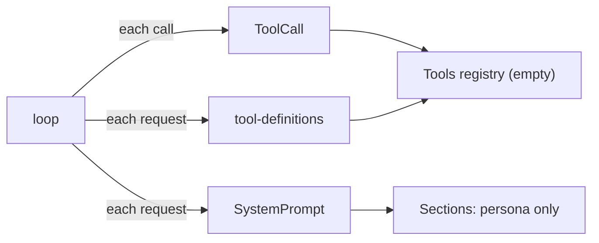
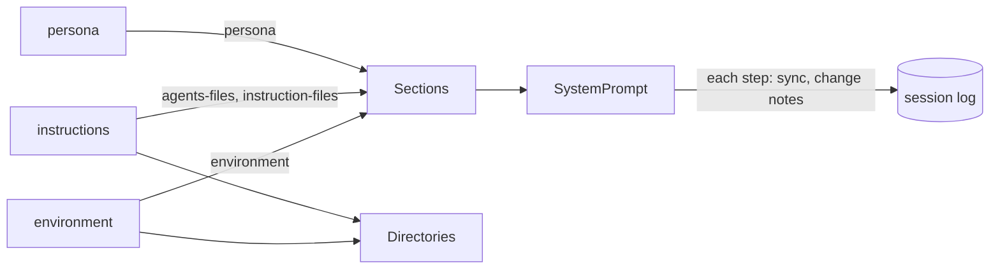
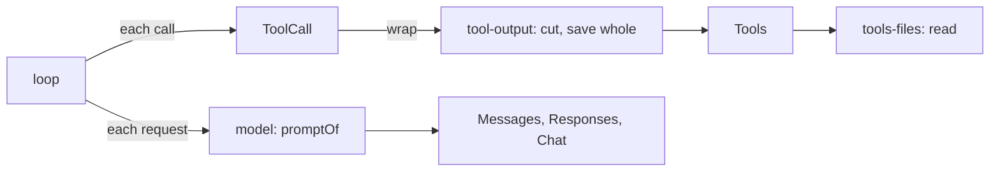
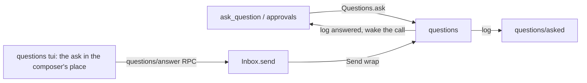
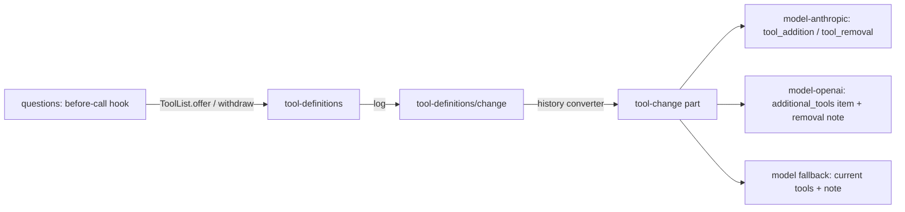

# Plan: milestone 3, the coding agent

Tools that read, edit and run things, the prompt that tells the model where it is, and the questions and approvals that keep the user in charge. Work list: [plugins/coding.md](../plugins/coding.md).

## Systems

| System | Change |
| --- | --- |
| `packages/plugins/tools-files` | Adds `read`, `edit`, `write` |
| `packages/plugins/tools-shell` | Adds `shell` and background processes |
| `packages/plugins/tools-web` | Adds `websearch`, `webfetch` |
| `packages/plugins/tool-output` | Adds a `ToolCall` wrap that cuts large results and saves the whole output |
| `packages/plugins/instructions`, `environment` | Adds prompt sections: the base prompt, `AGENTS.md`, `.liminal/instructions/`, workspace facts |
| `packages/plugins/questions`, `approvals` | Adds questions as events and answers as inputs; a `ToolCall` wrap that asks before risky calls |
| `model` contract | Changes `ToolResult`: text and image parts, not only JSON |
| `tools` contract | Expands `Tool` with hints (read-only, destructive) and `ToolContext` with progress |
| `chat` | Expands: diffs for edits, shell output as it runs, the question in the composer's place |
| `.liminal/`, `docs/instructions/` | Recreates `.liminal/`; moves the instruction files into it with `read-when` front matter |
| Database | Settles the schema; a later change adds a migration |

## Today



`tools`, `tool-definitions` and `loop` already run calls, save results and send the tool list; no plugin adds a tool. `system-prompt` has one section, `persona`.

## Build order

```text
1. instructions, environment       prompt sections; .liminal/ and docs/instructions/ move
2. tools-files read, tool-output   ToolResult gains text and image parts
3. questions                       questions as events, answers as inputs
4. approvals                       Tool gains hints; asks before risky calls
5. tools-files edit, write         diffs in chat
6. tools-shell                     ToolContext gains progress; output as it runs; environment lists found tools (rg, jq)
7. tools-web                       websearch, webfetch
8. Liminal on its own repository; settle the database schema
```

- Nothing that changes files or runs commands exists before the user can approve it. Pi runs every call with the process's permissions and leaves confirmation to extensions that read MCP-style hints (`readOnlyHint`, `destructiveHint`; Pi `docs/extensions.md`); OpenCode (`core/src/permission`) and Crush (`internal/permission`) ask before risky calls.
- Each contract change lands with its first user: content parts with `read`, hints with `approvals`, progress with `shell`. Their shapes come from the code that needs them.
- Size guide from the previous code: `tools-read`, `tools-edit` and `files` about 700 lines; `tools-shell`, `command-runner`, `shell-safety` and `processes` about 2,900; `tools-web` 800; `tool-output` 260; `approval` 1,900; `questions` 2,100; `agents-files`, `instruction-files` and `environment` 1,150.

## Step 1: prompt sections



The system prompt, in order:

| Order | Section | Plugin | Text |
| --- | --- | --- | --- |
| -100 | `persona` | `persona` | `You are Liminal…`, `<communication>`, `<discussion>`, and now `<execution>` |
| 0 | `agents-files` | `instructions` | Each `AGENTS.md` in `<instructions path="…">`, most shared first |
| 10 | `instruction-files` | `instructions` | The `always: true` files' text, then `<instruction_files>`: one intro line and `` - `path`: situation `` per `read-when` file |
| 100 | `environment` | `environment` | `<environment>`: workspace, Git branch or none, platform, date, the workspace root's entries |

Stable text first and per-day text last, so sessions in one repository share the longest prompt prefix.

### Where each piece comes from

| Piece | Read from | References |
| --- | --- | --- |
| `<execution>` | Copied from `archive/packages/plugins/system-prompt/src/server/base.ts` into `persona`; `<reminders>` dropped, nothing sends reminders | Pi `core/system-prompt.ts` keeps rules in its base prompt |
| `AGENTS.md` | `~/.agents/AGENTS.md`, `~/.liminal/AGENTS.md`, then each folder from the repository root down to the workspace; outside a repository, the workspace only | OpenCode `config/plugin/instruction.ts` walks up to the worktree root; Pi `core/resource-loader.ts` walks to the filesystem root |
| Instruction files | `.md` files in `~/.liminal/instructions/` and `<workspace>/.liminal/instructions/`; a project file replaces a global one of the same name | `archive/packages/plugins/instruction-files`; Pi lists skills by path and description for the model to read |
| Environment | `Directories`, `process.platform`, `process.arch`, the clock; the root's entries from `git ls-files` in a repository (what Git ignores left out), else the folder's visible names; capped at 200 lines | Crush `templates/coder.md.tpl` `<env>`; `archive/packages/plugins/environment` |

- An instruction file's front matter is `always: true` or `read-when: <situation>`.
- Instruction files are Liminal's way to give the model instructions. Reading `AGENTS.md` is opt-in: `{ "instructions": { "agentsFiles": true } }` in the global or project `settings.json`, read on each step; off by default. When off, the `agents-files` section is empty and left out.
- A file without valid front matter, and any `AGENTS.md` or instruction file that fails to read, is left out with a warning notice in the session.
- Sections read the files again on every step; `system-prompt` already turns a changed section into a change note.
- Nothing is gated on a trusted workspace yet; Pi and OpenCode read `AGENTS.md` without asking. Trust arrives with `loader`.

### Contract change: `Section`

A notice needs a session, so a section's text is read for one.

```ts
interface Section {
  name: string
  text: (session: SessionId) => Effect<string>
}
```

`SystemPrompt.sync` and `fold` already have the session and pass it; `persona` ignores it.

### Contract change: `Directories`

`AGENTS.md` and `environment` both need the repository root, and `environment` needs the branch the sidebar already reads.

```ts
interface Directories {
  global: string
  workspace: string
  project: string
  /** The folder holding `.git`, found once at start by walking up from the workspace. */
  repository: Option<string>
  /** The checked-out branch, or a short commit id; read on each call. */
  branch: Effect<Option<string>>
}
```

`directories/workspace` reads `branch` too, so a workspace in a subfolder of a repository shows its branch.

### Moving `docs/instructions/`

```text
docs/instructions/*.md  ->  .liminal/instructions/*.md   (git mv; front matter from the AGENTS.md table)
```

- Each file gains `read-when:` with the text of its row in the `AGENTS.md` table.
- The `AGENTS.md` table stays, with the new paths, for agents that read only `AGENTS.md`. Liminal leaves `AGENTS.md` off here and reads the front matter instead. Revisit at step 8.
- Links in `AGENTS.md`, `docs/_index.md`, `docs/status.md`, `docs/plans/` and the instruction files themselves change to the new paths.
- Exact text for `AGENTS.md` and the instruction files goes to the user before the edit.

The shell line in `environment`, and the command-line tools found on the machine, land with `tools-shell`.

## Step 2: read and tool output



### Contract change: results are text and images

```ts
// model contract
ToolResult = { type: "tool-result"; callId; name; content: Array<Text | Image>; isFailure; loads? }
// tools contract
interface ToolOutput { content: ReadonlyArray<Text | Image>; loads?: ReadonlyArray<string> }
```

- `content` replaces `result: Json`. A failure is one text part. Pi (`ai/src/types.ts`) and OpenCode (`tool/plugin/read.ts`, `toModelContent`) use the same shape.
- Provider plugins do not change. Effect AI 4.0.5 sends a tool result only as a string on all three wires (`AnthropicLanguageModel.ts` `tool_result.content`, `OpenAiLanguageModel.ts` `function_call_output.output`, compat `role: "tool"`). So `model`'s `promptOf` sends the text parts as the result and puts a run of results' images in one user message after the run, as Pi does for Chat Completions (`api/openai-completions.ts`, "Attached image(s) from tool result"). One message after the run, not one per result: Chat Completions refuses a user message between tool messages. Anthropic's encoder folds it into the same user turn (`groupMessages`).
- For a model whose catalog details say no images, `promptOf` leaves images out and says so in the result's text, as Pi's `read` notes (`getNonVisionImageNote`). `call.ts` already has the details and passes them in.
- Logged results change shape, so the database is reset when this lands.

| Builds a result today | Change |
| --- | --- |
| `tools/src/index.ts` (run, failed) | `content` from `ToolOutput`; failures as one text part |
| `loop/src/recovery.ts` (stand-ins, cancelled) | Reason as one text part |
| `model/src/prompt.ts` | As above |
| `chat/src/view/index.ts` | Reads only `isFailure`; no change |

### `read` in `tools-files`

| Behaviour | Liminal | Pi `tools/read.ts` | OpenCode `read.ts`, `read-filesystem.ts` | Crush `view.go` |
| --- | --- | --- | --- | --- |
| Params | `path`, `offset` (from 1), `limit` | same | same | same |
| Page | 2,000 lines or 50 KB, footer included | 2,000 / 50 KB | 2,000 / 50 KB | 200 lines, 200 KB file cap |
| Line numbers | `12: text` | none | `12: text` | `12\|text` |
| More follows | `[lines 1-2000 of 5120; read on with offset 2001]` | same idea | same idea | same idea |
| Long line | cut at 2,000 characters | no | 2,000 | 2,000 |
| Binary | NUL in the first 8 KB fails the call | no check | fails the call | |
| Images | PNG, JPEG, GIF, WebP by their first bytes; over 5 MB as base64 fails | resizes (`processImage`) | 5 MB, 2000×2000 limit (`image.ts`) | sniffs type |
| Folder | sorted entries, `/` after folders | separate `ls` | entries, paged | separate `ls` |
| Path | any path, relative to the workspace or absolute; `approvals` decides later whether outside paths ask | anywhere | asks outside the workspace | |

- Line numbers let the model point at lines and match `edit` later; the description says the prefix is not part of the file, as OpenCode's does.
- No resizing: Pi's needs an image library. Resizing and PDFs go under Later.
- `tags` already pages a file for `@` (`windowOf`, 2,000 lines, 50 KB) and spots binaries (`isBinary`). Both move to `tools-files/contract` as `pageOf` and `isBinary`; `tags` imports them, so an `@` file reads the same as `read`. `read` is the base way to see a file and `tags` builds on it, so the import runs that way.

### `tool-output`

A `ToolCall` wrap. When a result's text is over 2,000 lines or 50 KB, the model gets the first and last halves and a line between them:

```text
[Output cut: 12,480 lines, 1.2 MB. Whole output: ~/.liminal/tool-output/<session>/<call>.txt; read it with offset.]
```

| Choice | Liminal | Reference |
| --- | --- | --- |
| Kept | first and last halves: the start says what ran, the end holds the error | `archive/packages/plugins/tool-output` (halves); OpenCode `tool-output.ts` keeps the head; Pi's `bash` keeps the tail |
| Limits | 2,000 lines or 50 KB | OpenCode, Pi |
| Whole output | `<global>/tool-output/<session>/<callId>.txt`, folder `0700`, file `0600`; folders older than 7 days removed at start | OpenCode keeps 7 days in its data folder; the archive used a temp folder |
| Images | passed through | OpenCode |
| Failures | cut the same way | archive |

`read` pages within the same limits, so its results pass through uncut. No contract until a second plugin needs the cut.

### No `grep` or `find` tools

The model searches files through `shell` (step 6). `environment` then lists the command-line tools found on the machine that the model should use, such as `rg` and `jq`, beside the shell line. Pi, OpenCode and Crush ship separate search tools; Liminal does not. Until step 6, the model finds files through `read` on folders and the root listing in `environment`.

### Files

```text
packages/plugins/model/src/contract.ts      ToolResult.content
packages/plugins/model/src/prompt.ts        results as text; images after the run; none for models without images
packages/plugins/model/src/call.ts          passes details to promptOf
packages/plugins/tools/src/contract.ts      ToolOutput.content
packages/plugins/tools/src/index.ts         content and text failures
packages/plugins/loop/src/recovery.ts       stand-ins as text
packages/plugins/tools-files/               new: read; contract: pageOf, isBinary
packages/plugins/tags/src/                  windowOf and isBinary deleted; imports tools-files/contract
packages/plugins/tool-output/               new: the wrap, the saved files, the 7-day sweep
apps/cli                                    composition and dependencies
```

Deleted: `ToolResult.result`, `ToolOutput.result`, `tags`' `windowOf` and `isBinary`.

## Step 3: questions



### Contract

```ts
// questions/contract
Asked    = defineEvent("questions/asked",    { id; callId; kind: string; data: Json })   // the model never sees it; callId is the tool call that asks
Answered = defineEvent("questions/answered", { id; answer: Json })               // an input; the model reads it in the tool result
Requested = defineEvent("questions/requested", { text })                        // /qna's request; an input
Asker = { session; callId }
defineQuestion(kind, data: Codec, answer: Codec) => { kind; ask(asker, data): Effect<Answer> }
Questions.ask(asker, kind, data): Effect<Json>        // logs Asked, waits for its answer
QuestionsRpc: "questions/answer" { session; id; answer }  // sends Answered through Inbox.send
```

- `ask` waits inside the tool call, as OpenCode's `Form.ask` (`core/src/form.ts`, a `Deferred` per form). The turn stays running.
- Answers are inputs, as `docs/architecture.md` says: the RPC sends `Answered` through `Inbox.send`, so `Send` wraps such as actors see it. `questions` wraps `Send`: an `Answered` for a waiting ask is logged and wakes the call; it never queues. Any other input goes on.
- An ask is open while its turn runs and no `Answered` names it. A cancelled or crashed turn closes it: its `TurnEnded` follows. Screens build open asks from events, so nothing else is stored.
- Several open asks show one at a time, oldest first. This settles the Open item for `approvals`: parallel calls ask in turn.
- `kind` picks the screen: `questions` draws `questions/form`; `approvals` adds `approvals/approval` in step 4.

### `ask_question`

- Input: the gallery's form (`apps/gallery/src/components/asks/form.ts`), the archive's schema (`archive/packages/plugins/questions/src/contract.ts`): a title; questions of kind `select` (2 or more options), `confirm` or `input`; an optional suggested answer with its reason. The archive's checks stay: distinct ids, a suggested answer that names an option.
- Answer: `{ answers, notes }`, one answer per question in order: `picked { option, note }`, `own { text }`, `written { text }` or `skipped`; the note is the user's on the picked option, such as why they picked it. `notes` is the additional notes tab's text (the form's last tab, labelled `notes`). The result is the archive's `answersText`, reworded: each answer on its own line with `(own answer)` or `(suggested)`, then `Note:` and `Additional notes:`.
- `deferred`: declared from the session's start, offered only while a turn runs that took `/qna`'s request (see Offering a deferred tool).
- `/qna` is a `questions` tui command. A slash command takes no text, so a `ChatSend` wrap turns a sent draft that starts with `/qna` into the same call with the rest as `text`. Both call `questions/qna { session, text }`, which sends a `questions/requested { text }` event through `Inbox.send`. Inputs may be any event, so it starts or joins a turn as a message does.
- `questions/requested` shows nothing: chat draws another plugin's event only when that plugin adds a renderer (`chat/src/view/index.ts`), and `questions` adds none. A history converter turns it into the user message the model reads: the archive's request to ask its open questions with `ask_question`, then the text.
- Print mode has no `/qna`, so it never meets a question from `ask_question`.
- The tool's transcript row shows the user's answers (see TUI).

### Offering a deferred tool

Providers now offer and withdraw a declared tool partway through a conversation without touching the cached prefix:

| Provider | How | Source |
| --- | --- | --- |
| Anthropic | Declare the tool in `tools` with `defer_loading: true`; a later `role: "system"` message holds `tool_addition` / `tool_removal` blocks naming it. Beta header `inline-tools-2026-09-15`. Opus 4.8, Opus 5, 5.5, Sonnet 5.5, Haiku 5.5, Fable, Mythos; not Sonnet 5. | Claude docs, mid-conversation system messages; Pi `ai/src/api/anthropic-messages.ts` |
| OpenAI Responses | An `additional_tools` input item at the point of change; or a client `tool_search_call` + `tool_search_output` pair that carries the definitions. No removal item: a note says the tool is gone. | OpenAI tool search guide; Pi `ai/src/api/openai-responses-shared.ts` |
| DeepSeek | `tool_addition` / `tool_removal`, as Anthropic. | deepseek-harness note `2026-09-20-dynamic-tool-updates.md` |
| Others (chat completions, OpenRouter) | No native way: the request's tool list changes, which misses the cache once, plus a note. | Pi `resolveTranscriptTools` mode `none` |

Pi and deepseek-harness log tool changes once, the same for every provider, and each provider turns them into its own form. Liminal already logs them once (`tool-definitions/list`, `tool-definitions/change`); today the change reaches every provider as a user text note and a changed tool list.



Contract changes:

```ts
// model (base)
ToolChange = { type: "tool-change"; added: ToolDefinition[]; removed: string[] }  // a Part, in user messages only
ModelRequest.tools                                // the tools the last list declared; later changes are tool-change parts
ToolResult.loads                                  // removed: tools-search offers through ToolList.offer instead
ModelProvider.nativeToolChanges?(model): boolean  // the model takes tool changes mid-conversation
LanguageModelOptions.toolChanges?: { declared: ToolDefinition[]; changes: ToolChange[] }  // set when native

// tools (base)
Tool.deferred                                     // meaning: declared from the start, offered only through ToolList.offer
ToolOutput.loads                                  // removed

// tool-definitions
ToolListRecord                                    // lists offered tools only; a deferred tool is added by value when offered
ToolList.offer(session, names): Effect<void>      // logs a change adding them; nothing when already offered
ToolList.withdraw(session, names): Effect<void>   // logs a change removing them; nothing when not offered
ToolList.sync                                     // keeps registry tools in step; leaves offered deferred tools alone
ToolCall wrap                                     // a call to a tool not offered in its session fails: "not available"
```

- The converter for `tool-definitions/change` returns a `tool-change` part instead of text. The `model` fallback turns it into today's `<tool-update>` note and sends the current tools; a removed tool stays in the list until the next fold, as now.
- `ToolDefinition` gains no `deferred` flag. Both native forms carry a definition by value (`tool_addition` holds the definition, as Pi's `anthropic-messages.ts` does; `additional_tools` holds definitions), so a deferred tool is never declared up front.
- The fallback request holds tools as they stand after every change, and each change as a `<tool-update>` note in its user message. For a native model, `model` puts each change's note in a mid-conversation system message instead and passes `toolChanges`; `model-wire`'s `messagesModel` and `responsesModel` rewrite the body. The system messages after the first are only tool changes, so the rewrite pairs them with `changes` in order; when the counts differ it leaves the fallback body alone.
- `model-anthropic` maps natively for the models above (Pi's `supportsAnthropicMidConvoSystemMessages`): the declared tools plus a never-offered placeholder with `defer_loading`, which Pi measured keeps the first change from missing the cache; each change's system message becomes `tool_removal` and `tool_addition` blocks; the beta header. Effect AI does not know these blocks, so a body rewrite adds them, as the archive's `messages.ts` added `tool_reference`. With no declared tool it stays the fallback: Anthropic refuses a list of only deferred tools.
- `model-openai` maps natively for Pi's model lists (`OPENAI_ADDITIONAL_TOOLS_MODEL_IDS` for the OpenAI API and ChatGPT, `OPENAI_CODEX_ADDITIONAL_TOOLS_MODEL_IDS` for Codex). An `additional_tools` item cannot replace a top-level tool, so as in Pi every tool goes in `additional_tools` items: the declared tools in one at the head of the input, each change's added tools in one at its point, after Pi's incremental-tools notice. A withdrawal has no item, so it stays a note. The item has thin OpenAI docs; Pi reports it working on GPT models in October 2026.
- A fold lists offered tools only; the next turn's before-call hook offers again.
- `questions` adds a before-call hook: when the running turn took a `questions/requested` input, it offers `ask_question`; otherwise it withdraws it. A turn ended by Esc, a crash or a restart is covered, because the next turn withdraws.
- Cache: Anthropic never misses. OpenAI with `additional_tools` never misses. The fallback misses once, the first time a session offers the tool.

### TUI

- The open ask takes the composer's place (gallery `Ask`, `Questions`). Esc cancels the whole turn, which closes the ask.
- `chat` gains `ComposerCovers`: a registry of `{ active(props), component }`, both given `CoverProps`: the composer's props, the session and its `ViewState`. Chat draws the first active cover in the composer's place. Chat's tui exports `Gutter` and `WorkRow`, so a cover and a tool row look like the composer and the plain row. `chat/composer` is a `replace` slot, so a cover cannot be a composer fill.
- `questions` tui adds one cover. It draws the oldest open ask by `kind` through its own `AskViews` registry, which `approvals` adds to.
- The form's last tab is `notes`, for additional notes. A choice question holds one note, on the picked option, shown under it.
- `chat` gains `ToolRows`: a registry of `{ tool: string, component: (props: { item, state: ViewState }) => JSX.Element }`. Chat draws a registered tool's row with it, else the plain `WorkRow`. Step 5's diffs use it too.
- `questions` tui adds the `ask_question` row (gallery `transcript/Answers`). It finds its `Asked` by `callId` and the matching `Answered` in `state.events`:

```text
✓ ask    Before I rewrite the concurrency test  3 answered, 1 skipped
  │ How should the test tell that two plugins started together?
  │ → Spans overlap  (suggested)
  │   └ CI is slow, so no timing margins.
  │
  │ Can bootAndRecord return when each plugin finished, as well as when it started?
  │ → skipped
  │
  │ Additional notes
  │ → Keep the test under twenty lines.
```

- A click on the row opens the answers under it, and another closes them; they start closed. While the form waits the row notes `waiting for you`; a cancelled turn leaves `× … cancelled`.

### Porter's moods

Porter is the little face that murmurs words while a turn runs (the kit's `Spinner` today, renamed `kit.Porter`). While an ask waits on the user he still shows, so `questions` changes what he murmurs.

```ts
// tui kit
type Pose = { face: string; weight: number; hold: [number, number] }   // faces are seven cells
Porter(props: { words?: string[]; poses?: Pose[] })                    // missing or empty uses his own; a single word holds still

// chat/src/tui/slots.ts
type MoodProps = { session; state: ViewState }
type Mood = { active(props): boolean; words(props): string[]; poses?: Pose[]; header?: "scanning" | "still" }
Moods: Registry<Mood>   // read when the session screen first draws; the first active mood wins, else the screen's own look

// questions tui
Moods.add({ active: open asks > 0, words: ["patiently waiting", "waiting for you", "all ears"], poses: slow blinks, dozing, header: "still" })
```

- When the words or poses change, the next word and face come at once rather than after the current one's hold.
- A registry, first active wins, as `ComposerCovers`; a `Pipeline` would make the winner depend on wrap order.
- A mood is the working screen's whole look, so the header's scan is a mood field rather than a second registry with its own winner. Missing `header` scans while the turn runs.
- `approvals` adds its own mood in step 4.

### Settled while building

- The form's schemas (`Form`, `Question`, `Answer`, `Answers`), `formQuestion` and `askQuestionName` live in `questions/contract`, so the server entry and the `tui` entry share them without importing each other. `form.ts` keeps only `answersText`.
- `AskViews` entries are `{ kind, component }`, and a view gets `AskProps`: `ask` (the `Asked` data), `session`, `more` (how many asks wait after it), `answer(json)` and `cancel()`. `questions/tui` exports `AskViews`, `Ask`, `Field`, `Note` and `moreAside` for other kinds.
- The cover is active while the session view holds open asks, and draws the oldest whose kind has a view. While only asks with no view wait, the composer's place stays empty, since the turn waits on them.
- `/qna` alone is listed only in a session; `/qna text` goes through the `ChatSend` wrap from either screen.
- The row's summary is the form's title with `N answered, M skipped`.
- `WorkRow` takes optional `details`: a function that draws what a click opens under the row, called each time it opens, since OpenTUI destroys a removed node. Chat holds whether the row is open and whether the mouse is over it, in the row, not the log. Under the mouse a row with details brightens (opacity 0.3 to 0.5); a row without details never changes. `AskRow` passes the answers as details once they come; other rows have none yet. Keys cannot open a row yet.
- `ToolList.offer` takes names and reads each definition from `Tools` through `ToolDefinitions`; names that are not registered are left out.

### Files

```text
packages/plugins/questions/            new: contract, Send wrap, ask_question, RPC; tui: cover, form
packages/plugins/chat/src/tui/         ComposerCovers, ToolRows
packages/plugins/model/                tool-change part, nativeToolChanges, toolChanges, loads removed; fallback note
packages/plugins/tools/                deferred meaning, loads removed
packages/plugins/tool-definitions/     deferred tools in the list, offer, withdraw, ToolCall wrap, tool-change converter
packages/plugins/model-anthropic/      defer_loading, tool_addition / tool_removal, beta header
packages/plugins/model-openai/         additional_tools item
packages/model-wire/                   body rewrites for both native forms
docs/architecture.md                   model, tools, tool-definitions and chat contract changes
apps/cli                               composition
```

## Open

- Whether `approvals` asks one question at a time when calls in one reply run together.
