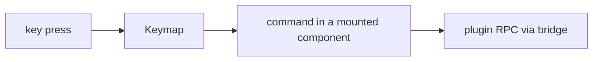
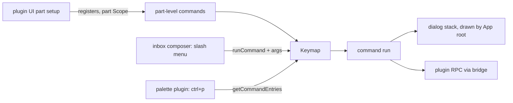

# Commands and dialogs

Lets the user run plugin commands by typing `/name` in the composer or picking them from a command palette, and lets a command open a dialog. Proven with `/reload`, `/new` and `/model`. The command definition is in [05-frontends.md](../requirements/05-frontends.md).

## Today

| Piece | Where | Shape now |
| --- | --- | --- |
| Keymap | `apps/cli/src/tui/run.tsx` | `createDefaultOpenTuiKeymap(renderer)` in a `KeymapProvider`; no addons registered |
| Commands | `useBindings` inside mounted components | `app.quit` (App root), `reload.now` (reload header item), `cancel.turn`, `inbox.queue` (composer) |
| Part API | `TuiHost` = `FrontendHost<SolidKind>` (`packages/sdk/src/tui/host.ts`) | `register`, `client`, `follow`, `sessionState`; nothing for commands or dialogs |
| Composer | inbox plugin, `packages/plugins/inbox/src/tui/Composer.tsx` | textarea; Enter sends or steers; model line read once from `agent-loop/defaults` |
| Session | chat plugin, `packages/plugins/chat/src/tui.tsx` | opens one session in `setup`; no way to switch |
| Models | models plugin | server service only; no RPCs, no UI part |
| Gallery | `apps/gallery/src/chat/{Dialog,CommandPalette,CommandSuggestions,SuggestionList}.tsx` | designs with sample data; nothing in the TUI uses them |



## Keymap capabilities used

From `@opentui/keymap` 0.6.6 (`docs/reference/copies/@opentui/core/0.6.6/packages/web/src/content/docs/keymap/`):

| Need | API |
| --- | --- |
| `title`, `desc`, `category` | metadata fields, registered by `createDefaultOpenTuiKeymap` |
| List commands with their keys | `getCommandEntries({ visibility: "reachable", filter })` |
| Run a command with slash arguments | `runCommand(name, { payload })` |
| Re-read on change | `keymap.on("state")` |

## Architecture



| Decision | Shape | Beat |
| --- | --- | --- |
| Part-level commands | registered in a part's `setup`, removed when its Scope closes; `useBindings` stays for keys local to one component | `useBindings` only: commands vanish while their component is off screen |
| Slash and palette fields | kept on each `Command` in `TuiCommands`' registry; `listed()` joins them with the keymap's reachable entries and their keys | `registerExCommands`: forces `:` and makes each alias its own command |
| Dialog stack | in `@liminal/sdk/tui`, drawn by the App root over the root slot; `show(component)`, `close()`, `esc` closes the top; `SelectDialog` building block (confirm and prompt dialogs come with their first user, in the connect plan); results reach plugins through callbacks that call RPCs via the bridge | Promise-returning dialogs |

| Piece | Owner | Change |
| --- | --- | --- |
| Slash menu | `inbox` composer | `/` shows matching commands; Enter runs one |
| Palette, `ctrl+p` | new `palette` plugin | lists `palette` commands with their keys |
| `/reload` | `reload` | `reload.now` moves to part level with `slash` and `palette` |
| `/new` | `chat` | prep: chat keeps a current session it can switch |
| `/model` | `models` gains a UI part and RPCs listing providers and models; `agent-loop` sets the default model and streams its defaults | composer model line updates live |

## Code shape

The renderer, keymap and dialog stack exist before the frontend starts, so parts register commands in `setup`, and a command's `run` opens dialogs without a Solid context.

```ts
// @liminal/sdk/tui
interface Command {
  readonly name: string; readonly title: string
  readonly desc?: string; readonly category?: string
  readonly slash?: { readonly name: string; readonly aliases?: ReadonlyArray<string>; readonly arguments?: true }
  readonly palette?: true
  readonly run: (args: string) => void
}
class TuiCommands  // register(commands, bindings?): Effect<void, never, Scope>
class TuiDialogs   // show(component): void; close(): void; top: Accessor<DialogComponent | undefined>
defineTui(...)     // setup may require TuiHost | TuiCommands | TuiDialogs | Scope
```

```text
packages/frontend/src/parts.ts   FrontendOptions gains `services`, a Context given to each part's setup
packages/sdk/src/tui/commands.ts TuiCommands, slashCommand, args payload decoding
packages/sdk/src/tui/dialogs.tsx TuiDialogs stack, DialogLayer, DialogFrame
packages/sdk/src/tui/SelectDialog.tsx SelectDialog
packages/sdk/src/tui/match.ts    matchIndices, moved from the gallery
apps/cli/src/tui/run.tsx         split: makeTerminal (renderer, keymap, dialogs), then mount
apps/cli/src/main.ts             makeTerminal, startFrontend with services, mount
apps/cli/src/tui/App.tsx         draws the top dialog; app.quit moves to TuiCommands
```

| Piece | Behavior |
| --- | --- |
| Slash menu | `/` at the start opens it; `↑↓` choose, `tab` completes the name, `enter` runs; a command with `arguments` gets the text after its name; text matching no command is sent as a prompt |
| Focus | the composer gives up focus while a dialog is open |
| `chat` | the current session is a `SubscriptionRef<SessionId>`; the transcript is `Stream.switchMap(current, follow then scan)`; `/new` creates a session and sets the ref |
| `models` | `ModelsRpcs`: `models/providers`, `models/list(provider)`; its UI part registers `/model`, a `SelectDialog` grouped by provider |
| `agent-loop` | `agent-loop/set-default({ model, thinking? })` writes global settings through `Settings.write`; `agent-loop/defaults` streams, emitting after each set; the inbox model line follows it |

## Build order

Steps 1 to 3 share one commit; steps 4 to 6 get one each.

| Step | Work | Proves |
| --- | --- | --- |
| 1 | frontend `services`, `makeTerminal`, `TuiCommands`, `TuiDialogs` | parts register commands and open dialogs |
| 2 | `/reload`: `reload.now` at part level | a part-level command with `slash` and `palette` |
| 3 | slash menu in the composer | `/reload` end to end |
| 4 | `palette` plugin, `ctrl+p` | listing commands with their keys |
| 5 | `chat` current session, `/new` | switching sessions |
| 6 | `ModelsRpcs`, `agent-loop/set-default` and defaults stream, `/model` select dialog, live model line | select dialog and RPC round trip |

## Tests

| Where | Cases |
| --- | --- |
| SDK, `apps/cli/test/commands.test.ts` | `TuiCommands` unregisters when its Scope closes; slash lookup by name and alias; args payload decoding |
| TUI frames, `apps/cli/test/tui.test.tsx` | `/re` shows `/reload`; `/reload` Enter runs it; `/nope hi` is sent as a prompt; `ctrl+p` lists `/new` and `/reload` with keys; `/new` shows an empty transcript; `/model` pick changes the model line |
| Server | `agent-loop/set-default` writes the setting and the defaults stream emits it; `models` RPCs list providers and models |

## Gallery

- `Dialog`, `CommandPalette`, `CommandSuggestions` match the TUI's look.
- New `ModelPicker` sample of the select dialog.
- `apps/gallery/src/chat/match.ts` is deleted; the gallery imports `matchIndices` from `@liminal/sdk/tui`.

## Deleted or replaced

- `reload.now` `useBindings` in the reload header item and `app.quit` `useBindings` in `App.tsx`, both moved to `TuiCommands`.
- One-shot `agent-loop/defaults`, replaced by the stream.
- `chat`'s fixed session from `setup`.
- The gallery's `match.ts`.
