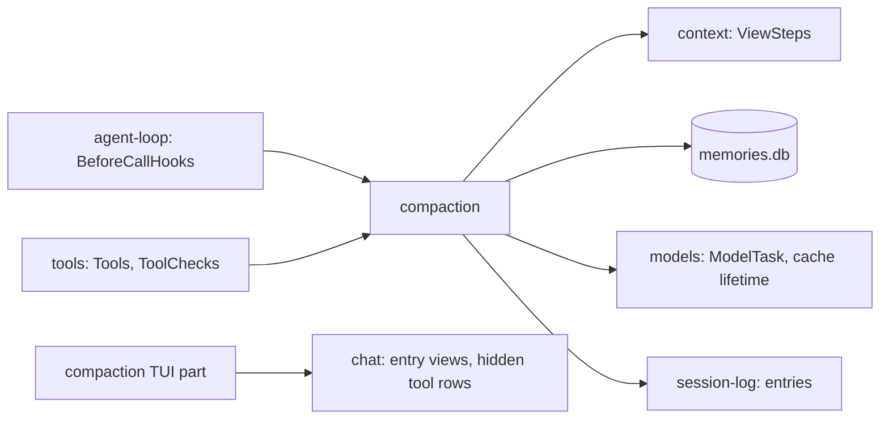

# Compaction

Lets a session run past the model's context window. A checkpoint folds the history: from then on the model sees a fresh system prompt, its memories, the recent entries and, when the model wrote the checkpoint, its handoff. The model writes checkpoints; Liminal also writes one when the provider's cache is already lost. The transcript keeps everything. Requirements are in [compaction.md](../plugins/compaction.md); the transcript look is in the gallery (`apps/gallery/src/transcript/Checkpoint.tsx`).

Built in one step.

## Shape

One new plugin, `compaction`, joins existing extension points. `models` and `chat` each gain one field.



| Piece | Joins | Does |
| --- | --- | --- |
| Before call | `BeforeCallHooks` | Measures the session; writes an automatic checkpoint when the cache is lost; saves a hidden nudge when a stage is crossed; starts the note writer |
| `checkpoint` tool | `Tools` | Saves the checkpoint and the handoff; never waits on a model |
| Forced check | `ToolChecks` | At the forced stage, denies every tool but `checkpoint` |
| View step | `ViewSteps` | Rebuilds what the model sees after the latest checkpoint; sends a fresh system prompt after a checkpoint or a model switch |
| Note writer | `ModelTask` | Writes short-term notes and condenses them into long-term memory in `memories.db` |
| TUI part | `ChatSlots.entry`, `ChatSlots.tool` | Draws the rule; the handoff and note lines in the debug view; hides the `checkpoint` call's row |

A fresh system prompt needs no change in `context`: the view step drops system entries before the cut, so `context`'s `diff` finds no baseline and saves a fresh one (`packages/plugins/context/src/server/system.ts`), and `fold` leads with it.

## Files

```
packages/plugins/compaction/
  plugin.ts                 requires Context, SessionLog, Tools, ToolChecks, BeforeCallHooks, Models, ModelTask, Settings
  package.json              exports . and ./contract
  src/contract.ts           entry kinds, settings section
  src/server.ts             wires the pieces below into the extension points
  src/server/budget.ts      budget, size, stage
  src/server/before-call.ts automatic checkpoint, nudges, starting the writer
  src/server/checkpoint.ts  the checkpoint tool and the forced check
  src/server/view.ts        the view step
  src/server/notes.ts       the note writer: ranges, prompts, condensing
  src/server/store.ts       memories.db: Memories service over SqlClient, migrations in code
  src/tui.tsx               registers the entry views and the hidden tool row
  src/tui/Checkpoint.tsx    the rule
  src/tui/DebugLine.tsx     the handoff (folded) and note lines
  test/compaction.test.ts   stages, forced check, tool, automatic checkpoint, view, writer
packages/plugins/models/src/contract.ts   ModelProvider.cacheLifetime; Models.cacheLifetime
packages/plugins/model-*/src/...          each provider declares its cache lifetime
packages/plugins/chat/src/contract.ts     ToolRows gains a Hidden variant
packages/plugins/chat/src/tui/work.ts     skips calls whose tool is Hidden
```

## Types

```ts
// compaction contract.ts
export const CompactionSettings = Schema.Struct({
  budget: Schema.Int.pipe(Schema.withDecodingDefaultKey(Effect.succeed(200_000))),
});

/** Who wrote the checkpoint. */
const Trigger = Schema.Union([
  Schema.TaggedStruct("Model", { callId: Schema.String }),   // the checkpoint tool
  Schema.TaggedStruct("Idle", { idleSeconds: Schema.Int }),  // cache lifetime passed
  Schema.TaggedStruct("Switch", { from: ModelRef }),         // model or provider changed
]);

export const CheckpointEntry = defineEntry({
  kind: "compaction/checkpoint",
  data: Schema.Struct({
    trigger: Trigger,
    longTerm: Schema.optionalKey(Schema.Int),   // memory number used
    shortTerm: Schema.Array(Schema.Int),        // note numbers used
    tailFrom: Seq,                              // first entry no note or memory covers
  }),
  model: false,
  user: "shown",
});

export const HandoffEntry = defineEntry({ kind: "compaction/handoff", data: Schema.Struct({ handoff: Schema.String }), model: false, user: "debug" });

/** A note or memory was written: its range and size only; the text stays in memories.db. */
export const NoteEntry = defineEntry({
  kind: "compaction/note",
  data: Schema.Struct({ layer: Schema.Literals(["short-term", "long-term"]), from: Seq, through: Seq, tokens: Schema.Int }),
  model: false,
  user: "debug",
});

// server/store.ts
interface Note { number: number; session: SessionId; from: Seq; through: Seq; text: string; tokens: number }
interface Memory { number: number; session: SessionId; throughNote: number; throughSeq: Seq; text: string; tokens: number }

class Memories extends Context.Service<Memories, {
  notes: (session: SessionId) => Effect<ReadonlyArray<Note>, StoreError>;
  memories: (session: SessionId) => Effect<ReadonlyArray<Memory>, StoreError>;
  addNote: (note: Omit<Note, "number">) => Effect<Note, StoreError>;
  addMemory: (memory: Omit<Memory, "number">) => Effect<Memory, StoreError>;
}>() {}

// models contract.ts
interface ModelProvider { /* … */ readonly cacheLifetime: Duration.Duration }
Models: { /* … */ readonly cacheLifetime: (provider: string) => Effect<Duration.Duration, ProviderNotFound> }

// chat contract.ts
type ToolRows = Data.TaggedEnum<{ Rows: { fold: (call: ToolCall) => WorkRow }; Hidden: {} }>;
```

Nudges reuse `contextMessage({ label: "compaction", text, user: "debug" })` from `context`.

Cache lifetimes start at 5 minutes for every provider, the default for Anthropic and OpenAI prompt caching and Mastra's `auto` value for Anthropic, OpenRouter and GPT-5 models (`references/mastra/packages/memory/src/processors/observational-memory/`).

## Size and stage

```
budget = min(contextWindow - 16_000, settings.budget)      // Models.describe(turn.settings.model)
size   = last finish usage (input + cacheRead + cacheWrite + output)
         + chars / 4 of model content in view entries after that reply
stage  = none < 50% <= notice < 75% <= warning < 100% <= forced
```

## Before call

```
beforeCall(turn):
  fork writer.catchUp(session) in a FiberMap keyed by session, only if missing
  view = context view entries
  stage = stageOf(size(view), budget)
  if stage >= notice and notes cover entries the latest checkpoint does not:
    idle = now - last reply's time
    if previous turn's model differs from turn.settings.model -> append checkpoint(Switch)
    else if idle >= Models.cacheLifetime(provider)         -> append checkpoint(Idle)
  if stage > last nudged stage since the latest checkpoint:
    Proceed({ input: [nudge(stage)] })
  else Proceed({ input: [] })

forcedCheck(call, tool):
  stage is forced and tool is not checkpoint -> Deny("Context is full. Call checkpoint first.")
  else Allow
```

The last nudged stage and the last reply's time are read from the view. Nothing is kept in memory.

## Checkpoint tool

```
checkpoint({ handoff })        // handoff: 1 to 24,000 characters; hints read-only, so approval never asks
  calls = tool-call entries of the current reply
  calls.length > 1 -> ToolFailed("Call checkpoint alone, without other tool calls.")
  append CheckpointEntry { trigger: Model { callId }, ...covered() }
  append HandoffEntry { handoff }
  return "Checkpoint saved. Your next model call starts from your memory, notes, recent entries and this handoff."

covered():
  memory = newest memory; notes = notes after memory.throughNote
  { longTerm, shortTerm, tailFrom = last covered seq + 1 }
```

## View step

```
view(session, entries):
  cut = latest of: a checkpoint (a Model one only once its tool result is done), a turn start whose model differs from the turn before
  drop every context/system entry before cut                 // context saves a fresh baseline
  checkpoint = latest checkpoint
  none -> entries
  [
    long-term memory message,                  // "Long-term memory of entries 1–120:"
    each short-term note message,              // "Entries 121–160:"; cache breakpoint on the last
    entries with seq >= tailFrom, before the checkpoint,    // a Model checkpoint also drops its call
    handoff message, only for Model,           // "Your handoff at the checkpoint: … Checkpoint completed."
    entries after the checkpoint,
  ]
```

Memory, note and handoff messages are entries built in the step and never saved: user-role `<reminder kind="memory">` text in `model`.

## Note writer

```
catchUp(session):
  entries = view entries after the newest note's `through`
  start = min(50,000, budget / 4); range = min(16,000, budget / 8)
  until the session first reaches start tokens: stop
  while unnoted entries >= range tokens:
    range = entries up to range tokens, ending after a tool result, never between a call and its result
    text  = ModelTask.run(Models.cheap(provider), "summarize these entries", submit { note }, maxSteps 1)
    addNote(range, text); append NoteEntry                  // aim: at most 2,000 tokens
  if tokens of notes after the newest memory >= 30,000:
    keep the newest notes up to 8,000 tokens out
    text = ModelTask.run(cheap, previous memory + the other notes, submit { memory })
    addMemory(throughNote, throughSeq, text); append NoteEntry
```

Forks reuse the parent's notes up to the fork point. `SessionLog` has no fork command yet, so this is built with forks.

A failed model call logs a warning and stops this catch-up; the next call before a model request tries again. A reload interrupts the fiber; nothing is half-written because each note is one insert.

## Transcript

| Entry | Drawn |
| --- | --- |
| `compaction/checkpoint` | The rule, every trigger alike |
| `compaction/handoff` | Debug view: `▸ Handoff  first line`, unfolds on click |
| `compaction/note` | Debug view: `Short-term note, entries 121–160, 1,840 tokens` |
| `checkpoint` tool call | Hidden |

The gallery's Checkpoint entry gains the note line and an automatic checkpoint state.

## Injection

| Service | Production | Tests |
| --- | --- | --- |
| `Memories` | `memories.db` in `Directories.data` | the same layer on a temp data folder from `testBaseServices` |
| `ModelTask` | `models` with the session's provider | `model-scripted` answering the submit tool |
| Context window, cache lifetime | `Models.describe`, `Models.cacheLifetime` | `model-scripted`'s model info and lifetime |
| Idle time | `Clock` | `TestClock` |

## Deletes and replaces

- `ToolRows` becomes a tagged union; every tool's registration wraps its rows in `Rows`, and `pathRows` returns `Rows`.
- The budget drops the long-context price threshold: `ModelInfo` has no such field.
- The `Open` items in `docs/plugins/compaction.md` about checkpoint timing and memory contents are settled.

## Guides

- `docs/guides/plugins.md`: a "Run work in the background" section (a `FiberMap` in the server's scope, keyed by session, only if missing).
- `docs/guides/tui.md` "Show a tool call": hiding a tool's row with `Hidden`.
- `docs/guides/providers.md`: declaring `cacheLifetime`.
