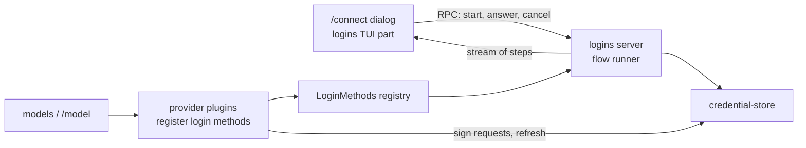

# Connect and login

`/connect` lets the user sign in to every provider Tau supports, from the TUI, and sign out again. Once signed in, the provider's models show up in `/model`.

Step 1 is built; login is not. Today Liminal stores credentials (`credential-store`) and the Codex provider (`model-codex`) uses a `codex` credential if one exists, but nothing can write one. In the running app `/model` lists nothing until this plan is built.

## Today

| Piece | Where | What it does |
| --- | --- | --- |
| `credential-store` | `packages/plugins/credential-store/` | `get`/`set`/`remove` a `Credential` (`ApiKey`, `OAuth`, `Command`) per login method; `secret` falls back to an env variable; `fresh` refreshes OAuth under a lock |
| `model-codex` | `packages/plugins/model-codex/` | Provider `codex`; signs requests and refreshes tokens (`src/server/auth.ts`); lists models from the Codex backend |
| `models` | `packages/plugins/models/` | `ModelProviders` registry; RPCs `models/providers`, `models/list` |
| `agent-loop` UI | `packages/plugins/agent-loop/src/tui.tsx` | `/model`; leaves out providers whose list fails |
| TUI dialogs | `packages/sdk/src/tui/{dialogs.tsx,SelectDialog.tsx}` | Dialog stack; only a select dialog exists |

## Scope: every Tau provider and login method

From Tau `src/ai/Providers.ts`, `src/ai/Connections.ts`, `src/ai/Login.ts`.

| Vendor | Provider | Login method | Ways to finish | Credential |
| --- | --- | --- | --- | --- |
| OpenAI | `codex` | Codex login (OAuth, `auth.openai.com`) | Browser (callback `127.0.0.1:1455`), device code | `OAuth` |
| OpenAI | `chatgpt` | Sign in with ChatGPT (per-user app registration, ID token checked) | Browser (callback `127.0.0.1:1455`) | `OAuth` with client id and ID token in `extra`; revoked on sign-out |
| OpenAI | `openai` | API key, env `OPENAI_API_KEY` | Paste key | `ApiKey` |
| Anthropic | `anthropic` | Claude subscription (OAuth, `claude.ai`) | Browser (callback `localhost:53692`), paste a code | `OAuth`; requests carry Claude Code headers |
| Anthropic | `anthropic-api` | API key, env `ANTHROPIC_API_KEY` (not in Tau; on the agreed list) | Paste key | `ApiKey` |
| OpenRouter | `openrouter` | API key, env `OPENROUTER_API_KEY` | Paste key | `ApiKey` |
| OpenCode | `opencode-go` | API key, env `OPENCODE_API_KEY` | Paste key | `ApiKey` |
| Local | user-added in settings | None | Nothing to sign in | None |

Each row shows one of three sign-in states in `/connect`: signed out, saved, or found in an environment variable (Tau `SignInState`).

## Shape



| System | Change |
| --- | --- |
| `logins` (new plugin) | Owns the `LoginMethods` registry, the flow runner, sign-in state, `/connect` and its dialogs |
| Provider plugins | Expand `model-codex`; add one per provider row; each registers its login methods |
| `credential-store` | Unchanged; storage and refresh only |
| SDK TUI | Adds prompt (text and secret) and confirm dialogs beside `SelectDialog` |
| `model-catalog` (new plugin) | `models.dev` catalog and cache; source of model details for `/model` |
| `models` / `/model` | Lists from the catalog, filtered by sign-in and plan lists; re-lists when a credential changes |

## Decisions

| Topic | Decision |
| --- | --- |
| Who owns login | A new `logins` plugin holds the `LoginMethods` registry (a `KeyedRegistry`, like `ModelProviders`), the shared OAuth pieces (PKCE, local callback server, paste the address) and `/connect`. Provider plugins register `{ id, vendor, title, ways, logIn, logOut }` |
| Login methods | A tagged union. `ApiKey { env }` is a declaration that `logins` handles fully: ask, save, remove, saved or environment state. `Flow { ways, logIn, logOut? }` is for OAuth; `logIn` runs against a `LoginFlow` service from `logins` (`openUrl`, `showCode`, `ask`, `askSecret`, `waiting`) |
| `effect/ai` translation | A new SDK zone `@liminal/sdk/ai` holds the translation every provider shares (`promptOf`, `toolkitOf`, `streamOf`, `toModelError`), moved out of `model-codex`; each provider supplies its own metadata Schema |
| Running a login | The flow runs on the server and streams steps over RPC (see Step 2 Types). The TUI draws the current step, answers by an `answer` RPC and stops it by closing the stream; the RPC client's `Interrupt` stops the server flow, so there is no `cancel` RPC |
| Provider plugins | One per provider: `model-codex` (exists), `model-chatgpt`, `model-openai`, `model-anthropic`, `model-openrouter`, `model-opencode-go`, `model-local` |
| Anthropic | One `model-anthropic` plugin with two login methods: Claude subscription and API key |
| API packages | `@effect/ai-openai`, `@effect/ai-anthropic`, `@effect/ai-openrouter`, `@effect/ai-openai-compat` (per `docs/plugins/models.md`). Native tool changes come from a provider layer that wraps the package client (`docs/plans/core-contracts.md`); OpenCode Go Messages replies get their missing `usage` fields filled before decoding |
| Model lists | A new `model-catalog` plugin owns the `models.dev` catalog and its local cache; `models` depends on it; replaceable like `credential-store` |
| Catalog refresh | Startup uses the cached copy; a background refresh runs when the cache is older than a set age |
| Plan-limited logins | Codex and ChatGPT fetch their live plan list; `/model` shows only catalog models on that list (Tau `fetchPlanLists`) |
| Callback server | `Bun.serve` inside `Effect.acquireRelease`, scoped to the login so the port closes when it ends; a taken port is a typed failure (`BunHttpServer.make` turns it into a defect). The browser opens through `open` (macOS) or `xdg-open` |
| Sign-out | Confirm dialog, then remove the credential. `chatgpt` revokes first; a failed revoke still removes it and tells the user to disconnect the app by hand |
| Live test credentials | Live recording tests read Liminal's own credential store only |

## Build order

One commit each, with gallery updates.

1. `model-catalog`: `models.dev` catalog, cache and background refresh; `/model` lists from it
2. `@liminal/sdk/ai` with `model-codex` moved onto it, SDK prompt and confirm dialogs, `logins` plugin, `/connect`, `/model` sign-in rows, `model-openai` with its API key; one commit
3. Codex browser and device code login
4. `model-anthropic`: Claude subscription and API key
5. `model-chatgpt`: Sign in with ChatGPT
6. `model-openrouter`, `model-opencode-go`, `model-local`

## Step 1: model-catalog

Built. Lets `/model` list every catalog provider's models with names, limits, thinking options and prices from `models.dev`, with no provider-specific list code.

### Files

```text
packages/plugins/model-catalog/          new plugin
  plugin.ts                              provides ModelCatalog; requires nothing
  src/contract.ts                        ModelCatalog
  src/server.ts                          layer: cache, refresh, FetchHttpClient
  src/server/models-dev.ts               models.dev entry Schema; entry -> ModelInfo
  src/server/cache.ts                    read and write <data>/catalog.json
  test/catalog.test.ts                   fixture subset served at HttpClient; TestClock for age
  test/fixtures/models-dev.json          a few openai and anthropic entries
packages/plugins/models/
  plugin.ts                              requires ModelCatalog
  src/contract.ts                        ModelProvider.models -> source: ModelSource
  src/server.ts                          listModels joins catalog and plan list
  test/models.test.ts                    Listed, Catalog and PlanCatalog joins
packages/plugins/model-codex/src/server/
  catalog.ts -> plan.ts                  plan list only: slug and context window
  provider.ts                            source: PlanCatalog("openai", plan)
packages/plugins/model-scripted/src/server.ts   source: Listed
packages/sdk/src/core/model.ts           CatalogUnavailable; thinking values and options
docs/plugins/model-catalog.md            new plugin file
docs/plugins/models.md                   "Each provider owns its model list" rewritten
```

### Types

```ts
// sdk/src/core/model.ts (shared by models and agent-loop)
class CatalogUnavailable extends Schema.TaggedError("CatalogUnavailable", {
  catalogId: Schema.String, message: Schema.String })

// model-catalog/src/contract.ts
class ModelCatalog extends Context.Service<ModelCatalog, {
  /** Tool-calling models models.dev lists under catalogId; fetches when the cache lacks it. */
  readonly models: (catalogId: string) => Effect<ReadonlyArray<ModelInfo>, CatalogUnavailable>
}>

// models/src/contract.ts
type PlanModel = { readonly id: string; readonly contextWindow: Option<number> }

type ModelSource = Data.TaggedEnum<{
  Listed: { models: Effect<ReadonlyArray<ModelInfo>, ModelError> }            // scripted, local
  Catalog: { catalogId: string }                                             // openai, anthropic, openrouter
  PlanCatalog: { catalogId: string; plan: Effect<ReadonlyArray<PlanModel>, ModelError> }  // codex, chatgpt
}>

interface ModelProvider { id; name; source: ModelSource; stream; nativeToolChanges }

// ModelsRpcs "models/list" error: ModelError | ProviderNotFound | CatalogUnavailable
```

### Cache file `<Directories.data>/catalog.json`

| Field | Holds |
| --- | --- |
| `fetchedAt` | Milliseconds of the last full fetch |
| `providers` | `Record<catalogId, { models: Record<modelId, Json> }>`, only the ids asked for; each model decodes on its own so one bad entry is skipped |

The full `api.json` is over 5 MB, so the cache keeps only catalog ids a provider asked for (Tau `keepProviders`).

### Call path

```text
model-catalog layer start
  read catalog.json into a Ref (missing or undecodable file: empty)
  fork in scope: refresh when fetchedAt is older than one day

refresh(ids)
  GET https://models.dev/api.json
  keep ids; set fetchedAt; write catalog.json
  failure: log, keep the old Ref and file

ModelCatalog.models(catalogId)
  catalogId missing from Ref -> refresh(known ids + catalogId)
  still missing -> CatalogUnavailable
  decode each entry; drop tool_call false; map to ModelInfo

Models.listModels(provider)
  Listed       -> source.models
  Catalog      -> catalog.models(catalogId)
  PlanCatalog  -> both at once; keep catalog models on the plan; plan context window wins
```

### Entry to `ModelInfo`

| `ModelInfo` | From models.dev |
| --- | --- |
| `name`, `contextWindow`, `maxOutput` | `name`, `limit.context`, `limit.output` |
| `input` | `modalities.input` filtered to `text`, `image` |
| `price` | `cost.input`, `output`, `cache_read`, `cache_write` |
| `thinking`, `defaultThinking` | See Thinking options |

### Deletes

- `model-codex` `catalog.ts`: `modelInfo`, `outputLimit` and the reasoning-level mapping; Codex details come from the catalog.
- `ModelProvider.models`.

### Step 1 decisions

- No bundled snapshot: the first run fetches; offline with no cache, a catalog provider's listing fails with `CatalogUnavailable`.
- `/model` rows for a provider that cannot list (`CatalogUnavailable` or no login) arrive in step 2 with the sign-in rows; until then such a provider is left out.
- Plan lists are fetched each time `/model` opens, as Codex does today.
- Models from settings arrive in step 6 with `model-local`.

### Thinking options

Each model offers its own options, named as the provider names them (OpenCode `packages/core/src/variant.ts`); no shared ladder.

| models.dev `reasoning_options` | Options (id: label) |
| --- | --- |
| `effort` values | Each value as given, such as `none`, `low`, `high`, `xhigh`, `max`; effort wins over a budget |
| `budget_tokens` | `low`: min (1024 when none), `medium`: a quarter, `high`: half, `max`: the output limit less one; labels show tokens |
| `toggle` | Adds `off` unless an effort offers `none`; alone it gives `off` and `on` |
| `reasoning` false | None |

```ts
// sdk/src/core/model.ts
type ThinkingValue = Data.TaggedEnum<{ Off: {}; On: {}; Effort: { effort: string }; Budget: { tokens: number } }>
type ThinkingOption = { id: string; label: string; value: ThinkingValue }
ModelInfo.thinking: ReadonlyArray<ThinkingOption>          // was ReadonlyArray<ThinkingLevel>
ModelInfo.defaultThinking: Option<string>                  // medium when offered, else the middle option
ModelRequest.thinking: ThinkingValue                       // was ThinkingLevel
Models.describe(ref): Effect<ModelInfo, ModelError | ProviderNotFound | CatalogUnavailable>  // no plan fetch
```

| Path | Change |
| --- | --- |
| `agent-loop` settings `thinking` | An option id, optional; no `medium` default |
| Turn start | `describe(model)`; the saved id when offered, else the model's default, else `Off` |
| `/model` | Shows each model's options; the composer line shows the chosen option's label |
| `model-codex` | `Effort` sends that effort; `Off` sends `none` |
| `ThinkingLevel` | Deleted |

## Step 2: logins, /connect, model-openai

Status: built.

Lets the user save an OpenAI API key from `/connect`, sign out again, and see OpenAI's models in `/model`; `/model` shows a sign-in row under a provider that cannot list.

### Files

```text
packages/sdk/src/ai/                     new SDK zone `@liminal/sdk/ai`, moved from model-codex
  index.ts                               exports below
  prompt.ts                              promptOf, toolkitOf (from codex prompt.ts)
  events.ts                              streamOf: effect/ai parts -> ModelEvent (from codex events.ts)
  errors.ts                              toModelError (from codex errors.ts)
  data.ts                                ProviderData, OpenAiData, keptData
  reply.ts                               replyOf: request -> ModelEvent stream
  effort.ts                              effortOf: thinking -> a provider's effort
packages/sdk/src/tui/
  PromptField.tsx                        one text or secret line, inside another dialog
  ConfirmDialog.tsx                      a question, enter confirms
  SelectDialog.tsx                       option tone: notice or warning rows
packages/plugins/logins/                 new plugin
  plugin.ts                              provides LoginMethods; requires CredentialStore
  src/contract.ts                        LoginMethod, LoginMethods, LoginFlow, LoginStep, LoginsRpcs
  src/server.ts                          registry, sign-in state, RPC handlers
  src/server/flow.ts                     runs one login: steps out, answers in
  src/tui.tsx                            /connect
  src/tui/connect.tsx                    providers -> ways -> methods -> login; sign-out
  src/tui/ChoiceDialog.tsx               rows with a note at the right; enter, ctrl+d
  src/tui/LoginDialog.tsx                draws the steps; retry after a failure
  src/tui/steps.ts                       the steps shown, with the local Failed
  test/logins.test.ts                    API key flow, state, sign-out, closing the stream cancels
packages/plugins/model-openai/           new plugin
  plugin.ts                              requires ModelProviders, CredentialStore, LoginMethods
  src/server/provider.ts                 provider `openai`, Catalog("openai"), checkLogin; login ApiKey OPENAI_API_KEY
  test/openai.test.ts                    a hand-written Responses stream at HttpClient
packages/plugins/model-codex/src/server/ prompt.ts, events.ts, errors.ts moved to @liminal/sdk/ai
packages/plugins/models/src/             ModelProvider.checkLogin, checked before listing
packages/plugins/agent-loop/src/tui/     sign-in rows in /model
apps/gallery/src/chat/                   PromptDialog, ConfirmDialog, Connect, Login states; /model sign-in row
.fallowrc.jsonc, tools/lint/plugin-rules.ts, docs/requirements/07-repository.md   zone `ai`
docs/plugins/logins.md, docs/plugins/model-openai.md
```

### Types

```ts
// sdk/src/ai
promptOf(messages, data: ProviderData): Effect<Prompt.RawInput, ModelError, FileSystem>
toolkitOf(tools): Effect<Toolkit, ModelError>
streamOf(name: string, data: ProviderData, parts: Stream<Response.StreamPart, AiError>): Stream<ModelEvent, ModelError>
toModelError(error: AiError): ModelError
/** What a provider keeps from a reply part's metadata for the next request, and reads back. */
type ProviderData = Schema.Codec<Record<string, Json>>   // codex and openai: { openai: { itemId, encryptedContent } }

// logins/src/contract.ts
type Vendor = { id: string; name: string }
type LoginWay = { id: string; title: string }                     // "browser", "device", "paste"
type LoginMethod = Data.TaggedEnum<{
  ApiKey: { id: string; vendor: Vendor; title: string; env: string }
  Flow: { id; vendor; title; ways: ReadonlyArray<LoginWay>;
    logIn: (way: string) => Effect<Credential, LoginFailed, LoginFlow>   // logins saves it
    logOut: Option<Effect<void, LoginFailed>> }
}>                                                                // id is the credential-store method
class LoginMethods extends KeyedRegistry.Service<LoginMethods, LoginMethod>
class LoginFlow extends Context.Service<{ openUrl(url): Effect<void>; showCode(code, url): Effect<void>;
  ask(question): Effect<string>; askSecret(question): Effect<Redacted>; waiting(text): Effect<void>; tell(text): Effect<void> }>
class LoginFailed extends Schema.TaggedError("LoginFailed", { method, message })
SignIn = SignedOut | Saved | FromEnv { variable }
LoginStep = OpenUrl { url } | ShowCode { code, url } | Ask { question, secret } | Waiting { text } | Told { text } | Done
MethodInfo = { id, vendor, title, ways, state: SignIn }
LoginsRpcs:
  "logins/list"    success Array<MethodInfo>
  "logins/start"   { method, way? } stream LoginStep, error LoginFailed
  "logins/answer"  { method, text }      // the open flow's pending ask
  "logins/logout"  { method } error LoginFailed
```

### Call path

```text
/connect -> logins/list -> providers list "Connect a provider": vendors, "signed in" when any way is
  enter  -> ways list titled with the vendor: its methods, state at the right; skipped when one method
    enter  -> methods list titled with the method when ways > 1 -> LoginDialog titled with the vendor
  ctrl+d on a signed-in vendor or method -> SignOutDialog "Sign out of <vendor> (<method>)?" -> logins/logout
  esc    -> back one list; closes from the providers list
LoginDialog watches logins/start(method, way)
  Ask        -> PromptField; enter -> logins/answer
  OpenUrl, ShowCode, Waiting, Told -> lines
  Done       -> back to the ways list; Failed -> the message, enter retries, esc goes back
  esc        -> closes; the stream ends; the client sends Interrupt; the server flow stops

logins/start (server)
  one open flow per method; a second start replaces the first
  steps: Queue; pending ask: Deferred, completed by logins/answer
  ApiKey: askSecret(title) -> store.set(id, ApiKey { key }) -> Done
  Flow:   logIn(way) with LoginFlow over the queue, saving its credential -> Done
logins/logout: Flow logOut when given -> store.remove(id)
state: store.get(id) Some -> Saved; ApiKey with env set (Config.option(Config.Redacted(env))) -> FromEnv; else SignedOut

/model: a provider whose list fails with ModelError auth or CatalogUnavailable -> one row under it,
  "Sign in with /connect" (auth) or the catalog message; picking the sign-in row runs /connect

model-openai stream
  key: store.secret("openai", { env: "OPENAI_API_KEY" }); none -> ModelError auth
  OpenAiClient.make({ apiKey }) + OpenAiLanguageModel.make({ store: false, include encrypted reasoning,
    prompt_cache_key, reasoning.effort when Effect, none when Off })
  replyOf("OpenAI", OpenAiData, ...); On or a budget -> ModelError invalid-request
  checkLogin: the same key read; listing fails with ModelError auth while none
```

| Injection | Production | Tests |
| --- | --- | --- |
| `HttpClient` (model-openai) | `FetchHttpClient` | a hand-written Responses stream; no OpenAI key to record with |
| `CredentialStore` | SQLite store | SQLite store in the test directories |
| Login answers | TUI over RPC | `logins/answer` called by the test |

### Step 2 open

- No `PromptDialog`: the login dialog holds a `PromptField`, and nothing else asks for one line yet.
- `ModelProvider.checkLogin` is new: a catalog provider lists without its key, so `/model` would offer OpenAI models that fail at the first turn.
- Codex shows a sign-in row in `/model` until step 3 registers its login method; `/connect` lists only OpenAI meanwhile.
- The `model-openai` reply test uses a hand-written Responses stream; record a real one once a key is at hand.

### Step 2 build order

- Gallery states first: prompt, confirm, `/connect`, login steps and the `/model` sign-in row; the user reviews them before the wiring. One commit for the whole step.

### Deletes

- `model-codex` `prompt.ts`, `events.ts`, `errors.ts` translation code, moved to `@liminal/sdk/ai`.
- `agent-loop` UI: leaving out a provider whose list fails.

## Step 3: Codex login

Status: built; a live sign-in confirmed `originator: liminal`.

Lets the user sign in to Codex from `/connect`, in the browser or with a device code, and drops the live tests' read of Tau's `~/.tau/credentials.db`.

### Today

| Piece | Where | State |
| --- | --- | --- |
| Codex requests | `model-codex/src/server/auth.ts` | Signs with `CredentialStore.fresh("codex", refreshTokens)`; account id read from the access token |
| Token refresh | same file | Built: `auth.openai.com/oauth/token`, client `app_EMoamEEZ73f0CkXaXp7hrann` |
| Login method | none | `/model` shows a sign-in row; `/connect` has no Codex row |
| Live tests | `model-codex/test/record.test.ts` | Read Tau's `~/.tau/credentials.db` |
| `LoginFlow` | `logins/src/contract.ts` | Steps only: `openUrl`, `showCode`, `ask`, `askSecret`, `waiting`, `tell` |

### Codex protocol (Codex CLI `codex-rs/login/src/{server,device_code_auth}.rs`, Tau `src/ai/Providers.ts`)

| Way | Steps |
| --- | --- |
| Browser | PKCE and state; open `auth.openai.com/oauth/authorize` with `id_token_add_organizations`, `codex_cli_simplified_flow`, `originator`; the browser returns to `http://127.0.0.1:1455/auth/callback`; exchange the code at `/oauth/token` (form) |
| Device code | POST `/api/accounts/deviceauth/usercode`; show the code and `auth.openai.com/codex/device`; poll `/api/accounts/deviceauth/token` at its interval; exchange the returned code and verifier at `/oauth/token` with redirect `auth.openai.com/deviceauth/callback` |

### Step 3 decisions

| Topic | Decision |
| --- | --- |
| Shared browser steps | `LoginFlow.authorizeInBrowser({ authorizeUrl, params, callback })` runs PKCE, the local callback server and the paste fallback, and returns the code, verifier and redirect address; each provider exchanges the code for tokens itself |
| `originator` | `liminal`; a live sign-in works with it |
| Device code | In `model-codex`: OpenAI's own endpoints and exchange; `logins` only shows the code through `showCode` |

### Step 3 files

```text
packages/plugins/logins/
  src/contract.ts                LoginFlow.authorizeInBrowser, BrowserAuthorization, Authorized
  src/server/flow.ts             flowOf adds authorizeInBrowser for the running method
  src/server/browser.ts          new: PKCE, callback server, open the browser, race with a pasted address
  test/browser.test.ts           new: callback on port 0, pasted address, wrong state, port taken
packages/plugins/model-codex/
  package.json                   + @liminal/logins
  plugin.ts                      requires + LoginMethods
  src/server/provider.ts         registers the `codex` Flow method
  src/server/auth.ts             requestTokens: token request -> OAuth, shared by exchange and refresh
  src/server/login.ts            new: browser and device ways, code exchange
  test/support.ts                stack adds logins
  test/login.test.ts             new: fake LoginFlow, fake HttpClient
  test/record.test.ts            reads Liminal's store, not ~/.tau/credentials.db
docs/plugins/logins.md, docs/plugins/model-codex.md
```

The gallery needs no new state: the login dialog already draws `OpenUrl`, `ShowCode`, `Ask` and `Waiting` together.

### Step 3 types

```ts
// logins/src/contract.ts
/** Where the browser comes back to; port 0 takes a free port. */
const LoginCallback = Schema.Struct({ host: Schema.String, port: Schema.Int, path: Schema.String })
const BrowserAuthorization = Schema.Struct({
  authorizeUrl: Schema.String,
  params: Schema.Record(Schema.String, Schema.String),   // client_id, scope, provider extras
  callback: LoginCallback,
})
const Authorized = Schema.Struct({ code: Schema.String, verifier: Schema.String, redirectUri: Schema.String })
LoginFlow += authorizeInBrowser(authorization: BrowserAuthorization): Effect<Authorized, LoginFailed>

// model-codex/src/server/login.ts
codexMethod(client: HttpClient): LoginMethod   // Flow { id: "codex", vendor OpenAI, ways: browser, device }
```

### Step 3 call path

```text
authorizeInBrowser (logins/server/browser.ts), scoped to the call
  verifier, state = base64url(Crypto.randomBytes(32)); challenge = base64url(sha256(verifier))
  Bun.serve({ hostname: callback.host, port: callback.port }) in acquireRelease; release stops it
    request on callback.path -> reply Deferred { code, state, error }; page "Liminal received the login. You can close this tab."
    port taken -> tell "Port <port> is in use; paste the address the browser ends on"; no server
  redirectUri = http://<host>:<bound port><path>
  url = authorizeUrl + params + response_type=code, redirect_uri, code_challenge, S256, state
  openUrl(url); spawn open (macOS) or xdg-open (Linux); a failed spawn tells the user to open the link
  reply = first of: callback reply, ask("Or paste the address the browser ends on")
  error -> LoginFailed(error); state differs -> LoginFailed("The reply belongs to another login")
  -> { code, verifier, redirectUri }; the scope closes the port

codex browser (model-codex/server/login.ts)
  authorizeInBrowser({ auth.openai.com/oauth/authorize,
    { client_id, scope "openid profile email offline_access", id_token_add_organizations, codex_cli_simplified_flow, originator "liminal" },
    { 127.0.0.1, 1455, /auth/callback } })
  exchange: POST /oauth/token form { authorization_code, code, redirect_uri, client_id, code_verifier }
codex device
  POST /api/accounts/deviceauth/usercode { client_id } -> { device_auth_id, user_code, interval }; 404 -> "device code login is off"
  showCode(user_code, auth.openai.com/codex/device); waiting("Waiting for the code")
  poll /api/accounts/deviceauth/token { device_auth_id, user_code } every interval; 403, 404 -> again; 15 minutes -> LoginFailed
  200 { authorization_code, code_verifier } -> exchange with redirect https://auth.openai.com/deviceauth/callback
both: requestTokens(client, params) -> OAuth; accountId(access) must succeed -> return it; logins saves it
```

| Injection | Production | Tests |
| --- | --- | --- |
| `HttpClient` (model-codex) | `FetchHttpClient` | fake token and device endpoints |
| `LoginFlow` (model-codex tests) | logins over RPC | a fake answering `authorizeInBrowser` with a code |
| Callback server (logins tests) | port 1455 | port 0, hit by a `FetchHttpClient` request |
| `Crypto` | host base services (`BunServices.layer`) | same, from `testBaseServices` |
| Opening the browser | `ChildProcessSpawner` from the host | `ChildProcessSpawner.make` with a spawn that records the command |

- `Crypto` joins the base services type in `packages/sdk/src/core/plugin.ts`; the host's `BunServices.layer` already provides it.

## Deletes or replaces

- Live Codex tests stop reading Tau's `~/.tau/credentials.db`; they read Liminal's store.
- `model-codex` `src/server/catalog.ts` stops being the source of the Codex model list; it supplies the plan list the catalog filters.
- `/model` stops leaving failed providers out silently; it shows "sign in with /connect" under them.

## References

- Tau `src/ai/{Providers,Connections,Login,Catalog}.ts`, `src/ai/internal/login/{oauth,chatgpt-app,token-endpoint,login-services}.ts`, `src/ai/internal/signing/claude-code.ts`, `src/tui/internal/{connect-state,connect-flow,ConnectDialog}.ts*`
- Liminal `docs/plugins/credential-store.md`
