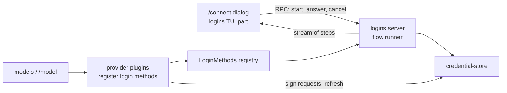

# Connect and login

`/connect` lets the user sign in to every provider Tau supports, from the TUI, and sign out again. Once signed in, the provider's models show up in `/model`.

Not built yet. Today Liminal stores credentials (`credential-store`) and the Codex provider (`model-codex`) uses a `codex` credential if one exists, but nothing can write one. In the running app `/model` lists nothing until this plan is built.

## Today

| Piece | Where | What it does |
| --- | --- | --- |
| `credential-store` | `packages/plugins/credential-store/` | `get`/`set`/`remove` a `Credential` (`ApiKey`, `OAuth`, `Command`) per login method; `secret` falls back to an env variable; `fresh` refreshes OAuth under a lock |
| `model-codex` | `packages/plugins/model-codex/` | Provider `codex`; signs requests and refreshes tokens (`src/server/auth.ts`); lists models from the Codex backend |
| `models` | `packages/plugins/models/` | `ModelProviders` registry; RPCs `models/providers`, `models/list` |
| `agent-loop` UI | `packages/plugins/agent-loop/src/tui.tsx` | `/model`; leaves out providers whose list fails |
| TUI dialogs | `packages/sdk/src/tui/{dialogs.tsx,SelectDialog.tsx}` | Dialog stack; only a select dialog exists |

## Scope: every Tau provider and login method

From Tau `src/ai/Providers.ts`, `src/ai/Connections.ts`, `src/ai/Login.ts`.

| Vendor | Provider | Login method | Ways to finish | Credential |
| --- | --- | --- | --- | --- |
| OpenAI | `codex` | Codex login (OAuth, `auth.openai.com`) | Browser (callback `localhost:1455`), device code | `OAuth` |
| OpenAI | `chatgpt` | Sign in with ChatGPT (per-user app registration, ID token checked) | Browser (callback `127.0.0.1:1455`) | `OAuth` with client id and ID token in `extra`; revoked on sign-out |
| OpenAI | `openai` | API key, env `OPENAI_API_KEY` | Paste key | `ApiKey` |
| Anthropic | `anthropic` | Claude subscription (OAuth, `claude.ai`) | Browser (callback `localhost:53692`), paste a code | `OAuth`; requests carry Claude Code headers |
| Anthropic | `anthropic-api` | API key, env `ANTHROPIC_API_KEY` (not in Tau; on the agreed list) | Paste key | `ApiKey` |
| OpenRouter | `openrouter` | API key, env `OPENROUTER_API_KEY` | Paste key | `ApiKey` |
| OpenCode | `opencode-go` | API key, env `OPENCODE_API_KEY` | Paste key | `ApiKey` |
| Local | user-added in settings | None | Nothing to sign in | None |

Each row shows one of three sign-in states in `/connect`: signed out, saved, or found in an environment variable (Tau `SignInState`).

## Shape

| System | Change |
| --- | --- |
| `logins` (new plugin) | Owns the `LoginMethods` registry, the flow runner, sign-in state, `/connect` and its dialogs |
| Provider plugins | Expand `model-codex`; add one per provider row; each registers its login methods |
| `credential-store` | Unchanged; storage and refresh only |
| SDK TUI | Adds prompt (text and secret) and confirm dialogs beside `SelectDialog` |
| `models` / `/model` | Re-lists when a credential changes |

## Round 1

1. **Who owns login flows.** Recommend one `logins` plugin with a `LoginMethods` registry (like `ModelProviders`, a `KeyedRegistry`); provider plugins register `{ id, vendor, title, ways, logIn, logOut }`. The shared OAuth pieces (PKCE, local callback server, paste a code, device code polling) live in `logins` and providers call them. Beats each provider owning its own flow and UI: one `/connect`, one copy of the OAuth code.
2. **How the TUI drives a running login.** Recommend the flow runs on the server and emits a stream of steps over RPC: `OpenUrl`, `ShowCode`, `Ask`, `AskSecret`, `Waiting`, `Done`, `Failed`. The TUI answers `Ask` with an `answer` RPC and can `cancel`. The flow is a state machine on the server; the TUI only draws the current step. Beats running flows in the TUI: the server holds the callback port and the credential, and a future web frontend reuses it.
3. **Provider plugins.** Recommend one plugin per provider row: `model-codex` (exists), `model-chatgpt`, `model-openai`, `model-anthropic` (subscription and API key as two methods of one plugin, or two plugins), `model-openrouter`, `model-opencode-go`, and `model-local` for user-added providers. New dependencies need approval: `@effect/ai-anthropic`, `@effect/ai-openrouter`, `@effect/ai-openai-compat` (Tau's `opencode-go` speaks OpenAI chat). The alternative is direct HTTP per provider, as `model-codex` partly does.
4. **Model lists.** Recommend each provider lists its own models live, as `model-codex` does. Tau instead reads the `models.dev` catalog with a cache (`src/ai/Catalog.ts`); that adds a catalog plugin and network fetch at startup.
5. **Local callback server.** Recommend `BunHttpServer.layer` from `@effect/platform-bun` (already a dependency) with `HttpServer.serve`, scoped to the login so the port closes when it ends. Opening the browser runs the platform `open` command through `ChildProcessSpawner`.
6. **Sign-out.** Recommend `/connect` shows a confirm dialog for a saved method, removes the credential, and for `chatgpt` revokes the token first; a failed revoke still removes it and tells the user to disconnect the app by hand (Tau behavior).
7. **Build order.** Recommend: (a) SDK prompt and confirm dialogs, `logins` plugin, `/connect`, API key methods for `openai`; (b) OAuth browser and device code for `codex`; (c) Claude subscription and Anthropic API key; (d) ChatGPT app; (e) OpenRouter, OpenCode Go, local providers. Each step is one commit with gallery updates.

## Deletes or replaces

- Live Codex tests stop depending on Tau's `~/.tau/credentials.db` once Liminal can sign in itself; the recording test reads Liminal's own store instead (open: keep Tau's store as a read-only source for tests).
- `/model` stops leaving failed providers out silently once sign-in state exists; it shows "sign in with /connect" under them.

## References

- Tau `src/ai/{Providers,Connections,Login,Catalog}.ts`, `src/ai/internal/login/{oauth,chatgpt-app,token-endpoint,login-services}.ts`, `src/ai/internal/signing/claude-code.ts`, `src/tui/internal/{connect-state,connect-flow,ConnectDialog}.ts*`
- Liminal `docs/plugins/credential-store.md`
