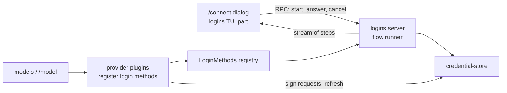

# Connect and login

`/connect` lets the user sign in to every provider Tau supports, from the TUI, and sign out again. Once signed in, the provider's models show up in `/model`.

Step 1 is built; login is not. Today Liminal stores credentials (`credential-store`) and the Codex provider (`model-codex`) uses a `codex` credential if one exists, but nothing can write one. In the running app `/model` lists nothing until this plan is built.

## Today

| Piece | Where | What it does |
| --- | --- | --- |
| `credential-store` | `packages/plugins/credential-store/` | `get`/`set`/`remove` a `Credential` (`ApiKey`, `OAuth`, `Command`) per login method; `secret` falls back to an env variable; `fresh` refreshes OAuth under a lock |
| `model-codex` | `packages/plugins/model-codex/` | Provider `codex`; signs requests and refreshes tokens (`src/server/auth.ts`); lists models from the Codex backend |
| `models` | `packages/plugins/models/` | `ModelProviders` registry; RPCs `models/providers`, `models/list` |
| `agent-loop` UI | `packages/plugins/agent-loop/src/tui.tsx` | `/model`; leaves out providers whose list fails |
| TUI dialogs | `packages/sdk/src/tui/{dialogs.tsx,SelectDialog.tsx}` | Dialog stack; only a select dialog exists |

## Scope: every Tau provider and login method

From Tau `src/ai/Providers.ts`, `src/ai/Connections.ts`, `src/ai/Login.ts`.

| Vendor | Provider | Login method | Ways to finish | Credential |
| --- | --- | --- | --- | --- |
| OpenAI | `codex` | Codex login (OAuth, `auth.openai.com`) | Browser (callback `localhost:1455`), device code | `OAuth` |
| OpenAI | `chatgpt` | Sign in with ChatGPT (per-user app registration, ID token checked) | Browser (callback `127.0.0.1:1455`) | `OAuth` with client id and ID token in `extra`; revoked on sign-out |
| OpenAI | `openai` | API key, env `OPENAI_API_KEY` | Paste key | `ApiKey` |
| Anthropic | `anthropic` | Claude subscription (OAuth, `claude.ai`) | Browser (callback `localhost:53692`), paste a code | `OAuth`; requests carry Claude Code headers |
| Anthropic | `anthropic-api` | API key, env `ANTHROPIC_API_KEY` (not in Tau; on the agreed list) | Paste key | `ApiKey` |
| OpenRouter | `openrouter` | API key, env `OPENROUTER_API_KEY` | Paste key | `ApiKey` |
| OpenCode | `opencode-go` | API key, env `OPENCODE_API_KEY` | Paste key | `ApiKey` |
| Local | user-added in settings | None | Nothing to sign in | None |

Each row shows one of three sign-in states in `/connect`: signed out, saved, or found in an environment variable (Tau `SignInState`).

## Shape



| System | Change |
| --- | --- |
| `logins` (new plugin) | Owns the `LoginMethods` registry, the flow runner, sign-in state, `/connect` and its dialogs |
| Provider plugins | Expand `model-codex`; add one per provider row; each registers its login methods |
| `credential-store` | Unchanged; storage and refresh only |
| SDK TUI | Adds prompt (text and secret) and confirm dialogs beside `SelectDialog` |
| `model-catalog` (new plugin) | `models.dev` catalog and cache; source of model details for `/model` |
| `models` / `/model` | Lists from the catalog, filtered by sign-in and plan lists; re-lists when a credential changes |

## Decisions

| Topic | Decision |
| --- | --- |
| Who owns login | A new `logins` plugin holds the `LoginMethods` registry (a `KeyedRegistry`, like `ModelProviders`), the shared OAuth pieces (PKCE, local callback server, paste a code, device code polling) and `/connect`. Provider plugins register `{ id, vendor, title, ways, logIn, logOut }` |
| Running a login | The flow runs on the server as a state machine and streams steps over RPC: `OpenUrl`, `ShowCode`, `Ask`, `AskSecret`, `Waiting`, `Done`, `Failed`. The TUI draws the current step, answers by an `answer` RPC and stops it by `cancel` |
| Provider plugins | One per provider: `model-codex` (exists), `model-chatgpt`, `model-openai`, `model-anthropic`, `model-openrouter`, `model-opencode-go`, `model-local` |
| Anthropic | One `model-anthropic` plugin with two login methods: Claude subscription and API key |
| API packages | `@effect/ai-openai`, `@effect/ai-anthropic`, `@effect/ai-openrouter`, `@effect/ai-openai-compat` (per `docs/plugins/models.md`). Native tool changes come from a provider layer that wraps the package client (`docs/plans/core-contracts.md`); OpenCode Go Messages replies get their missing `usage` fields filled before decoding |
| Model lists | A new `model-catalog` plugin owns the `models.dev` catalog and its local cache; `models` depends on it; replaceable like `credential-store` |
| Catalog refresh | Startup uses the cached copy; a background refresh runs when the cache is older than a set age |
| Plan-limited logins | Codex and ChatGPT fetch their live plan list; `/model` shows only catalog models on that list (Tau `fetchPlanLists`) |
| Callback server | `BunHttpServer.layer` (`@effect/platform-bun`) with `HttpServer.serve`, scoped to the login so the port closes when it ends; the browser opens through the platform `open` command |
| Sign-out | Confirm dialog, then remove the credential. `chatgpt` revokes first; a failed revoke still removes it and tells the user to disconnect the app by hand |
| Live test credentials | Live recording tests read Liminal's own credential store only |

## Build order

One commit each, with gallery updates.

1. `model-catalog`: `models.dev` catalog, cache and background refresh; `/model` lists from it
2. SDK prompt and confirm dialogs, `logins` plugin, `/connect`, `model-openai` with its API key
3. Codex browser and device code login
4. `model-anthropic`: Claude subscription and API key
5. `model-chatgpt`: Sign in with ChatGPT
6. `model-openrouter`, `model-opencode-go`, `model-local`

## Step 1: model-catalog

Built. Lets `/model` list every catalog provider's models with names, limits, thinking options and prices from `models.dev`, with no provider-specific list code.

### Files

```text
packages/plugins/model-catalog/          new plugin
  plugin.ts                              provides ModelCatalog; requires nothing
  src/contract.ts                        ModelCatalog
  src/server.ts                          layer: cache, refresh, FetchHttpClient
  src/server/models-dev.ts               models.dev entry Schema; entry -> ModelInfo
  src/server/cache.ts                    read and write <data>/catalog.json
  test/catalog.test.ts                   fixture subset served at HttpClient; TestClock for age
  test/fixtures/models-dev.json          a few openai and anthropic entries
packages/plugins/models/
  plugin.ts                              requires ModelCatalog
  src/contract.ts                        ModelProvider.models -> source: ModelSource
  src/server.ts                          listModels joins catalog and plan list
  test/models.test.ts                    Listed, Catalog and PlanCatalog joins
packages/plugins/model-codex/src/server/
  catalog.ts -> plan.ts                  plan list only: slug and context window
  provider.ts                            source: PlanCatalog("openai", plan)
packages/plugins/model-scripted/src/server.ts   source: Listed
packages/sdk/src/core/model.ts           CatalogUnavailable; thinking values and options
docs/plugins/model-catalog.md            new plugin file
docs/plugins/models.md                   "Each provider owns its model list" rewritten
```

### Types

```ts
// sdk/src/core/model.ts (contracts import only Effect and the SDK, so models and agent-loop name it here)
class CatalogUnavailable extends Schema.TaggedError("CatalogUnavailable", {
  catalogId: Schema.String, message: Schema.String })

// model-catalog/src/contract.ts
class ModelCatalog extends Context.Service<ModelCatalog, {
  /** Tool-calling models models.dev lists under catalogId; fetches when the cache lacks it. */
  readonly models: (catalogId: string) => Effect<ReadonlyArray<ModelInfo>, CatalogUnavailable>
}>

// models/src/contract.ts
type PlanModel = { readonly id: string; readonly contextWindow: Option<number> }

type ModelSource = Data.TaggedEnum<{
  Listed: { models: Effect<ReadonlyArray<ModelInfo>, ModelError> }            // scripted, local
  Catalog: { catalogId: string }                                             // openai, anthropic, openrouter
  PlanCatalog: { catalogId: string; plan: Effect<ReadonlyArray<PlanModel>, ModelError> }  // codex, chatgpt
}>

interface ModelProvider { id; name; source: ModelSource; stream; nativeToolChanges }

// ModelsRpcs "models/list" error: ModelError | ProviderNotFound | CatalogUnavailable
```

### Cache file `<Directories.data>/catalog.json`

| Field | Holds |
| --- | --- |
| `fetchedAt` | Milliseconds of the last full fetch |
| `providers` | `Record<catalogId, { models: Record<modelId, Json> }>`, only the ids asked for; each model decodes on its own so one bad entry is skipped |

The full `api.json` is over 5 MB, so the cache keeps only catalog ids a provider asked for (Tau `keepProviders`).

### Call path

```text
model-catalog layer start
  read catalog.json into a Ref (missing or undecodable file: empty)
  fork in scope: refresh when fetchedAt is older than one day

refresh(ids)
  GET https://models.dev/api.json
  keep ids; set fetchedAt; write catalog.json
  failure: log, keep the old Ref and file

ModelCatalog.models(catalogId)
  catalogId missing from Ref -> refresh(known ids + catalogId)
  still missing -> CatalogUnavailable
  decode each entry; drop tool_call false; map to ModelInfo

Models.listModels(provider)
  Listed       -> source.models
  Catalog      -> catalog.models(catalogId)
  PlanCatalog  -> both at once; keep catalog models on the plan; plan context window wins
```

### Entry to `ModelInfo`

| `ModelInfo` | From models.dev |
| --- | --- |
| `name`, `contextWindow`, `maxOutput` | `name`, `limit.context`, `limit.output` |
| `input` | `modalities.input` filtered to `text`, `image` |
| `price` | `cost.input`, `output`, `cache_read`, `cache_write` |
| `thinking`, `defaultThinking` | See Thinking options |

### Deletes

- `model-codex` `catalog.ts`: `modelInfo`, `outputLimit` and the reasoning-level mapping; Codex details come from the catalog.
- `ModelProvider.models`.

### Step 1 decisions

- No bundled snapshot: the first run fetches; offline with no cache, a catalog provider's listing fails with `CatalogUnavailable`.
- `/model` rows for a provider that cannot list (`CatalogUnavailable` or no login) arrive in step 2 with the sign-in rows; until then such a provider is left out.
- Plan lists are fetched each time `/model` opens, as Codex does today.
- Models from settings arrive in step 6 with `model-local`.

### Thinking options

Each model offers its own options, named as the provider names them (OpenCode `packages/core/src/variant.ts`); no shared ladder.

| models.dev `reasoning_options` | Options (id: label) |
| --- | --- |
| `effort` values | Each value as given, such as `none`, `low`, `high`, `xhigh`, `max`; effort wins over a budget |
| `budget_tokens` | `low`: min (1024 when none), `medium`: a quarter, `high`: half, `max`: the output limit less one; labels show tokens |
| `toggle` | Adds `off` unless an effort offers `none`; alone it gives `off` and `on` |
| `reasoning` false | None |

```ts
// sdk/src/core/model.ts
type ThinkingValue = Data.TaggedEnum<{ Off: {}; On: {}; Effort: { effort: string }; Budget: { tokens: number } }>
type ThinkingOption = { id: string; label: string; value: ThinkingValue }
ModelInfo.thinking: ReadonlyArray<ThinkingOption>          // was ReadonlyArray<ThinkingLevel>
ModelInfo.defaultThinking: Option<string>                  // medium when offered, else the middle option
ModelRequest.thinking: ThinkingValue                       // was ThinkingLevel
Models.describe(ref): Effect<ModelInfo, ModelError | ProviderNotFound | CatalogUnavailable>  // no plan fetch
```

| Path | Change |
| --- | --- |
| `agent-loop` settings `thinking` | An option id, optional; no `medium` default |
| Turn start | `describe(model)`; the saved id when offered, else the model's default, else `Off` |
| `/model` | Shows each model's options; the composer line shows the chosen option's label |
| `model-codex` | `Effort` sends that effort; `Off` sends `none` |
| `ThinkingLevel` | Deleted |

## Deletes or replaces

- Live Codex tests stop reading Tau's `~/.tau/credentials.db`; they read Liminal's store.
- `model-codex` `src/server/catalog.ts` stops being the source of the Codex model list; it supplies the plan list the catalog filters.
- `/model` stops leaving failed providers out silently; it shows "sign in with /connect" under them.

## References

- Tau `src/ai/{Providers,Connections,Login,Catalog}.ts`, `src/ai/internal/login/{oauth,chatgpt-app,token-endpoint,login-services}.ts`, `src/ai/internal/signing/claude-code.ts`, `src/tui/internal/{connect-state,connect-flow,ConnectDialog}.ts*`
- Liminal `docs/plugins/credential-store.md`
