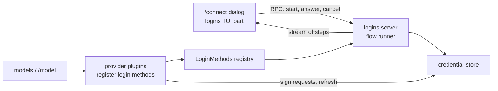
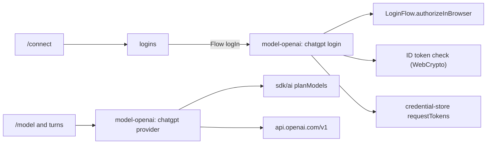
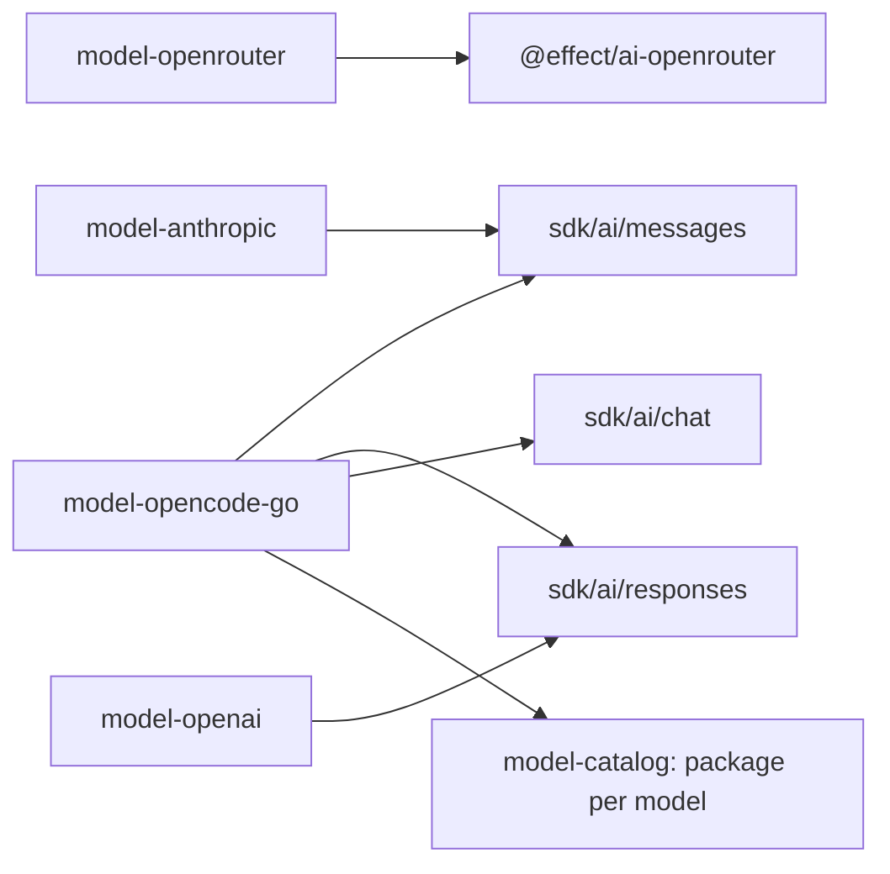

# Connect and login

`/connect` lets the user sign in to every provider Tau supports, from the TUI, and sign out again. Once signed in, the provider's models show up in `/model`.

Step 1 is built; login is not. Today Liminal stores credentials (`credential-store`) and the Codex provider (`model-codex`) uses a `codex` credential if one exists, but nothing can write one. In the running app `/model` lists nothing until this plan is built.

## Today

| Piece | Where | What it does |
| --- | --- | --- |
| `credential-store` | `packages/plugins/credential-store/` | `get`/`set`/`remove` a `Credential` (`ApiKey`, `OAuth`, `Command`) per login method; `secret` falls back to an env variable; `fresh` refreshes OAuth under a lock |
| `model-codex` | `packages/plugins/model-codex/` | Provider `codex`; signs requests and refreshes tokens (`src/server/auth.ts`); lists models from the Codex backend |
| `models` | `packages/plugins/models/` | `ModelProviders` registry; RPCs `models/providers`, `models/list` |
| `agent-loop` UI | `packages/plugins/agent-loop/src/tui.tsx` | `/model`; leaves out providers whose list fails |
| TUI dialogs | `packages/sdk/src/tui/{dialogs.tsx,SelectDialog.tsx}` | Dialog stack; only a select dialog exists |

## Scope: every Tau provider and login method

From Tau `src/ai/Providers.ts`, `src/ai/Connections.ts`, `src/ai/Login.ts`.

| Vendor | Provider | Login method | Ways to finish | Credential |
| --- | --- | --- | --- | --- |
| OpenAI | `codex` | Codex login (OAuth, `auth.openai.com`) | Browser (callback `127.0.0.1:1455`), device code | `OAuth` |
| OpenAI | `chatgpt` | Sign in with ChatGPT (per-user app registration, ID token checked) | Browser (callback `127.0.0.1:1455`) | `OAuth` with client id and ID token in `extra`; revoked on sign-out |
| OpenAI | `openai` | API key, env `OPENAI_API_KEY` | Paste key | `ApiKey` |
| Anthropic | `anthropic` | Claude subscription (OAuth, `claude.ai`) | Browser (callback `localhost:53692`), paste a code | `OAuth`; requests carry Claude Code headers |
| Anthropic | `anthropic-api` | API key, env `ANTHROPIC_API_KEY` (not in Tau; on the agreed list) | Paste key | `ApiKey` |
| OpenRouter | `openrouter` | API key, env `OPENROUTER_API_KEY` | Paste key | `ApiKey` |
| OpenCode | `opencode-go` | API key, env `OPENCODE_API_KEY` | Paste key | `ApiKey` |

Each row shows one of three sign-in states in `/connect`: signed out, saved, or found in an environment variable (Tau `SignInState`).

## Shape



| System | Change |
| --- | --- |
| `logins` (new plugin) | Owns the `LoginMethods` registry, the flow runner, sign-in state, `/connect` and its dialogs |
| Provider plugins | Expand `model-codex`; add one per provider row; each registers its login methods |
| `credential-store` | Unchanged; storage and refresh only |
| SDK TUI | Adds prompt (text and secret) and confirm dialogs beside `SelectDialog` |
| `model-catalog` (new plugin) | `models.dev` catalog and cache; source of model details for `/model` |
| `models` / `/model` | Lists from the catalog, filtered by sign-in and plan lists; re-lists when a credential changes |

## Decisions

| Topic | Decision |
| --- | --- |
| Who owns login | A new `logins` plugin holds the `LoginMethods` registry (a `KeyedRegistry`, like `ModelProviders`), the shared OAuth pieces (PKCE, local callback server, paste the address) and `/connect`. Provider plugins register `{ id, vendor, title, ways, logIn, logOut }` |
| Login methods | A tagged union. `ApiKey { env }` is a declaration that `logins` handles fully: ask, save, remove, saved or environment state. `Flow { ways, logIn, logOut? }` is for OAuth; `logIn` runs against a `LoginFlow` service from `logins` (`openUrl`, `showCode`, `ask`, `askSecret`, `waiting`) |
| `effect/ai` translation | A new SDK zone `@liminal/sdk/ai` holds the translation every provider shares (`promptOf`, `toolkitOf`, `streamOf`, `toModelError`), moved out of `model-codex`; each provider supplies its own metadata Schema |
| Running a login | The flow runs on the server and streams steps over RPC (see Step 2 Types). The TUI draws the current step, answers by an `answer` RPC and stops it by closing the stream; the RPC client's `Interrupt` stops the server flow, so there is no `cancel` RPC |
| Provider plugins | One per provider: `model-codex` (exists), `model-chatgpt`, `model-openai`, `model-anthropic`, `model-openrouter`, `model-opencode-go` |
| Anthropic | One `model-anthropic` plugin with two login methods: Claude subscription and API key |
| API packages | `@effect/ai-openai`, `@effect/ai-anthropic`, `@effect/ai-openrouter`, `@effect/ai-openai-compat` (per `docs/plugins/models.md`). Native tool changes come from a provider layer that wraps the package client (`docs/plans/core-contracts.md`); OpenCode Go Messages replies get their missing `usage` fields filled before decoding |
| Model lists | A new `model-catalog` plugin owns the `models.dev` catalog and its local cache; `models` depends on it; replaceable like `credential-store` |
| Catalog refresh | Startup uses the cached copy; a background refresh runs when the cache is older than a set age |
| Plan-limited logins | Codex and ChatGPT fetch their live plan list; `/model` shows only catalog models on that list (Tau `fetchPlanLists`) |
| Callback server | `Bun.serve` inside `Effect.acquireRelease`, scoped to the login so the port closes when it ends; a taken port is a typed failure (`BunHttpServer.make` turns it into a defect). The browser opens through `open` (macOS) or `xdg-open` |
| Sign-out | Confirm dialog, then remove the credential. `chatgpt` revokes first; a failed revoke still removes it and tells the user to disconnect the app by hand |
| Live test credentials | Live recording tests read Liminal's own credential store only |

## Build order

One commit each, with gallery updates.

1. `model-catalog`: `models.dev` catalog, cache and background refresh; `/model` lists from it
2. `@liminal/sdk/ai` with `model-codex` moved onto it, SDK prompt and confirm dialogs, `logins` plugin, `/connect`, `/model` listing only signed-in providers, `model-openai` with its API key; one commit
3. Codex browser and device code login
4. `model-anthropic`: Claude subscription and API key
5. Sign in with ChatGPT: provider `chatgpt` in `model-openai`
6. `model-openrouter`, `model-opencode-go` (Step 6 below)

## Step 1: model-catalog

Built. Lets `/model` list every catalog provider's models with names, limits, thinking options and prices from `models.dev`, with no provider-specific list code.

### Files

```text
packages/plugins/model-catalog/          new plugin
  plugin.ts                              provides ModelCatalog; requires nothing
  src/contract.ts                        ModelCatalog
  src/server.ts                          layer: cache, refresh, FetchHttpClient
  src/server/models-dev.ts               models.dev entry Schema; entry -> ModelInfo
  src/server/cache.ts                    read and write <data>/catalog.json
  test/catalog.test.ts                   fixture subset served at HttpClient; TestClock for age
  test/fixtures/models-dev.json          a few openai and anthropic entries
packages/plugins/models/
  plugin.ts                              requires ModelCatalog
  src/contract.ts                        ModelProvider.models -> source: ModelSource
  src/server.ts                          listModels joins catalog and plan list
  test/models.test.ts                    Listed, Catalog and PlanCatalog joins
packages/plugins/model-codex/src/server/
  catalog.ts -> plan.ts                  plan list only: slug and context window
  provider.ts                            source: PlanCatalog("openai", plan)
packages/plugins/model-scripted/src/server.ts   source: Listed
packages/sdk/src/core/model.ts           CatalogUnavailable; thinking values and options
docs/plugins/model-catalog.md            new plugin file
docs/plugins/models.md                   "Each provider owns its model list" rewritten
```

### Types

```ts
// sdk/src/core/model.ts (shared by models and agent-loop)
class CatalogUnavailable extends Schema.TaggedError("CatalogUnavailable", {
  catalogId: Schema.String, message: Schema.String })

// model-catalog/src/contract.ts
class ModelCatalog extends Context.Service<ModelCatalog, {
  /** Tool-calling models models.dev lists under catalogId; fetches when the cache lacks it. */
  readonly models: (catalogId: string) => Effect<ReadonlyArray<ModelInfo>, CatalogUnavailable>
}>

// models/src/contract.ts
type PlanModel = { readonly id: string; readonly contextWindow: Option<number> }

type ModelSource = Data.TaggedEnum<{
  Listed: { models: Effect<ReadonlyArray<ModelInfo>, ModelError> }            // scripted
  Catalog: { catalogId: string }                                             // openai, anthropic, openrouter
  PlanCatalog: { catalogId: string; plan: Effect<ReadonlyArray<PlanModel>, ModelError> }  // codex, chatgpt
}>

interface ModelProvider { id; name; source: ModelSource; stream; nativeToolChanges }

// ModelsRpcs "models/list" error: ModelError | ProviderNotFound | CatalogUnavailable
```

### Cache file `<Directories.data>/catalog.json`

| Field | Holds |
| --- | --- |
| `fetchedAt` | Milliseconds of the last full fetch |
| `providers` | `Record<catalogId, { models: Record<modelId, Json> }>`, only the ids asked for; each model decodes on its own so one bad entry is skipped |

The full `api.json` is over 5 MB, so the cache keeps only catalog ids a provider asked for (Tau `keepProviders`).

### Call path

```text
model-catalog layer start
  read catalog.json into a Ref (missing or undecodable file: empty)
  fork in scope: refresh when fetchedAt is older than one day

refresh(ids)
  GET https://models.dev/api.json
  keep ids; set fetchedAt; write catalog.json
  failure: log, keep the old Ref and file

ModelCatalog.models(catalogId)
  catalogId missing from Ref -> refresh(known ids + catalogId)
  still missing -> CatalogUnavailable
  decode each entry; drop tool_call false; map to ModelInfo

Models.listModels(provider)
  Listed       -> source.models
  Catalog      -> catalog.models(catalogId)
  PlanCatalog  -> both at once; keep catalog models on the plan; plan context window wins
```

### Entry to `ModelInfo`

| `ModelInfo` | From models.dev |
| --- | --- |
| `name`, `contextWindow`, `maxOutput` | `name`, `limit.context`, `limit.output` |
| `input` | `modalities.input` filtered to `text`, `image` |
| `price` | `cost.input`, `output`, `cache_read`, `cache_write` |
| `thinking`, `defaultThinking` | See Thinking options |

### Deletes

- `model-codex` `catalog.ts`: `modelInfo`, `outputLimit` and the reasoning-level mapping; Codex details come from the catalog.
- `ModelProvider.models`.

### Step 1 decisions

- No bundled snapshot: the first run fetches; offline with no cache, a catalog provider's listing fails with `CatalogUnavailable`.
- `/model` leaves out a provider that is not signed in; a signed-in provider whose list fails shows the failure in one row.
- Plan lists are fetched each time `/model` opens, as Codex does today.

### Thinking options

Each model offers its own options, named as the provider names them (OpenCode `packages/core/src/variant.ts`); no shared ladder.

| models.dev `reasoning_options` | Options (id: label) |
| --- | --- |
| `effort` values | Each value as given, such as `none`, `low`, `high`, `xhigh`, `max`; effort wins over a budget |
| `budget_tokens` | `low`: min (1024 when none), `medium`: a quarter, `high`: half, `max`: the output limit less one; labels show tokens |
| `toggle` | Adds `off` unless an effort offers `none`; alone it gives `off` and `on` |
| `reasoning` false | None |

```ts
// sdk/src/core/model.ts
type ThinkingValue = Data.TaggedEnum<{ Off: {}; On: {}; Effort: { effort: string }; Budget: { tokens: number } }>
type ThinkingOption = { id: string; label: string; value: ThinkingValue }
ModelInfo.thinking: ReadonlyArray<ThinkingOption>          // was ReadonlyArray<ThinkingLevel>
ModelInfo.defaultThinking: Option<string>                  // medium when offered, else the middle option
ModelRequest.thinking: ThinkingValue                       // was ThinkingLevel
Models.describe(ref): Effect<ModelInfo, ModelError | ProviderNotFound | CatalogUnavailable>  // no plan fetch
```

| Path | Change |
| --- | --- |
| `agent-loop` settings `thinking` | An option id, optional; no `medium` default |
| Turn start | `describe(model)`; the saved id when offered, else the model's default, else `Off` |
| `/model` | Shows each model's options; the composer line shows the chosen option's label |
| `model-codex` | `Effort` sends that effort; `Off` sends `none` |
| `ThinkingLevel` | Deleted |

## Step 2: logins, /connect, model-openai

Status: built.

Lets the user save an OpenAI API key from `/connect`, sign out again, and see OpenAI's models in `/model`; `/model` lists only signed-in providers.

### Files

```text
packages/sdk/src/ai/                     new SDK zone `@liminal/sdk/ai`, moved from model-codex
  index.ts                               exports below
  prompt.ts                              promptOf, toolkitOf (from codex prompt.ts)
  events.ts                              streamOf: effect/ai parts -> ModelEvent (from codex events.ts)
  errors.ts                              toModelError (from codex errors.ts)
  data.ts                                ProviderData, OpenAiData, keptData
  reply.ts                               replyOf: request -> ModelEvent stream
  effort.ts                              effortOf: thinking -> a provider's effort
packages/sdk/src/tui/
  PromptField.tsx                        one text or secret line, inside another dialog
  ConfirmDialog.tsx                      a question, enter confirms
  SelectDialog.tsx                       option tone: warning rows
packages/plugins/logins/                 new plugin
  plugin.ts                              provides LoginMethods; requires CredentialStore
  src/contract.ts                        LoginMethod, LoginMethods, LoginFlow, LoginStep, LoginsRpcs
  src/server.ts                          registry, sign-in state, RPC handlers
  src/server/flow.ts                     runs one login: steps out, answers in
  src/tui.tsx                            /connect
  src/tui/connect.tsx                    providers -> ways -> methods -> login; sign-out
  src/tui/ChoiceDialog.tsx               rows with a note at the right; enter, ctrl+d
  src/tui/LoginDialog.tsx                draws the steps; retry after a failure
  src/tui/steps.ts                       the steps shown, with the local Failed
  test/logins.test.ts                    API key flow, state, sign-out, closing the stream cancels
packages/plugins/model-openai/           new plugin
  plugin.ts                              requires ModelProviders, CredentialStore, LoginMethods
  src/server/provider.ts                 provider `openai`, Catalog("openai"), checkLogin; login ApiKey OPENAI_API_KEY
  test/openai.test.ts                    a hand-written Responses stream at HttpClient
packages/plugins/model-codex/src/server/ prompt.ts, events.ts, errors.ts moved to @liminal/sdk/ai
packages/plugins/models/src/             ModelProvider.checkLogin, checked before listing
packages/plugins/agent-loop/src/tui/     /model lists signed-in providers, failure rows
apps/gallery/src/chat/                   PromptDialog, ConfirmDialog, Connect, Login states; /model failure row
.fallowrc.jsonc, tools/lint/plugin-rules.ts, docs/requirements/07-repository.md   zone `ai`
docs/plugins/logins.md, docs/plugins/model-openai.md
```

### Types

```ts
// sdk/src/ai
promptOf(messages, data: ProviderData): Effect<Prompt.RawInput, ModelError, FileSystem>
toolkitOf(tools): Effect<Toolkit, ModelError>
streamOf(name: string, data: ProviderData, parts: Stream<Response.StreamPart, AiError>): Stream<ModelEvent, ModelError>
toModelError(error: AiError): ModelError
/** What a provider keeps from a reply part's metadata for the next request, and reads back. */
type ProviderData = Schema.Codec<Record<string, Json>>   // codex and openai: { openai: { itemId, encryptedContent } }

// logins/src/contract.ts
type Vendor = { id: string; name: string }
type LoginWay = { id: string; title: string }                     // "browser", "device", "paste"
type LoginMethod = Data.TaggedEnum<{
  ApiKey: { id: string; vendor: Vendor; title: string; env: string }
  Flow: { id; vendor; title; ways: ReadonlyArray<LoginWay>;
    logIn: (way: string) => Effect<Credential, LoginFailed, LoginFlow>   // logins saves it
    logOut: Option<Effect<void, LoginFailed>> }
}>                                                                // id is the credential-store method
class LoginMethods extends KeyedRegistry.Service<LoginMethods, LoginMethod>
class LoginFlow extends Context.Service<{ openUrl(url): Effect<void>; showCode(code, url): Effect<void>;
  ask(question): Effect<string>; askSecret(question): Effect<Redacted>; waiting(text): Effect<void>; tell(text): Effect<void> }>
class LoginFailed extends Schema.TaggedError("LoginFailed", { method, message })
SignIn = SignedOut | Saved | FromEnv { variable }
LoginStep = OpenUrl { url } | ShowCode { code, url } | Ask { question, secret } | Waiting { text } | Told { text } | Done
MethodInfo = { id, vendor, title, ways, state: SignIn }
LoginsRpcs:
  "logins/list"    success Array<MethodInfo>
  "logins/start"   { method, way? } stream LoginStep, error LoginFailed
  "logins/answer"  { method, text }      // the open flow's pending ask
  "logins/logout"  { method } error LoginFailed
```

### Call path

```text
/connect -> logins/list -> providers list "Connect a provider": vendors, "signed in" when any way is
  enter  -> ways list titled with the vendor: its methods, state at the right; skipped when one method
    enter  -> methods list titled with the method when ways > 1 -> LoginDialog titled with the vendor
  ctrl+d on a signed-in vendor or method -> SignOutDialog "Sign out of <vendor> (<method>)?" -> logins/logout
  esc    -> back one list; closes from the providers list
LoginDialog watches logins/start(method, way)
  Ask        -> PromptField; enter -> logins/answer
  OpenUrl, ShowCode, Waiting, Told -> lines
  Done       -> back to the ways list; Failed -> the message, enter retries, esc goes back
  esc        -> closes; the stream ends; the client sends Interrupt; the server flow stops

logins/start (server)
  one open flow per method; a second start replaces the first
  steps: Queue; pending ask: Deferred, completed by logins/answer
  ApiKey: askSecret(title) -> store.set(id, ApiKey { key }) -> Done
  Flow:   logIn(way) with LoginFlow over the queue, saving its credential -> Done
logins/logout: Flow logOut when given -> store.remove(id)
state: store.get(id) Some -> Saved; ApiKey with env set (Config.option(Config.Redacted(env))) -> FromEnv; else SignedOut

/model: a provider whose list fails with ModelError auth -> left out; any other failure -> one
  warning row under it with the message; picking it does nothing

model-openai stream
  key: store.secret("openai", { env: "OPENAI_API_KEY" }); none -> ModelError auth
  OpenAiClient.make({ apiKey }) + OpenAiLanguageModel.make({ store: false, include encrypted reasoning,
    prompt_cache_key, reasoning.effort when Effect, none when Off })
  replyOf("OpenAI", OpenAiData, ...); On or a budget -> ModelError invalid-request
  checkLogin: the same key read; listing fails with ModelError auth while none
```

| Injection | Production | Tests |
| --- | --- | --- |
| `HttpClient` (model-openai) | `FetchHttpClient` | a hand-written Responses stream; no OpenAI key to record with |
| `CredentialStore` | SQLite store | SQLite store in the test directories |
| Login answers | TUI over RPC | `logins/answer` called by the test |

### Step 2 open

- No `PromptDialog`: the login dialog holds a `PromptField`, and nothing else asks for one line yet.
- `ModelProvider.checkLogin` is new: a catalog provider lists without its key, so `/model` would offer OpenAI models that fail at the first turn.
- Codex is left out of `/model` until step 3 registers its login method; `/connect` lists only OpenAI meanwhile.
- The `model-openai` reply test uses a hand-written Responses stream; record a real one once a key is at hand.

### Step 2 build order

- Gallery states first: prompt, confirm, `/connect`, login steps and the `/model` failure row; the user reviews them before the wiring. One commit for the whole step.

### Deletes

- `model-codex` `prompt.ts`, `events.ts`, `errors.ts` translation code, moved to `@liminal/sdk/ai`.
- `agent-loop` UI: leaving out a provider whose list fails.

## Step 3: Codex login

Status: built; a live sign-in confirmed `originator: liminal`.

Lets the user sign in to Codex from `/connect`, in the browser or with a device code, and drops the live tests' read of Tau's `~/.tau/credentials.db`.

### Today

| Piece | Where | State |
| --- | --- | --- |
| Codex requests | `model-codex/src/server/auth.ts` | Signs with `CredentialStore.fresh("codex", refreshTokens)`; account id read from the access token |
| Token refresh | same file | Built: `auth.openai.com/oauth/token`, client `app_EMoamEEZ73f0CkXaXp7hrann` |
| Login method | none | `/model` leaves Codex out; `/connect` has no Codex row |
| Live tests | `model-codex/test/record.test.ts` | Read Tau's `~/.tau/credentials.db` |
| `LoginFlow` | `logins/src/contract.ts` | Steps only: `openUrl`, `showCode`, `ask`, `askSecret`, `waiting`, `tell` |

### Codex protocol (Codex CLI `codex-rs/login/src/{server,device_code_auth}.rs`, Tau `src/ai/Providers.ts`)

| Way | Steps |
| --- | --- |
| Browser | PKCE and state; open `auth.openai.com/oauth/authorize` with `id_token_add_organizations`, `codex_cli_simplified_flow`, `originator`; the browser returns to `http://127.0.0.1:1455/auth/callback`; exchange the code at `/oauth/token` (form) |
| Device code | POST `/api/accounts/deviceauth/usercode`; show the code and `auth.openai.com/codex/device`; poll `/api/accounts/deviceauth/token` at its interval; exchange the returned code and verifier at `/oauth/token` with redirect `auth.openai.com/deviceauth/callback` |

### Step 3 decisions

| Topic | Decision |
| --- | --- |
| Shared browser steps | `LoginFlow.authorizeInBrowser({ authorizeUrl, params, callback })` runs PKCE, the local callback server and the paste fallback, and returns the code, verifier and redirect address; each provider exchanges the code for tokens itself |
| `originator` | `liminal`; a live sign-in works with it |
| Device code | In `model-codex`: OpenAI's own endpoints and exchange; `logins` only shows the code through `showCode` |

### Step 3 files

```text
packages/plugins/logins/
  src/contract.ts                LoginFlow.authorizeInBrowser, BrowserAuthorization, Authorized
  src/server/flow.ts             flowOf adds authorizeInBrowser for the running method
  src/server/browser.ts          new: PKCE, callback server, open the browser, race with a pasted address
  test/browser.test.ts           new: callback on port 0, pasted address, wrong state, port taken
packages/plugins/model-codex/
  package.json                   + @liminal/logins
  plugin.ts                      requires + LoginMethods
  src/server/provider.ts         registers the `codex` Flow method
  src/server/auth.ts             requestTokens: token request -> OAuth, shared by exchange and refresh
  src/server/login.ts            new: browser and device ways, code exchange
  test/support.ts                stack adds logins
  test/login.test.ts             new: fake LoginFlow, fake HttpClient
  test/record.test.ts            reads Liminal's store, not ~/.tau/credentials.db
docs/plugins/logins.md, docs/plugins/model-codex.md
```

The gallery needs no new state: the login dialog already draws `OpenUrl`, `ShowCode`, `Ask` and `Waiting` together.

### Step 3 types

```ts
// logins/src/contract.ts
/** Where the browser comes back to; port 0 takes a free port. */
const LoginCallback = Schema.Struct({ host: Schema.String, port: Schema.Int, path: Schema.String })
const BrowserAuthorization = Schema.Struct({
  authorizeUrl: Schema.String,
  params: Schema.Record(Schema.String, Schema.String),   // client_id, scope, provider extras
  callback: LoginCallback,
})
const Authorized = Schema.Struct({ code: Schema.String, verifier: Schema.String, redirectUri: Schema.String })
LoginFlow += authorizeInBrowser(authorization: BrowserAuthorization): Effect<Authorized, LoginFailed>

// model-codex/src/server/login.ts
codexMethod(client: HttpClient): LoginMethod   // Flow { id: "codex", vendor OpenAI, ways: browser, device }
```

### Step 3 call path

```text
authorizeInBrowser (logins/server/browser.ts), scoped to the call
  verifier, state = base64url(Crypto.randomBytes(32)); challenge = base64url(sha256(verifier))
  Bun.serve({ hostname: callback.host, port: callback.port }) in acquireRelease; release stops it
    request on callback.path -> reply Deferred { code, state, error }; page "Liminal received the login. You can close this tab."
    port taken -> tell "Port <port> is in use; paste the address the browser ends on"; no server
  redirectUri = http://<host>:<bound port><path>
  url = authorizeUrl + params + response_type=code, redirect_uri, code_challenge, S256, state
  openUrl(url); spawn open (macOS) or xdg-open (Linux); a failed spawn tells the user to open the link
  reply = first of: callback reply, ask("Or paste the address the browser ends on")
  error -> LoginFailed(error); state differs -> LoginFailed("The reply belongs to another login")
  -> { code, verifier, redirectUri }; the scope closes the port

codex browser (model-codex/server/login.ts)
  authorizeInBrowser({ auth.openai.com/oauth/authorize,
    { client_id, scope "openid profile email offline_access", id_token_add_organizations, codex_cli_simplified_flow, originator "liminal" },
    { 127.0.0.1, 1455, /auth/callback } })
  exchange: POST /oauth/token form { authorization_code, code, redirect_uri, client_id, code_verifier }
codex device
  POST /api/accounts/deviceauth/usercode { client_id } -> { device_auth_id, user_code, interval }; 404 -> "device code login is off"
  showCode(user_code, auth.openai.com/codex/device); waiting("Waiting for the code")
  poll /api/accounts/deviceauth/token { device_auth_id, user_code } every interval; 403, 404 -> again; 15 minutes -> LoginFailed
  200 { authorization_code, code_verifier } -> exchange with redirect https://auth.openai.com/deviceauth/callback
both: requestTokens(client, params) -> OAuth; accountId(access) must succeed -> return it; logins saves it
```

| Injection | Production | Tests |
| --- | --- | --- |
| `HttpClient` (model-codex) | `FetchHttpClient` | fake token and device endpoints |
| `LoginFlow` (model-codex tests) | logins over RPC | a fake answering `authorizeInBrowser` with a code |
| Callback server (logins tests) | port 1455 | port 0, hit by a `FetchHttpClient` request |
| `Crypto` | host base services (`BunServices.layer`) | same, from `testBaseServices` |
| Opening the browser | `ChildProcessSpawner` from the host | `ChildProcessSpawner.make` with a spawn that records the command |

- `Crypto` joins the base services type in `packages/sdk/src/core/plugin.ts`; the host's `BunServices.layer` already provides it.

## Step 4: model-anthropic

Status: built; a live Claude sign-in and requests work.

### Step 4 decisions

| Topic | Decision |
| --- | --- |
| Claude subscription | Built as Tau does: requests carry Claude Code's headers and identity; the account risk and breakage under Anthropic's third-party ban are accepted |
| Claude Code version | Read from `registry.npmjs.org/@anthropic-ai/claude-code/latest`, as Tau does; `model-anthropic` keeps it in `<data>/claude-code.json` and refreshes it in the background once a day; with no copy, the first request fetches it first; no built-in version |
| Request steps | The context plugin gains `RequestSteps`, an ordered chain that rewrites the finished `ContextRequest`; `cache-hints` registers one, so `context/preview` shows the marks |
| Claude sign-in | Ways: Browser (callback `localhost:53692/callback`, paste the address as fallback) and Copy code (the page shows `code#state` to paste); one `authorizeInBrowser` takes where the browser returns to: a local callback or a page that shows the code; `Authorized` gains `state` for Claude's token request |
| Prompt caching | Messages in `ModelRequest` carry an optional provider-neutral `cache` mark; the `cache-hints` plugin, built in this step, marks the first and last system messages and the last message; tools carry no mark, since the first system mark caches them (Anthropic caches tools, then system, then messages) and the package sends no `cache_control` on tools; `model-anthropic` sends each mark as `cache_control: ephemeral` on that block; OpenAI providers ignore marks; no top-level `cache_control` |
| API package | `@effect/ai-anthropic` 4.0.5 |
| Efforts | Every effort the model offers is sent, `xhigh` and `max` included, through a cast with a reason comment (the package types only `low`, `medium`, `high`) |

### Step 4 files

```text
packages/sdk/src/core/model.ts           ModelContent gains `cache` (CacheMark)
packages/sdk/src/ai/data.ts              + mergeData: a part keeps the metadata of its start, deltas and end
packages/sdk/src/ai/events.ts            parts keep merged metadata (Anthropic sends the signature on a delta)
packages/sdk/src/ai/provider-prompt.ts   ProviderPrompt, OpenAiPrompt
packages/sdk/src/ai/prompt.ts            promptOf takes a ProviderPrompt; a marked message gets its cache options
packages/sdk/src/ai/reply.ts             replyOf takes a ProviderPrompt instead of a ProviderData
packages/plugins/model-openai/…/provider.ts, model-codex/…/provider.ts   pass OpenAiPrompt
packages/plugins/context/
  src/contract.ts                        + RequestStep, RequestSteps
  src/server.ts                          run: fold, then each request step; layer adds Registry.layer(RequestSteps)
  test/context.test.ts                   a request step runs for build and preview; nothing it adds is saved
packages/plugins/cache-hints/            new plugin, server only
  plugin.ts                              requires [RequestSteps]
  src/contract.ts                        no services
  src/server.ts                          registers the step
  src/server/marks.ts                    marksOf(request): first system, last system, last message
  test/cache-hints.test.ts
packages/plugins/logins/
  src/contract.ts                        BrowserAuthorization.returnTo (LoginReturn); Authorized + state
  src/server/browser.ts                  Page return: no server, ask for the shown code
  test/browser.test.ts                   + page return, `code#state` paste, wrong state
packages/plugins/model-codex/src/server/login.ts   callback -> returnTo: Callback
packages/plugins/model-anthropic/        new plugin
  package.json                           + @effect/ai-anthropic, @liminal/{logins,models,credential-store}
  plugin.ts                              requires [ModelProviders, CredentialStore, LoginMethods]
  src/contract.ts                        ids: anthropic, anthropic-api; env ANTHROPIC_API_KEY
  src/server.ts                          layer: version keeper, both providers, both logins
  src/server/provider.ts                 providers `anthropic` and `anthropic-api`; AnthropicData, AnthropicPrompt
  src/server/thinking.ts                 ThinkingValue -> thinking, output_config.effort, max_tokens
  src/server/login.ts                    Flow method `anthropic`: ways browser and code; token exchange (JSON)
  src/server/auth.ts                     requestTokens, refresh through CredentialStore.fresh, signer, identity
  src/server/version.ts                  Claude Code version kept in <data>/claude-code.json
  test/support.ts, test/anthropic.test.ts, test/login.test.ts, test/version.test.ts (hand-written streams)
docs/reference/sources.json              + @effect/ai-anthropic (versionSource lock); `mise run docs`
docs/plugins/{cache-hints,model-anthropic,context,logins}.md
```

No gallery change: the code way uses the existing `OpenUrl` and `Ask` steps.

### Step 4 types

```ts
// sdk/core/model.ts
/** The cached prefix ends after this message. Saved entries never carry it. */
const CacheMark = Schema.Literal("breakpoint")
ModelContent = { role, parts, cache?: CacheMark }            // Schema.optionalKey

// model-anthropic/server/provider.ts; sdk/ai/provider-prompt.ts, prompt.ts, reply.ts
const AnthropicData: ProviderData = Schema.Struct({ anthropic: Schema.Struct({
  info: Schema.Union([{ type: "thinking", signature }, { type: "redacted_thinking", redactedData }]) }) })
interface ProviderPrompt {
  readonly data: ProviderData                                 // kept reply metadata, as today
  readonly cache: Option<Prompt.ProviderOptions>              // options for a marked message; none ignores marks
}
const OpenAiPrompt: ProviderPrompt = { data: OpenAiData, cache: Option.none() }
const AnthropicPrompt: ProviderPrompt = { data: AnthropicData,
  cache: Option.some({ anthropic: { cacheControl: { type: "ephemeral" } } }) }
promptOf(messages, prompt: ProviderPrompt): Effect<ReadonlyArray<Prompt.MessageEncoded>, ModelError, FileSystem>
replyOf(name, prompt: ProviderPrompt, model, request): Stream<ModelEvent, ModelError, FileSystem>

// context/contract.ts
/** Rewrites the finished request, such as marking cache points; runs for build and preview. */
type RequestStep = (sessionId: SessionId, request: ContextRequest) => Effect<ContextRequest>
class RequestSteps extends Registry.Service<RequestSteps, RequestStep>()("liminal/context/RequestSteps") {}

// logins/contract.ts
const LoginReturn = Schema.Union([
  Schema.TaggedStruct("Callback", { host, port, path }),     // local server, paste the address as fallback
  Schema.TaggedStruct("Page", { redirectUri }),               // the page shows `code#state` to paste
])
BrowserAuthorization = { authorizeUrl, params, returnTo: LoginReturn }
Authorized = { code, verifier, redirectUri, state }

// model-anthropic/server/version.ts
const KeptVersion = Schema.Struct({ version: Schema.String, checkedAt: Schema.Finite })   // epoch ms
interface ClaudeCode { readonly version: Effect<string, ModelError> }   // kept copy, or waits for the first fetch

// model-anthropic/server/thinking.ts
thinkingOf(value: ThinkingValue, maxOutputTokens: Option<number>):
  Effect<Pick<AnthropicLanguageModel.Config.Service, "thinking" | "output_config" | "max_tokens">, ModelError>
```

### Step 4 call path

```text
Context.run (context/server.ts)
  request = fold(view, model)
  for step of RequestSteps.list: request = step(sessionId, request)      // after the system entry is saved
  -> ContextRequest; context/preview shows the marks

cache-hints step (marksOf)
  first system message, last system message, last message -> cache: "breakpoint" (at most 3, distinct)

agent-loop -> ModelProviders.stream(request)

provider `anthropic` (subscription)
  token   = store.fresh("anthropic", refresh, skew)                      // refresh: JSON { refresh_token, client_id }
  version = ClaudeCode.version
  client  = AnthropicClient.make({ apiUrl: api.anthropic.com, transformClient: signer(token, version) })
    signer: Authorization Bearer, no x-api-key; anthropic-beta = package betas + claude-code-20250219, oauth-2025-04-20;
            user-agent claude-cli/<version>; x-app cli
  messages = [identity system message, ...request.messages]            // "You are Claude Code, Anthropic's official CLI for Claude."
provider `anthropic-api`
  key    = store.secret("anthropic-api", { env: ANTHROPIC_API_KEY })
  client = AnthropicClient.make({ apiKey })
both
  config = { ...providerOptions.anthropic, ...thinkingOf(thinking, maxOutputTokens), strictJsonSchema: false }
    Off -> thinking disabled; On -> adaptive; Effort e -> adaptive + output_config.effort e (cast; reason comment)
    Budget n -> enabled budget_tokens n, max_tokens = maxOutputTokens when set (else the package's model default)
  replyOf("Anthropic", AnthropicPrompt, AnthropicLanguageModel.make({ model, config }), request)
    promptOf: a marked message gets options.anthropic.cacheControl; the package puts it on the system block
    or on the message's last part

ClaudeCode version (version.ts), started by the layer
  read <data>/claude-code.json; unreadable -> none, logged
  forked daily: GET registry.npmjs.org/@anthropic-ai/claude-code/latest -> { version } -> write file
    checks hourly, reads when the copy is a day old; failure logged, kept copy stays
  version: kept -> it; none -> fetch once under a semaphore; failure -> ModelError("network", "Cannot read the Claude Code version")

login `anthropic` (login.ts): Flow { vendor Anthropic, title "Claude subscription", ways browser, code }
  params = { client_id 9d1c250a-e61b-44d9-88ed-5944d1962f5e, scope <Tau scopes>, code: "true" }
  browser: authorizeInBrowser({ claude.ai/oauth/authorize, params, Callback(localhost, 53692, /callback) })
  code:    authorizeInBrowser({ …, Page(https://platform.claude.com/oauth/code/callback) })
  exchange: POST platform.claude.com/v1/oauth/token JSON
    { grant_type authorization_code, code, state, client_id, redirect_uri, code_verifier } -> OAuth
login `anthropic-api`: LoginMethod.ApiKey { env ANTHROPIC_API_KEY }

authorizeInBrowser, Page return (logins/server/browser.ts)
  pkce; url with redirect_uri = page; openUrl, open the browser
  ask("Paste the code the page shows") -> split on "#" -> { code, state }; codeOf checks state
  -> { code, verifier, redirectUri: page, state }
```

| Injection | Production | Tests |
| --- | --- | --- |
| `HttpClient` (model-anthropic) | `FetchHttpClient` | answers with hand-written streams; records the sent headers and body |
| Credentials | `CredentialStore` (SQLite) | in-memory store with an API key or OAuth tokens |
| Claude Code version | npm registry through `HttpClient`, file in `Directories.data` | fake registry reply; temp data folder; `TestClock` drives the daily refresh |
| `LoginFlow` (model-anthropic tests) | logins over RPC | a fake answering `authorizeInBrowser` with a code and state |
| Page return (logins tests) | browser and paste | `ask` answered with `code#state` |
| `RequestSteps` (context tests) | `cache-hints` | a step that marks every message |

### Step 4 deletes

- `BrowserAuthorization.callback` becomes `returnTo`; the Codex browser way passes `Callback`.
- `replyOf` and `promptOf` take a `ProviderPrompt` instead of a `ProviderData`.

## Step 5: Sign in with ChatGPT

Status: built; a live sign-in and requests work.

Lets the user sign in with a ChatGPT account and spend the plan on the public OpenAI API (`api.openai.com/v1`), with Liminal registered as its own app on the account. It is a second OpenAI provider beside `codex`, which spends the plan on the Codex backend through the Codex CLI's app.

### Step 5 today

| Piece | Where | What it does now |
| --- | --- | --- |
| `model-openai` | `packages/plugins/model-openai/` | Provider `openai`: Responses calls signed with an API key |
| `model-codex` plan list | `model-codex/src/server/plan.ts` | Reads `GET <api>/models` (slug, context window, visibility) for the plan's models |
| Browser sign-in | `logins/src/server/browser.ts` | PKCE, callback server, paste fallback; reads `code`, `state`, `error` from the reply |
| Token requests | `credential-store` contract `issuedTokens` | Posts a token request, decodes access, refresh, expiry; gives an `OAuth` |
| Sign-out | `logins/src/server.ts` | Runs the method's `logOut`; a failed `logOut` stops the removal |

### Step 5 protocol (Tau `src/ai/internal/login/chatgpt-app.ts`, `src/ai/Providers.ts`, `src/host/HostId.ts`)

| Piece | Value |
| --- | --- |
| Authorize | `https://auth.openai.com/api/accounts/authorize`; first login sends `client_id=dynamic_agent_client` and `agent_name_hint`; later logins send the issued `client_id` and `id_token_hint`; every login sends `ext_agent_host_id`, `resource=https://api.openai.com/v1`, a `nonce` and scopes `openid profile email offline_access resource.invoke chatgpt.tokens.use.direct` |
| Callback | `127.0.0.1:1455/auth/callback` (same as Codex); a first login's reply carries the issued `client_id` |
| Token | `https://auth.openai.com/api/accounts/oauth/token`, form body with `resource`; replies add `id_token` and `scope` |
| Checks | `scope` holds `chatgpt.tokens.use.direct`, else "plan use not allowed"; the ID token's RS256 signature matches a key from `/.well-known/jwks.json`, issuer `https://auth.openai.com`, audience the client id, not expired, nonce matches |
| Revoke | `https://auth.openai.com/api/accounts/oauth/revoke`, form `token`, `token_type_hint=refresh_token`, `client_id` |
| Host id | `urn:uuid:<uuid v4>`, made once, kept apart from the credentials |
| Requests | Responses API at `api.openai.com/v1`, Bearer access token, streamed only |
| Plan list | `GET api.openai.com/v1/models` with the token answers in the Codex shape |

### Step 5 shape



### Step 5 files

```text
packages/sdk/src/ai/plan.ts                    planModels(name, request, client, sign): Codex-shape model list, moved from model-codex
packages/sdk/src/core/model.ts                 PlanModel, moved from the models contract
packages/plugins/credential-store/src/contract.ts   requestTokens gives the decoded reply (id_token, scope); issuedTokens builds on it
packages/plugins/logins/src/contract.ts        Authorized gains clientId: Option<string>
packages/plugins/logins/src/server/browser.ts  reads client_id from the reply
packages/plugins/logins/src/server.ts          logout removes the credential even when logOut fails, then reports the failure
packages/plugins/model-codex/src/server/plan.ts     deleted; uses planModels
packages/plugins/model-openai/
  src/contract.ts                              chatgptProvider = "chatgpt", chatgptLogin = "chatgpt"
  src/server/provider.ts                       Responses stream shared by both providers, signed by each provider's token
  src/server/chatgpt/provider.ts               provider chatgpt: plan list, fresh access token, login registration
  src/server/chatgpt/auth.ts                   token endpoint, saved extra, refresh, access token
  src/server/chatgpt/login.ts                  Flow "Sign in with ChatGPT": registration, nonce, token exchange, checks, revoke
  src/server/chatgpt/id-token.ts               verifyIdToken: JWKS fetch, RS256 verify, claims
  src/server/chatgpt/host-id.ts                <data>/host-id, made on first use
  test/chatgpt-login.test.ts                   fake auth server: first login, later login, scope refused, bad token, revoke
  test/chatgpt.test.ts                         plan list and a signed request
```

### Step 5 types

```ts
// credential-store contract
export const TokenReply: Schema.Struct<{ access_token; refresh_token; expires_in; id_token?: string; scope?: string }>
export const requestTokens: (client, request) => Effect<TokenReply, HttpClientError | SchemaError>
export const issuedTokens: (client, request, extra) => Effect<OAuth, ...>   // unchanged signature

// logins contract
export interface Authorized { code; verifier; redirectUri; state; readonly clientId: Option.Option<string> }

// model-openai: what the chatgpt OAuth credential keeps in extra
{ clientId: string; idToken: string }

// sdk/ai
export const planModels: (name: string, request: HttpClientRequest, client: HttpClient, sign: RequestSigner) => Effect<ReadonlyArray<PlanModel>, ModelError>
```

### Step 5 call path

```text
logIn("browser")
  saved  <- store.get(chatgpt)                      OAuth with extra.clientId, extra.idToken, or none
  hostId <- hostId.read                             <data>/host-id
  nonce  <- random 32 bytes
  params <- saved ? { client_id, id_token_hint } : { client_id: dynamic_agent_client, agent_name_hint: "Liminal" }
            + ext_agent_host_id, scope, resource, nonce
  authorized <- flow.authorizeInBrowser({ authorizeUrl, params, returnTo: Callback 127.0.0.1:1455 })
  clientId <- saved.clientId (reply must not name another) | authorized.clientId (required on first login)
  reply <- requestTokens(token form: authorization_code, code, verifier, redirect_uri, client_id, resource)
  scope lacks chatgpt.tokens.use.direct -> LoginFailed "plan use not allowed"
  verifyIdToken(reply.id_token, clientId, nonce)
  return OAuth { access, refresh, expiresAt, extra: { clientId, idToken } }

logOut
  saved <- store.get(chatgpt)
  revoke(refresh, clientId) failing -> LoginFailed "disconnect Liminal at chatgpt.com/settings"
  logins removes the credential either way

request (provider chatgpt)
  oauth <- store.fresh(chatgpt, refresh: requestTokens(refresh_token, client_id, resource), skew)
  OpenAiClient.make({ apiKey: oauth.access }) -> same Responses model as openai
```

### Step 5 decisions

| Topic | Decision |
| --- | --- |
| Home | Provider `chatgpt` and its login live in `model-openai` beside `openai`; they share the Responses request code and differ in signing |
| Model list | The plan's models from `GET api.openai.com/v1/models`; Codex's plan reader moves to `@liminal/sdk/ai` as `planModels` and both providers use it |
| ID token | Verified as Tau does: RS256 signature against OpenAI's JWKS with WebCrypto (`crypto.subtle`), then issuer, audience, expiry and nonce |
| ID token storage | `OAuth.extra` holds `clientId` and `idToken` as plain JSON |
| Host id | `<data>/host-id`, a `urn:uuid` made on first use, owned by `model-openai`, apart from the credentials |
| Sign-out | `logins` removes the credential even when `logOut` fails, then reports the failure; the ChatGPT failure says to disconnect Liminal in ChatGPT settings |

## Step 6: OpenRouter, OpenCode Go

Status: built; no live request yet.

Adds two providers, `openrouter` and `opencode-go`, each signed in with an API key.

### Step 6 today

| Piece | Where | What it does now |
| --- | --- | --- |
| Messages calls | `model-anthropic/src/server/provider.ts` | `AnthropicPrompt`, thinking, signing; used only by `anthropic` and `anthropic-api` |
| Responses calls | `model-openai/src/server/provider.ts` | `responsesStream(http, fs, Signing)`; used by `openai` and `chatgpt` |
| API key lookup | `keyOf` in `model-openai` and `model-anthropic` | `store.secret(login, { env })`, then an `auth` `ModelError` naming `/connect` and the variable |
| Catalog | `model-catalog` `ModelCatalog.models(catalogId)` | Gives `ModelInfo`; drops the `provider.npm` that models.dev sets on models using another protocol |
| Gallery | `apps/gallery/src/chat/connectStates.tsx` | Static rows for OpenRouter and OpenCode Go |

### Step 6 protocol (Tau `src/ai/{Providers,Models}.ts`, `src/ai/internal/catalog/models-dev.ts`, `src/ai/internal/protocols/{thinking,messages-defaults}.ts`, `src/ai/internal/signing/provider-auth.ts`; models.dev `api.json`)

| Provider | Value |
| --- | --- |
| OpenRouter | `https://openrouter.ai/api/v1`, Bearer key, `@effect/ai-openrouter` (`strictJsonSchema` left unset: it only shapes `response_format`); thinking `reasoning: { effort | enabled | max_tokens }`, set on the request body because the package types`reasoning` with `effort` alone; catalog `openrouter` (390 models, 319 call tools); `cacheControl` marks like Anthropic; `reasoning_details` sent back on later turns |
| OpenCode Go | `https://opencode.ai/inference/go/v1`, Bearer key; catalog `opencode-go` (32 models); default protocol Chat Completions; models.dev `provider.npm` per model picks another: `@ai-sdk/anthropic` (Messages at the address without `/v1`), `@ai-sdk/openai` (Responses); `@ai-sdk/google` models are left out; headers `x-opencode-session: <cache key>`, `x-opencode-client`; Messages replies lack `usage` fields Effect requires, filled before decoding |

### Step 6 shape



| System | Change |
| --- | --- |
| `@liminal/sdk/ai` | Gains three protocol modules: `messages` (moved from `model-anthropic`), `responses` (moved from `model-openai`), `chat` (new, `@effect/ai-openai-compat`) |
| `credential-store` contract | Gains `apiKeyOf`, the shared key lookup |
| `model-catalog` | `models` gives each model's models.dev package beside its `ModelInfo` |
| `model-openrouter`, `model-opencode-go` | New plugins, on by default |

### Step 6 files

```text
packages/sdk/package.json                      exports ./ai/messages, ./ai/responses, ./ai/chat; @effect/ai-* as optional peers
packages/sdk/src/ai/messages.ts                messagesStream, AnthropicPrompt, thinking; moved from model-anthropic
packages/sdk/src/ai/responses.ts               responsesStream, Signing; moved from model-openai
packages/sdk/src/ai/chat.ts                    chatStream: Chat Completions through @effect/ai-openai-compat
packages/plugins/credential-store/src/contract.ts   apiKeyOf(store, { login, env, name })
packages/plugins/model-catalog/src/contract.ts      CatalogModel { info, package }
packages/plugins/model-catalog/src/server/models-dev.ts   decodes provider.npm
packages/plugins/models/src/server.ts          maps CatalogModel to info
packages/plugins/model-anthropic/src/server/provider.ts   uses sdk/ai/messages; thinking.ts deleted
packages/plugins/model-openai/src/server/provider.ts      uses sdk/ai/responses
packages/plugins/model-openrouter/
  plugin.ts, package.json, src/contract.ts     provider and login openrouter, env OPENROUTER_API_KEY
  src/server.ts                                Catalog openrouter; OpenRouterPrompt (cacheControl, reasoning_details); reasoning effort
  test/openrouter.test.ts                      signed request, reasoning sent back, cache marks, errors
packages/plugins/model-opencode-go/
  plugin.ts, package.json, src/contract.ts     provider and login opencode-go, env OPENCODE_API_KEY
  src/server.ts                                Listed from the catalog, kept to known packages; stream picks the protocol per model
  src/server/usage.ts                          fills missing Messages fields
packages/sdk/src/testing/http.ts               stubHttp, Sent, event, dataEvent, eventStream; moved from model-anthropic/test/support.ts
  test/opencode-go.test.ts                     each protocol's address, headers, usage fill, Google models left out
apps/gallery/src/chat/connectStates.tsx        OpenRouter and OpenCode Go rows match the registered titles
apps/cli/test/tui.test.tsx                     /connect lists the two new vendors
docs/plugins/model-openrouter.md, model-opencode-go.md
docs/requirements/07-repository.md          SDK subpaths and optional peers
```

### Step 6 types

```ts
// model-catalog contract
export interface CatalogModel {
  readonly info: ModelInfo;
  /** models.dev `provider.npm`: set when the model uses another protocol than its provider's. */
  readonly package: Option.Option<string>;
}
models: (catalogId: string) => Effect<ReadonlyArray<CatalogModel>, CatalogUnavailable>

// credential-store contract
export const apiKeyOf: (store, key: { login: string; env: string; name: string }) => Effect<Redacted, ModelError>

// sdk/ai/chat
// sdk/ai/{chat,responses,messages}: each takes its client's options, built per call
export interface ChatSigning { readonly provider: string; readonly name: string; readonly options: Effect<OpenAiClient.Options, ModelError> }
export const chatStream: (http, fs, signing: ChatSigning) => (request: ModelRequest) => Stream<ModelEvent, ModelError>

```

### Step 6 call path

```text
/model -> models.listModels(opencode-go)
  checkLogin: apiKeyOf(opencode-go, OPENCODE_API_KEY)
  Listed: catalog.models("opencode-go") -> keep package none | @ai-sdk/anthropic | @ai-sdk/openai -> info

stream(opencode-go, request)
  key <- apiKeyOf; model <- catalog.models("opencode-go") find id (none -> Chat Completions)
  package @ai-sdk/anthropic -> messagesStream(apiUrl without /v1, key, headers, usage fill)
  package @ai-sdk/openai    -> responsesStream(apiUrl, key, headers)
  none                      -> chatStream(apiUrl, key, headers)

stream(openrouter, request)
  key <- apiKeyOf(openrouter, OPENROUTER_API_KEY)
  OpenRouterLanguageModel { reasoning } -> replyOf(OpenRouterPrompt)
```

| Injection | Production | Tests |
| --- | --- | --- |
| `HttpClient` | `FetchHttpClient` | hand-written streams per protocol; records address, headers and body |
| Credentials | `CredentialStore` (SQLite) | in-memory store with an API key |
| Catalog | `model-catalog` | fixed `CatalogModel` lists, with and without packages |

### Step 6 decisions

| Topic | Decision |
| --- | --- |
| New dependencies | `@effect/ai-openrouter` 4.0.5 (`model-openrouter`) and `@effect/ai-openai-compat` 4.0.5 (`sdk/ai/chat`) |
| Shared protocol code | `@liminal/sdk/ai/{messages,responses,chat}` subpaths, each importing one `@effect/ai-*` package the SDK takes as an optional peer, like OpenTUI for `/tui`; `model-anthropic`, `model-openai` and `model-opencode-go` build on them |
| Package per model | `ModelCatalog.models` gives `CatalogModel { info, package }`; OpenCode Go lists only models whose package it can call |
| Local servers | No local provider |
| OpenRouter decision models | Left out; Liminal has no decision-model seam |

### Step 6 deletes

- `model-anthropic` `src/server/thinking.ts` and the Messages wiring in `src/server/provider.ts` move to `sdk/ai/messages`.
- `responsesStream` and `Signing` leave `model-openai/src/server/provider.ts` for `sdk/ai/responses`.
- `keyOf` in `model-openai` and `model-anthropic` gives way to `apiKeyOf`.
- `modelInfos` in `model-catalog` gives way to a list of `CatalogModel`.
- `model-anthropic/test/support.ts` moves to `@liminal/sdk/testing`.

## Deletes or replaces

- Live Codex tests stop reading Tau's `~/.tau/credentials.db`; they read Liminal's store.
- `model-codex` `src/server/catalog.ts` stops being the source of the Codex model list; it supplies the plan list the catalog filters.
- `/model` stops leaving failed providers out silently; a signed-in provider whose list fails shows the failure.

## References

- Tau `src/ai/{Providers,Connections,Login,Catalog}.ts`, `src/ai/internal/login/{oauth,chatgpt-app,token-endpoint,login-services}.ts`, `src/ai/internal/signing/claude-code.ts`, `src/tui/internal/{connect-state,connect-flow,ConnectDialog}.ts*`
- Liminal `docs/plugins/credential-store.md`
