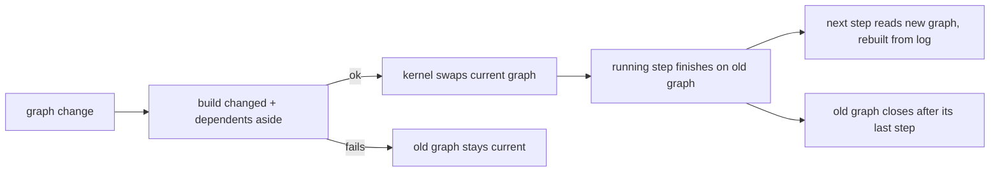
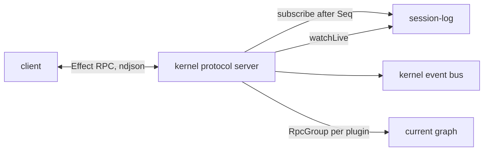
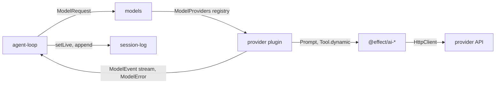

# Core contracts

The contracts every later step builds behind, designed together for the final product before step 2 of [milestones.md](milestones.md) is built. A step adds implementations behind these contracts and deletes nothing.

## Rounds

| # | Round | Covers |
| --- | --- | --- |
| 1 | Graph changes and service lifetime | How a reload reaches dependents, which graph a unit of work runs on, plugins holding live resources |
| 2 | Events and protocol | Kernel event bus, envelope, commands, streaming deltas that are not log entries |
| 3 | `models` | Requests, streaming responses, providers, the scripted test provider |
| 4 | `context` | Log to messages, prompt sections and their order |
| 5 | `agent-loop` | A turn, multi-step with tool calls, extension points |
| 6 | Tools | `tool-registry`, `tool-pipeline`, SDK `Pipeline` |
| 7 | `settings` and `credential-store` | Config layers, keys, secrets |
| 8 | Step 1 re-check | `EntryKinds` as a `Registry`, the single append lock, against rounds 1 to 7 |

Then [milestones.md](milestones.md) is rewritten against these contracts.

## Round 1: graph changes and service lifetime

Today the host (`packages/kernel/src/host/build.ts`) builds each plugin once, in its own scope, from the `Context` of the plugins it needs. A plugin reads a dependency with `yield* Tag` while its layer builds and keeps that value.

### Prior art

| Source | Reload reaches dependents by | Work in flight | Live resources |
| --- | --- | --- | --- |
| DeepSeek (Cordis) `docs/cordis-primer.md`, `cordis-api/context.md`, `packages/boot/hmr` | Unload drops the provided service; dependents go `PENDING` and restart when a provider returns. Stop, then start; a failed replacement leaves nothing running | Agents torn down on unload; facts that must survive a reload go in the session log (`docs/architecture.md`) | Start fresh after reload (`docs/subsystems/browser-use.md`) |
| OpenCode `core/src/plugin.ts`, `plugin/effect/README.md` | Core domains are fixed, never replaced; plugins only register hooks. Reload closes the changed plugin and every plugin after it, then reruns them | Server reads the current app from a `Ref` per request (`server/src/process.ts`); runs resume from durable execution claims after restart | Owned by the plugin scope, closed on reload |
| Pi `packages/durable/docs/spec.md` §7.5 | Extensions replaced by name in the registry; nothing restarts | Running work keeps its snapshot until its phase settles; later phases use the new code | The extension's responsibility |
| Effect `RcRef` (`node_modules/effect/src/RcRef.ts`) | — | `invalidate`: later `get`s build fresh; holders keep the old value until their scope closes | — |

### Shape

Requirements in [03-plugin-model.md](../requirements/03-plugin-model.md#orchestration).

- Pattern: immutable graphs held by reference count (Effect `RcRef` semantics); beat stable proxies, which keep one graph but leak new code into running steps and lose registry contents
- A future state handover between a plugin's old and new build is an addition to the SDK, not a change

## Round 2: events and protocol

Today `SessionLog` (`packages/plugins/session-log/src/contract.ts`) has `subscribe` (saved entries after a `Seq`, then `Synced`, then live entries) and one saved live slot per session (`setLive`, `watchLive`). No protocol or event bus exists yet.

### Prior art

| Source | Wire | Session content to clients | Other events | Server asks the client |
| --- | --- | --- | --- | --- |
| OpenCode `protocol/src/api.ts`, `core/src/bus.ts`, `schema/src/event.ts` | Effect `HttpApi` groups plus one SSE stream | Durable events in a per-aggregate `log` read: replay, `Synced`, live | Ephemeral events on the same bus; "volatile by contract", missed during disconnect | Form and permission groups |
| Codex `app-server-protocol/src/protocol/common.rs` | JSON-RPC: client requests, server notifications, server requests; requests serialized per thread | `item/started`, delta notifications, `item/completed`; `thread/resume` replays | Notifications | `item/*/requestApproval`, `item/tool/requestUserInput` |
| DeepSeek `docs/event-producer-consumer.md`, `docs/architecture.md` | Cordis events (`emit`, `waterfall`, `serial`, ...) | Durable session events; live `agent/assistant-stream` unsaved | Many `emit` events | `approval/request`, `user-questions/request` waterfalls |
| Pi `packages/durable/docs/spec.md` §1, §8.2, §9 | Library, no wire | Every visible change is committed first; "there is no volatile publication path". Clients read a snapshot plus committed document deltas with a cursor; the live document holds the partial reply, tool slots and inbox | Agent events are derived from commits | — |
| Crush `internal/server/events.go`, `internal/proto` | HTTP plus one event stream of pubsub payloads | Message events | LSP, MCP events | Permission and question requests as volatile events |
| Goose `crates/goose-sdk`, Grok Build `crates/codegen/xai-acp-lib` | ACP (JSON-RPC) | `session/update` notifications | — | `session/request_permission` transport request |
| Tau `src/core/Client.ts` | Typed in-process commands and events | Events | — | — |
| AI SDK `packages/ai/src/ui/ui-messages.ts` | UI message stream | Message parts | — | Tool approval is a saved message part state (`approval-requested`, `approval-responded`); the answer arrives with the next request |
| Mastra `packages/core/src/agent` | HTTP | — | — | `requireToolApproval` suspends the run to a saved snapshot; resume with the answer |
| Effect `rpc/*` (`node_modules/effect/src/rpc/`) | `RpcGroup` schemas, streaming RPCs, socket, websocket, HTTP, stdio and worker protocols | — | — | — |

Not consulted: Bubbletea, Lipgloss, Glow (TUI only); oh-my-pi `packages/wire` is collab relay frames, studied for the later session sharing topic.

### Spike: Effect RPC in memory

- `RpcTest` skips serialization (`makeNoSerialization`), so it does not meet the same-envelope requirement
- `RpcServer.layerProtocolSocketServer` and `RpcClient.makeProtocolSocket` run over an in-memory `Socket.make` pair built from two `Queue`s, with `RpcSerialization.ndjson`: every message crosses as an encoded line
- Verified: a `DateTimeUtc` payload and reply round-trip, a `Schema.TaggedError` decodes as its class, a streaming RPC delivers its elements
- The client protocol must be built in the long-lived scope; providing it as a layer to `RpcClient.make` alone closes its read loop
- Bun exits while fibers wait only on queues; a host must hold the process open

### Shape

Requirements in [02-architecture.md](../requirements/02-architecture.md#protocol).

- Pattern: durable log plus volatile bus (Pi `durable`, OpenCode); beat notification-only protocols (Codex, ACP, Crush), which lose state on disconnect
- Approvals and questions: saved entries plus an answer command (AI SDK, Mastra); beat transport requests, which need replay on reconnect

## Round 3: `models`

Today `ModelPart` and `ModelContent` (`packages/plugins/session-log/src/contract.ts`) are Liminal's own types for what the model sees. No model code exists. Providers to support first: Anthropic, OpenAI, Codex and ChatGPT plan logins, OpenCode Go, OpenRouter.

### Prior art

| Source | Seam types | Provider split | Stream events | Errors and retries | Test fake |
| --- | --- | --- | --- | --- | --- |
| Pi `packages/ai/src/types.ts`, `providers/faux.ts` | Own `Message`, `Context`, `AssistantMessage` | Wire `Api` (`anthropic-messages`, `openai-responses`, ...) apart from `Provider` (endpoint, auth, models); models catalog shipped per provider | `*_start`, `*_delta`, `*_end` per content index, `*_end` carries the finished block; `done` or `error` carries the full message | Failure ends the stream with `stopReason: "error"` | `faux` provider: queued responses or factories, per-call state |
| OpenCode `packages/ai` (`schema/events.ts`, `route/protocol.ts`, `testing.ts`) | Own Effect Schemas (`LLMRequest`, `LLMEvent`); does not use `effect/ai` | `Protocol` (body schema, stream state machine) apart from `Route` (endpoint, auth, framing) | Start, delta, end per text, reasoning, tool input; `Finish` with usage | `AIError` in the error channel | `TestLLM`: `push`, `always`, `failAfter`, `hangAfter`, `gate`; `http-recorder` cassettes |
| DeepSeek `docs/subsystems/llm-streaming.md`, `packages/test-support` | Own `ContentBlock`, `StreamChunk` (closed union) | `LlmAdapter` registered per provider route; `llm-pi-ai` wraps Pi's library | `block-start`, deltas, `block-end` with the assembled block, `usage`, `finish` with an adapter-owned replay envelope | One call is one attempt; adapters disable library retries; `LlmFailure` with stable codes (`CONTEXT_WINDOW_EXCEEDED`, `EMPTY_RESPONSE`); `llm-retry` retries at step boundaries | `llm-replay` from recorded session logs; `llm-mock-server` scripted HTTP SSE |
| Tau `src/ai/Models.ts`, `ModelProfile.ts`, `internal/protocols` | `effect/ai` `LanguageModel` and `Prompt` | `@effect/ai-anthropic`, `-openai`, `-openai-compat`, `-openrouter` 4.0.3; own catalog | `effect/ai` `Response` stream parts | Added code for thinking fields per protocol, stream-only plan endpoints, quota errors | — |
| Effect `effect/ai` (`node_modules/effect/src/ai/LanguageModel.ts`, `Tool.ts`, `AiError.ts`) | `Prompt`, `Response` Schemas; marked `@stability unstable` | `LanguageModel.make({ generateText, streamText })`; `Tool.dynamic` takes raw JSON Schema; `disableToolCallResolution` with `toolCallValidation: "deferred"` returns raw calls | `text-start`/`-delta`/`-end`, `reasoning-*`, `tool-params-*`, `tool-call`, `finish` | `AiError` with a Schema `AiErrorReason` union | — |
| AI SDK `packages/provider/src/language-model/v2`–`v4`, `packages/ai/src/test` | `LanguageModelV3` spec | Spec implemented per provider package | `stream-start`, `text-*`, `reasoning-*`, `tool-input-*`, `finish`, `error`, `raw` | — | `MockLanguageModelV2`–`V4`, `simulateReadableStream` |
| Mastra `packages/core/src/llm/model` | AI SDK models | Gateways resolve `provider/model` strings; carries adapters for AI SDK `v4` to `v7` | AI SDK parts | — | — |
| Crush `internal/agent` | `charm.land/fantasy` `LanguageModel` | `charm.land/catwalk` catalog | fantasy parts | — | `go-vcr` recorded cassettes |
| Codex `codex-api/src/common.rs`, `model-provider-info` | Responses API items | Providers are config entries (`base_url`, `env_key`, `wire_api`); one wire API | `ResponseEvent`: item added, deltas, item done, `Completed` with usage | — | Mock SSE server in `core/tests` |
| Goose `goose-provider-types/src/base.rs`, `providers/testprovider.rs` | Own `Message` | `Provider` trait per provider: `stream`, `fetch_supported_models`, `get_context_limit`, `retry_config` | `MessageStream` | Provider-level `RetryConfig` | `TestProvider` records and replays by input |
| Grok Build `xai-grok-sampler` | Own sampling types | xAI only | Raw chunks, then `SamplingEvent`s | Retry inside the sampler actor | — |

Not consulted: Bubbletea, Lipgloss, Glow (TUI only); oh-my-pi `packages/ai` is a Pi fork (its `dialect` module adds text tool-call formats for models without native tool calls).

### Spike: `effect/ai` behind a provider plugin

- `LanguageModel.make` with a scripted `streamText`, called with `Toolkit.make(Tool.dynamic(...))`, `disableToolCallResolution: true` and `toolCallValidation: "deferred"`
- The provider receives each tool with its raw JSON Schema through `Tool.getJsonSchema`
- Tool calls pass through unvalidated, including unknown tool names and non-object params
- Reasoning metadata (`{ anthropic: { signature } }`) reaches the response parts, and prompt part `options` reach the provider: both carry `providerData`
- Text, reasoning and finish parts arrive in order with usage

### Shape

Requirements in [plugins/models.md](../plugins/models.md).

- Pattern: own seam types with a provider registry (Pi, OpenCode, DeepSeek, Goose); beat exposing a dependency's model spec (Tau, Mastra), which ties the log and every plugin to its versions
- `effect/ai` stays inside provider plugins; a provider can move to hand-written protocol code without changing the contract
- The four `@effect/ai-*` packages are added with sources in `docs/reference/sources.json` when the first provider plugin is built
- `model-catalog` is not a plugin: providers own model metadata

## Round 4: `context`

Today [plugins/context.md](../plugins/context.md) requires the system prompt and tool list to live in the log: the first request saves every section and tool, later entries add, replace or remove them, each checkpoint saves a full copy, and the context stays append-only between checkpoints. Each entry already freezes its model content when written.

### Prior art

| Source | Where sections live | Order | Changes mid-session | Reset |
| --- | --- | --- | --- | --- |
| Pi `packages/durable/docs/spec.md` §7.4, `ai/src/types.ts` `SystemMessage` | Rendered per request by the agent's extensions; only `pi.system` transcript entries are durable | Extension order; a later same-key section replaces in place; sections wrapped in `<key>` tags | One positional `pi.system` entry with changed sections (`null` removes) and `toolsAdded`/`toolsRemoved`; the provider renders later system messages natively or folds them into the leading one (`api/anthropic-messages.ts`) | After compaction, a full baseline is written before the next request |
| Codex `core/src/context/world_state/mod.rs`, `session/mod.rs` | `WorldStateSection`s with stable IDs and snapshots persisted in the rollout | Code order (`IndexMap`) | Each section renders its own diff against its last snapshot, appended as developer or user fragments | Full context reinjected when the baseline is missing, after compaction |
| OpenCode `core/src/instructions/index.ts`, `schema/src/session-event.ts` | Ordered `Source`s: key, codec, `read`, `render.initial`, `render.changed`, `render.removed`; values hashed and stored | List order | Durable `session.instructions.updated` with a key-to-hash delta and the rendered text frozen at emit time; a failed read keeps the stored value | Epoch advanced at compaction |
| DeepSeek `docs/subsystems/system-prompt.md`, `packages/context` | `PromptSection`s registered in scope; separate cache-safe `PromptContext` | Numeric order, then name; named order slots owned by the service | Prompt is a `system/message` history node; routes that accept updates get them appended after cached history, others consolidate at the first node | New request series rewrites the head |
| Tau `src/session/ContextView.ts`, `src/core/ContextMethod.ts` | One base prompt string per run | — | Not durable | Memory method swaps the view |
| Goose `agents/prompt_manager.rs` | `SystemPromptBuilder` rebuilt each turn from extensions and hints | Builder order | Not durable | — |
| Crush `internal/agent/prompt/prompt.go`, Grok Build `xai-grok-agent/src/prompt` | Template rendered per session from placeholders | Template | Not durable | — |
| Mastra `packages/core/src/processors` | Input processors rewrite messages each step | Processor order | Not durable | — |
| AI SDK | One `system` field per call | — | — | — |

Not consulted: Bubbletea, Lipgloss, Glow (TUI only); oh-my-pi follows Pi.

### Spike: provider packages 4.0.5 (deleted)

- Native positional tools: Anthropic `tool_addition` (beta `inline-tools-2026-09-15`), OpenAI Responses `additional_tools` developer item; both keep `tools` unchanged and the cache intact
- Anthropic: a tool declared with `defer_loading: true` stays out of the context until a `tool_addition` naming it by `tool_reference`; `tool_removal` withdraws it from that point on; `tools` never changes
- OpenAI: `allowed_tools` in `tool_choice` limits callable tools while the `tools` list stays stable; Anthropic: a `tool_choice` change invalidates only message blocks
- Tau `ask_question`: in `tools` only on a `/qna` run (`core/internal/runner/runner.ts`), so each use changes `tools` twice
- `@effect/ai-anthropic`: emits no `tool_addition` and no `defer_loading` on function tools; tools always go in the `tools` array
- `@effect/ai-anthropic`: places later system messages in `messages` when `supportsMidConversationSystemMessages` (per-model table, `midConversationSystemMessages` config override; false for 4.5 and older); each must follow a user turn and precede an assistant turn, else every system message moves to top-level `system`
- `@effect/ai-openai`: a system message becomes a `developer` item in place for reasoning models; `additional_tools`, `defer_loading` and `tool_search` exist only in `Generated.ts` and are never emitted
- `@effect/ai-openai-compat`, `@effect/ai-openrouter`: system messages in place; no positional tools
- Hooks into the request body: `transformClient` (HttpClient middleware), or a provider layer that wraps the `AnthropicClient` or `OpenAiClient` service and rewrites the `createMessageStream` or `createResponseStream` payload
- OpenCode Go (Tau `src/ai/Providers.ts`, catalog snapshot): one address, three protocols; most models on Chat Completions, some on Anthropic Messages (MiniMax, Qwen, Claude Haiku), some on Responses (GPT, Grok)

### Spike: tool offer and withdraw (deleted)

- Method: the provider layer wraps the client service; `ModelContent` carries the change as a system message the wrapper turns into native items; real calls, three requests each (baseline, offer, withdraw)
- Streaming payloads go out through `HttpBody.jsonUnsafe` with no schema encode, so extra blocks and fields reach the provider; response decoding is unchanged
- OpenAI `gpt-5.4-mini`, `ask_question` left out of `tools` and offered by an `additional_tools` item, withdrawn by `allowed_tools` plus a developer note: offer called the tool; withdraw did not; cache read 16000 of 16324, then 16256 of 16368
- OpenAI, `ask_question` always in `tools` and gated by `allowed_tools`: same behaviour; cache read 15872 of 16235, then 15872 of 16279
- OpenAI: `allowed_tools` may name only tools in `tools`; naming an `additional_tools` tool is a 400
- `@effect/ai-openai` `toolChoice: { oneOf }` filters the `tools` array, which changes the cached prefix; withdraw needs the wrapper
- Without the offer, the model said it could not use `ask_question`
- OpenCode Go `claude-haiku-5-5`: needs `x-opencode-session`; drops `anthropic-beta`, so `tool_addition` and `tool_removal` fail with 400; plain mid-conversation system text and `defer_loading` pass; treat it as a basic endpoint
- OpenCode Go Messages replies omit `usage.service_tier`, which `@effect/ai-anthropic` requires; Tau fills the missing fields in `src/ai/internal/protocols/messages-defaults.ts`
- Anthropic direct (Claude subscription token), `claude-haiku-5-5` and `claude-sonnet-5-5`, by `tool_reference` to a `defer_loading` tool and by `tool_definition` with the tool absent from `tools`: all eight runs offer, call, withdraw and refuse as intended; each request reads every earlier token from cache and writes only the new tail (for example 24351 read, 166 then 227 written)
- Anthropic: a `defer_loading` tool still adds about 94 tokens to the cached prefix
- Anthropic: without the offer, every model said it had no `ask_question` tool
- Anthropic docs (`mid-conversation-system-messages`): declare known tools in `tools` with `defer_loading: true` and offer by `tool_reference`; a tool unknown at the first request can be defined by value in `tool_addition`; keep at least one non-deferred tool in `tools`; tool blocks are refused right after a paused assistant turn; supported on Opus 4.8 and the 5.x models except Sonnet 5
- Anthropic docs: Sonnet 5.5 and Haiku 5.5 may ignore a system message right after a tool result; user words sent mid-turn go as a text block in that user message

### Shape

- Sections sort by number, then key; named bands: base 0, environment 100, instructions 200, skills 300, others 900
- Sync before every model call: replay saved sections and tools, append one `context/system` entry at the point of change when they differ
- `PromptSection.renderChange`: a changed `AGENTS.md` before a checkpoint is sent as a diff
- Later system messages take the provider's nearest native form, else fold into the leading one
- Tools: declared once in the baseline as offered or not; offer and withdraw are entries at the point of change
- Native tool changes: Anthropic `defer_loading` plus `tool_addition` and `tool_removal` (beta `inline-tools-2026-09-15`); OpenAI `additional_tools` plus `allowed_tools`; built by a provider layer that wraps the package client
- Basic endpoints: every declared tool stays in `tools`; the harness refuses calls to tools not offered; offer and withdraw render as system text
- A tool that appears after the baseline: one entry declares and offers it; native providers define it in place; basic endpoints add it to `tools` at once (one cache miss)
- View steps: an ordered chain, `(sessionId, entries) => Effect<Entry[]>`, run before folding; compaction adds one; `context` knows nothing about checkpoints and writes a full baseline when none is left in view

- `PromptSection<A>`: `key`, `order`, `codec`, `read({ sessionId, model })` returning a value, `Unavailable` or `Removed`, and `render.initial`, `render.changed`, optional `render.removed` (OpenCode `core/src/instructions/index.ts`); `PromptSections` is an SDK `Registry`, re-sorted by order then key
- `Context`: `build(sessionId)` syncs, runs view steps, writes a baseline if none is in view and folds to a model request; `preview(sessionId)` does the same without writing; `ContextRpcs` holds `preview`
- Tools and their offered state come from the Round 6 tools contract; `context` saves and compares them
- `models` request: each tool is marked offered at the start or not; system messages carry a tool-change part

## Round 5: `agent-loop`

Today [plugins/agent-loop.md](../plugins/agent-loop.md) requires partial output saved about every 100 ms, resume after restart, safe-to-rerun tools, nothing saved when a turn stops on an error, and inbox, steering, retry, cancel and usage as separate plugins.

### Prior art

| Source | How plugins join a turn | Where queued input enters | Failed attempt | Tool calls in one step | Turn ends |
| --- | --- | --- | --- | --- | --- |
| Pi `packages/durable/docs/spec.md` §6, §7.2, §8.3 | Named hooks, each with its own rule: `beforeRequest`, `beforeTool`, `afterTool` replace in a chain; `afterResponse`, `afterTools` observe; `onYield` first answer wins | Inbox items `steer`, `followUp`, `write`; after tool results: writes and steers; at the end: also follow-ups | Interrupted partial saved as an `aborted` entry; retryable error saves an `error` entry; `ai/src/api/transform-messages.ts` skips both for the model | Parallel by default; any `sequential` tool makes the step sequential (`agent/src/agent-loop.ts`) | No tool calls and no continuation from `onYield` |
| DeepSeek `docs/subsystems/core.md` | Event chains: `agent/pre-step` decides enter or reject and the messages; `agent/request-error` may return retry; `agent/turn-stopping` before the final drain | Claimed batch at each step start; one last drain before the turn stops | Failed step closes; a listener may retry | — | No tool or steering continuation |
| Codex `core/src/session/inject.rs` | Hook context injected into the running turn | Pending input added to the next model request of the running turn | — | — | — |
| OpenCode `protocol/src/groups/session.ts` | — | Durable inbox; steering runs at the next step boundary; queued prompts wait for idle; mode changeable per item | — | — | Idle marker |
| Tau `src/core/internal/runner/runner.ts` | — | Steering waits for the next model call; steering after the last call runs as the next prompt | — | — | `maxTurns` option |
| AI SDK `packages/ai/src/agent` | `prepareStep`, `stopWhen` callbacks | — | — | Parallel | `stopWhen`, default `isStepCount(20)` |
| Anthropic docs (Round 4 spike) | — | Sonnet 5.5 and Haiku 5.5: user words mid-turn go as a text block in the tool-result user message | — | — | — |

Not consulted: Bubbletea, Lipgloss, Glow (TUI only); oh-my-pi follows Pi.

### Shape

- Three checkpoints with fixed rules: before each model call (add input or end the turn), after a failed attempt (retry or stop), when the turn would end (stop or continue); tool-call checks live in the tool pipeline (Round 6)
- Steering enters at the next step boundary as text in the tool-result message; follow-ups enter when the turn would end; both owned by the inbox plugin
- Failed attempt before a retry: the partial stays in live state only and is discarded; nothing saved
- Cancel: output so far saved marked interrupted, visible to the model; unrun tool calls report as cancelled
- Tool calls in one step: one at a time unless every tool in the step declares it can run alongside others; the flag comes from the Round 6 tools contract
- No built-in step limit; a plugin can end the turn before a model call
