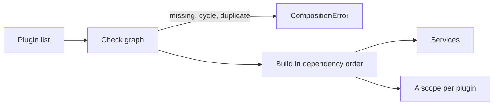

# Plan: `packages/core`

Core composes plugins: `definePlugin`, `compose`, `Registry`, `Pipeline`, `Attribute`. It depends only on `effect` and knows nothing about agents. Design: [architecture.md](../architecture.md#core).

## Systems

| System | Change |
| --- | --- |
| `packages/core` | Adds the package |
| Archive kernel (`archive/packages/kernel/src/graph`, `src/host`) | Carried over: graph checks, a scope per plugin. Left out: inactive plugins, concurrent builds, graph versions |
| Archive SDK (`archive/packages/sdk/src/core`) | Carried over: `definePlugin` type check, `Registry.Service`/`Registry.layer`. Left out: `uses`, `enabledByDefault`, build-number visibility, input-less `next` |

## Plugins

```ts
definePlugin({ name, provides, requires, layer, entries })
```

- `provides` and `requires` are arrays of Effect service tags, so `compose` can check the graph and name plugins at runtime; a Layer's services exist only in its types.
- `definePlugin` fails to type-check unless `layer` provides every `provides` tag and needs nothing outside `requires`.
- `layer` is a value.
- `entries` is `{ [frontend: string]: () => Promise<unknown> }`. Core never imports an entry; each frontend kit defines what its module exports.

## Compose



- A missing provider, a cycle or two providers of one tag fails with `CompositionError` naming the plugins. There is no partial composition.
- Plugins build one at a time in dependency order; ties keep list order, so registration order is deterministic.
- Each plugin's layer builds in its own child of `compose`'s scope. Closing that scope closes every plugin, dependents first.

## Registry and Pipeline

The owning plugin makes the tag with a core helper and provides it. Plugins that add to it list the tag in `requires`.

| Helper | Gives |
| --- | --- |
| `Registry.Service<Self, T>()(key)` | A `Context.Service` tag whose service is a `Registry<T>` |
| `Registry.layer(tag)` | The owner's empty registry |
| `Pipeline.Service<Self, In, Out, E>()(key)` | A `Context.Service` tag whose service is a `Pipeline<In, Out, E>` |
| `Pipeline.layer(tag, terminal)` | The owner's pipeline, ending in the owner's `terminal` step |

- Ordering, both: `order?: number`, default 0, lowest first; ties keep composition order.
- In a `Pipeline`, lower `order` runs outer: it sees the input first and the output last.
- Middleware: `(input: In, next: (input: In) => Effect<Out, E>) => Effect<Out, E>`. Middleware may rewrite the input it passes on.
- A `Registry` lists its items. Lookup by name and what a duplicate name means belong to the owner.
- `Registry.add` and `Pipeline.wrap` are scoped: an addition is removed when the scope that made it closes. Inside a plugin's layer, that is the plugin's scope.

## Attribute

```ts
Attribute.make(key, schema)          // a typed key, e.g. Attribute.make("actors/Actor", ActorSchema)
type Attributes = { readonly [key: string]: unknown }   // schema-encoded values by key
Attribute.get(attributes, attribute) // decodes; a stored value that fails to decode is AttributeInvalid
Attribute.set(attributes, attribute, value)
```

- `session` puts `Attributes` on sessions, inputs and events; the log stores the record as it is.
- Keys no plugin in the composition knows survive a round trip, so a saved session outlives a removed plugin.

## Open

Round 2:

- Type signatures for `definePlugin`, `compose`, `Registry`, `Pipeline`, `Attribute`.
- The `compose` call path from plugin list to built services.
- `CompositionError` and `AttributeInvalid` shapes.
