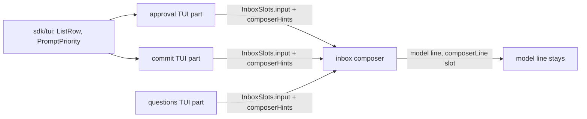

# Custom prompts

The approval ask and `/commit` ask the user through the composer's place, not a dialog. A custom prompt keeps the model line, shows its own key hints, and leaves the draft untouched. Vocabulary and the dialog-or-prompt rule are in [06-tui-design.md](../requirements/06-tui-design.md); the designs are in the gallery (Components: Approval prompt, Commit prompt; Screens: Chat).

## Shape

`questions` already works this way: it registers on `InboxSlots.input` (the draft area inside inbox's composer) and `ChatSlots.composerHints`, both chains, with the same `select`. `approval` and `commit` do the same. `trust` takes the whole `ChatSlots.composer` because an untrusted workspace has no model line to keep; it stays as it is.



| System | Change |
| --- | --- |
| `sdk/tui` | Expands: `ListRow` (a highlighted choice row), `PromptPriority`, `hintsPriority` and `PROMPT_KEYS_PRIORITY` (which prompt wins and its keys) |
| `approval` | Changes: the oldest ask is a prompt; `ApprovalDialog` and the dialog-opening effect are deleted; `Inbox` is a used plugin |
| `commit` | Changes: the flow is a prompt; `CommitDialog` and its `dialogs` use are deleted |
| `questions` | Changes: reads its priorities from `PromptPriority` |
| `inbox` | Renames `SlashMenu` to `CommandMenu` (own step, last) |

Pattern: a chain slot, as `questions` uses. Beaten: one `custom-prompt` host service that stacks prompts, which adds a service for three callers that a priority number already orders.

## Decisions

- Priority, lowest wins: approval, then commit, then questions. An agent blocked on an ask comes first; answering it shows the prompt beneath it again, because each prompt keeps its state in its plugin, not in the component.
- `esc` is the prompt's cancel, bound above the composer's keys (approval rejects, commit answers no or stops). A prompt's keys are off while a dialog is open, as in `questions`.
- The composer has no glide today, so a prompt has none; the header glides for a running turn.
- The same ask arriving again keeps its prompt and its state; a different oldest ask starts a new one.

## Code

```
packages/sdk/src/tui/
  ListRow.tsx    new: the gallery's ListRow
  prompt.ts      new: PromptPriority { approval: -3, commit: -2, questions: -1 }, hintsPriority, PROMPT_KEYS_PRIORITY
packages/plugins/approval/src/
  tui.tsx              holds `pending` and `hints` signals; registerPrompt
  tui/ApprovalPrompt.tsx   new (replaces ApprovalDialog.tsx); registerPrompt registers InboxSlots.input + composerHints
  tui/ModeLabel.tsx    followAsks hands the watched asks to `setPending`
packages/plugins/commit/src/
  tui.tsx              holds the running `CommitFlow` signal; registerPrompt
  tui/CommitPrompt.tsx new (replaces CommitDialog.tsx); hints follow the flow's step
```

Call path: `answer` sends `approval/answer`; the ask leaves `approval/pending`; `pending()` shrinks; the next ask's prompt, or the composer, shows. Commit: the flow's `step()` drives the prompt; `answer` and `cancel` are the flow's own.

## Tests

- `approval.test.ts` and `input-waits.test.ts` stay; `apps/cli/test/tui.test.tsx` keeps the `/commit` toast test.
- `apps/gallery/test/prompts.test.tsx` already covers the designs.

## Guide

`docs/guides/tui.md`: a new "Ask the user in the composer's place" section (custom prompt, the two registrations, `PromptPriority`, when to use a dialog instead).
