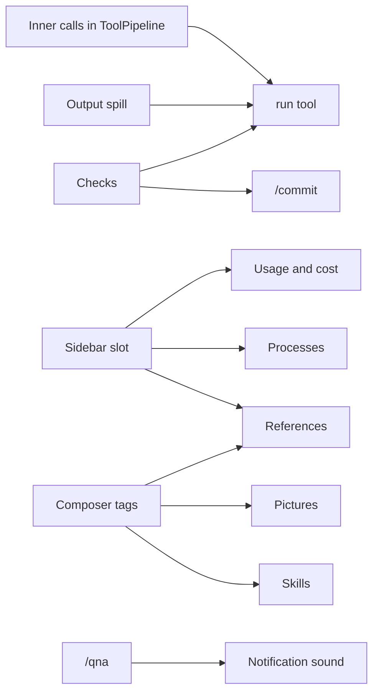
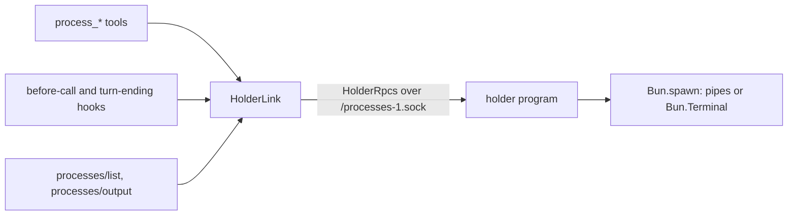
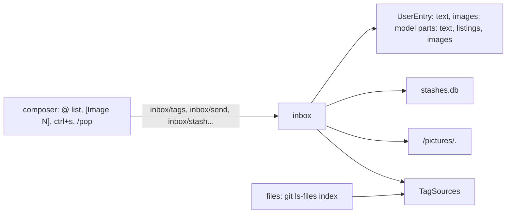
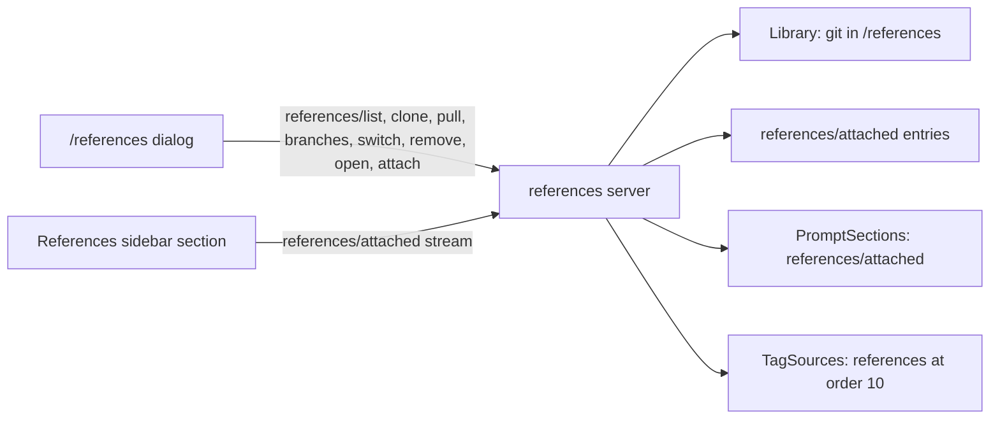
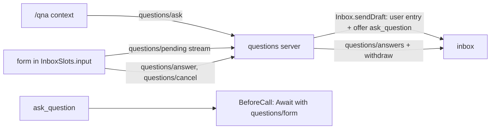

# Daily driver

Brings Liminal to where Tau was, so it can replace Tau for daily work: sessions and print mode, checks, web, long-running processes, a `run` script tool, the sidebar with usage and cost, `@` tags and pictures, stash, references, `/qna`, `/commit`, skills and a notification sound. Each step gets its own code plan here when it is built.

## Decisions

- Separate tools stay. A `run` tool joins them: it runs a script whose functions are the other tools, and its guidance tells the model to use it when chaining or filtering saves tokens.
- Every function call inside `run` goes through `ToolPipeline` as its own call, so checks, approvals and output spill judge each one.
- Web search comes from a searcher registry: providers with built-in search (Anthropic, OpenAI) register, Exa registers too; the tool uses the first that works.
- A sidebar like Tau's: Ctrl+B, beside the chat at 122 columns or wider, over it when narrower. Plugins fill its sections through a slot.
- The processes holder program exits when it holds no running commands and no server is connected.
- Checks live in `.liminal/checks.json` at the repository root with `fix`, `check` and `commit` lists, as Tau's `.tau/checks.json`; ignored in an untrusted workspace.
- `/sessions` labels each session with its first user message, cut to one line, and its last-written time.
- The notification sound is Tau's `assets/sounds/notification.wav`, bundled and played by the system player: `afplay` on macOS; on Linux the first installed of `paplay`, `pw-play` or `aplay`, silent if none.
- Stashes are text only, kept in `stashes.db` in Liminal's data folder, one list per workspace folder.

## What needs what

Foundations come first because later steps draw into them.



| Foundation | Where | What it gives later steps |
| --- | --- | --- |
| Inner calls | `tools`: `ToolCall` gains the outer call's id | `run` dispatches each function through the pipeline; wrappers such as checks' `fix` run once per outer call |
| Sidebar slot | `chat`: `ChatSlots.sidebar`, a list slot of sections, session scope; Ctrl+B; width rule | Usage, compaction stage, processes and references each register one section |
| Composer tags | `inbox`: a `TagSources` registry; a tag resolves to text or an image part | Files and folders, pictures, references and skills each register one source |
| User message parts | `session-log`: `UserEntry` gains image parts beside its text | Pictures; the providers already send `ModelPart` images |

## Steps

| Step | Plugins | Joins | Draws |
| --- | --- | --- | --- |
| 1. Sessions and the command line | `chat`, which owns `/new`; `session-store`; `session-log`; `settings`; `apps/cli` | `session-log/list`; `SelectDialog`; `effect/cli` | `/sessions` dialog; `--session`, `-p`, `--model` |
| 2. Small tool hooks | new `tool-output`; `agent-loop`; `compaction` | `ToolWrappers`; `BeforeCallHooks` ends a turn on repeats; `Memories` ranges | `history` tool rows |
| 3. Checks | new `checks` | `command-runner`; `ToolWrappers` for `fix`; `TurnEndingHooks` re-runs skipped or stale checks and continues the turn on failure | `checks` tool row `Hidden`; its own `checks/report` entry; `fix` runs as debug lines |
| 4. `run` tool | new `tools-run`; `tools` | Inner calls; `Tools` as script functions; codemode's `search` for deferred functions | Its row opens to the script and output; inner calls fold under it |
| 5. Web | new `tools-web`; `model-anthropic`, `model-openai` register searchers | `effect/http` `HttpClient` for fetch | `search` and `fetch` rows |
| 6. Sidebar, usage and cost | `chat`; new `usage`; `compaction` | `Finish.usage`; `model-catalog` prices | Sidebar with Context, Cost, Compaction sections (gallery first) |
| 7. Processes | `processes` and its holder program | Bun's PTY; `TurnEndingHooks`; a resumed turn's reminder | Process rows; Processes section; live output |
| 8. Composer | `inbox`; `session-log`; `files` | Composer tags; user message parts | `@` list (gallery `FileSuggestions`); `[Image N]`; Ctrl+S stash and `/pop` |
| 9. References | new `references` | Composer tags; sidebar | `/references` dialog; References section |
| 10. `/qna` | `questions` | The `composer` chain slot, as `trust` uses it | The form in the composer's place; asked and answers entries |
| 11. `/commit` | new `commit` | Checks' `commit` mode; `ModelTask` with the cheap model; `command-runner` for git | Plan dialog; push confirm |
| 12. Skills | new `skills` | `instruction-files`' front matter and trust rule; composer tags; slash commands | `/<skill>`; skill rows |
| 13. Notification sound | new `attention` (TUI) | Turn end, pending approvals and pending forms in the session feed | None |

## Step 1: sessions and the command line

```
packages/sdk/src/core/launch.ts            LaunchSettings base service: settings sections from the command line
packages/plugins/settings/src/server.ts    merges LaunchSettings over the files
packages/plugins/session-store/src/server/
  migrations.ts                            0002: sessions.workspace, sessions.title, title backfill
  queries.ts, session-index.ts             create with workspace; fork copies it; nameSession; list by workspace
packages/plugins/session-log/src/server/   create stamps Directories.workspace; the first user message names the session
packages/plugins/chat/src/tui/sessions.tsx /sessions: SelectDialog of this folder's sessions; picks switch the followed session
apps/gallery/src/chat/SessionPicker.tsx    the same dialog in the gallery; PickerRows.tsx holds the rows it shares with Models
apps/cli/src/args.ts                       effect/cli command: [prompt] --print/-p --session --model --check -> Launch (Check | Print | Tui)
apps/cli/src/print.ts                      runTurn: send, follow to the turn's end, return reply, notices, end; printTurn prints it
```

```ts
class LaunchSettings extends Context.Service<LaunchSettings, { readonly sections: JsonObject }>
// SessionStore
createSession(id, workspace): Effect<void, StoreError>
nameSession(id, title): Effect<void, StoreError>      // only while it has none
listSessions(workspace): Effect<ReadonlyArray<StoredSession>, StoreError>
StoredSession += { workspace: string; title: string }
SessionSummary += { title: string }                   // SessionLog.list: this workspace's sessions
```

```
main
  parse args
  --check            start kernel, exit 0
  --print <prompt>   start kernel (no parts), LaunchSettings from --model
                     session = --session or new; synced = follow until Synced
                     inbox/send(session, prompt, follow-up)
                     follow after synced: collect text entries until turn-ended
                     print text; exit 0 when answered, else reason on stderr, exit 1
  otherwise          TUI; handoff from the restart file, else { chat/session: --session }
```

- `--model provider/model` becomes the launch section `{ "agent-loop": { "model": ... } }`, for this run only.
- Sessions created before the migration have no workspace and are not listed.
- An invalid command line exits 2; a printed turn that did not answer exits 1.
- A new session's id goes to stderr in print mode, so the next run can pass `--session`.

## Step 2: small tool hooks

```
packages/sdk/src/core/directories.ts          Directories.temp: scratch files the system may clear (<tmpdir>/liminal)
packages/plugins/tool-output/                 new plugin: one ToolWrapper that spills long output
  src/contract.ts                             outputLimits: 50,000 characters or 2,000 lines
  src/server/spill.ts                         cut: first and last half kept; the whole text to a private file
packages/plugins/agent-loop/src/server/
  repeats.ts                                  before-call hook: the same call failing 3 times in a row ends the turn
  turns.ts                                    a turn a plugin ended saves a warning notice with the reason
packages/plugins/compaction/src/server/
  recall.ts                                   history tool: entries from..through as a transcript
  notes.ts                                    exports historyText, which recall shares
packages/plugins/compaction/src/tui.tsx       history rows: Recalling / Recalled entries 12–40
apps/gallery/src/transcript/                  a recall action and its row, in the sample
```

```ts
// tool-output: ToolWrappers, order 0 (outermost)
(allowed, next) => next.pipe(Effect.flatMap((outcome) =>
  done   -> text = string result or its JSON; over the limits -> result = cut(text, path)
  failed -> the same with message
  denied -> unchanged))
// path: <temp>/tool-output/<session>/<callId>.txt, folder 0o700, file 0o600
// cut: <first 1,000 lines or 25,000 chars>\n[Output cut: N lines, M characters. Full output saved at <path>; read or search it for the rest.]\n<last half>
// a failed write keeps the cut text and names the error instead of the path

// agent-loop: BeforeCallHooks, order -10
repeats(log): BeforeCallHook
  entries since the latest turn-started; the last 3 tool results
  all failed or denied, and their calls share name and params -> EndTurn("The same <name> call failed 3 times in a row.")
  a log read failure logs a warning and proceeds

// compaction: Tools
history { from: Seq, through: Seq } -> log.read(session, { after: from - 1, through }) -> historyText
  through < from -> ToolFailed
```

- Spill sees the final outcome of every call, so the later `run` tool's inner calls spill one by one.
- Notes in the view already name their entry range; the `history` guidance points the model at them.
- The ended-by-plugin notice is the only place the user sees why a turn stopped; the loop guard is its first user.

## Step 3: checks

```
packages/plugins/tool-output/src/contract.ts  LongOutput service: fit(session, name, text) -> the cut text naming its file
packages/plugins/tool-output/src/server/      spill wrapper uses LongOutput; one file layout for both
packages/plugins/checks/                      new plugin
  src/contract.ts                             checks.json schema; Changes; CheckReport; entries; checksTool
  src/server/file.ts                          <project>/checks.json -> Option<ProjectChecks>; untrusted -> none
  src/server/snapshot.ts                      git status -z under the workspace + content hash per path
  src/server/history.ts                       this turn's changes, last report, failed settles (pure)
  src/server/run.ts                           dueChecks (globs on workspace paths), runChecks -> CheckReport
  src/server/fix.ts                           ToolWrappers order 10: snapshot around a writing call, run fixers
  src/server/tool.ts                          the checks tool; re-registered before each model call to follow the file
  src/server/settle.ts                        TurnEndingHooks order 50: runs due checks, sends failures back
  src/tui.tsx                                 checks tool rows; report entry row; fixed debug line
```

```ts
// contract
ChecksFile = { fix?, check?, commit?: Array<{ name, command, details?, include?, exclude?, cwd?, env?, timeoutSeconds? }> }
Changes   = { type: "files", paths } | { type: "unknown" }       // paths from the workspace
CheckReport = { passed: string[], failed: Array<{ name, output }> }
ChangesEntry "checks/changes"  model false, hidden
FixedEntry   "checks/fixed"    model false, debug      // "Fixed with format, lint on 3 files"
ReportEntry  "checks/report"   model true,  shown      // report text + next step, as a user message

// fix wrapper: tool.hints.readOnlyHint -> next unchanged
before = snapshot; outcome = next; after = snapshot
none of them -> ChangesEntry(unknown); else paths = changed(before, after)
fixers due on paths -> run, FixedEntry; paths = changed(before, snapshot)
paths non-empty -> ChangesEntry(files)

// tool (no params; Record<String, Never> so the schema is type: object)
due = dueChecks(check, changesThisTurn); none -> "No checks apply to the changes in this run."
report -> passed: result; failed: ToolFailed(report text + fix-and-check-again), details = report

// settle hook
no config, no change after the last report (checks/report or a checks result) -> []
report = runChecks(due)
passed, or failed and 3 earlier failed reports this turn -> append ReportEntry, []   // the turn ends
failed -> [ReportEntry]                                                              // the turn continues
```

- `{files}` in a command becomes the matching changed files, absolute and shell-quoted; a check that takes files and has none left is skipped.
- Unknown changes (no git, or git failed) make every check due, with no files.
- The tool draws as the gallery's checks row: `Running checks`, `Ran checks (all passed)`, `Ran checks (lint failed)`; opened, each check's mark and the failures' output. The settle report draws the same row.
- Edits to `checks.json` apply from the next model call.

## Step 4: the `run` tool

A new `tools-run` plugin registers `run`, which runs a script in codemode's interpreter. The script's functions are the registered tools by the same names and params, so `run` adds no second set of file or shell functions. Each function call is an inner call: it goes through `ToolPipeline` with the outer call's id, and its outcome is saved as its own entry for the transcript.

What OpenCode does with codemode (`packages/core/src/codemode/tool.ts`, `instructions.ts`): it wraps every tool as a `Tool.make` with its JSON schema, runs `CodeMode.make({ tools }).execute(code)`, folds the result's value, warnings and logs into text, and keeps the changing catalog out of the tool's description so the request's cached start stays the same. Liminal's tools are already in the model's tool list, so the description only says the functions are those tools; `search` finds the tools not offered yet.

| Where | Change |
| --- | --- |
| `tools` contract | `ToolCall.outer?: string`: the `run` call an inner call runs inside |
| `session-log` contract | `InnerCallEntry` `session-log/inner-call`, hidden, no model view: `{ outer, id, name, params, status, result, details? }` |
| `checks` fix wrapper | Skips inner calls; the outer `run` call is tracked once |
| `chat` | `ToolCall.inner`; the transcript adds inner-call entries to their outer call; `WorkRows` draws a call's inner rows under its row, each worded by its own tool |
| new `tools-run` | `RunParams { code, timeout? }`; the tool; its TUI row |
| gallery | A `script` action whose inner actions draw as rows under it |
| root `package.json` | `overrides.effect` pins codemode's `effect` to the workspace's 4.0.5 |

```ts
// tools-run server
run({ code, timeout = 300 }, { sessionId, callId }) =>
  functions = Tools.list without "run", each Tool.make({ description, input: spec.parameters, output: {} ,
    execute: (input) => inner(sessionId, callId, name, input) })
  CodeMode.execute({ code, tools: functions, limits: { timeoutMs, maxOutputBytes: 10 MiB } })
  ok -> { result: logs + value + warnings }; failed -> ToolFailed(logs + diagnostic)

inner(session, outer, name, input) =                                  // callId `${outer}/${n}`
  params = decode Json(input)
  outcome = (tool.runAlongside ? id : serial.withPermit)(ToolPipeline.run({ ..., outer }, Tools.get(name)))
  append InnerCallEntry
  done -> output.result; failed or denied -> toolError(message)
```

- Checks, approvals and output spill judge each inner call; the repeat guard sees only the model's calls.
- Inner calls of tools that cannot run alongside others wait for each other.
- The row reads `Ran <first line of the script>` with `N calls`; opened, it shows the script and its output.

## Step 5: web

A new `tools-web` plugin registers `websearch` and `webfetch` and owns `WebSearchers`, an ordered registry of searchers. Providers with a search tool on their side register one searcher per provider: `model-anthropic` for `anthropic` and `anthropic-api`, `model-openai` for `openai` and `chatgpt`, each on its cheap model. `tools-web` registers Exa last. `websearch` tries the searchers in order and answers with the first that works; a searcher without a login fails at once and the next one runs.

The names are `websearch` and `webfetch` because a `run` script already has a built-in `search`.

| Where | Change |
| --- | --- |
| `sdk` core | `WebQuery { query, maxSources }`, `WebSource { url, title }`, `WebAnswer { text, sources }` |
| `sdk/ai` | `hostedSearch`: one `generateText` call with the provider's search tool required; sources from cited parts, then tool results |
| `sdk/ai/messages`, `sdk/ai/responses` | `messagesSearch`, `responsesSearch`: `hostedSearch` signed as the provider's calls are |
| new `tools-web` contract | `SearchFailed`; `WebSearcher { name, search }`; `WebSearchers` registry; `SearchParams`; `FetchParams` |
| new `tools-web` server | The two tools; the Exa searcher; the page fetch and HTML to text |
| `model-anthropic`, `model-openai` | Register their searchers when `WebSearchers` is loaded, as `model-openai` registers Luna |
| new `tools-web` TUI | `Searched the web <query>` with the source count; `Fetched <url>` |
| gallery | `websearch` and `webfetch` actions, each its own row |

```ts
// tools-web server
websearch({ query, maxSources = 8, timeout = 25 }) =>
  attempt(WebSearchers.list, failures = [], deadline)
attempt([searcher, ...rest], failures, left) =
  limit = rest is empty ? left : left * 0.7
  searcher.search({ query, maxSources }) within limit
    ok -> text + "Sources:" list + "Searched with <name>"
    fails -> attempt(rest, failures + "<name>: <message>", left - spent)
attempt([], failures) -> ToolFailed(failures joined)

webfetch({ url, timeout = 30 }) =>
  GET url as a browser; text types only; at most 5 MB
  HTML -> text with each link's address after its words (Bun's HTMLRewriter)
  -> "URL, status, type" header + text; long pages spill through tool-output

// model-anthropic, as model-openai
searchers = Effect.serviceOption(WebSearchers)
Some -> register({ name: "Claude", search: messagesSearch(http, fs, claudeSigning, cheap.id) }, { order: 0 })
```

- Exa runs on its free endpoint, or with `EXA_API_KEY`; its searches start at least 2 seconds apart.
- Both tools run alongside others and approval allows them.

## Step 6: sidebar, usage and cost

`chat` owns the sidebar and its slot; sections come from other plugins. A new `usage` plugin counts each session's calls from the log and streams them to its TUI part; `compaction` streams its budget the same way. Both re-read after each burst of new entries.

| Where | Change |
| --- | --- |
| `session-log` contract | `finishOf(entry)`, `turnModelOf(entry)`, moved from `compaction` |
| `sdk/tui` | `SidebarSection`, `SidebarStat`, `SidebarNote`, `formatTokens`, `formatShare` |
| `chat` contract | `ChatSlots.sidebar`: list slot, session scope |
| `chat` TUI | `Sidebar.tsx`: 42 columns; docked from 122 columns, else a drawer over the dimmed chat; Ctrl+B `view.sidebar`; docked choice kept across reloads; a drawer starts closed and escape closes it |
| new `usage` | `SessionUsage { context, contextWindow?, cacheHit?, cost?, unpriced }`; `usage/session` stream; Context at order 0, Cost at 10 |
| `compaction` | `Stage` and `CompactionStatus { size, budget, stage, notesThrough?, checkpoints }` in the contract; `compaction/status` stream; Compaction section at order 20 |
| gallery | `Sidebar` shows the three sections at 42 columns |

```ts
// usage server
watchUsage(session) = log.subscribe(session).debounce(100ms).mapEffect(usageNow)
usageNow(session) =
  counted = countCalls(log.read(session))   // model from each turn-started entry; usage from each finish
  none -> nothing yet
  described = each model in counted.byModel -> Models.describe (option)
  usageOf(counted, described):
    sent = input + cacheRead + cacheWrite of the latest call
    context = sent + output; contextWindow from the latest call's model; cacheHit = cacheRead / sent
    cost = sum of priced models' usage * price / 1M; unpriced = models with no price

// compaction server
watchStatus(session) = log.subscribe(session).debounce(100ms).mapEffect(statusOf)
statusOf = last turn start's model -> measure -> { size, budget, stage, notesThrough, checkpoints }
```

- The sidebar's sections show a muted note before the session's first reply.
- The budget turns the warning color from the warning stage.

## Step 7: processes

A new `processes` plugin. Its holder program runs the commands; the server part talks to it over Effect RPC on a Unix socket, so commands live through a server restart or a plugin swap. The holder serves every Liminal server of the user; commands are kept per session.



| Where | Change |
| --- | --- |
| `processes` contract | `ProcessState` (Running, Exited code, Stopped), `ProcessSummary { id, command, pty, state }`, `WaitResult`, errors `UnknownProcess`, `ProcessNotRunning`, `ProcessStartFailed`, `BadPattern`, `HolderUnavailable`; `NoticeEntry` `processes/notice` (model reads it, shown as a line); `ProcessesRpcs`: `processes/list` and `processes/output` streams |
| `processes` `src/holder/` | `protocol.ts` `HolderRpcs`; `buffer.ts` first and last half of output, read mark; `spawn.ts` detached `sh -c` on pipes or `Bun.Terminal`, stop = `ps` descendants then the group, TERM then KILL; `commands.ts` the per-session registry; `serve.ts` socket server counting connections, ends after 10 idle seconds; `main.ts` entry |
| `processes` server | `link.ts` connects, starting the holder only to start a command; tools `process_start`, `process_wait`, `process_read`, `process_write`, `process_stop`, `process_list`; before-call hook: the resumed reminder and exits; turn-ending hook: exits continue the turn |
| `processes` TUI | Rows `Started`, `Waited on`, `Read`, `Typed into`, `Stopped`, `Listed`; an opened `process_start` row tails the command's live output; Processes sidebar section at order 30, ended commands stay a minute; the notice line |
| gallery | Processes section in `Sidebar`; process rows in the sample transcript |

```ts
// holder protocol, one socket per protocol version
HolderRpcs: holder/hello, holder/start, holder/list, holder/watch (stream), holder/read,
  holder/write, holder/wait, holder/stop, holder/exits, holder/output (stream)

// server
HolderLink {
  current: SubscriptionRef<Option<Client>>   // set on connect, cleared when a call fails on the socket
  running: Effect<Option<Client>>            // connects only when a holder answers
  ensure: Effect<Client, HolderUnavailable>  // starts `bun src/holder/main.ts <socket>` detached, waits up to 5s
}
beforeCall(turn) =
  reminder: once per session per server life, when commands are running: "Still running: p1 `bun dev` ..."
  exits: holder/exits -> "p2 `bun test` exited with code 1. Its last output: ..."
  -> Proceed({ input: notices })
turnEnding(turn) = holder/exits -> notices; any continues the turn
```

- The holder ends when no command runs and no server has been connected for 10 seconds; its socket file goes with it.
- A stale socket file that refuses connections is removed before the holder listens.
- Ended commands keep their output in the holder until it ends.

## Step 8: composer

`inbox` owns tags, pictures and stashes; `files` registers the tag source for workspace files and folders; `session-log`'s `UserEntry` carries images.



| Where | Change |
| --- | --- |
| `inbox` contract | `TagRow { kind: file, folder, reference or image; path; tag; note? }`; `TagAttachment`: `TagText { text }` or `TagImage { data, mediaType }`; `TagSource { find(query), attach(tag) }`; `TagSources` registry and `offerTagSource`; `Picture { data, mediaType }`; `UserInput { text, pictures }`; `Stash { id, text, createdAt }`; `StashesError`; tag text helpers `tagAt`, `tagText`, `tagPaths`; RPCs `inbox/send` takes pictures, `inbox/tags`, `inbox/stash`, `inbox/stashes`, `inbox/unstash` |
| `inbox` server | `compose.ts`: saves pictures, resolves each tag by the first source that attaches it, builds the user message; queues hold drafts; `stashes.ts`: `stashes.db`, one list per workspace folder, newest first, the same text twice is `duplicate` |
| `inbox` TUI | `tags.ts` + `TagMenu.tsx`: the `@` list at the cursor (up, down, tab opens a folder or tags, enter tags, esc closes); `pictures.ts`: `[Image N]` chips from ctrl+v or an empty paste (clipboard) and from a pasted picture path; sending renumbers chips and drops the rest; ctrl+s stashes the draft; `/pop` opens the stashes, enter pops into the draft, ctrl+d discards after a confirm |
| `files` server | `tags.ts`: `git ls-files -co --exclude-standard` in the workspace, folders from the paths; fuzzy rows ranked by fewest match runs then length; picture files are `image` rows with their size; a folder tag attaches a one-level listing without git-ignored names; a picture tag attaches its bytes; a file tag attaches nothing, as the model reads it |
| `session-log` | `UserEntry` data gains `images` (path, media type); `userMessage(text, parts)` adds listings and image parts after the text |
| `sdk` | `SelectDialog` gains `actions` (key, label, run on the highlighted value) |
| gallery | Composer: picture state, ctrl+s stash hint; Stashes dialog; palette loses the ctrl+s session key |

```ts
send(session, { text, pictures }, mode) =
  images = pictures.map(save)                       // <data>/pictures/<sha256>.png
  attached = tagPaths(text) -> first source.attach  // TagText -> text part, TagImage -> save -> image part
  draft = userMessage(text, [...attached, ...images])
  turn running ? queue(draft) : start(draft)
```

- Tags outside a git repository find no files or folders; other sources still answer.
- Pictures go to the model whatever input it accepts.

## Step 9: references

A new `references` plugin keeps reference repositories as git clones in `<data>/references/<name>`, as Tau's `~/.tau/references`. A session attaches some of them; the model is told their folder in a prompt section, and `@` tags reach them and their files.



| Where | Change |
| --- | --- |
| `references` contract | `Reference { name, branch?, description? }`; `CloneEvent`: `CloneProgress { phase, percent }` or `Cloned { reference }`; `ReferenceFailed { reference, message }`; `AttachedEntry` `references/attached` (names, hidden, not for the model); `ReferencesRpcs`: `references/list`, `references/attached` (stream), `references/attach`, `references/clone` (stream), `references/pull`, `references/branches`, `references/switch`, `references/remove`, `references/open` |
| `references` server | `git.ts`: run git with a timeout, its error line; `clone.ts`: `git clone --progress --single-branch` into `.clone-<name>-<time>`, renamed when done, progress parsed from stderr, stopped after 3 silent minutes; `description.ts`: GitHub's description saved as `.git/liminal-description` at clone time and filled in the background at start, else the README's first prose line; `library.ts`: list from folders and `.git/HEAD`, pull `--ff-only`, branches local and remote, switch (fetches a remote branch), remove, open in `$VISUAL`, `$EDITOR` or `code`; `attached.ts`: the session's names from its newest `references/attached` entry, kept in a `SubscriptionRef` map; the prompt section at order 230; `tags.ts` |
| `inbox` | `ranked` and `withFolders` move from `files` into the contract for every source; tab opens a `reference` row as it opens a folder |
| `references` TUI | `/references`: the library with attached rows marked; up and down move, space marks, enter attaches the marked and closes; ctrl+n asks for a git URL and clones, the row noting progress; ctrl+u pulls every clone; ctrl+r picks a branch; ctrl+o opens; ctrl+x deletes after a confirm; a failure notes `! <git's line>` on its row. References sidebar section at order 40, only while some are attached. The session on screen comes from a composer-line item that draws nothing |
| gallery | References dialog: marked rows, a clone in progress, a failed pull; References section in `Sidebar` |

```ts
prompt section "references/attached", order 230, value: attached names that still have a folder
  initial: "Reference repositories are read-only git clones in <folder>/<name>. When the user names one, read it there. Never change them.\nAttached:\n- a\n- b"
  changed: the same, "Attached now:"; removed: "No reference repositories are attached any more."

tag source, order 10, find(query):
  query "<short folder>/<name>/<rest>" -> git ls-files in the clone, ranked by <rest>; rows path "<name>/<found>", tag "<short folder>/<name>/<found>"
  otherwise -> clones whose name matches: kind reference, path "<name>/", tag "<short folder>/<name>/"
  attach -> none; files attaches a folder's listing or a picture by its `~/` path
```

- `<short folder>` is the folder with the home folder written `~`.
- Attaching to a session that has no entries yet creates it.
- A clone deleted from disk drops out of the prompt section.

## Step 10: `/qna`

A new `questions` plugin. `/qna` sends a request that offers `ask_question`; the call ends the turn with a form entry; the form takes the composer's input area until the user answers or cancels, and either withdraws the tool.



| Where | Change |
| --- | --- |
| `agent-loop` contract | `BeforeCall.Await { input }`: saves `input` and ends the turn as answered, with no notice |
| `inbox` | `Inbox.sendDraft(session, { text, draft }, mode)`, as `send` for a draft another plugin made; `InboxSlots.input`, a session chain slot: what the composer shows in place of its draft, above the model line |
| `chat`, `compaction` | `ToolRows.Hidden({ live? })`: a hidden tool's words while it streams |
| `agent-loop` TUI | a streaming tool call reads as its tool's running verb, or `Hidden`'s `live`, else `Calling <name>` |
| `questions` contract | `Question` (`select`, `confirm`, `input`; prompt, options, recommendation), `Form { title, questions }`; `Answer` (`picked`, `own`, `written`, `skipped`), `Answers { title, answered, context }`; entries `questions/form` (shown, not for the model), `questions/answers` (shown, model reads text and the withdraw), `questions/cancelled` (hidden, model reads it and the withdraw); `Pending`: `NoForm` or `Asked { seq, form }`; RPCs `questions/ask`, `questions/pending` (stream), `questions/answer`, `questions/cancel` |
| `questions` server | `ask_question`, not offered at start: checks ids are unique and each recommendation is one of the options, its details the form; a before-call hook ends the turn with `Await` and the form entry when the latest reply's calls include a done `ask_question`; pending from the session's entries |
| `questions` TUI | `/qna [context]`; the form in `InboxSlots.input` and its hints in `ChatSlots.composerHints`, both at priority -1 while the on-screen session has a pending form; `? <title>  N questions for you`; the answers band, folded by a click |
| gallery | none: its form, `Asked` and `Answers` are the design |

```ts
/qna ctx -> user entry text "/qna ctx", model: "[qna] Ask me, with the ask_question tool, ...\n\nctx" + tool-change offer
before call: tail after the latest non-tool entry has a done ask_question -> Await([form entry])
pending = newest of form | answers | cancelled | user is form ? Asked : NoForm
form keys: tab/shift+tab tabs; up/down rows; enter picks or accepts, sends on the context tab; n notes; esc drops a note, else cancels
```

- A question left open is sent as `skipped`.
- A session whose first system entry predates the plugin learns the tool only from the offer.

## New dependency

- `@opencode/codemode` 2.0.32 for the `run` interpreter, which Tau used (`src/sandbox/Sandbox.ts`, patched there). Unpatched here: its console logs are cut only when the script ends.

## Guides

- `tui.md`: the sidebar slot; tag sources
- `plugins.md`: tag sources; inner calls for wrappers
- `providers.md`: registering a web searcher
