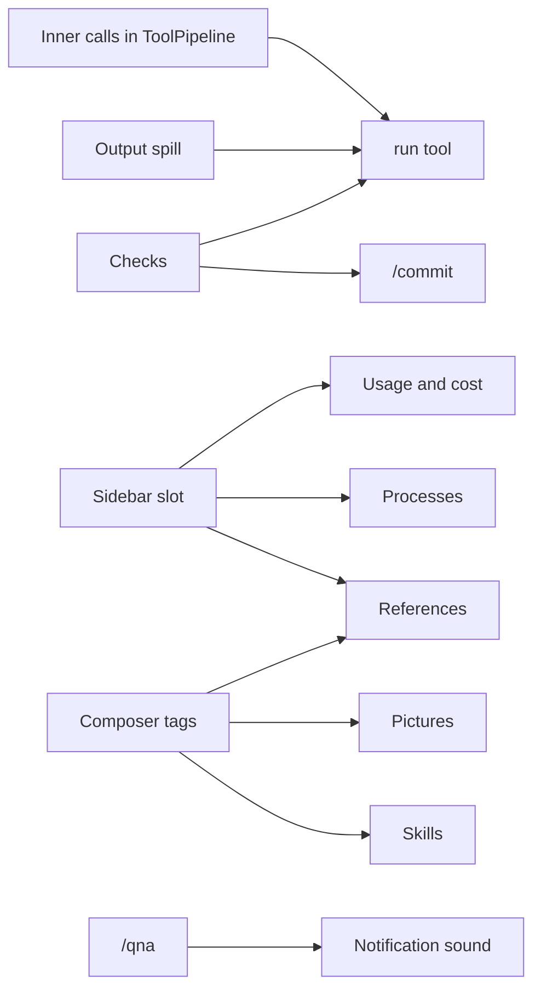

# Daily driver

Brings Liminal to where Tau was, so it can replace Tau for daily work: sessions and print mode, checks, web, long-running processes, a `run` script tool, the sidebar with usage and cost, `@` tags and pictures, stash, references, `/qna`, `/commit`, skills and a notification sound. Each step gets its own code plan here when it is built.

## Decisions

- Separate tools stay. A `run` tool joins them: it runs a script whose functions are the other tools, and its guidance tells the model to use it when chaining or filtering saves tokens.
- Every function call inside `run` goes through `ToolPipeline` as its own call, so checks, approvals and output spill judge each one.
- Web search comes from a searcher registry: providers with built-in search (Anthropic, OpenAI) register, Exa registers too; the tool uses the first that works.
- A sidebar like Tau's: Ctrl+B, beside the chat at 122 columns or wider, over it when narrower. Plugins fill its sections through a slot.
- The processes holder program exits when it holds no running commands and no server is connected.
- Checks live in `.liminal/checks.json` at the repository root with `fix`, `check` and `commit` lists, as Tau's `.tau/checks.json`; ignored in an untrusted workspace.
- `/sessions` labels each session with its first user message, cut to one line, and its last-written time.
- The notification sound is Tau's `assets/sounds/notification.wav`, bundled and played by the system player: `afplay` on macOS; on Linux the first installed of `paplay`, `pw-play` or `aplay`, silent if none.
- Stashes are text only, kept in `stashes.db` in Liminal's data folder, one list per workspace folder.

## What needs what

Foundations come first because later steps draw into them.



| Foundation | Where | What it gives later steps |
| --- | --- | --- |
| Inner calls | `tools`: `ToolCall` gains the outer call's id | `run` dispatches each function through the pipeline; wrappers such as checks' `fix` run once per outer call |
| Sidebar slot | `chat`: `ChatSlots.sidebar`, a list slot of sections, session scope; Ctrl+B; width rule | Usage, compaction stage, processes and references each register one section |
| Composer tags | `inbox`: a `TagSources` registry; a tag resolves to text or an image part | Files and folders, pictures, references and skills each register one source |
| User message parts | `session-log`: `UserEntry` gains image parts beside its text | Pictures; the providers already send `ModelPart` images |

## Steps

| Step | Plugins | Joins | Draws |
| --- | --- | --- | --- |
| 1. Sessions and the command line | `chat`, which owns `/new`; `session-store`; `session-log`; `settings`; `apps/cli` | `session-log/list`; `SelectDialog`; `effect/cli` | `/sessions` dialog; `--session`, `-p`, `--model` |
| 2. Small tool hooks | new `tool-output`; `agent-loop`; `compaction` | `ToolWrappers`; `BeforeCallHooks` ends a turn on repeats; `Memories` ranges | `history` tool rows |
| 3. Checks | new `checks` | `command-runner`; `ToolWrappers` for `fix`; `TurnEndingHooks` re-runs skipped or stale checks and continues the turn on failure | `checks` tool row `Hidden`; its own `checks/report` entry; `fix` runs as debug lines |
| 4. `run` tool | new `tools-run`; `tools` | Inner calls; `Tools` as script functions; codemode's `search` for deferred functions | Its row opens to the script and output; inner calls fold under it |
| 5. Web | new `tools-web`; `model-anthropic`, `model-openai` register searchers | `effect/http` `HttpClient` for fetch | `search` and `fetch` rows |
| 6. Sidebar, usage and cost | `chat`; new `usage`; `compaction` | `Finish.usage`; `model-catalog` prices | Sidebar with Context, Cost, Compaction sections (gallery first) |
| 7. Processes | `processes` and its holder program | Bun's PTY; `TurnEndingHooks`; a resumed turn's reminder | Process rows; Processes section; live output |
| 8. Composer | `inbox`; `session-log`; `files` | Composer tags; user message parts | `@` list (gallery `FileSuggestions`); `[Image N]`; Ctrl+S stash and `/pop` |
| 9. References | new `references` | Composer tags; sidebar | `/references` dialog; References section |
| 10. `/qna` | `questions` | The `composer` chain slot, as `trust` uses it | The form in the composer's place; asked and answers entries |
| 11. `/commit` | new `commit` | Checks' `commit` mode; `ModelTask` with the cheap model; `command-runner` for git | Plan dialog; push confirm |
| 12. Skills | new `skills` | `instruction-files`' front matter and trust rule; composer tags; slash commands | `/<skill>`; skill rows |
| 13. Notification sound | new `attention` (TUI) | Turn end, pending approvals and pending forms in the session feed | None |

## Step 1: sessions and the command line

```
packages/sdk/src/core/launch.ts            LaunchSettings base service: settings sections from the command line
packages/plugins/settings/src/server.ts    merges LaunchSettings over the files
packages/plugins/session-store/src/server/
  migrations.ts                            0002: sessions.workspace, sessions.title, title backfill
  queries.ts, session-index.ts             create with workspace; fork copies it; nameSession; list by workspace
packages/plugins/session-log/src/server/   create stamps Directories.workspace; the first user message names the session
packages/plugins/chat/src/tui/sessions.tsx /sessions: SelectDialog of this folder's sessions; picks switch the followed session
apps/gallery/src/chat/SessionPicker.tsx    the same dialog in the gallery; PickerRows.tsx holds the rows it shares with Models
apps/cli/src/args.ts                       effect/cli command: [prompt] --print/-p --session --model --check -> Launch (Check | Print | Tui)
apps/cli/src/print.ts                      runTurn: send, follow to the turn's end, return reply, notices, end; printTurn prints it
```

```ts
class LaunchSettings extends Context.Service<LaunchSettings, { readonly sections: JsonObject }>
// SessionStore
createSession(id, workspace): Effect<void, StoreError>
nameSession(id, title): Effect<void, StoreError>      // only while it has none
listSessions(workspace): Effect<ReadonlyArray<StoredSession>, StoreError>
StoredSession += { workspace: string; title: string }
SessionSummary += { title: string }                   // SessionLog.list: this workspace's sessions
```

```
main
  parse args
  --check            start kernel, exit 0
  --print <prompt>   start kernel (no parts), LaunchSettings from --model
                     session = --session or new; synced = follow until Synced
                     inbox/send(session, prompt, follow-up)
                     follow after synced: collect text entries until turn-ended
                     print text; exit 0 when answered, else reason on stderr, exit 1
  otherwise          TUI; handoff from the restart file, else { chat/session: --session }
```

- `--model provider/model` becomes the launch section `{ "agent-loop": { "model": ... } }`, for this run only.
- Sessions created before the migration have no workspace and are not listed.
- An invalid command line exits 2; a printed turn that did not answer exits 1.
- A new session's id goes to stderr in print mode, so the next run can pass `--session`.

## Step 2: small tool hooks

```
packages/sdk/src/core/directories.ts          Directories.temp: scratch files the system may clear (<tmpdir>/liminal)
packages/plugins/tool-output/                 new plugin: one ToolWrapper that spills long output
  src/contract.ts                             outputLimits: 50,000 characters or 2,000 lines
  src/server/spill.ts                         cut: first and last half kept; the whole text to a private file
packages/plugins/agent-loop/src/server/
  repeats.ts                                  before-call hook: the same call failing 3 times in a row ends the turn
  turns.ts                                    a turn a plugin ended saves a warning notice with the reason
packages/plugins/compaction/src/server/
  recall.ts                                   history tool: entries from..through as a transcript
  notes.ts                                    exports historyText, which recall shares
packages/plugins/compaction/src/tui.tsx       history rows: Recalling / Recalled entries 12–40
apps/gallery/src/transcript/                  a recall action and its row, in the sample
```

```ts
// tool-output: ToolWrappers, order 0 (outermost)
(allowed, next) => next.pipe(Effect.flatMap((outcome) =>
  done   -> text = string result or its JSON; over the limits -> result = cut(text, path)
  failed -> the same with message
  denied -> unchanged))
// path: <temp>/tool-output/<session>/<callId>.txt, folder 0o700, file 0o600
// cut: <first 1,000 lines or 25,000 chars>\n[Output cut: N lines, M characters. Full output saved at <path>; read or search it for the rest.]\n<last half>
// a failed write keeps the cut text and names the error instead of the path

// agent-loop: BeforeCallHooks, order -10
repeats(log): BeforeCallHook
  entries since the latest turn-started; the last 3 tool results
  all failed or denied, and their calls share name and params -> EndTurn("The same <name> call failed 3 times in a row.")
  a log read failure logs a warning and proceeds

// compaction: Tools
history { from: Seq, through: Seq } -> log.read(session, { after: from - 1, through }) -> historyText
  through < from -> ToolFailed
```

- Spill sees the final outcome of every call, so the later `run` tool's inner calls spill one by one.
- Notes in the view already name their entry range; the `history` guidance points the model at them.
- The ended-by-plugin notice is the only place the user sees why a turn stopped; the loop guard is its first user.

## Step 3: checks

```
packages/plugins/tool-output/src/contract.ts  LongOutput service: fit(session, name, text) -> the cut text naming its file
packages/plugins/tool-output/src/server/      spill wrapper uses LongOutput; one file layout for both
packages/plugins/checks/                      new plugin
  src/contract.ts                             checks.json schema; Changes; CheckReport; entries; checksTool
  src/server/file.ts                          <project>/checks.json -> Option<ProjectChecks>; untrusted -> none
  src/server/snapshot.ts                      git status -z under the workspace + content hash per path
  src/server/history.ts                       this turn's changes, last report, failed settles (pure)
  src/server/run.ts                           dueChecks (globs on workspace paths), runChecks -> CheckReport
  src/server/fix.ts                           ToolWrappers order 10: snapshot around a writing call, run fixers
  src/server/tool.ts                          the checks tool; re-registered before each model call to follow the file
  src/server/settle.ts                        TurnEndingHooks order 50: runs due checks, sends failures back
  src/tui.tsx                                 checks tool rows; report entry row; fixed debug line
```

```ts
// contract
ChecksFile = { fix?, check?, commit?: Array<{ name, command, details?, include?, exclude?, cwd?, env?, timeoutSeconds? }> }
Changes   = { type: "files", paths } | { type: "unknown" }       // paths from the workspace
CheckReport = { passed: string[], failed: Array<{ name, output }> }
ChangesEntry "checks/changes"  model false, hidden
FixedEntry   "checks/fixed"    model false, debug      // "Fixed with format, lint on 3 files"
ReportEntry  "checks/report"   model true,  shown      // report text + next step, as a user message

// fix wrapper: tool.hints.readOnlyHint -> next unchanged
before = snapshot; outcome = next; after = snapshot
none of them -> ChangesEntry(unknown); else paths = changed(before, after)
fixers due on paths -> run, FixedEntry; paths = changed(before, snapshot)
paths non-empty -> ChangesEntry(files)

// tool (no params; Record<String, Never> so the schema is type: object)
due = dueChecks(check, changesThisTurn); none -> "No checks apply to the changes in this run."
report -> passed: result; failed: ToolFailed(report text + fix-and-check-again), details = report

// settle hook
no config, no change after the last report (checks/report or a checks result) -> []
report = runChecks(due)
passed, or failed and 3 earlier failed reports this turn -> append ReportEntry, []   // the turn ends
failed -> [ReportEntry]                                                              // the turn continues
```

- `{files}` in a command becomes the matching changed files, absolute and shell-quoted; a check that takes files and has none left is skipped.
- Unknown changes (no git, or git failed) make every check due, with no files.
- The tool draws as the gallery's checks row: `Running checks`, `Ran checks (all passed)`, `Ran checks (lint failed)`; opened, each check's mark and the failures' output. The settle report draws the same row.
- Edits to `checks.json` apply from the next model call.

## Step 4: the `run` tool

A new `tools-run` plugin registers `run`, which runs a script in codemode's interpreter. The script's functions are the registered tools by the same names and params, so `run` adds no second set of file or shell functions. Each function call is an inner call: it goes through `ToolPipeline` with the outer call's id, and its outcome is saved as its own entry for the transcript.

What OpenCode does with codemode (`packages/core/src/codemode/tool.ts`, `instructions.ts`): it wraps every tool as a `Tool.make` with its JSON schema, runs `CodeMode.make({ tools }).execute(code)`, folds the result's value, warnings and logs into text, and keeps the changing catalog out of the tool's description so the request's cached start stays the same. Liminal's tools are already in the model's tool list, so the description only says the functions are those tools; `search` finds the tools not offered yet.

| Where | Change |
| --- | --- |
| `tools` contract | `ToolCall.outer?: string`: the `run` call an inner call runs inside |
| `session-log` contract | `InnerCallEntry` `session-log/inner-call`, hidden, no model view: `{ outer, id, name, params, status, result, details? }` |
| `checks` fix wrapper | Skips inner calls; the outer `run` call is tracked once |
| `chat` | `ToolCall.inner`; the transcript adds inner-call entries to their outer call; `WorkRows` draws a call's inner rows under its row, each worded by its own tool |
| new `tools-run` | `RunParams { code, timeout? }`; the tool; its TUI row |
| gallery | A `script` action whose inner actions draw as rows under it |
| root `package.json` | `overrides.effect` pins codemode's `effect` to the workspace's 4.0.5 |

```ts
// tools-run server
run({ code, timeout = 300 }, { sessionId, callId }) =>
  functions = Tools.list without "run", each Tool.make({ description, input: spec.parameters, output: {} ,
    execute: (input) => inner(sessionId, callId, name, input) })
  CodeMode.execute({ code, tools: functions, limits: { timeoutMs, maxOutputBytes: 10 MiB } })
  ok -> { result: logs + value + warnings }; failed -> ToolFailed(logs + diagnostic)

inner(session, outer, name, input) =                                  // callId `${outer}/${n}`
  params = decode Json(input)
  outcome = (tool.runAlongside ? id : serial.withPermit)(ToolPipeline.run({ ..., outer }, Tools.get(name)))
  append InnerCallEntry
  done -> output.result; failed or denied -> toolError(message)
```

- Checks, approvals and output spill judge each inner call; the repeat guard sees only the model's calls.
- Inner calls of tools that cannot run alongside others wait for each other.
- The row reads `Ran <first line of the script>` with `N calls`; opened, it shows the script and its output.

## New dependency

- `@opencode/codemode` 2.0.32 for the `run` interpreter, which Tau used (`src/sandbox/Sandbox.ts`, patched there). Unpatched here: its console logs are cut only when the script ends.

## Guides

- `tui.md`: the sidebar slot; tag sources
- `plugins.md`: tag sources; inner calls for wrappers
- `providers.md`: registering a web searcher
