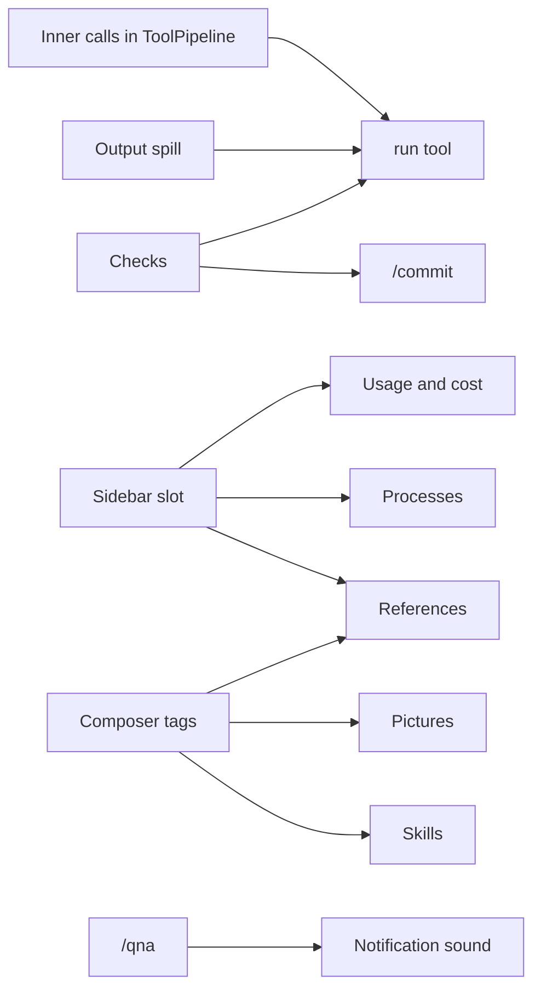

# Daily driver

Brings Liminal to where Tau was, so it can replace Tau for daily work: sessions and print mode, checks, web, long-running processes, a `run` script tool, the sidebar with usage and cost, `@` tags and pictures, stash, references, `/qna`, `/commit`, skills and a notification sound. Each step gets its own code plan here when it is built.

## Decisions

- Separate tools stay. A `run` tool joins them: it runs a script whose functions are the other tools, and its guidance tells the model to use it when chaining or filtering saves tokens.
- Every function call inside `run` goes through `ToolPipeline` as its own call, so checks, approvals and output spill judge each one.
- Web search comes from a searcher registry: providers with built-in search (Anthropic, OpenAI) register, Exa registers too; the tool uses the first that works.
- A sidebar like Tau's: Ctrl+B, beside the chat at 122 columns or wider, over it when narrower. Plugins fill its sections through a slot.
- The processes holder program exits when it holds no running commands and no server is connected.
- Checks live in `.liminal/checks.json` at the repository root with `fix`, `check` and `commit` lists, as Tau's `.tau/checks.json`; ignored in an untrusted workspace.
- `/sessions` labels each session with its first user message, cut to one line, and its last-written time.
- The notification sound is Tau's `assets/sounds/notification.wav`, bundled and played by the system player: `afplay` on macOS; on Linux the first installed of `paplay`, `pw-play` or `aplay`, silent if none.
- Stashes are text only, kept in `stashes.db` in Liminal's data folder, one list per workspace folder.

## What needs what

Foundations come first because later steps draw into them.

| Foundation | Where | What it gives later steps |
| --- | --- | --- |
| Inner calls | `tools`: `ToolCall` gains the outer call's id | `run` dispatches each function through the pipeline; wrappers such as checks' `fix` run once per outer call |
| Sidebar slot | `chat`: `ChatSlots.sidebar`, a list slot of sections, session scope; Ctrl+B; width rule | Usage, compaction stage, processes and references each register one section |
| Composer tags | `inbox`: a `TagSources` registry; a tag resolves to text or an image part | Files and folders, pictures, references and skills each register one source |
| User message parts | `session-log`: `UserEntry` gains image parts beside its text | Pictures; the providers already send `ModelPart` images |

## Steps

| Step | Plugins | Joins | Draws |
| --- | --- | --- | --- |
| 1. Sessions and the command line | new `sessions`; `apps/cli` | `session-log/list`; `SelectDialog` | `/sessions` dialog; `--session`, `-p`, `--model` |
| 2. Small tool hooks | new `tool-output`; `agent-loop`; `compaction` | `ToolWrappers`; `BeforeCallHooks` ends a turn on repeats; `Memories` ranges | `history` tool rows |
| 3. Checks | new `checks` | `command-runner`; `ToolWrappers` for `fix`; `TurnEndingHooks` re-runs skipped or stale checks and continues the turn on failure | `checks` tool row `Hidden`; its own `checks/report` entry; `fix` runs as debug lines |
| 4. `run` tool | new `tools-run`; `tools` | Inner calls; `Tools` as script functions; codemode's `search` for deferred functions | Its row opens to the script and output; inner calls fold under it |
| 5. Web | new `tools-web`; `model-anthropic`, `model-openai` register searchers | `effect/http` `HttpClient` for fetch | `search` and `fetch` rows |
| 6. Sidebar, usage and cost | `chat`; new `usage`; `compaction` | `Finish.usage`; `model-catalog` prices | Sidebar with Context, Cost, Compaction sections (gallery first) |
| 7. Processes | `processes` and its holder program | Bun's PTY; `TurnEndingHooks`; a resumed turn's reminder | Process rows; Processes section; live output |
| 8. Composer | `inbox`; `session-log`; `files` | Composer tags; user message parts | `@` list (gallery `FileSuggestions`); `[Image N]`; Ctrl+S stash and `/pop` |
| 9. References | new `references` | Composer tags; sidebar | `/references` dialog; References section |
| 10. `/qna` | `questions` | The `composer` chain slot, as `trust` uses it | The form in the composer's place; asked and answers entries |
| 11. `/commit` | new `commit` | Checks' `commit` mode; `ModelTask` with the cheap model; `command-runner` for git | Plan dialog; push confirm |
| 12. Skills | new `skills` | `instruction-files`' front matter and trust rule; composer tags; slash commands | `/<skill>`; skill rows |
| 13. Notification sound | new `attention` (TUI) | Turn end, pending approvals and pending forms in the session feed | None |

## New dependency

- `@opencode/codemode` 2.0.32 for the `run` interpreter, which Tau used (`src/sandbox/Sandbox.ts`, patched there). Step 4's plan studies how OpenCode uses it and writes the `run` guidance from that.

## Guides

- `tui.md`: the sidebar slot; tag sources
- `plugins.md`: tag sources; inner calls for wrappers
- `providers.md`: registering a web searcher
