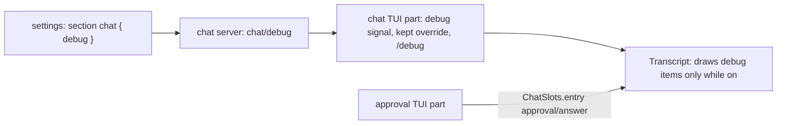

# Debug view

Entries a plugin marks `debug` show in the transcript only while the debug view is on, drawn quieter than shown entries. The `debug` setting in chat's section sets the default; `/debug` flips it for the run. Approval answers are the first `debug` kind. Requirements are in [06-tui-design.md](../requirements/06-tui-design.md) and [approval.md](../plugins/approval.md).

## Shape



- Chat gains a server part. It only reads the setting; the TUI cannot read settings itself.
- The run's choice is kept with `host.keep`, so it holds through reloads and restarts until quit.

## Changes

### Chat

```ts
// contract.ts
export const ChatSettings = Schema.Struct({ debug: Schema.Boolean.pipe(Schema.withDecodingDefaultKey(Effect.succeed(false))) });
export class ChatRpcs extends RpcGroup.make(Rpc.make("chat/debug", { success: Schema.Boolean })) {}

// server.ts: section("chat", ChatSettings); SettingsInvalid logs a warning and reads false.

// tui.tsx
const kept = host.keep("debug", Schema.NullOr(Schema.Boolean), () => null); // null: follow the setting
const setting = bridge.watch(Stream.fromEffect(client["chat/debug"]()), false);
const debug = () => override() ?? setting();
// command view.debug, slash "debug", palette, category "View": sets override to !debug()
```

`plugin.ts` requires `Settings`, adds `rpcs` and `server`; `@liminal/settings` becomes a peer dependency.

### Transcript fold

`withEntry` keeps `debug` entries as items; `hidden` entries are still dropped. A tool call joins the last work item even when `debug` items follow it, so an approval answer saved mid-run does not split the run; the answers draw after the run.

### Transcript view

`ChatScreen` and `Transcript` take `debug: Accessor<boolean>`. `ItemRow` draws an entry whose `user` is `debug` only while `debug()` is on. The fallback for a `debug` entry with no view is its text in `text.faint`.

### Approval

- `ApprovalEntry.user` becomes `"debug"`.
- `src/tui/AnswerRow.tsx` draws `approval/answer` on `ChatSlots.entry`, one `text.faint` line: `✓ shell approved by reviewer (gpt-5-mini): reason` or `✕ shell rejected by you: reason`.

### Toasts

`/debug` raises a toast saying whether the view turned on or off. The TUI had no toasts, so the SDK gains them next to the dialog stack:

```ts
// @liminal/sdk/tui toasts.ts
type ToastKind = "info" | "success" | "warning" | "error";
interface ToastMessage { kind: ToastKind; title: string; message?: string }
interface TuiToastsService {
  show(toast: ToastMessage): void;      // replaces the current toast; it times out after 4s
  current: Accessor<ToastMessage | undefined>;
  hold(held: boolean): void;            // the mouse is over it: the timer stops, then restarts
}
class TuiToasts extends Context.Service<...>()("liminal/sdk/TuiToasts") {}
const makeTuiToasts: Effect<TuiToastsService, never, Scope>; // timer in a FiberHandle
```

- The app makes it in `makeTerminal` and adds it to `tuiServices`; `TuiServices` includes `TuiToasts`.
- Chat draws the current toast in its column's top right, one row under the header (`src/tui/Toast.tsx`).
- `/debug` shows `Debug view on` (`Debug entries show in the transcript`) or `Debug view off`.

### Gallery

`apps/gallery/src/transcript/ApprovalAnswer.tsx`, and a "Debug entries" entry in `TRANSCRIPT_COMPONENTS` with states for the decision model, the reviewer, the full mode and the user's rejection.

## Tests

- `packages/plugins/chat/test/transcript.test.ts`: `debug` entries are kept, `hidden` dropped; a call after a `debug` item joins the run.
- `apps/cli/test/tui.test.tsx`: a saved `approval/answer` draws only after `/debug`; each `/debug` raises its toast.
