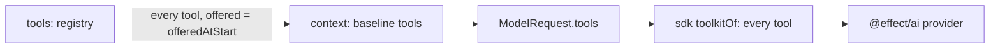
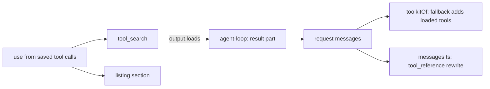
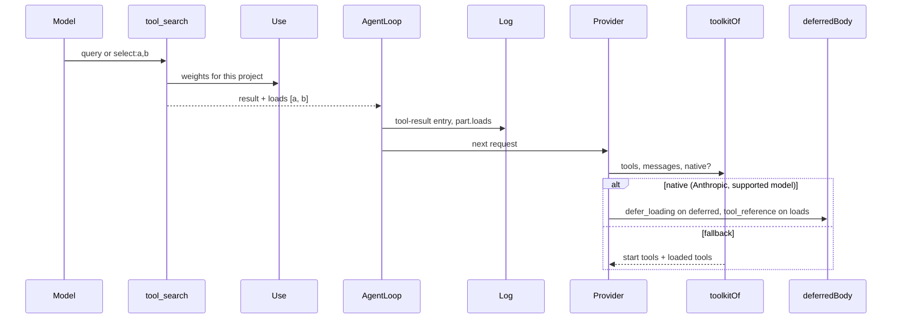

# Deferred tools

Rarely used tools stay out of the model's request and are loaded when needed, so their schemas cost no tokens on every call. Steps 1 to 5 are built; the live checks are not run.

## Requirements

- The model finds and loads deferred tools with a search tool it calls directly; `execute`'s built-in `search` is not the only way.
- One field on a tool says how it is offered: at the start, by search, or only by its own plugin (`ask_question`); it replaces `offeredAtStart`
- A stable prompt section lists each deferred tool by name and one line of description
- The listing holds about 1,000 tokens, most used tools first, then one line saying how many more search can find
- Search ranks often used tools higher, so they surface when there are many
- Use is the model's calls of each tool in this project's saved sessions; a call's weight halves every 30 days; nothing new is stored
- A query is keywords ranked over name, description and parameter text, or `select:a,b` to load named tools
- On Anthropic models with tool search (Haiku 4.5, Sonnet 4.5, Opus 4.5 and newer), deferred tools carry `defer_loading: true` and a found tool loads as `tool_reference` blocks in the search tool's result
- On other providers and models, a loaded tool is added to `tools`, at one cache miss per load
- `websearch`, `webfetch` and `vocabulary` are deferred; MCP tools arrive deferred

## Today



- `@effect/ai-anthropic` writes every tool result as a JSON string and has no per-tool `defer_loading`; config cannot replace `tools` or `messages`, since `makeRequest` sets them after it. So `defer_loading` and `tool_reference` need a request-body rewrite in `transformClient`, as Tau's `collectResponseStream` rewrites a Responses request body.
- `@effect/ai-openai` cannot send `additional_tools` or `tool_search_output`, so OpenAI uses the fallback.

## Architecture

The loaded set lives in the conversation: a tool result names the tools it loads. Each request reads it from its own messages, so nothing tracks loads per session.

| System | Change |
| --- | --- |
| `sdk` `core/tool.ts` | Changes: `offer` replaces `offeredAtStart`; `ToolOutput.loads` |
| `sdk` `core/model.ts` | Changes: `tool-result` part gains `loads`; `ModelTool` gains `deferred` |
| `tools` | Changes: the source marks `offer: "search"` tools `deferred` |
| `agent-loop` | Changes: copies `loads` from the output to the result part |
| `sdk` `ai/prompt.ts` | Changes: `toolkitOf` withholds deferred tools no result has loaded |
| `sdk` `ai/messages.ts` | Expands: `deferredBody` rewrite when the signing allows it for the model |
| `tools-search` | Adds: `tool_search`, the listing section, ranking from use |
| `tools-web`, `vocabulary`, `questions` | Change: `offer: "search"`, `"search"`, `"plugin"` |



- Pattern: the data travels with the message (a field on the result part), so encoding stays a pure function of the request. The alternative, a per-session `ToolLoads` registry read by a session-aware `ToolSources`, needed two contract changes and a second log read on each request.
- A checkpoint that drops the loading result drops the load; the model searches again. Anthropic behaves the same, since `tool_reference` blocks expand only where they are.
- `ask_question` (`offer: "plugin"`) stays declared from the start, so `/qna` keeps the cache.
- `execute`'s inner calls reach deferred tools without loading them; their `loads` are dropped, since the model sees only the script's output.

## Types

```ts
type ToolOffer = "start" | "search" | "plugin"; // ToolDefinition.offer, default "start"
interface ToolOutput { result; details?; readonly loads?: ReadonlyArray<string> }
// ModelPart tool-result: { ..., loads?: ReadonlyArray<string> }
// ModelTool: { ...ToolSpec, offered: boolean, deferred?: true }
interface MessagesSigning { ...; readonly deferredLoading: (modelId: string) => boolean }
// tool_search params: { query: string (1 to 500), limit?: Int 1 to 20, default 5 }
// tool_search result: { loaded: [{ name, description }], unknown?: string[] }
```

## Call path



## Logic

```text
toolkitOf(tools, messages, native)
  loaded = names in loads of tool-result parts in messages
  send each tool unless deferred and not native and not in loaded

deferredBody(body, deferred, loadsByCallId)            // in transformClient, on the JSON body
  names = tool names in body.tools
  if every tool would be deferred: leave the body as it is
  mark each tool in deferred with defer_loading: true
  for each tool_result whose tool_use_id has loads:
    content = original text, then a tool_reference per loaded name found in names

tool_search(query, limit)
  candidates = registered tools with offer "search"
  if query starts with "select:": exact names; unknown names reported
  else: score = bm25(name split on _ - and case, description, parameter names and descriptions)
        times (1 + ln(1 + use)); keep the top `limit` with a score above 0
  output: result lists loaded names and descriptions; loads = their names

use (cached for an hour)
  sessions = SessionLog.list                            // this workspace's sessions
  calls = recentOfKinds([ToolCallEntry], now - 180 days), in those sessions
  weight per tool = sum of 0.5 ^ (age in days / 30)

listing section tools-search/deferred, order 60
  value = deferred names ordered by use, then name
  initial: "- name: first sentence, cut at 120 characters" while chars / 4 fits 1,000,
           then "N more; find them with tool_search"
  changed only when the set of deferred tools changes: added and removed names
```

## Build steps

1. `offer`, `deferred`, `loads` through `sdk`, `tools`, `agent-loop`, `questions`; the `(not offered)` debug label becomes `(deferred)` for deferred tools
2. `toolkitOf` fallback
3. `tools-search` plugin with its TUI row `Loaded <names>`
4. `tools-web` and `vocabulary` move to `offer: "search"`
5. Anthropic `deferredBody`; `model-anthropic` sets `deferredLoading` by model version, `model-opencode-go` sets it off

Tests: `toolkitOf` withholds and adds; `deferredBody` on recorded bodies (`packages/sdk/src/testing/http.ts`): flags, references, unknown names, unsupported model, all-deferred guard; `tools-search` on the scripted provider: `select:`, ranking with use, listing budget and its stability, decay from saved calls.

Live checks: Claude sign-in accepts `tool_reference` without a beta header.

- A `tool_result` that loads tools holds only `tool_reference` blocks (Anthropic refuses one mixing them with other content: "Tool definitions/code execution functions cannot be mixed with other content"); its text follows as a text block after the message's results.

Deletes: `offeredAtStart`; `toolkitOf`'s "every declared tool" rule; the vocabulary always-offered note in `docs/status.md`.

Guides: `docs/guides/plugins.md` tool definition table (`offer`, `loads`); `docs/guides/providers.md` deferred tools and `deferredLoading`.

## References

- Codex `codex-rs/core/src/tools/handlers/tool_search.rs`, `tool_search_spec.rs`, `codex-rs/core/src/context/world_state/tools.rs`
- Pi `packages/durable/src/tool-search/tool-search.ts`, `packages/ai/src/utils/transcript.ts`, `packages/ai/src/api/anthropic-messages.ts`, `openai-responses-shared.ts`
- OpenCode `packages/core/src/codemode/catalog.ts` (description limit 120, 4 characters per token)
- Tau `src/ai/internal/protocols/responses-stream.ts` (`collectResponseStream`), `messages-defaults.ts`
- `@effect/ai-anthropic` `AnthropicLanguageModel.ts` (`makeRequest`, `prepareTools`, tool results)
- Anthropic docs: Tool search tool (custom tool search implementation); cookbook: tool search with embeddings
- OpenAI docs: Tool search guide
