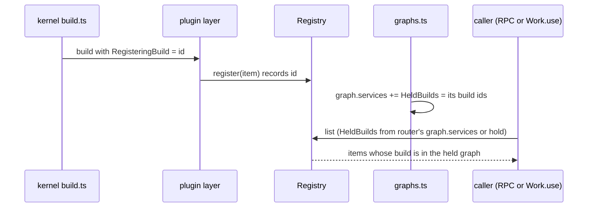

# Entry versions and graph-scoped registries

Lets a plugin change the data shape of an entry kind without breaking saved sessions, and lets a reload swap plugins without the old and new builds running side by side. Requirements: [plugins/session-log.md](../plugins/session-log.md).

## How it works today

| Part | Where | Today | Remaining gap |
| --- | --- | --- | --- |
| Entry definitions | `packages/sdk/src/core/session.ts`: `EntryDefinition`, `defineEntry` | One `data` schema per kind | No version or older schemas |
| Storage | `packages/plugins/session-store/src/server/migrations.ts` | SQLite migrations through `0003_name`; entries store JSON data | No entry version column |
| Writing | `packages/plugins/session-log/src/server/entries.ts`: `prepare` | Encodes with the writer's own definition | Does not save the definition's version |
| Reading | `entries.ts`: `restore`; `entries-log.ts`: `read`, `restored` | Decodes with the registered schema; one failed row fails the read | No forward migration or model-hidden decode fallback |
| Wire feed | `entries.ts`: `toSaved`; `entries-log.ts`: `readSaved`, `follow` | Sends saved JSON, model content and text without decoding plugin data | Carry version information through the saved-entry boundary |
| Registries | SDK registries; kernel `host/build.ts`, `graph/graphs.ts` | Registrations belong to builds; callers filter by their held graph | Step 1 built, awaiting review |


## Next

- Current priority: step 2, saved-session compatibility; keep step 1's graph-scoped registries and extend the existing `defineEntry`, `prepare`, `restore` and SQLite migration path rather than adding a second persistence system
- Step 2 covers versioned definitions and stored rows, forward migration on read without rewriting saved data, and raw-JSON fallback for entries with no model content whose plugin data cannot decode
- Validate existing unversioned rows, current-version writes, multi-version reads, disabled plugins, model-hidden malformed data, and restart/resume; preserve frozen model content, user text and sequence numbers
- Step 3 covers generated schema snapshots, a check against unversioned shape changes, the saved-data code rule and the plugin guide's entry-definition and migration sections

## Shape

| System | Change | Does |
| --- | --- | --- |
| SDK core | changes | `EntryDefinition` gains a version and its older shapes; `Registry` and `KeyedRegistry` filter by the caller's graph |
| Kernel | expands | Tags each build's registrations with its build id; gives each graph's services the set of its build ids |
| `session-log` | changes | Reads a row's version, migrates it forward, then decodes; a model-hidden row that still fails keeps its JSON |
| `session-store` | expands | A `version` column on `entries`, `1` for existing rows |
| `checks` | expands | A check that fails when a kind's saved shape changes without a new version |

## Decisions

- Each entry kind has a version; its definition migrates rows saved under older versions
- Today's entry shapes establish version 1; existing unversioned rows receive version 1, with no migrations for older development-era shapes
- Audit the user's saved history against the version-1 baseline and report mismatching sessions and entries without modifying them
- An entry newer than its installed plugin supports permits read-only session viewing from saved text where possible, but blocks manual and automatic resume until compatible code is installed
- Compatibility protection runs before inbox input is saved or queued and before unfinished tool calls execute; blocked sessions keep their history unchanged
- Startup isolates incompatible sessions rather than failing agent-loop startup or saving turn-end entries into blocked histories
- The server migrates data for all reads, including the TUI feed; stored rows remain unchanged, and delivered data identifies its migrated version
- An unreadable or unmigratable saved approval mode recovers to `ask` with a visible warning, never to the configured default
- An entry the model never sees whose data fails to decode keeps its JSON and does not stop the read; consumers already narrow `entry.data` with `Schema.decodeUnknownOption` and skip what does not match
- Registries are graph-scoped: each registration records the build that made it; `list`, `get` and `changes` keep only registrations from builds in the graph the caller holds. A candidate's items stay invisible until commit, and the old graph's callers keep only the old items. Beat rebuilding every registry owner on each change, and splitting plugin layers into build and activate phases
- The version is a `version` column on `entries`, written from the writer's definition
- A definition lists each older version's schema with a one-way step to the next version's encoded JSON (`Schema.decodeTo(next, { decode: SchemaGetter.transform(step), encode: SchemaGetter.forbiddenEncoding })`); reading decodes the stored version, steps forward, then decodes the current one; rows are never rewritten
- A committed snapshot of each kind's shape per version; a check fails when the shape changes and the version did not
- `.liminal/instructions/code.md`: saved data changes through a new entry version, never in place

## History audit

- `mise run check:session-history -- <sessions.db>` audits stored entry data read-only against built-in contract exports, without starting the kernel, loading third-party plugins, migrating the store or resuming work
- The task is separate from `mise run check`; the local checks configuration selects the real-history audit only when its implementation changes
- Reports session ids, entry sequences, kinds and failing field paths; unknown kinds are separate from mismatches; output omits saved data and schema error messages
- Exit codes: 0 for matching history, 1 for mismatches or unknown kinds, 2 for usage, contract-loading or database errors
- The audit of `~/.liminal/data/sessions.db` reports no mismatching entry data or unknown kinds against the current built-in definitions

## Step 1: graph-scoped registries

```text
packages/sdk/src/core/
  build-scope.ts        new: RegisteringBuild and HeldBuilds references, isVisible
  registry.ts           changes: registrations carry their build; list and changes filter
  keyed-registry.ts     changes: same, get too
packages/kernel/src/
  host/build.ts         changes: numbers a build before building it; provides RegisteringBuild
  graph/graphs.ts       changes: a graph's services carry HeldBuilds; hold provides it to f
```

```ts
/** The build whose layer is running; none outside a kernel build, such as in tests. */
export const RegisteringBuild: Context.Reference<Option.Option<number>>;
/** The builds of the graph the caller holds; none for a fiber started outside any graph. */
export const HeldBuilds: Context.Reference<Option.Option<ReadonlySet<number>>>;
/** A registration with no build, or a caller with no graph, sees and is seen by everything. */
export const isVisible: (build: Option.Option<number>, held: Option.Option<ReadonlySet<number>>) => boolean;
```



```text
register(item):
  build = RegisteringBuild
  add { item, build } until the caller's scope closes
list:
  held = HeldBuilds
  registrations kept by isVisible(each.build, held), then items
changes:
  held = HeldBuilds, read once when the stream starts
  each change filtered the same way
```

Injection: production gets both references from the kernel; `serverOf` tests get neither, so registries behave as today.

Tests: `sdk` registry tests for filtering by `HeldBuilds`; a kernel test where a prepared candidate's registration is invisible to the current graph, and after commit a holder of the old graph sees only the old item.

Fibers forked while a layer builds hold no graph and see every build's registrations; none reads a registry, and background work that does goes through `Work.use` ([guides/plugins.md](../guides/plugins.md#run-work-in-the-background)).

Deletes: nothing; the per-build `writers` FiberMap in `compaction` stays, since one caller now runs one build's hook.

## Open

- Step 2 execution sites: cover `makeTurns.resume`, both inbox send paths and direct `AgentLoop.step`/`run` callers
- Step 2, entry versions: the store migration, the definition type, `restore`'s order, the model-hidden fallback
- Step 3: the snapshot check and the code rule
- Guide sections in `docs/guides/plugins.md`
