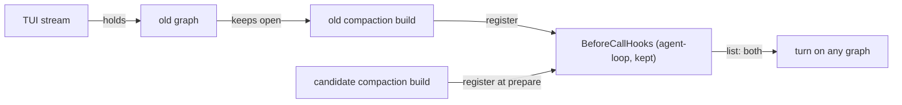
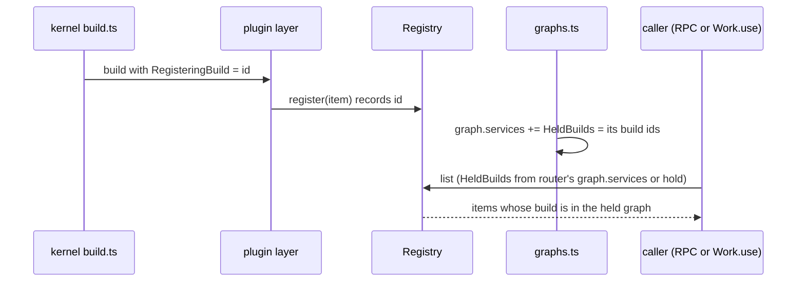

# Entry versions and graph-scoped registries

Lets a plugin change the data shape of an entry kind without breaking saved sessions, and lets a reload swap plugins without the old and new builds running side by side. Requirements: [plugins/session-log.md](../plugins/session-log.md).

## How it works today

| Part | Where | Today | Failure seen |
| --- | --- | --- | --- |
| Entry kinds | `sdk/src/core/session.ts` `EntryDefinition`; `session-log` `EntryKinds` (a `KeyedRegistry`) | One `data` schema per kind, no version; `restore` in `session-log/src/server/entries.ts` decodes every row with the newest registered definition | `ReviewVerdict` changed from `{decision, reason}` to `{risk, reason}`; entry 1425 no longer decoded and the turn stopped |
| Reading | `entries-log.ts` `read`, `restored` | `Effect.forEach` over rows; one failed row fails the whole read | A model-hidden debug record stopped a turn |
| Registries | `sdk/src/core/keyed-registry.ts`, `sdk/src/core/registry.ts` | One instance, owned by a kept build and shared by every graph; `KeyedRegistry.get` returns the newest registration, `Registry.list` returns all | See the next two rows |
| Reload check | `kernel/src/graph/graphs.ts` `prepare` | Builds the candidate's plugins against the live graph's kept builds; their `register` calls land in the shared registries before commit | The new `approval/answer` definition took effect mid-turn |
| Old graph | `kernel/src/server/router.ts` `request` | Each plugin RPC holds the graph it started on until it settles; a TUI stream never settles | The old and new `compaction` builds both ran their `BeforeCallHooks`; each has its own `writers` FiberMap, so both wrote a note for entries 94–208 |
| Saved data rule | `.liminal/instructions/code.md` | "No fallback paths or compatibility shims" | Pushes agents to change saved shapes in place |



## Shape

| System | Change | Does |
| --- | --- | --- |
| SDK core | changes | `EntryDefinition` gains a version and its older shapes; `Registry` and `KeyedRegistry` filter by the caller's graph |
| Kernel | expands | Tags each build's registrations with its build id; gives each graph's services the set of its build ids |
| `session-log` | changes | Reads a row's version, migrates it forward, then decodes; a model-hidden row that still fails keeps its JSON |
| `session-store` | expands | A `version` column on `entries`, `1` for existing rows |
| `checks` | expands | A check that fails when a kind's saved shape changes without a new version |

Agreed:

- Each entry kind has a version; its definition migrates rows saved under older versions
- An entry the model never sees whose data fails to decode keeps its JSON and does not stop the read; consumers already narrow `entry.data` with `Schema.decodeUnknownOption` and skip what does not match
- Registries are graph-scoped: each registration records the build that made it; `list`, `get` and `changes` keep only registrations from builds in the graph the caller holds. A candidate's items stay invisible until commit, and the old graph's callers keep only the old items. Beat rebuilding every registry owner on each change, and splitting plugin layers into build and activate phases
- The version is a `version` column on `entries`, written from the writer's definition
- A definition lists each older version's schema with a one-way step to the next version's encoded JSON (`Schema.decodeTo(next, { decode: SchemaGetter.transform(step), encode: SchemaGetter.forbiddenEncoding })`); reading decodes the stored version, steps forward, then decodes the current one; rows are never rewritten
- A committed snapshot of each kind's shape per version; a check fails when the shape changes and the version did not
- `.liminal/instructions/code.md`: saved data changes through a new entry version, never in place

## Step 1: graph-scoped registries

```text
packages/sdk/src/core/
  build-scope.ts        new: RegisteringBuild and HeldBuilds references, isVisible
  registry.ts           changes: registrations carry their build; list and changes filter
  keyed-registry.ts     changes: same, get too
packages/kernel/src/
  host/build.ts         changes: numbers a build before building it; provides RegisteringBuild
  graph/graphs.ts       changes: a graph's services carry HeldBuilds; hold provides it to f
```

```ts
/** The build whose layer is running; none outside a kernel build, such as in tests. */
export const RegisteringBuild: Context.Reference<Option.Option<number>>;
/** The builds of the graph the caller holds; none for a fiber started outside any graph. */
export const HeldBuilds: Context.Reference<Option.Option<ReadonlySet<number>>>;
/** A registration with no build, or a caller with no graph, sees and is seen by everything. */
export const isVisible: (build: Option.Option<number>, held: Option.Option<ReadonlySet<number>>) => boolean;
```



```text
register(item):
  build = RegisteringBuild
  add { item, build } until the caller's scope closes
list:
  held = HeldBuilds
  registrations kept by isVisible(each.build, held), then items
changes:
  held = HeldBuilds, read once when the stream starts
  each change filtered the same way
```

Injection: production gets both references from the kernel; `serverOf` tests get neither, so registries behave as today.

Tests: `sdk` registry tests for filtering by `HeldBuilds`; a kernel test where a prepared candidate's registration is invisible to the current graph, and after commit a holder of the old graph sees only the old item.

Fibers forked while a layer builds hold no graph and see every build's registrations; none reads a registry, and background work that does goes through `Work.use` ([guides/plugins.md](../guides/plugins.md#run-work-in-the-background)).

Deletes: nothing; the per-build `writers` FiberMap in `compaction` stays, since one caller now runs one build's hook.

## Open

- Step 2, entry versions: the store migration, the definition type, `restore`'s order, the model-hidden fallback
- Step 3: the snapshot check and the code rule
- Guide sections in `docs/guides/plugins.md`
