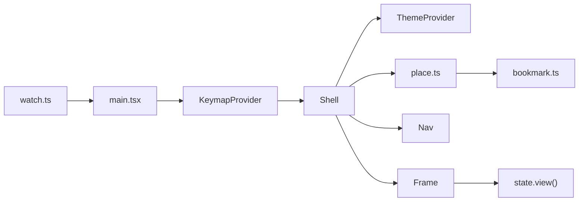

# Plan: the gallery

`apps/gallery` is where the TUI's look is designed: tokens, primitives, components and screens, each shown in its states, palettes and terminal sizes. It recreates `archive/apps/gallery` with less code.

## Systems

| System | Change |
| --- | --- |
| `apps/gallery` | Adds the gallery: its shell, its own components and their sample states |
| `mise.toml`, `.pi/tau/settings.json` | Adds gallery checks; the repository checks leave `apps/gallery` out |
| `tools/planned` | Gives `@opentui/core`, `@opentui/keymap`, `@opentui/solid`, `solid-js` and `fuzzysort` to `apps/gallery` |
| `.fallowrc.jsonc` | Ignores `apps/gallery/**`; the gallery has its own `apps/gallery/.fallowrc.jsonc` |

## Decisions

- **The gallery owns its components.** Design evolves there without touching the real TUI. Milestone 2 copies approved components into `packages/tui` and the plugins' `tui` entries; the gallery keeps its own.
- **Separate checks.** `apps/gallery` has its own `tsconfig.json` and gallery check tasks that run only when files under `apps/gallery/**` change. The repository's type check, lint and dead-code checks leave it out. Formatting stays shared. The gallery lint uses the full Liminal rule set.
- **Scope: what milestone 2 needs.** Tokens, primitives, the header, composer, transcript (turns, replies, work rows, notices), sidebar, toasts, the pickers for commands, models, sessions and `/connect`, and the chat screen. Components for later milestones come with them.
- **Look.** The archive's oklch palettes and color roles carry over; the components are redesigned with a playful touch drawn from Crush and Bubble Tea: a gradient wordmark, diagonal hatch fields, a shimmering spinner, and a band of light that scans back and forth along the header's diagonals while a turn runs. Gradients run from light accent to dark; the palettes keep one accent.
- **No repeated information.** The model shows only in the composer's footer and the context share only in the sidebar, as one percentage. The header, the spaced wordmark and the session title, shows once the session starts; before that the landing's logo stands in for it. The sidebar, on wide screens, has the session's folder and branch, the context with its memory and checkpoint counts, the repositories attached as references and the running language servers.
- **Structure.** Four groups: Tokens, Primitives, Components, Screens. No Scenarios. Each component's states sit in a file beside it; each group lists its entries in one short file.
- **Theme.** A Solid context gives components the palette's roles; `t` switches palettes. No color prop through every component.
- **One picker.** A `Picker` (dialog, filter input, `fuzzysort` matches, rows, hints) that every picker configures.
- **Fill.** A state fills the frame as `page` (scrolls from the top), `center` (the component sets its width) or `screen`.
- **Shell.** Nav list; `s` cycles states, `t` palettes, `z` terminal sizes; a bookmark keeps the place across restarts; the gallery restarts on save.
- **Static states.** No scripted playback; a working state animates with OpenTUI's timeline.
- **Static views.** Every component takes its state as props, such as a picker's query and selected row; the gallery passes sample values. No key handling inside components.
- **OpenTUI first.** `textarea` and `input` for the composer and filter, `scrollbox` for lists and the transcript, `markdown`, `code` and `diff` for replies and edits, `tab-select` for tabs, `@opentui/keymap` for keys.

## Files

```text
apps/gallery/
  package.json              @shanepadgett/liminal-gallery, private; OpenTUI, Solid, fuzzysort, effect
  tsconfig.json             extends the root config; includes src/
  bunfig.toml               preloads @opentui/solid/preload
  .fallowrc.jsonc           settings for gallery:dupes
  src/
    watch.ts                runs main.tsx and restarts it when a file under src/ changes
    main.tsx                renderer, keymap and shell; quits on q, ctrl+c and SIGTERM
    entries.ts              Group, Section, Entry, State types and the ordered group list
    shell/
      Shell.tsx             nav on the left, the frame on the right, key hints below; sets the theme
      Frame.tsx             draws a state at the chosen size and fill
      place.ts              where the user is: group, entry, state, palette, size; moves between them
      keys.ts               keymap commands and bindings
      bookmark.ts           saves and restores the place across restarts
      chrome.ts             the shell's own fixed colors, apart from the palette under design
    theme/
      oklch.ts ramp.ts palettes.ts roles.ts   ported from archive/packages/sdk/src/tui/tokens
      syntax.ts             markdown and code colors from the palette's roles
      theme.tsx             ThemeProvider, useTheme and useColor
    tokens/                 Tokens group: PaletteView, TerminalView, terminal-palette.ts
    primitives/             Primitives group: Rule, Chip, Hints, ListRow, MatchedText, Section,
                            Gradient, Hatch, Logo, Spinner
    components/
      chat/                 Header, Composer, Sidebar, Toast, Landing
      transcript/           Turn, Reply, WorkRows, Notice; samples.ts holds shared sample text
      dialogs/              Dialog, Picker, Connect (API key and browser steps); the commands,
                            models, sessions and connect pickers are Picker states only
    screens/                Screens group: Chat, which places the components in slots
```

Each component is `X.tsx` with `X.states.tsx` beside it. Each group folder has an `index.ts` that lists its sections and entries in order.

## Types

```ts
type Fill = "page" | "center" | "screen"
type State = { readonly name: string; readonly fill: Fill; readonly view: () => JSX.Element }
type Entry = { readonly id: string; readonly title: string; readonly states: readonly [State, ...State[]] }
type Section = { readonly title: string; readonly entries: readonly Entry[] }
type Group = { readonly title: string; readonly sections: readonly Section[] }

// theme.tsx
type Theme = { readonly palette: Palette; readonly color: (role: RoleName) => string; readonly syntax: SyntaxStyle }
function ThemeProvider(props: { palette: Palette; children: JSX.Element }): JSX.Element
const useTheme: () => Accessor<Theme>
const useColor: () => (role: RoleName) => string

// dialogs/Picker.tsx
type PickerRow = { readonly id: string; readonly title: string; readonly detail?: string; readonly section?: string }
function Picker(props: {
  title: string
  placeholder: string           // shown in the filter input while the query is empty
  empty: string                 // shown when no row matches
  rows: readonly PickerRow[]
  query: string                 // filters rows with fuzzysort and marks the matched letters
  selected: string              // a row id
  hints: readonly Hint[]
}): JSX.Element

// screens/Chat.tsx
function Chat(props: {
  header?: JSX.Element          // left out on the landing
  transcript: JSX.Element
  composer: JSX.Element
  sidebar?: JSX.Element
  dialog?: JSX.Element
  toast?: JSX.Element
}): JSX.Element
```

## Call path



`t` sets the palette in `place`; `Shell` hands it to `ThemeProvider` around the frame, so every component redraws in the new colors.

## Checks

| Check | Command | Runs when |
| --- | --- | --- |
| `gallery:types` | `tsc --noEmit -p apps/gallery` | `apps/gallery/**`, `tsconfig.json`, `bun.lock` |
| `gallery:lint` | `oxlint --type-aware --deny-warnings --disable-nested-config apps/gallery` | `apps/gallery/**`, `.oxlintrc.json`, `tools/lint/**` |
| repository `check:types` | root `tsconfig.json` excludes `apps/gallery` | unchanged globs, minus `apps/gallery/**` |
| repository `check:lint` | adds `--ignore-pattern 'apps/gallery/**'` | unchanged globs, minus `apps/gallery/**` |
| `gallery:dupes` | `fallow dupes --root apps/gallery --fail-on-issues`, settings in `apps/gallery/.fallowrc.jsonc` | `apps/gallery/**` |
| dead code, duplicates | `.fallowrc.jsonc` ignores `apps/gallery/**` | unchanged globs, minus `apps/gallery/**` |
| tests | unchanged | `apps/**` minus `apps/gallery/**` |
| format | unchanged, shared | unchanged |

The gallery checks join `afterRun` and `beforeCommit` in `.pi/tau/settings.json`. Oxlint finds `apps/gallery/tsconfig.json` for type-aware rules on its own.

## Running it

`mise run gallery` runs `src/watch.ts`, which starts the gallery and restarts it when a file under `src/` changes. Bun's `--hot` and `--watch` miss the `.tsx` files the Solid preload loads.

## Deletes

- `@opentui/core`, `@opentui/keymap`, `@opentui/solid`, `solid-js` and `fuzzysort` leave `tools/planned/package.json`; `packages/tui` takes them again in milestone 2.
- From the archive's gallery: Scenarios, `transcript/play.ts`, `script.ts`, `sample.ts`, `Playback.tsx`, `entryViews.ts` (`withRoles`, `only`), the `color` prop, and the separate picker row components.

The gallery has no dead-code check; unused designs are normal there. `gallery:dupes`, its fallow config and the repository fallow ignore are built.
