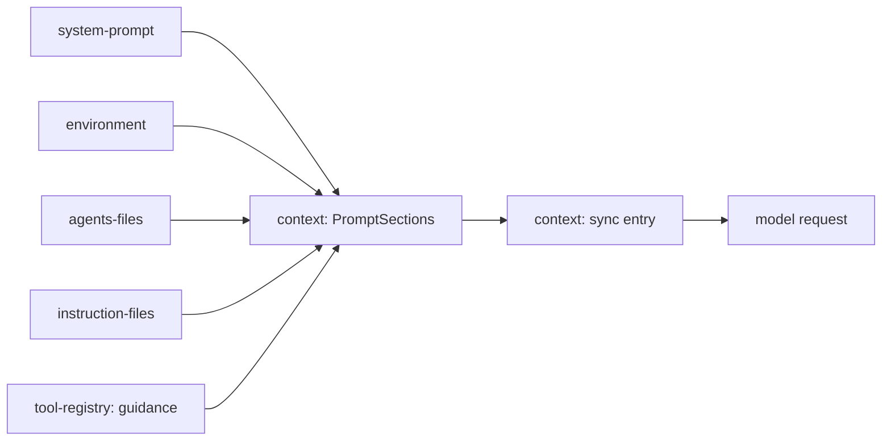

# System prompt and instructions

Status: rounds 1 and 2 agreed; step 1 built; step 2 code plan proposed.

Gives every session a base system prompt, the facts of its environment, and the user's and project's instruction files, kept current as files change without breaking the prompt cache.

## Today

| Piece | Where | What it does now |
| --- | --- | --- |
| Prompt sections | `context` `PromptSections` (`src/contract.ts`) | Keyed registry; each section has `order`, a codec, `read` and `render.{initial, changed, removed}`; none registered |
| Sync entry | `context` `SystemEntry` (`src/server/system.ts`) | First request saves a baseline of every section's value and text; later requests append an update only for sections that changed; a failed read keeps the saved value |
| Update placement | `systemModel` in `system.ts` | Sends an update as a `system` role message mid-conversation |
| Workspace | `Directories.project` | `tools-file` and `tools-shell` work in its parent folder |
| Section input | `SectionInput` | `sessionId`, `model` |

`@effect/ai-anthropic` sends a later `system` message inline only for models with `supportsMidConversationSystemMessages`; for the rest it moves the text into the top system block (`AnthropicLanguageModel.ts` around line 1002), which changes the cached start of every later request.

## Shape



| System | Change |
| --- | --- |
| `context` | Expands: update entries reach the model as a user-role `<reminder kind="instructions">`; a changed file renders as a diff against the text the model saw |
| `system-prompt` | New: the built-in base prompt; users add through `AGENTS.md`; replacing it means replacing the plugin |
| `environment` | New: workspace, git or not, platform, shell, date, and a two-level file listing capped at 200 lines, updated as files are added or removed |
| `agents-files` | New, on by default: `AGENTS.md` only; the user's and those from the repository root down to the workspace; no subfolder files; off by removing the plugin or by a `settings.json` setting (global or per folder) |
| `tool-registry` | Expands: a tool registers with optional `guidance` (rule lines); one section renders the guidance of the registered tools, removing duplicate lines |
| `notices` | New: a session-log entry kind any server plugin appends (kind, title, body); the context view skips it; its TUI part renders it in the transcript |
| `instruction-files` | New: Markdown files in `~/.liminal/instructions/` and `<folder>/.liminal/instructions/` with front matter `always: true` or `read-when: <situation>`; works with `agents-files` turned off; folder-specific rules are `read-when` files naming the folder |
| `skills` | Later, own plugin at order 300 |
| `compaction` | Unchanged here; a checkpoint already makes the context write a fresh baseline |

File problems (an unreadable file, bad front matter) are notices, appended once when the problem appears or changes.

Updates use the user-role reminder for every provider, Claude models included.

Plugin instructions not tied to a tool are the plugin's own `PromptSections` entry.

## Sections

| Key | Order | Value | Source |
| --- | --- | --- | --- |
| `system-prompt/base` | 0 | text | Built into the plugin, like Tau's `soul.ts` |
| `tool-registry/guidance` | 50 | rule lines | `guidance` of registered tools |
| `environment/facts` | 100 | workspace, git or not, platform, shell, date | Read each call |
| `environment/files` | 110 | two-level listing | Updates list only added and removed lines |
| `agents-files/agents` | 200 | path to text, most shared first | `~/.agents/AGENTS.md`, `~/.liminal/AGENTS.md`, root down to workspace |
| `instruction-files/always` | 210 | path to text | `always: true` files; nearest folder wins by name |
| `instruction-files/read-when` | 220 | name, path, situation | `read-when:` files, listed for the model to read, under fixed guidance owned by the plugin: read a file only just before acting (editing, writing, running) in its situation, not while exploring; shown only when at least one such file exists |

Each section holding files keeps a record of path to text, so a file appearing, changing or going away renders as its own line in one update.

## Call path

```text
agent-loop -> context.build(session)
  for each PromptSection: read({ sessionId, model })
    agents-files: skip when the setting is off
      folders from the repository root down to the workspace
      read each file; missing -> left out; unreadable -> unavailable (saved value kept) + notice
  compare with saved values -> baseline (first call) | update (changes) | nothing
  update -> <reminder kind="instructions"> user-role message at the point of change
```

## Steps

1. `context`: user-role reminder, diffs for changed files, section order
2. `notices`: its own step, before the instruction plugins
3. `tool-registry` guidance
4. `system-prompt` and `environment`; the base prompt is drafted from Tau's `soul.ts` for the user to edit
5. `agents-files` and `instruction-files`

## Step 1: `context`

A baseline stays one `system` message. An update becomes one `user` message: section texts inside `<reminder kind="instructions">`, then the `tool-change` parts, which a provider with `nativeToolChanges` sends natively and every other provider sends as text inside `<reminder kind="tools">`. Files sections share one value shape and renderer, so a changed file reaches the model as a diff.

### Types

```ts
// @liminal/sdk (core/text.ts), new; `diff` 9.0.0 becomes an SDK dependency
/** Hunks only, 2 lines of context, no headers. */
export const unifiedDiff: (before: string, after: string) => string;
export type ReminderKind = "instructions" | "tools";
/** `<reminder kind="">\n{text}\n</reminder>`: text the harness wrote, not the user. */
export const reminder: (kind: ReminderKind, text: string) => string;

// context contract

/** One file a section holds, most shared first. */
export const FileText = Schema.Struct({ path: Schema.String, text: Schema.String });
export const FileTexts = Schema.Array(FileText);
/** Render for a FileTexts section; spread into `definePromptSection`. */
export const fileTextsRender: PromptSectionDefinition<typeof FileTexts.Type>["render"];
```

`fileTextsRender`, per path, in the value's order:

| Case | Text |
| --- | --- |
| `initial`, or a path added | `<file path="…">` text `</file>` |
| Text changed | `` `path` changed: `` and the diff in a `diff` fence; the whole new text instead when the diff is longer |
| Path gone | `` `path` was removed; stop following it. `` |

### Call path

```text
Context.foldView (server.ts, unchanged)
  diff(replay(entries), sortSections(read), tools) -> SystemData
  draft(SystemEntry, { model: systemModel(change) })
systemModel(data)                          system.ts
  baseline -> [{ role: "system", parts: section texts }]           unchanged
  update   -> [{ role: "user", parts: [
                text(reminder("instructions", section texts joined by blank lines)),   when any
                ...tool-change parts ] }]                                              when any
promptOf (@liminal/sdk/ai prompt.ts)
  user message: the run of tool-change parts -> one text part, reminder("tools", toolChangeText per part)
  system message: text parts only
```

The `ModelPart` doc for `tool-change` changes from "in system messages only" to "in user messages only". `@effect/ai-anthropic` groups consecutive user and tool messages into one user turn, so a reminder after a tool result needs nothing extra.

### Tests

- `context.test.ts`: an update is one user message whose text starts `<reminder kind="instructions">` followed by its `tool-change` parts; the baseline stays `system`
- `prompt.ts`: a user message's `tool-change` parts become one `<reminder kind="tools">` text part
- `fileTextsRender`: added, changed (hunks only), removed, and a diff longer than the new text sends the whole text
- `unifiedDiff`: hunk output with no header lines

### Deletes or replaces

- `tool-change` handling in `prompt.ts` `systemText` moves to the user path
- The order comment on `PromptSectionDefinition.order` becomes: base 0, tool guidance 50, environment 100 to 110, instructions 200 to 220, skills 300, others 900
- `docs/plugins/context.md`: updates are user-role reminders; file sections share `FileTexts`
- `docs/reference/sources.json` gains `diff` 9.0.0, the version `@opentui/core` 0.6.6 already installs

## Step 2: `notices`

A new `notices` plugin gives server plugins one way to tell the user what happened in a session: a saved transcript entry the model never sees. Its first writer is `agent-loop`: a turn that stops on an error leaves an error notice, where today the failure only reaches the log file.

### Today

| Piece | Where | What it does now |
| --- | --- | --- |
| Entry kinds | `defineEntry` in `@liminal/sdk` `core/session.ts` | `model: false` entries carry no model content, so the context never sends them |
| Transcript | `chat` `Transcript.tsx`, `transcript-state.ts` | Draws each `user: "shown"` entry through `ChatSlots.entry` keyed by kind; plain text when nothing is registered |
| Stopped turn | `agent-loop` `server/turns.ts` `drive` | Logs the error, saves `turn-ended` with `stopped`; the user sees the turn end with no reason |
| Notice design | gallery `transcript/Notice.tsx` | `Notice`, `LiveNotice`, `noticeText`, marks and kind colors |

`agent-loop` writes notices only for turns stopped by errors; a plugin that ends a turn writes its own notice when the user should know.

Prior art: Tau keeps notices in TUI state only (`tui/internal/chat-state.ts`), so they vanish on reload; Pi's `custom_message` with `display: true` is saved and shown but also sent to the model.

### Files

```text
packages/plugins/notices/
  plugin.ts            requires SessionLog; server and tui parts
  package.json         exports . and ./contract
  src/contract.ts      NoticeEntry, NoticeKind, Notice, notice()
  src/server.ts        registers NoticeEntry with EntryKinds
  src/tui.tsx          registers NoticeView in ChatSlots.entry under NoticeEntry.kind
  src/tui/Notice.tsx   the gallery's Notice and LiveNotice, as the TUI component
  test/notices.test.ts
packages/plugins/agent-loop/src/server/turns.ts   a stopped turn appends stoppedNotice(error) before turn-ended
packages/plugins/agent-loop/src/server/stopped.ts new: stoppedNotice(error: TurnError): EntryDraft
```

### Types

```ts
// notices contract
export const NoticeKind = Schema.Literals(["info", "success", "warning", "error"]);
export const Notice = Schema.Struct({
  kind: NoticeKind,
  title: Schema.String,
  body: Schema.optionalKey(Schema.String),
});
/** Saved and shown in the transcript; never sent to the model. */
export const NoticeEntry = defineEntry({ kind: "notices/notice", data: Notice, model: false, user: "shown" });
/** The draft a server plugin appends; its text is the title, a blank line, the body. */
export const notice: (value: Notice) => EntryDraft<Notice>;
```

### Call path

```text
agent-loop drive (turns.ts)
  step fails with error
    log.append(session, [stoppedNotice(error), ended("stopped")])
stoppedNotice(error)
  ModelError -> title by reason, body = message, then "status N, request R" when known
  other      -> title "Turn stopped", body = message
chat Transcript -> ChatSlots.entry["notices/notice"] -> NoticeView
  decode data as Notice; none -> plain text
  LiveNotice: mark and bold title in the kind's color, muted body indented 2, copy button
```

| `ModelError` reason | Title |
| --- | --- |
| `rate-limit` | Rate limited |
| `quota` | Out of quota |
| `auth` | Sign-in rejected |
| `context-overflow` | Context is full |
| `invalid-request` | Request rejected |
| `provider` | Provider error |
| `network` | Network error |
| `empty-response` | Empty response |

### Tests

- `notices.test.ts`: a notice draft saves with `user: "shown"`, no model content, and the context's preview leaves it out
- `agent-loop.test.ts`: a scripted model error stops the turn with one error notice before `turn-ended`, titled by reason, body with the message
- `chat` or `notices` TUI test: a saved notice draws its mark, title and body; clicking `copy` reads `copied`

### Deletes or replaces

- `docs/plugins/context.md`: the shared context message line drops "notices" (those are model-facing nudges)
- New `docs/plugins/notices.md`; `_index.md` links it

## Open

- The `settings.json` key that turns off `agents-files`
- Step 2: whether `notice()` in the contract is the whole writing surface, or a `Notices` service wraps the append

## Deletes or replaces

- `systemModel` stops sending updates as `system` role messages.

## References

- Tau `src/core/internal/instructions/{instructions,sources,instruction-files,folders,front-matter}.ts`, `src/host/UserInstructions.ts`, `src/core/internal/run-tool/soul.ts`, `src/session/Reminder.ts`
- Pi `coding-agent/src/core/resource-loader.ts`: `AGENTS.md` and `CLAUDE.md` per folder, `SYSTEM.md`, `APPEND_SYSTEM.md`
- Pi `coding-agent/src/core/system-prompt.ts`: tool `promptSnippet` and `promptGuidelines`
- OpenCode `core/src/session/system-prompt.ts` (tool rules by tool name), `core/src/config/plugin/instruction.ts`, `core/src/tool/plugin/read.ts` (nearby `AGENTS.md` after a read), `core/src/plugin/system-prompt/*.txt` (a base prompt per model family)
- `@effect/ai-anthropic` `AnthropicLanguageModel.ts`: mid-conversation system messages
