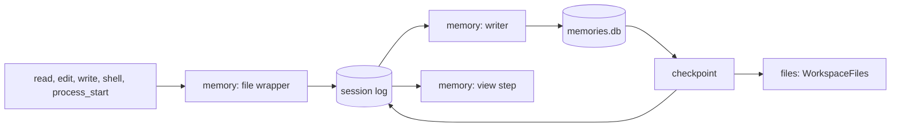
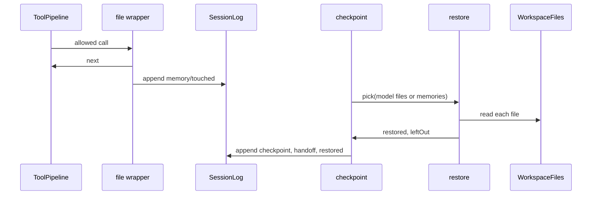

# Memory

Lets a checkpoint bring back the code the work depends on. Each memory carries a labeled file list. At a checkpoint the relevant files are read once and placed in the model's view, so the model doesn't start by reading them again. The `compaction` plugin becomes `memory`, and its sidebar rows move under Context. Requirements are in [memory.md](../plugins/memory.md).

Round 1, architecture: agreed. Round 2, code-level plan: agreed. Next: step 4.

## Systems

| System | Lives in | Change |
| --- | --- | --- |
| `memory` (was `compaction`) | `packages/plugins/compaction/` → `packages/plugins/memory/` | Renamed; file lists in memories; restored files at a checkpoint; `files` param on `checkpoint` |
| `usage` | `packages/plugins/usage/` | Expands: a `contextRows` slot inside its Context section |
| `session-log`, `session-store` | `packages/plugins/session-log/`, `packages/plugins/session-store/` | Expand: a generic entry kind rename |
| `tools` | `packages/plugins/tools/` | Unchanged; `memory` registers a `ToolWrappers` middleware |
| `files` | `packages/plugins/files/` | Unchanged; `WorkspaceFiles` reads restored files |
| `command-runner` | `packages/plugins/command-runner/` | Unchanged; `CommandRunner` runs `git status` |
| `tools-read` | `packages/plugins/tools-read/` | Exports its line window so restored files look like `read` output |
| `chat` | `packages/plugins/chat/` | Sidebar comment loses the compaction section at 20 |



## Flow

| Stage | Does |
| --- | --- |
| File wrapper | Around every allowed call of a file or shell tool, outer or inner: records the paths and line ranges the call read or changed in a hidden `memory/touched` entry |
| Writer | Per range: candidates come from `memory/touched`; the cheap model returns a summary, a label for each candidate and the files it found in shell text; code drops added files that don't exist or aren't named in the range's text |
| Condense | The cheap model condenses summaries; code merges file lists, newest label wins, deleted files drop |
| Checkpoint | Picks files (the model's `files`, else the newest memories' relevant ones), orders them, reads within the cap, appends the checkpoint, the handoff and `memory/restored` in one batch |
| View step | Places restored files after the memories, before the recent entries; never reads the disk |

The file wrapper is middleware on the tool pipeline (`ToolWrappers`). It beats reading tool params and diffing `git status` at write time: one source covers every tool, inner `run` calls included, and each change stays tied to the call, and so the range, that made it.

## Rename

Saved `compaction/checkpoint`, `compaction/handoff` and `compaction/note` entries are rewritten once to `memory/checkpoint`, `memory/handoff` and `memory/memory-written`. `session-store` stays plugin-blind: it gains a generic kind rename, and `memory` calls it at setup. The rename is idempotent, so running it again changes nothing.

The `settings.json` section is `memory`, with no fallback to `compaction`. After the build, any `compaction` section in the repo's or the global `settings.json` moves to `memory`.

## Limits and format

| Item | Value |
| --- | --- |
| Restored files' share of the budget | 15% |
| Read whole under | 300 lines |
| Padding around each range | 20 lines |
| Model view | One `<reminder kind="files">` per file, path then lines in `read` format; left-out paths in one list after |

## Files

```
packages/plugins/memory/                   moved from compaction/, package @liminal/memory
  plugin.ts                                name "memory"; requires add ToolWrappers, WorkspaceFiles, CommandRunner
  src/contract.ts                          renamed kinds, MemorySettings, LineRange, MemoryFile, TouchedEntry, RestoredEntry, MemoryStatus
  src/server.ts                            registers the wrapper, the new kinds; runs the kind rename at setup
  src/server/touched.ts                    new: the file wrapper; git status snapshots
  src/server/files.ts                      new: candidates per range, validating added files, merging lists
  src/server/restore.ts                    new: picking, ordering, reading within the cap
  src/server/notes.ts → writer.ts          answer gains files; prompt lists candidates; memory text renders file lists
  src/server/store.ts                      ShortTerm, LongTerm; migration 0002
  src/server/checkpoint.ts                 `files` param; saveCheckpoint restores for every trigger
  src/server/view.ts                       restored-file reminders after the memories
  src/server/status.ts                     counts instead of notesThrough
  src/tui.tsx                              registers rows in UsageSlots.contextRows, not a sidebar section
  src/tui/Section.tsx → ContextRows.tsx    budget, short-term, long-term, checkpoints rows
  src/tui/Checkpoint.tsx                   `Checkpoint · 6 files read`; the label in a box, so odd widths stay aligned
  src/tui/RestoredLine.tsx                 new: debug `▸ Files  4 read, 1 left out`, unfolding to each path and its lines
  src/tui/DebugLine.tsx                    Short-term memory and Long-term memory lines
  test/memory.test.ts                      moved; cases below
packages/plugins/usage/src/contract.ts     UsageSlots.contextRows
packages/plugins/usage/src/tui.tsx         Context draws the slot after its own rows
packages/plugins/session-store/src/...     renameKind in the contract and the SQLite store
packages/plugins/session-log/src/...       renameKind passes through
packages/plugins/tools-read/src/contract.ts   lineWindow moves here from server.ts
packages/plugins/chat/src/contract.ts      sidebar comment
apps/cli/test/restart.test.ts             plugin name
apps/gallery/src/chat/Sidebar.tsx, src/transcript/Checkpoint.tsx   the new rows and label, built first
docs/guides/tui.md                         compaction example paths become memory
docs/guides/plugins.md, providers.md       compaction mentions become memory
docs/plugins/compaction.md → memory.md     moved; index row renamed
```

## Types

```ts
// memory contract.ts
export const MemorySettings = Schema.Struct({ budget: Int /* default 200_000 */ });

export const LineRange = Schema.Struct({ from: Int, through: Int }); // from 1, inclusive

/** One file a memory knows about; no ranges means the whole file. */
export const MemoryFile = Schema.Struct({
  path: Schema.String,                     // relative to the workspace
  ranges: Schema.Array(LineRange),
  edited: Schema.Boolean,
  relevant: Schema.Boolean,
  reason: Schema.String,
  seq: Seq,                                // last entry that touched it, for ordering
});

/** What one call read or changed. */
export const TouchedEntry = defineEntry({
  kind: "memory/touched",
  data: Schema.Struct({
    callId: Schema.String,
    files: Schema.Array(Schema.Struct({ path, ranges: Schema.Array(LineRange), edited: Schema.Boolean })),
  }),
  model: false,
  user: "hidden",
});

/** The files a checkpoint read back, as the model sees them. */
export const RestoredEntry = defineEntry({
  kind: "memory/restored",
  data: Schema.Struct({
    files: Schema.Array(Schema.Struct({ path, ranges: Schema.Array(LineRange), text: Schema.String })),
    leftOut: Schema.Array(Schema.String),
  }),
  model: false,                            // the view step builds its messages
  user: "debug",
});

CheckpointData += { restored: Schema.Int };  // files read back, for the rule

export const MemoryStatus = Schema.Struct({
  size, budget, stage,
  shortTerm: Schema.Int, longTerm: Schema.Int, checkpoints: Schema.Int,
});

// checkpoint params
files: Schema.optionalKey(Schema.Array(Schema.Struct({
  path: Schema.String,
  ranges: Schema.optionalKey(Schema.Array(LineRange)),
})))  // "Files you need open after the checkpoint, most important first"

// writer answer
ShortTermAnswer = Schema.Struct({
  summary: Schema.String,
  labels: Schema.Array(Schema.Struct({ path, relevant: Boolean, reason: String })),
  found: Schema.Array(Schema.Struct({ path, ranges: Array(LineRange), relevant: Boolean, reason: String })),
});

// store.ts: Note and Memory each gain files: ReadonlyArray<MemoryFile>
// migration 0002_files: add files TEXT NOT NULL DEFAULT '[]' to notes and memories

// session-store contract
renameKind: (from: string, to: string) => Effect<void, StoreError>;

// usage contract
export const UsageSlots = {
  contextRows: Slot.list<NoProps, "session">("usage/context-rows", { scope: "session" }),
};
```

## Call paths



## Logic

```
fileWrapper({ call, tool }, next):
  read  -> run next; touched = [{ path, ranges: [offset .. offset+limit-1] or [], edited: false }]
  edit  -> run next; on done read the file, find newText; touched = [{ path, ranges: [its lines], edited: true }]
  write -> run next; touched = [{ path, ranges: [], edited: true }]
  shell, process_start -> before = snapshot(); run next; after = snapshot()
                          touched = paths new in after, or listed in both with another mtime or size; edited: true
  other -> next
  outcome failed or denied, or touched empty -> return outcome
  append TouchedEntry { callId, files: touched }; a failed append logs a warning
  return outcome

snapshot():
  CommandRunner.run("git status --porcelain=v1 -z --untracked-files=all", workspace)
  for each listed path: stat -> { mtime, size }; outside git -> empty

writeShortTerm(range):
  candidates = merge TouchedEntry files in range by path (ranges unioned, edited or-ed, seq newest)
  answer = cheap model(historyText(range) + candidate list)
  labeled = candidates with answer.labels; unlabeled -> relevant, reason ""
  found = answer.found where path exists and historyText(range) names it
  save { from, through, summary, files: labeled ++ found }

condense(shortTerms):
  summary = cheap model(previous long-term + summaries)
  files = previous long-term files then each short-term's, by path, newest wins; drop missing paths

saveCheckpoint(trigger, modelFiles?):
  stored = long-term + unfolded short-terms
  list = modelFiles in order, else relevant merged files: edited first, then seq newest first
  restored, leftOut = restore(list, cap = 0.15 * budget)
  append [Checkpoint { ...covered, restored: restored.length }, Handoff?, Named?, Restored { restored, leftOut }]

restore(list, cap):
  for file in list:
    text = read file; missing -> skip
    lines < 300 or no ranges -> whole file, else merged ranges padded by 20, each via lineWindow
    used + tokens(text) > cap -> leftOut += path; else keep
```

The memory reminder renders the summary, then `Relevant files:` and `Explored, not relevant:`, one `- path:from–through — reason` per file.

## Injection

| Service | Production | Tests |
| --- | --- | --- |
| `CommandRunner` | command-runner's shell runner | a stub answering `git status` from a map |
| `WorkspaceFiles` | files on disk in the workspace | the files plugin on a temp folder |
| `ModelTask` | `models` with the session's provider | `model-scripted` answering `submit_short_term` |
| `SessionStore` | SQLite | the same on a temp data folder |

## Tests

- The wrapper records reads with ranges, edits with their new lines, writes, and shell changes, inner calls included; failed calls record nothing
- A file already dirty before a shell call counts only when its mtime or size changed
- The writer keeps a found file only when it exists and its range names it
- Condense: the newest label wins; a deleted file drops
- Restore: the model's list wins; under 300 lines whole; padding and merging; the cap leaves files out in order
- The view places restored files after the memories and stays stable across calls
- `renameKind` rewrites old kinds once and leaves the rest
- Sidebar rows and the rule label render from status and checkpoint data

## Steps

1. Gallery: the Context section with the new rows, the rule with its file count and the debug Files line, approved
2. Rename: package, kinds, settings section, `renameKind`, user-facing words; no behavior change, built
3. File wrapper and file lists in memories, built
4. Restore at checkpoint, the `files` param and the view step
5. Sidebar rows through `UsageSlots.contextRows`; the rule label; guides and docs

An edit's lines are found by locating `newText` in the file after the call. Both layers share the `memory/memory-written` kind; its `layer` field and transcript line name the layer.
