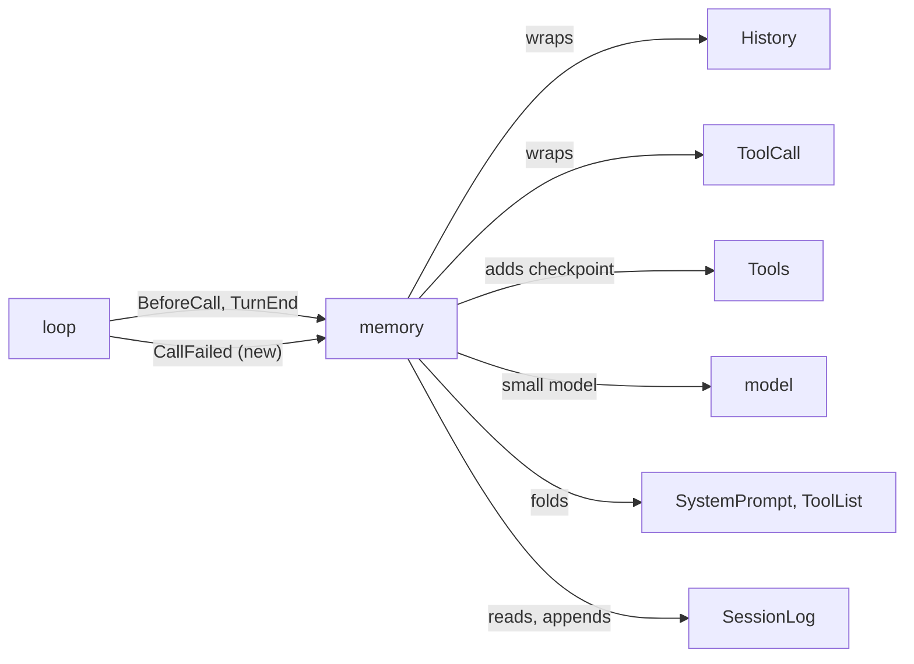

# Plan: memory

Milestone 5's `memory` plugin: very long sessions that flow on their own. Work: [plugins/features.md](../plugins/features.md#memory).

## Today

- `History` turns the whole log into messages for every call. Nothing shortens it.
- A call past the window fails at the provider; the turn ends with a notice.
- `BeforeCall` hooks exist for records logged before each call, such as reminders; no reminder event exists yet.
- `SystemPrompt.fold` logs the prompt again from the current sections.
- `Models.resolve(model, main)` picks the small model of the session model's provider.
- The gallery sketches a checkpoint row (`↺ Checkpoint · 3 files read`) and memory rows (`✧` short-term, `✦` long-term, a few words in the model's voice).

## How it works

Three things run together. The session's model never sees the first two until a checkpoint.

1. **Memories.** Beside the session, the provider's small model reads each stretch of about 15K tokens of new history and writes a memory of it, covering that range of entries.
2. **Compaction.** Once enough memories pile up, the small model compacts the older ones into one memory. It keeps what the work still needs and drops what later work replaced. That memory covers memories, not entries, and can itself be compacted later.
3. **Checkpoints.** Past 150K tokens of context a hidden nudge tells the model to consider a checkpoint at a good stopping point. Past 200K a second hidden nudge says to checkpoint soon. From 250K its other tool calls are denied until it does. The model calls `checkpoint` with a continuation note and the files and line ranges it needs.

At a checkpoint the context is rebuilt. The cache misses once.

```text
The log (everything stays; the transcript shows it all)
seq ─────────────────────────────────────────────────────────────────────────────────────▶
     │ 1 ……… 40 │ 41 ……… 85 │ 86 ……… 130 │ 131 ……… 170 │ 171 … 190 │ checkpoint │ 191 …
     └────┬─────┘└────┬─────┘└─────┬─────┘└──────┬──────┘ (no memory  ↺ call
          m1          m2           m3            m4        yet)
          └─────┬──────┘                                              on the side, written
                m5  (compacted from m1, m2)                           by the small model

The model's context
before:  [system prompt] [1 ………………………………………………………………………………………… 190] [nudges]          ~200K
after:   [system prompt, folded]                    ← sections that were only appended join it
         [m5] [m3] [m4]                             ← memories no other memory covers, oldest first
         [171 … 190]                                ← raw entries no memory covers
         [continuation note]                        ← the model's own, from `checkpoint`
         [files read back] + hidden note            ← "already read; read again only other parts"
         [191 …]                                    ← the work goes on
```

## Old Liminal

`archive/packages/plugins/memory`, 2,600 lines in 13 files.

| Piece | Old rule |
| --- | --- |
| Short-term memory | Up to 16K tokens of history each, at most about 2K tokens; the small model also labeled the files the range touched as relevant or not |
| Long-term memory | One rolling memory. Once the short-term memories after it reached 30K tokens, all but the newest 8K of them rolled into a new one with the previous memory, at most about 4K tokens |
| Budget | The window less a 16K reserve, at most a 200K setting; nudges at 50% and 75%, tools denied at 100% |
| `checkpoint` | `handoff` text, optional `files` with line ranges (left out: the files the memories marked relevant), optional new session `name`; called alone |
| Files read back | At most 15% of the budget; files under 300 lines whole, ranges padded by 20 lines |
| Also | A `history` tool to read entries a memory covers; checkpoints when the cache expired or the model changed; a sidebar Context section; memories in their own `memories.db` |

## Decisions

### Round 1

1. The model writes the checkpoint with its `checkpoint` tool. What it writes is the **continuation note**. "Handoff" is a later feature: a new chat started from the current one.
2. The design above: short-term memories every ~15K tokens, rolled into long-term memory, nudges at 150K and 200K, and the rebuilt context in that order with files read back.

### Round 2

1. Three thresholds: a nudge to consider a checkpoint at 150K, a nudge to checkpoint soon at 200K, and other tool calls denied from 250K. Only `checkpoint` and a reply without tool calls go through.
2. Each threshold is capped at the window less a 16K reserve, so on a small window the later ones meet at the cap.
3. One kind: **memories**, not short-term and long-term. A memory covers a range of entries or older memories, and memories compact into a memory. The rule is round 3.
4. Files read back: only what the model lists in `checkpoint`, paths and line ranges, capped at 30K tokens. No file tracking or labels.
5. Memories are events in the session log.
6. A call that overflows anyway: Liminal checkpoints for the model, with the continuation note written by the session's model, then retries once.
7. In the first build: checkpoints when the cache expired or the model changed, a sidebar Context section, and the optional session rename in `checkpoint`. Later: the `history` tool to read entries a memory covers.
8. Vocabulary: checkpoint, continuation note, fold, handoff.

### Round 3

1. Compaction: once the memories no other memory covers pass 30K tokens, the small model compacts the oldest of them into one memory of at most about 4K tokens, leaving the newest ~8K tokens of memories out. The new memory is uncovered too, so the next compaction takes it in.
2. Automatic checkpoint: when the provider's cache lifetime has passed since the last reply, or the model changed, and the context is past the 150K threshold, Liminal rebuilds the context at the start of the next turn: system prompt, memories, then the entries no memory covers. No continuation note and no files. Each provider declares its cache lifetime.

## Prior art

| Source | What it does | What we take |
| --- | --- | --- |
| Mastra observational memory (`packages/memory/src/processors/observational-memory`, docs `memory/observational-memory.mdx`) | An Observer writes dated, prioritized observations every ~6K tokens in the background; at 30K they replace the raw messages; a Reflector rewrites the whole log at 40K; early activation when the provider's cache lifetime passes or the provider changes; a failed write keeps its messages pending | The writer sees the newest memories so it does not repeat them; a mark for finished work; a compaction that comes back too long is retried with stronger compression; cache lifetimes per provider; a failed write leaves its range uncovered for the next try |
| Mastra, where we differ | Each activation swaps messages for observations, so each one misses the cache | The prefix stays until a checkpoint: one miss per checkpoint |
| DeepSeek harness (`packages/compaction/*`) | Raw events stay in the log; a replacement event shadows a span; the model's messages are a pure function of the log; a context-overflow error compacts and retries once | The same: a frozen checkpoint record, a projection from the log, one retry |
| OpenCode (`packages/ai/src/provider-error.ts`) | About 30 message patterns that mean the context overflowed | The same patterns |
| Old Liminal (`archive/packages/plugins/memory`) | The checkpoint recorded which memories it used; nudges before a checkpoint left out after it; ranges end where no tool call waits on its result | The same |

Cache lifetimes, from the providers' docs (web search) and Mastra's table: Anthropic 5 minutes, each hit refreshes it; OpenAI minutes for older models, 24 hours by default from gpt-5.5; DeepSeek 1 hour; Gemini 24 hours.

## Architecture (round 4, agreed)

One plugin, `memory`. It adds a tool and hooks, wraps two pipelines, and needs two new extension points in base plugins.



| Piece | Mechanism | Does |
| --- | --- | --- |
| Writer | `BeforeCall` and `TurnEnd` hooks start it; a forked fiber per session | Writes a memory per ~15K tokens of uncovered entries, then compacts |
| Thresholds | `BeforeCall` hook | Measures the context; logs a nudge when a threshold is crossed; checkpoints on cache loss, model switch or a request that will not fit |
| Denial | `ToolCall` wrap | From 250K, a call other than `checkpoint` gets a failed result |
| `checkpoint` tool | Add to `Tools` | Brings memories up to date, logs the checkpoint, folds, reads files back, renames |
| Projection | `History` wrap | After a checkpoint: memories, then entries from the first uncovered one |
| Overflow | `CallFailed` hook (new) | A context-overflow error checkpoints and retries the step once |
| Transcript, sidebar | `tui` entry: `ItemRenderer`, `ToolRows`, `sidebar` slot | Memory rows, the checkpoint row, the Memory section |

### New in base plugins

```ts
// model
interface ModelProvider { ...; cacheLifetime?: Duration }        // 5 minutes when missing
Models.cacheLifetime(model): Effect<Duration, ModelNotFound>
isContextOverflow(error: ModelCallError): boolean                 // provider messages, as OpenCode matches them

// loop
CallFailed: Registry<(turn: Turn, error: ModelCallError) => Effect<boolean, LogError>>
// a model call failed; a hook returning true retries the step, once per step
```

### Events

```ts
// memory/memory: no converter; the model sees memories only through a checkpoint
MemoryWritten = defineEvent("memory/memory", Struct({
  covers: Union([TaggedStruct("Entries", { from: Seq, to: Seq }),
                 TaggedStruct("Memories", { seqs: Array(Seq) })]),
  line: String,   // a few words in the model's voice, for the transcript
  text: String,
}))

// memory/checkpoint: freezes what the context is rebuilt from, so later memories leave the cache alone
CheckpointMade = defineEvent("memory/checkpoint", Struct({
  trigger: Literals(["model", "idle", "model-switch", "overflow"]),
  memories: Array(Seq),   // memories no other memory covered, oldest first
  from: Seq,              // first entry no memory covered
  files: Array(String),   // paths read back; empty for every trigger but `model`
}))

// memory/nudge: converts to a hidden reminder; no renderer, so the transcript leaves it out
Nudge = defineEvent("memory/nudge", Struct({ level: Literals(["consider", "soon", "full"]) }))

// checkpoint tool params; access: read of the paths
{ note: string; files?: { path: string; ranges?: { start: Int; end: Int }[] }[]; name?: string }
```

The continuation note is the tool call's `note` and the files are its result, so they sit in the log right where the rebuilt context needs them.

### Call paths

```text
BeforeCall (each step)
  events ← log.read; next model ← SessionModel
  size ← latest step's input + output, plus 4 characters a token for events since
  limits ← 150K, 200K, 250K, each at most window − 16K
  size > window                                         → checkpoint(overflow)
  size > 150K and (idle past cacheLifetime or model ≠ latest step's) → checkpoint(idle | model-switch)
  else level ← highest limit passed; nudge if above the latest nudge since the last checkpoint
  start the writer if uncovered entries ≥ 15K

Writer (one per session, background)
  while uncovered entries ≥ 15K:
    range ← oldest uncovered entries up to 15K, ending where no call waits on its result
    small model (newest ~8K of memories, the range as text) → { line, text }; log memory/memory
    if uncovered memories > 30K: compact the oldest, leaving the newest ~8K out; log memory/memory
  a failure is logged as a warning; the range stays uncovered for the next start

checkpoint(trigger)
  wait for a running writer; write what is due
  log memory/checkpoint { memories: uncovered, from: first uncovered entry }
  SystemPrompt.fold; ToolList.fold
  tool only: check it was called alone; read files (30K cap) → result + "already read" note; rename

History wrap
  no checkpoint → next(events)
  else → [user message: <memories> of checkpoint.memories] ++ next(events from checkpoint.from, nudges before it left out)
```

### Routine calls

- The sizes of ranges and memories are estimated at 4 characters a token; thresholds use the latest step's reported tokens.
- `checkpoint` is always offered, not deferred: the fold a checkpoint makes drops offered deferred tools while the history still holds the call.
- `system-prompt` and `tool-definitions` each leave out of `History` their change notes logged before their latest full record, which a fold already holds.
- Every provider declares 5 minutes for now; one with a longer cache can declare it later.
- The sidebar's Memory section and the memory rows (`✧` over entries, `✦` compacted) are sketched in the gallery first.
- `features.md#memory` loses its `ModelCall` wrap sketch and "queries across sessions": `BeforeCall` and `CallFailed` replace the first, nothing needs the second.

### Round 4 decisions

1. One plugin, `memory`: memories reach the model only through checkpoints, and a checkpoint shrinks the context only through memories.
2. The new extension points: `cacheLifetime` and `isContextOverflow` in `model`, `CallFailed` in `loop`. They go into `docs/architecture.md` with the build.
3. The overflow checkpoint has no continuation note: the session model could write it only from the rebuilt context, which already holds everything the note would say. This replaces round 2, item 6.

## Code plan (round 5, proposed)

### Files

| File | Holds |
| --- | --- |
| `packages/plugins/memory/src/contract.ts` | `MemoryWritten`, `CheckpointMade`, `Nudge`, `checkpointName`, `MemoryRpc` |
| `src/index.ts` | `definePlugin`: hooks, wraps, the tool, the RPC layer |
| `src/scan.ts` | `scan(events): Scan`, pure; everyone reads the log through it |
| `src/measure.ts` | The constants, `sizeOf(scan)`, `limitsOf(window)`, `estimate(text)` |
| `src/writer.ts` | `Writer` (`start`, `await`, `writing`) over a `FiberMap<SessionId>`; the two prompts |
| `src/checkpoint.ts` | `checkpoint(session, trigger, files)`, shared by the tool and both hooks |
| `src/files.ts` | `readBack(files)`: reads ranges through `tools-read`'s `pageOf` and `isBinary`, 30K cap |
| `src/tool.ts` | The `checkpoint` tool |
| `src/tui/index.tsx` | `MemoryRow`, `CheckpointRow`, `MemorySection`; the tool row `Hidden` |
| `README.md`, `package.json` | As every plugin |

About 900 lines. Old Liminal's `memories.db`, `budget.ts` stages and `history` tool have no counterpart.

### Types

```ts
// scan.ts: what the log says now, from the latest checkpoint on
interface Scan {
  readonly checkpoint: Option<{ seq: Seq; data: CheckpointMade }>;
  readonly memories: ReadonlyArray<{ seq: Seq; data: MemoryWritten }>;    // no other memory covers them
  readonly uncovered: ReadonlyArray<SessionEvent>;  // entries after the last covered one, nudges left out
  readonly lastStep: Option<{ at: DateTime; model: ModelId; tokens: number }>;
  readonly since: ReadonlyArray<SessionEvent>;      // events after that step ended
  readonly nudge: Option<NudgeLevel>;                // latest since the checkpoint
}

// writer.ts
class Writer extends Context.Service<Writer, {
  start: (session: SessionId) => Effect<void>;      // FiberMap.run(..., { onlyIfMissing: true })
  await: (session: SessionId) => Effect<void>;      // joins a running writer, if any
  writing: (session: SessionId) => Stream<boolean>;
}>()("memory/Writer") {}

// checkpoint.ts
type Trigger = "model" | "idle" | "model-switch" | "overflow";
checkpoint: (session: SessionId, trigger: Trigger, files: ReadonlyArray<FileRange>) =>
  Effect<ReadonlyArray<ReadBack>, LogError | ModelCallError>
```

`ModelProvider.cacheLifetime`, `Models.cacheLifetime`, `isContextOverflow` and `CallFailed` are typed as in round 4.

### Call paths in code

```text
loop makeStep (packages/plugins/loop/src/turn.ts)
  sync prompt, sync tools, BeforeCall hooks
  callOnce = request(session) >>= callModel
  callOnce.catch(error → any CallFailed hook true ? callOnce : fail error)   // one retry, no loop

memory BeforeCall hook
  s ← scan(log.read); model ← SessionModel.run(events); window ← Models.details(model)
  size ← sizeOf(s); limits ← limitsOf(window)
  overflow | idle | model-switch → checkpoint(session, trigger, [])
  else level above s.nudge → log Nudge
  estimate(s.uncovered) ≥ RANGE → Writer.start

memory TurnEnd hook       → Writer.start when due (the writer runs while the user reads)
memory CallFailed hook    → isContextOverflow(error) ? checkpoint(overflow) as true : false
ToolCall wrap             → scan(...).nudge is "full" and name ≠ checkpoint ? failed result : next
History wrap              → no checkpoint ? next(events)
                            : [memories message] ++ next(events from checkpoint.from, nudges left out)
Converters                → Nudge → hidden user reminder; MemoryWritten, CheckpointMade → nothing

checkpoint(session, trigger, files)
  Writer.await; write what is due inline; read ← readBack(files)
  log CheckpointMade { memories: s.memories, from: first of s.uncovered, files: paths of read }
  SystemPrompt.fold; ToolList.fold     // not Turns.fold, which waits for the turn it runs in

Writer loop (per session)
  range ← oldest uncovered entries up to RANGE, cut where no tool call waits
  text ← messages of History.run(range) as plain text
  Models.generateObject({ model: "small", main, schema: { line, text } }) → log MemoryWritten
  estimate(s.memories) > COMPACT_AT → compact all but the newest KEEP_OUT; too long → one stricter retry
  failure → Effect.logWarning; the range stays uncovered
```

### Base changes

| Where | Change |
| --- | --- |
| `packages/plugins/model/src/contract.ts` | `cacheLifetime?` on `ModelProvider`; `Models.cacheLifetime`; `isContextOverflow` with OpenCode's patterns |
| each `model-*` provider | Declares nothing; 5 minutes applies |
| `packages/plugins/loop/src/contract.ts`, `turn.ts` | `CallFailed` registry; the retry in `makeStep` |
| `packages/plugins/system-prompt/src/index.ts`, `tool-definitions/src/index.ts` | A `History` wrap that drops `PromptChange` / `ToolListChange` logged before the latest record |
| `docs/architecture.md` | The three extension points |
| gallery `Memory.tsx`, `Checkpoint.tsx` | `MemoryKind` becomes `"entries" \| "compacted"` |
| gallery `Sidebar.tsx` | The Memory section (sketched) |

### Routine calls (round 5)

- Every checkpoint, of any trigger, shows as one `CheckpointRow` from its `memory/checkpoint` event, so the event records the files read back and the tool row is hidden.
- Denial reads the log: the latest nudge since the checkpoint is `full`. Nothing is held in memory but the writer fibers.
- A range's text is `History`'s messages for it, so converters other plugins add carry over.
- A model with no known window gets the thresholds uncapped and no overflow check in `BeforeCall`; `CallFailed` still catches it.
- An automatic checkpoint waits for every memory that is due, which can take several small-model calls when the writer fell behind.

### Round 5 decisions

1. The sidebar section shows the memory count and the checkpoint count, nothing about the next threshold. The Usage section already shows the context size. It is titled Memory, appears from the first memory, and its note says "writing" while the small model writes or compacts. Sketched in the gallery's `Sidebar` (states "In use", "Writing a memory").
