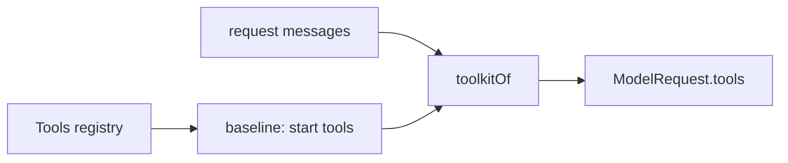

# Prompt trim

The system prompt and tool list carry only what every turn needs; everything else arrives with the tool or file that needs it. Built; live check of a real request not run.

## Today

Session `eee64960` request, at 4 characters per token:

| Block | ~Tokens |
| --- | --- |
| `system-prompt/base` | 1,735 |
| `instruction-files/always` (`liminal.md`) | 925 |
| `tools/guidance` | 553 |
| `environment/files` | 179 |
| read-when list, deferred listing, facts, vocabulary | ~400 |
| Tools offered at start | ~2,300 |
| `ask_question`, declared | ~620 |
| Deferred tools, flagged `defer_loading` | ~510 |

Leaks and repeats:

- `tools/guidance` lists the guidance of every registered tool, so deferred tools' rules (`vocabulary`, ~110 tokens) are always in the prompt
- `vocabulary/terms` header names the deferred `vocabulary` tool
- `execute`'s description holds a generated `search` signature (~300 tokens) and a second way to find tools besides `tool_search`
- `tool_search`'s result prints each loaded tool's full description, which the tool definition already carries
- The `checks` rule is in its guidance and its description; the "do not cd" rule is in two guidance lines
- The base prompt says "outcome first" four times and "do not narrate" three times; `<planning>` and `<coding>` repeat `planning.md` and `code.md`
- Every provider has `nativeToolChanges: false`, so a plugin-offered tool (`ask_question`) is sent on every request and only a reminder offers it

## Where content goes

| Kind | Home |
| --- | --- |
| A rule about one tool | That tool's description or parameter descriptions |
| A rule for choosing between tools, or an invariant | The tool's `guidance`, shown only while the tool is offered at start |
| True on every turn | A prompt section |
| Applies in some situations | A read-when instruction file |
| Rare capability | Deferred, one listing line |
| Capability the user switches on (`/qna`) | Absent from `tools` until the user's action offers it |

## Architecture: what a request's tool list is

A request's tools are a function of the baseline and the conversation, one rule for both deferred and user-offered tools. The data travels with the messages, so nothing tracks state per session.

| Offer | In `tools` when |
| --- | --- |
| `start` | always |
| `search` | a `tool-result` part's `loads` names it (native Anthropic: always, flagged `defer_loading`) |
| `plugin` | a `tool-change` offer part for it is in the messages; it stays after a withdrawal |

- A `plugin` tool is not in the baseline. `/qna`'s user message carries the `tool-change` offer; the request holding it adds the tool to `tools` and the reminder says it is available. Answers or cancel carry the withdrawal: the model is told and a call is refused, and the tool stays in `tools`, so a second `/qna` costs no cache miss.
- Cost: the first `/qna` of a session changes `tools`, so that request misses the cache once. `/qna` follows the user's typing, so the cache has often expired by then (`ModelProvider.cacheLifetime`).
- A checkpoint that drops the offer part drops the tool from `tools`; the next `/qna` offers it again.
- Pattern: derive from messages (as `loads` does) in preference to a per-session registry of offered tools, which would need a second log read and a contract change. `tool_reference` blocks are no alternative: they are valid only inside a `tool_result`, and `/qna` is a user message.
- This is the rule the context plugin already states for a tool that appears after the baseline; `toolkitOf` applies it to providers without native tool changes.

## Requirements

- `guidance` holds only rules across tools; the `tools/guidance` section reads the guidance of tools with `offer: "start"`
- A deferred or plugin-offered tool carries all its rules in its description
- The `Deferred tools:` intro is removed; `tool_search`'s description says to load a tool before calling it
- The listing keeps one line per deferred tool within its budget
- `tool_search`'s result names the loaded tools and unknown names, without descriptions
- `execute`'s description gives `search` in one line
- `ask_question` is `offer: "plugin"` and absent from `tools` until `/qna` offers it
- The six `process_*` tools are `offer: "search"`; `shell`'s guidance says commands that keep running need `process_start`, loaded with `tool_search`
- The base prompt keeps `<communication>` with repeated bullets merged, drops `<planning>` and `<coding>`, and keeps a short work rule for repositories with no instructions: stay within what the user asked, no unrequested features or refactors, the simplest change that solves the problem
- `liminal.md` becomes a short always-on file and read-when files; the always file holds the clean-room line, grounding, and "references are read-only; implement independently"; research, documentation and dependency rules move to read-when files
- Every prompt section renders under one `<name>…</name>` wrapper
- `environment/facts` and `environment/files` become one section, `environment`, listing the workspace root only
- `vocabulary/terms` header says to load `vocabulary` to read a definition

## Changes

| System | Change |
| --- | --- |
| `sdk` `ai/prompt.ts` | Changes: `toolkitOf` withholds a `plugin` tool until a `tool-change` offer is in the messages |
| `tools` `guidance.ts` | Change: guidance of `start` tools only |
| `questions` | Change: no change to `/qna` flow; tool leaves the baseline |
| `vocabulary` `tool.ts`, `section.ts` | Change: rules into the description; header wording |
| `processes` `tools.ts` | Change: `offer: "search"`; rules into descriptions |
| `tools-search` `section.ts`, `tool.ts` | Change: no intro; result without descriptions |
| `tools-execute` `server.ts` | Change: one-line `search` |
| `system-prompt` `base.ts` | Change: merge bullets; work rule; fix "The the" |
| `environment` | Change: one section, root listing |
| `context` `contract.ts` | Change: section wrapper in the line and file renderers |
| `.liminal/instructions/` | Change: split `liminal.md` |
| `docs/plugins/tools.md`, `tools-search.md`, `environment.md`, `system-prompt.md`, `context.md` | Change: match the above |

