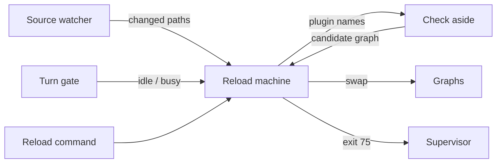

# Reload at turn end

Lets Liminal pick up its own code changes, plugins in process and kernel code by restart, without ever touching a running turn. A save during a turn is checked out of sight; the new code applies once no session has a turn running, on its own or on the reload command. Requirements: [02-architecture.md](../requirements/02-architecture.md) Reload.

## Today

| Piece | Where | What it does now | Problem |
| --- | --- | --- | --- |
| Graph swap | `packages/kernel/src/graph/graphs.ts` `reload(names)` | Rebuilds named plugins and dependents aside, swaps at once; `ChangeFailed` keeps the old graph | Swaps whenever called, even mid-turn; reuses cached modules, so edited plugin files never load |
| Turns | `agent-loop/src/server/turns.ts` | One `Work` task per session (`agent-loop/turn/<id>`); each step reads the current graph | A mid-turn swap reaches the turn's next step |
| Supervisor | `apps/cli/src/supervisor.ts` | Restarts the app on exit 75; races a `nextChange` effect | Nothing writes 75; `nextChange` lets a watcher kill the app mid-turn |
| Dev mode | `apps/cli/src/dev.ts`, `mise run dev` | Kills and restarts the whole process on every save | Breaks all three reload rules |
| Plugin imports | `host/discover.ts`, `host/build.ts` | `import(path)` once per path; Bun caches it for the process | No fresh code without a new process |

## Shape



| System | Change | Role |
| --- | --- | --- |
| Kernel | Expands | Owns the watcher, the reload machine and the check; `Kernel.reload` goes through the machine |
| SDK core | Expands | New base service: the turn gate |
| agent-loop | Changes | Holds the gate for each turn |
| Supervisor | Shrinks | Back to restart on exit 75, nothing else |
| `apps/cli` | Changes | Passes dev restart roots and mode; exits 75 when the kernel asks |
| Frontend / TUI | Expands | Shows "new code ready" and binds the reload command |

**Pattern: a state machine** (pure `transition(state, event) → [state, commands]`, run by one fiber), as Tau's `supervisor/internal/restart-machine.ts`. It beat ad hoc flags (`pending`, `checking`, `isIdle`, `mode`) because those combine into states that are easy to get wrong, and a pure transition is testable without processes.

```text
Phases: Current → Checking → Ready(candidate) → Applying → Current
                    ↘ Failed(reason) ── next change ──→ Checking
Events: Changed(paths) · Checked(candidate | failure) · Turns(idle) · ReloadRequested · Mode(automatic | confirmed)
Apply:  Ready and Turns(idle) and (automatic or ReloadRequested)
        plugin-only candidate → swap graph · any kernel path → exit 75
```

A change during `Checking` restarts the check. A candidate that passed is replaced by a newer one; only the newest applies.

## Turn gate

A new SDK base service, `TurnGate`: `hold(effect)` marks a turn running until the effect ends. agent-loop wraps each turn task in it, resumed ones included. The kernel is idle when nothing holds the gate, so it learns about turns without knowing agent-loop. Counting `Work` tasks would block reloads for ever once a plugin uses `Work` for a long-lived task that is not a turn.

## Home

The reload machine lives in the kernel, `packages/kernel/src/reload/`, next to `Graphs`. A plugin owning it could not reload its own fix when broken.

## Mode and command

`apps/cli` reads the automatic or confirmed setting from the settings plugin and passes it to the kernel, so the kernel imports no plugin contract. The kernel exposes its phase and the reload command over `KernelRpcs`: a `kernel/reload` stream and `kernel/reload-now`. The TUI shows the phase and binds the command.

## Check

| Change | Check |
| --- | --- |
| Plugin files | Typecheck, then load and build the new graph aside (today's `ChangeFailed` path) |
| Kernel, SDK, frontend, `apps/cli` | Typecheck, then a start check: spawn the app with `--check`, which boots the kernel without the TUI and exits 0 (Tau `supervisor/Children.ts`) |

The dev typecheck runs the repo's `tsc --noEmit` over the whole workspace, since a plugin change can break a dependent's types. It runs out of sight while the turn continues.

## Fresh plugin code

Each plugin build loads in its own `Bun.ModuleGraph` (experimental; `docs/reference/copies/bun/1.4.3/docs/runtime/module-graph.mdx`), disposed when the build's scope closes. One `Bun.plugin` with `builder.module(specifier, () => ({ exports, loader: "object" }))` (`bun-types` `bun.d.ts`) serves the host's single instance of `effect`, `@liminal/sdk`, `@opentui/*` and `solid-js` into every graph, as OpenCode does in `packages/plugin/src/runtime.ts`. Each subpath (`effect/rpc`, `@liminal/sdk/tui`) is its own specifier.

Spike on Bun 1.4.3, Effect 4.0.5:

| Question | Result |
| --- | --- |
| A new graph rereads an edited file | Yes; the older graph keeps its version until disposed |
| Host `effect` served into a graph | Works; the graph's effects and failures run on the host runtime |
| A service built in one graph, read with another graph's tag | Works; tags match by key string |
| Another plugin's contract | Each graph loads its own copy from disk; `Schema.is`, `Predicate.isTagged`, encode and decode work across copies; `instanceof` does not |
| Routing a shared module per graph | Not possible: `Bun.ModuleGraph.current` is `undefined` inside `builder.module`, so only host-wide modules are served |
| Lazy `import()` in an older graph after an edit | Loads the edited file |
| Solid JSX in a graph | The shared `@opentui/solid/preload` transform applies |

What this sets:

- Contracts are not served by the host. Every build reads them fresh, and a provider's contract change rebuilds its dependents, so one graph change sees one snapshot of the files.
- The check imports each plugin's manifest, server and TUI part into the build's graph, so a swap and the frontend's reload use only checked code. Builds happen only at the turn-end swap, so no half-edited file loads during a turn.
- The plugin authoring docs say: load your own files at build time, never with `import()` later. No lint rule; a late `import()` of a plugin's own edited file only risks that plugin.

## Deletes

- `apps/cli/src/dev.ts`, its `.fallowrc.jsonc` entry, and the change test in `apps/cli/test/supervisor.test.ts`
- `supervise`'s `nextChange`, `RunEnd`, `appCommand` and `runSupervisor` exports in `apps/cli/src/supervisor.ts`
- `mise run dev` runs `bun apps/cli/src/supervisor.ts`
- Immediate `Kernel.reload`; tests that swap call the machine, which applies at once when idle
- The `Open` lines in [archive/step-6.md](archive/step-6.md) on fresh code and the dev watcher, and the `mise run dev` line in [archive/tui-session.md](archive/tui-session.md)

## Open

- `Bun.ModuleGraph` is experimental; a Bun upgrade reruns the spike questions as tests
- Typechecking production plugin folders, which ship with no compiler
- Unsent composer text across a kernel restart (Tau hands the draft to the new process)
