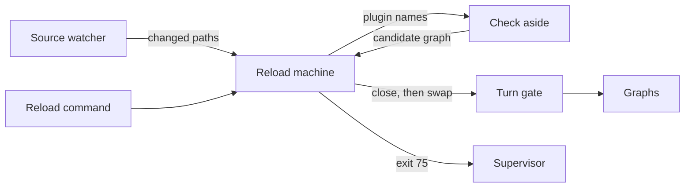

# Reload at turn end

Lets Liminal pick up its own code changes, plugins in process and kernel code by restart, without ever touching a running turn. A save during a turn is checked out of sight; the new code applies once no session has a turn running, on its own or on the reload command. Requirements: [02-architecture.md](../requirements/02-architecture.md) Reload.

## Today

| Piece | Where | What it does now | Problem |
| --- | --- | --- | --- |
| Graph swap | `packages/kernel/src/graph/graphs.ts` `reload(names)` | Rebuilds named plugins and dependents aside, swaps at once; `ChangeFailed` keeps the old graph | Swaps whenever called, even mid-turn; reuses cached modules, so edited plugin files never load |
| Turns | `agent-loop/src/server/turns.ts` | One `Work` task per session (`agent-loop/turn/<id>`); each step reads the current graph | A mid-turn swap reaches the turn's next step |
| Supervisor | `apps/cli/src/supervisor.ts` | Restarts the app on exit 75 | Nothing writes 75 |
| Frontend parts | `packages/frontend/src/parts.ts` | Calls `member.plugin.tui()` after a graph change | Imports TUI code that was never checked |
| Plugin imports | `host/discover.ts`, `host/build.ts` | `import(path)` once per path; Bun caches it for the process | No fresh code without a new process |

## Shape



| System | Change | Role |
| --- | --- | --- |
| Kernel | Expands | Owns the reload machine and the check; `apps/cli` passes the watcher |
| SDK core | Expands | New base service: the turn gate |
| agent-loop | Changes | Holds the gate for each turn |
| Supervisor | Unchanged | Restarts on exit 75 |
| `apps/cli` | Changes | Passes dev restart roots and mode; exits 75 when the kernel asks |
| `reload` plugin | New | UI-only: shows a ready reload or a failed check in the chat header; binds the reload command |

**Pattern: a state machine** (pure `transition(state, event) → [state, commands]`, run by one fiber), as Tau's `supervisor/internal/restart-machine.ts`. It beat ad hoc flags (`pending`, `checking`, `isIdle`, `mode`) because those combine into states that are easy to get wrong, and a pure transition is testable without processes.

```text
Phases: Current → Checking → Ready(candidate) → Applying → Current
                    ↘ Failed(reason) ── next change ──→ Checking
Events: Changed(change) · Passed(check, candidate, mode) · CheckFailed(check, reason) · Requested · Applied
Apply:  Ready and (automatic or Requested), under gate.close, which waits until no turn runs
        plugin-only candidate → swap graph · any kernel path → exit 75
```

A change during `Checking` restarts the check. A candidate that passed is replaced by a newer one; only the newest applies.

## Turn gate

A new SDK base service, `TurnGate`: `hold(effect)` marks a turn running until the effect ends. agent-loop wraps each turn task in it, resumed ones included. The kernel is idle when nothing holds the gate, so it learns about turns without knowing agent-loop. Counting `Work` tasks would block reloads for ever once a plugin uses `Work` for a long-lived task that is not a turn.

## Home

The reload machine lives in the kernel, `packages/kernel/src/reload/`, next to `Graphs`. A plugin owning it could not reload its own fix when broken.

## Mode and command

`apps/cli` reads the automatic or confirmed setting from the settings plugin and passes it to the kernel, so the kernel imports no plugin contract. The kernel exposes its phase and the reload command over `KernelRpcs`: a `kernel/reload` stream and `kernel/reload-now`. The TUI shows the phase and binds the command.

## Check

| Change | Check |
| --- | --- |
| Plugin files | Typecheck, then load and build the new graph aside (today's `ChangeFailed` path) |
| Kernel, SDK, frontend, `apps/cli` | Typecheck, then a start check: spawn the app with `--check`, which boots the kernel without the TUI and exits 0 (Tau `supervisor/Children.ts`) |

The dev typecheck runs the repo's `tsc --noEmit` over the whole workspace, since a plugin change can break a dependent's types. It runs out of sight while the turn continues.

## Fresh plugin code

Each plugin build loads in its own `Bun.ModuleGraph` (experimental; `docs/reference/copies/bun/1.4.3/docs/runtime/module-graph.mdx`), disposed when the build's scope closes. One `Bun.plugin` with `builder.module(specifier, () => ({ exports, loader: "object" }))` (`bun-types` `bun.d.ts`) serves the host's single instance of `effect`, `@liminal/sdk`, `@opentui/*` and `solid-js` into every graph, as OpenCode does in `packages/plugin/src/runtime.ts`. Each subpath (`effect/rpc`, `@liminal/sdk/tui`) is its own specifier.

Spike on Bun 1.4.3, Effect 4.0.5:

| Question | Result |
| --- | --- |
| A new graph rereads an edited file | Yes; the older graph keeps its version until disposed |
| Host `effect` served into a graph | Works; the graph's effects and failures run on the host runtime |
| A service built in one graph, read with another graph's tag | Works; tags match by key string |
| Another plugin's contract | Each graph loads its own copy from disk; `Schema.is`, `Predicate.isTagged`, encode and decode work across copies; `instanceof` does not |
| Routing a shared module per graph | Not possible: `Bun.ModuleGraph.current` is `undefined` inside `builder.module`, so only host-wide modules are served |
| Lazy `import()` in an older graph after an edit | Loads the edited file |
| Solid JSX in a graph | The shared `@opentui/solid/preload` transform applies |

What this sets:

- Contracts are not served by the host. Every build reads them fresh, and a provider's contract change rebuilds its dependents, so one graph change sees one snapshot of the files.
- The check imports each plugin's manifest, server and TUI part into the build's graph, so a swap and the frontend's reload use only checked code. Builds happen only at the turn-end swap, so no half-edited file loads during a turn.
- The plugin authoring docs say: load your own files at build time, never with `import()` later. No lint rule; a late `import()` of a plugin's own edited file only risks that plugin.

## Code

```text
packages/sdk/src/core/
  turn-gate.ts          new: TurnGate service; makeTurnGate (hold, close)
  plugin.ts             BaseServices gains TurnGate; GraphMember.plugin.tui resolves the preloaded module
  protocol.ts           ReloadState schema; KernelRpcs gains kernel/reload, kernel/reload-now
packages/sdk/src/testing/base.ts   provides a real TurnGate
packages/kernel/src/
  host/modules.ts       new: one Bun.plugin serving shared modules into every graph
  host/packages.ts      new: PackageLoad, one Bun.ModuleGraph per plugin package; disposed at 0 users
  host/discover.ts      imports manifests into the package's graph; reuses unchanged packages
  host/build.ts         imports server and the preloaded parts in the build's graph
  graph/graphs.ts       reload(names) → prepare(packages) → Candidate, commit(candidate), discard
  reload/machine.ts     new: pure transition(state, event) → [state, commands]
  reload/run.ts         new: runs the machine: watcher, checks, gate, commit or restart
  reload/changes.ts     new: watched paths → plugin packages | restart
  kernel.ts             Kernel.reload replaced by Kernel.reloads
  server/serve.ts       handles kernel/reload, kernel/reload-now
packages/plugins/agent-loop/src/server/turns.ts   each turn task runs in gate.hold
packages/plugins/reload/          new UI-only plugin: `chat/header` item (root scope) and `ctrl+r`; a slash command once slash commands exist
apps/cli/src/main.ts    passes ReloadOptions and shared modules; --check; exits 75 on restart
mise.toml               [tasks.dev] runs bun apps/cli/src/supervisor.ts
```

### Boundaries

```ts
class TurnGate extends Context.Service<TurnGate, {
  /** Runs `turn`; a reload waits until it ends. Waits while a reload applies. */
  readonly hold: <A, E, R>(turn: Effect<A, E, R>) => Effect<A, E, R>
}>()("liminal/TurnGate") {}

/** Kernel side: close waits for zero holders, blocks new holds, runs apply, opens. */
makeTurnGate: Effect<{ gate: TurnGate["Service"]; close: <A, E>(apply: Effect<A, E>) => Effect<A, E> }>

interface BootOptions {
  readonly folders: ReadonlyArray<string>
  /** Packages the host resolves from `from` and serves to every graph: effect, @liminal/sdk, and the frontend's own. */
  readonly shared: { readonly from: string; readonly packages: ReadonlyArray<string> }
  /** Manifest parts imported at build, such as ["tui"]. */
  readonly parts: ReadonlyArray<"tui">
  /** Absent: a locked plugin set, no reload (tests, web). */
  readonly reload?: ReloadOptions
}

interface ReloadOptions {
  readonly changes: Stream<ReadonlyArray<string>>      // prod: FileSystem.watch, debounced; tests: a Queue
  readonly restartRoots: ReadonlyArray<string>         // dev: apps/cli, packages/{kernel,sdk,frontend}
  readonly typecheck: Option<ChildProcess.Command>     // dev: tsc --noEmit at the repo root
  readonly startCheck: ChildProcess.Command            // the app with --check
  readonly mode: (use: HoldGraph) => Effect<ReloadMode> // apps/cli reads the settings "reload" section
}

type ReloadMode = "automatic" | "confirmed"

ReloadState = TaggedUnion {
  Current · Checking · Ready { restart: boolean } · Failed { reason: string } · Applying
}

interface Kernel {
  status; use; graph; connect               // unchanged
  readonly reloads: {
    readonly state: Stream<ReloadState>
    readonly request: Effect<void>          // the reload command
    readonly restartDue: Effect<void>       // completes when a restart applies
  }
}

Candidate = { graph: Unopened; base: Graph; fresh: { builds; packages } }   // fresh closes on discard
Change = Plugins { packages } | Restart
```

### Call path

```mermaid
sequenceDiagram
  participant W as changes
  participant M as reload machine
  participant C as checks
  participant G as graphs
  participant T as turn gate
  participant A as apps/cli
  W->>M: Changed(paths)
  M->>C: typecheck, then start check or prepare(packages)
  C-->>M: Checked(candidate | failure)
  M->>M: Ready; wait for mode or request
  M->>T: close(apply)
  T-->>M: no turn runs
  alt plugins
    M->>G: commit(candidate)
  else restart
    M->>A: restartDue
    A->>A: exit 75
  end
```

### Logic

```text
on Changed(paths):
  discard current candidate
  change = classify(paths)           // under restartRoots → Restart, else owning plugin packages
  merge with pending change          // Restart wins
  start check
check:
  typecheck if configured; fail → Failed(output tail)
  Restart → start check command exits 0
  Plugins → graphs.prepare(packages): new graphs, manifests, servers, parts, built aside
  → Checked
on Checked(ok): Ready; apply if mode is automatic
on ReloadRequested: apply if Ready
apply: gate.close(Plugins → graphs.commit · Restart → restartDue, never opens)
```

### Injection

| Service | Production (`apps/cli`) | Tests |
| --- | --- | --- |
| `changes` | `FileSystem.watch` on folders and restart roots, 100 ms debounce, `node_modules` ignored | `Queue` offered by the test |
| `typecheck` | `tsc --noEmit` | `Option.none()` |
| `startCheck` | `bun main.ts --check` | `/bin/sh -c "exit 0"` or `"exit 1"` |
| `mode` | settings `reload.mode`, default automatic | constant |
| `TurnGate` | kernel's | kernel's; SDK testing base provides its own |

### Tests

- Machine: transition table, as Tau's `restart-machine.test.ts`
- A change during a turn swaps only after the turn ends; the turn's steps all run on the old graph
- A failed check keeps the old graph and reports `Failed`; the next change clears it
- Confirmed mode waits for `request`
- A restart root change completes `restartDue` only when idle
- An edited plugin file runs fresh after the swap; the old build keeps its code (the spike as tests)
- `reload` plugin: header item shows `Ready` or the check failure; `ctrl+r` sends `kernel/reload-now`

## Deletes

- `Kernel.reload(names)`; tests that swap offer a change to `ReloadOptions.changes`, or call `graphs` directly in kernel tests
- `load(folders)`'s re-import of every manifest on each change
- The frontend's import of TUI parts after a swap
- The `Open` lines in [archive/step-6.md](archive/step-6.md) on fresh code and the dev watcher

## Open

- `Bun.ModuleGraph` is experimental; a Bun upgrade reruns the spike questions as tests
- Typechecking production plugin folders, which ship with no compiler
