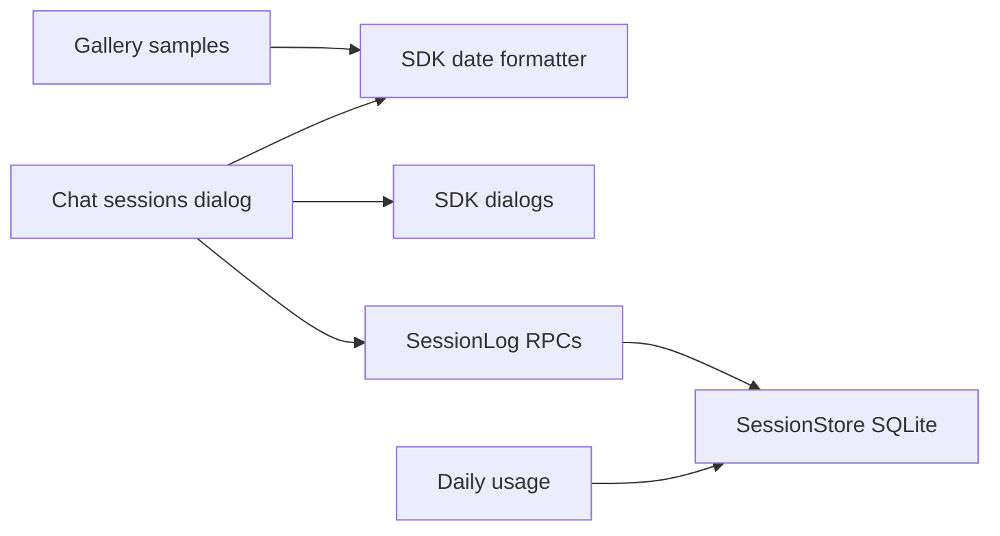

# Session archive and dialog dates

Code plan for reversible session archiving, a wider sessions dialog, and shared SDK date labels. Requirements: [sessions](../requirements/04-sessions.md#archive), [TUI design](../requirements/06-tui-design.md#dialogs-and-dates), [usage](../plugins/usage.md#requirements).

## Review

- Gallery and runtime are built; live behavior review remains.
- Gallery samples use fixed date labels; runtime labels use the shared SDK formatter.

## Boundaries and current code

Use a log-derived state machine, not mutable archive flags or a cleanup job. Manual archive/restore writes one metadata entry; seven-day expiry is calculated when listing. No entries move or disappear, and no database migration is needed.



| Existing capability | Today | Planned extension |
| --- | --- | --- |
| `sessionsCommand`, chat `src/tui/sessions.tsx` | Fetches once; absolute date as description | Reactive Active/Archived lists, archive actions, activity date at right |
| SDK `DialogFrame`, `SelectDialog` | Fixed 60-column frame; title cannot shrink | Optional width; trailing metadata; independent dialog actions |
| `SessionLog.list`, `SessionSummary` | Workspace list sorted by last saved entry | Add activity date and effective archive state; sort by conversation activity |
| `SessionStore.listSessions`, `lastEntriesOfKinds` | Workspace rows and latest own entry per kind set | Reuse unchanged; batch projection reads, no per-session history reads |
| Usage `todayNow`, `recentOfKinds` | All folders' own calls since local midnight | Keep archive filtering out of this path |

## State and contracts

Proposed additions below are Liminal interfaces, not existing APIs. Store `updatedAt` retains its last-write meaning, including metadata; `activityAt` is the separate conversation timestamp.

```ts
type SessionView = "active" | "archived";
type ArchiveAction = "archive" | "restore";
// One new defineEntry: session-log/archive-state, model:false, user:"hidden".
type ArchiveStateData = { readonly action: ArchiveAction };
// SessionSummary gains:
type ArchiveSummary = { readonly activityAt: DateTime.Utc; readonly archived: boolean };
// SessionLog gains; RPC session-log/set-archive has the same payload and errors.
type SetArchive = (session: SessionId, action: ArchiveAction) =>
  Effect.Effect<void, SessionNotFound | StoreError>;
// session-log/list keeps its existing payload and returns both states.
```

```text
list sessions in this workspace
read newest own conversation entry per session
read newest own user entry per session
read newest own archive-state entry per session
join by session id; discard other workspaces' projection rows
set activityAt from conversation entry, falling back to createdAt
if newest archive command follows newest user entry, by seq
  archive command => archived
  restore command => expiry starts at max(activityAt, restore time)
otherwise
  expiry starts at activityAt
archive when now >= expiry start + seven elapsed days
sort by activityAt descending, then session id
```

Conversation activity means core user, text, reasoning, tool-call, tool-result, inner-call, turn-started and turn-ended entries. Names, settings, archive commands, notices and background metadata do not count. Reads never count. A user entry after an archive command restores activity automatically; later output alone cannot undo a manual archive. Restore grants seven days without changing the row's activity date or order. A fork starts active from its own creation time and does not inherit its parent's archive commands.

Register the entry in `coreEntries`; save commands through `SessionLog.append` and its existing atomic store append. Validate workspace membership before a command and publish `SessionsChanged` after successful saves. Use sequence order, not timestamp ties, for manual commands versus user messages. Keep policy and decoding in session-log; session-store remains kind-neutral. The four indexed batch reads reuse existing queries; a dedicated projection is deferred unless measured list latency requires it.

## SDK and dialog behavior

```ts
// New @liminal/sdk/tui export; no implicit wall-clock read.
declare function formatRelativeDate(at: DateTime.Utc, now: DateTime.Utc): string;
// DialogFrame and SelectDialogProps gain: readonly width?: number;
// SelectOption gains: readonly trailing?: string;
// SelectDialogProps gains: readonly dialogActions?: ReadonlyArray<DialogAction>;
interface DialogAction {
  readonly key: string;
  readonly label: string;
  readonly run: () => void;
}
```

| Concern | Behavior |
| --- | --- |
| Width | Default 60 columns; sessions requests 90; cap at terminal width. Gallery gets the same option. |
| Row | Title uses remaining cells and ends in `…`; `trailing` is dimmed and right-aligned. Keep description/tag/keys behavior for existing callers. At extremely narrow widths, metadata yields rather than overflowing. |
| Dates | `<1m`: `just now`; `<1h`: whole minutes; `<24h`: whole hours; `<7d`: whole days; older: `Oct 17`, adding year outside this local year. Clamp future timestamps to `just now`. |
| Formatting | English labels, local calendar dates; `Intl.RelativeTimeFormat("en", { numeric: "always" })` plus `DateTime.formatLocal`. SDK owns thresholds; no new dependency. |
| Views | Open Active every time; Tab switches views even when empty; retain filter text across views. Title and hints name the current view and action. |
| Actions | Ctrl+A archives/restores highlighted row through existing `SelectAction` with `keepsOpen`. Do not optimistically hide it; on success refetch, select the next row or previous at end; errors leave it present. Disable repeat action while saving. |
| Opening | Enter opens either state without restoring; sending a user message restores. Archiving the currently open session does not switch or stop its conversation. |
| Refresh | Fetch on open, view switch and successful action; refresh once a minute while mounted for expiry and date labels. Release refresh work when closed/reloaded. Keep selection by id across refresh; clamp when rows vanish; explicit empty-state text. |

`dialogActions` is separate from highlighted-row actions so Tab works with no rows and appears in standard hints. Preserve the existing filter and matching code. Adjust the shared selection reconciliation for asynchronous list changes; do not create a parallel picker. Build visual changes in the gallery first, then match the runtime; no layout mockup in this plan.

## Files and build rounds

```text
packages/plugins/session-log/
  src/contract.ts                    archive entry, summary fields, service/RPC
  src/server.ts                     wire list projection and archive command
  src/server/archive.ts (new)        projection, activity kinds and command policy
  test/archive.test.ts               lifecycle, expiry, workspace, failed writes and reopening
packages/sdk/
  src/tui/relative-date.ts            pure shared formatter
  src/tui/EllipsizedText.tsx          shared display-cell and grapheme-safe trailing ellipsis
  src/tui/index.ts                   formatter and dialog-action exports
  src/tui/dialogs.tsx                optional frame width
  src/tui/SelectDialog.tsx           trailing metadata, dialog actions, selection
  test/relative-date.test.ts (new)   fixed-time formatter boundaries
packages/plugins/chat/src/tui/
  sessions.tsx                       command wiring
  SessionsDialog.tsx                 views, RPC actions, scoped refresh
packages/plugins/usage/test/usage.test.ts    archive-inclusive accounting
apps/gallery/src/chat/
  Dialog.tsx                        optional width
  PickerRows.tsx                    opt-in right metadata and title truncation
  SessionPicker.tsx                 active/archive samples and fixed SDK dates
apps/cli/test/select-dialog.test.tsx        width, empty actions, row removal
apps/cli/test/tui.test.tsx                  session archive/switch integration
```

| Round | Work and proof |
| --- | --- |
| 1: lifecycle | Add entry and projection, then RPC. Test 7-day boundary, read-only access, manual archive during output, message-after-archive, fresh restore window, unchanged activity sorting, restart, fork isolation, workspace errors and failed writes. |
| 2: SDK and gallery | Formatter boundary/timezone/year/future tests; gallery at narrow/default/wide widths with long and Unicode titles; shared picker tests preserve existing descriptions, tags and keys. |
| 3: live dialog | Active/Archived navigation including empty filtered lists, actions without closing, stable selection after asynchronous refresh, duplicate-key prevention, failure recovery, viewing versus sending. |
| 4: accounting and docs | Archive a session with priced calls today; verify today's total survives archive, restart and restore with no duplicate inherited calls. Update guides and run repository checks. |

Production injects the real `SessionStore`, `EventBus` and Effect clock through the existing session-log layer. Server tests use real temporary SQLite through `testBaseServices` and controlled time through `effectTest`/`TestClock.adjust`; formatter tests pass `now` directly. TUI tests use the existing OpenTUI renderer and mock input. No test-only archive policy or storage implementation.

Implementation removes the sessions dialog's absolute date description, one-shot snapshot, and last-write ordering; width configurability supersedes its mandatory 60-column size. Guide updates: `plugins.md` **Save entries in a session** (archive/list semantics), `tui.md` **Open a dialog** (width, trailing metadata, dialog actions, date formatter), `testing.md` **Test a TUI part** (narrow/wide and asynchronous list cases).

## Sources

- Local Codex reference: `codex-rs/state/src/runtime/threads.rs`, `mark_archived`/`mark_unarchived`: reversible archive separate from deletion; do not adopt file moves or modified-time changes.
- Local Pi reference: `packages/coding-agent/src/modes/interactive/components/session-selector.ts`, `formatSessionDate` and row width budgeting: age labels and reserved right-side space; Liminal uses its own wording and renderer layout.
- Pinned OpenTUI 0.6.6 docs: [text and cells](../reference/copies/@opentui/core/0.6.6/packages/web/src/content/docs/core-concepts/text-and-cells.mdx); use grapheme/display-cell truncation, never string slicing. Existing frame already uses numeric `width` and `maxWidth`.
- Effect 4.0.5 installed `DateTime.ts`: `now`, `toEpochMillis`, `formatLocal`; existing test guide supplies controllable time.
- [MDN RelativeTimeFormat.format](https://developer.mozilla.org/en-US/docs/Web/JavaScript/Reference/Global_Objects/Intl/RelativeTimeFormat/format): native relative labels; [date-fns formatDistanceToNow](https://date-fns.org/v2.29.3/docs/formatDistanceToNow) is prior art, not a proposed dependency. Native formatting plus a small threshold policy fits this scope.
