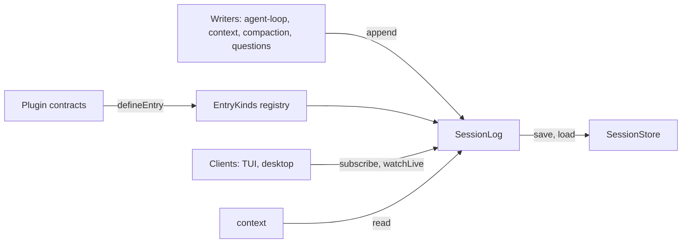

# session-log

The `session-log` plugin's contract: the entry schema, how plugins define entry kinds, and how code appends, reads and follows a session. Its requirements are in [plugins/session-log.md](../plugins/session-log.md).

## What it lets the code do

- `agent-loop` and other plugins append entries; `context` reads them; the TUI follows a session live.
- A plugin adds an entry kind by defining it in its contract; no change to `session-log`.
- Every entry carries the text the model sees and a plain text for the user, so it reads the same with its plugin off.

## Where it sits



## Files

```text
plugins/session-log/
  package.json
  plugin.ts         manifest: provides SessionLog and EntryKinds, requires SessionStore
  src/contract.ts   SessionId, Seq, ModelContent, Entry, defineEntry, SessionLog, EntryKinds, errors
  src/server.ts     the Layer: append, read, subscribe, live state
  test/             conformance with an in-memory SessionStore
```

## Types

```ts
const SessionId = Schema.String.pipe(Schema.brand("SessionId"))
const Seq = Schema.Int.pipe(Schema.brand("Seq")) // per session, from 1, gapless

// What the model sees, in Liminal's own types; an Effect upgrade cannot break saved sessions.
// context turns these into effect/ai Prompt messages.
type ModelPart =
  | { type: "text"; text: string; providerData: ProviderData }
  | { type: "reasoning"; text: string; providerData: ProviderData }
  | { type: "tool-call"; id: string; name: string; params: Json; providerData: ProviderData }
  | { type: "tool-result"; callId: string; name: string; result: Json; isFailure: boolean }
  | { type: "image"; path: string; mediaType: "image/png" | "image/jpeg" | "image/webp" }
type ModelContent = { role: "system" | "user" | "assistant" | "tool"; parts: ModelPart[] }

type UserVisibility = "shown" | "hidden" | "debug"

// In a plugin's contract
const Asked = defineEntry({
  kind: "questions/asked",          // plugin prefix
  data: Schema.Struct({ ... }),     // what the plugin's richer display reads
  model: true,                      // whether entries carry ModelContent
  user: "shown",                    // or "per-entry": each entry sets its UserVisibility
})

type Entry = {
  sessionId: SessionId
  seq: Seq
  kind: string
  at: DateTime.Utc
  data: unknown                     // Json when the kind's plugin is off
  model?: ModelContent[]            // frozen when written
  text: string                      // plain text for the user, frozen when written
  user: UserVisibility
}

type EntryDraft = Pick<Entry, "kind" | "data" | "model" | "text"> & { user?: UserVisibility }
type LiveState = { kind: string; data: Json }
type Synced = { type: "synced"; seq: Seq | undefined }

class SessionLog extends Context.Service<SessionLog, {
  append(session: SessionId, drafts: NonEmptyReadonlyArray<EntryDraft>):
    Effect<NonEmptyReadonlyArray<Entry>, SessionNotFound | UnknownEntryKind | InvalidEntry | StoreError>
  read(session: SessionId, range?: { after?: Seq; through?: Seq }):
    Effect<ReadonlyArray<Entry>, SessionNotFound | StoreError>
  subscribe(session: SessionId, from?: { after?: Seq }):
    Stream<Entry | Synced, SessionNotFound | StoreError>
  setLive(session: SessionId, live: LiveState | undefined): Effect<void, StoreError>
  watchLive(session: SessionId): Stream<LiveState | undefined, StoreError>
}>()("liminal/session-log/SessionLog") {}

class EntryKinds extends Context.Service<EntryKinds, {
  register(definition: EntryDefinition): Effect<void, DuplicateEntryKind, Scope>
}>()("liminal/session-log/EntryKinds") {}
```

## Logic

```text
append(session, drafts)
  hold the session's write lock (Semaphore, one permit)
    for each draft
      find its kind in EntryKinds, else UnknownEntryKind
      decode data with the kind's schema, else InvalidEntry
      require model content when the kind says so
      take user from the kind, or from the draft when the kind is per-entry
      stamp seq = last seq + 1 and at = now
    SessionStore saves all entries in one transaction
    signal the session's new last seq
  return the saved entries

subscribe(session, after)
  listen for new-seq signals first, so nothing slips between replay and live
  emit the saved entries after `after`, then Synced
  on each signal: read the entries after the last one sent and emit them
  (signals use a sliding PubSub of seq numbers; a slow subscriber skips signals, never entries)

read(session, range)
  SessionStore reads the session's entries, then its parent's up to the fork point
  decode each entry's data; a kind with no definition keeps its Json

setLive(session, live)
  SessionStore overwrites the session's one live slot
  publish to the session's SubscriptionRef

watchLive(session)
  SubscriptionRef.changes, starting from the saved slot
```

## What session-log needs from SessionStore

- Save a batch of entries in one transaction; read a range, following fork parents
- The last seq of a session
- Read and overwrite one live slot per session
- Create a session, and a fork as a session with a parent and a cut point
