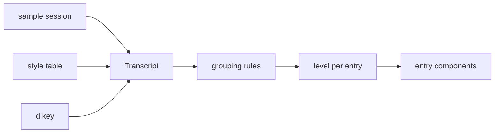

# Transcript

Lets the user compare ways the chat transcript can show a session, from Pi's full blocks to Codex's single working line, and blend them per kind of entry. Everything is explored in the gallery (`apps/gallery`).

## Agreed

- One typed sample session holds every kind of entry; every style renders the same session.
- A style is a table: each kind gets a level for the working phase and for the finished phase, plus grouping rules.
- Harness entries show or hide with a gallery-wide `d` key, saved in the bookmark like theme and size.
- Build order: work entries (thinking, tool calls) first.
- Expansion: component pages get collapsed and expanded states; the full-screen sample has one row expanded.
- A failed tool call always opens to show its error, even at the `line` level.
- A turn is a prompt and a reply. The prompt is a raised band with an accent bar; once it scrolls past the top, a copy stays pinned there.
- A long prompt shows two lines ending in `…`; a click opens and closes it, pinned copy included.

## Liminal style (agreed)

A fourth style, built beside Full, Folded and Quiet. It shows three things: that work is happening, the assistant's words between actions, and the answer.

- While working, one live line shows the current action in the present tense, with the elapsed time once a call passes 3s.
- Thinking shows on the live line as `∴ Thinking` with the thought in faint italic, and is gone once it ends.
- The live line does not reuse the header's glide or the eighth-block fade; a running mark breathes between the dim and bright step of its hue.
- Messages between actions stay as muted prose; the answer is in the base color.
- A finished turn shows `Worked for 2m 5s · 1 file changed` before the answer.
- The `worked` line opens to the turn's work log: prose alternating with one line per step.
- A step is the work between two prose entries or questions; thinking adds its time but is not counted; edits lead with their +/− counts.
- Edits, reads, runs and searches never show outside the live line and the work log; failures the assistant recovers from show only in the log.
- Checks keep only the turn's last run, as one line; a running check shows on the live line.
- Questions and permission requests always show in full.

## References studied

| Harness | Shape | Where |
| --- | --- | --- |
| Pi | Every tool draws a call block and a result block, same shape for all | `renderCall` / `renderResult` in Pi's extension docs |
| Grok Build | One line per action, expandable to its output | `crates/codegen/xai-grok-pager-render/src/render/` |
| Codex | One live working line; interim messages replaced; `Worked for 2m 5s` before the final message | `codex-rs/tui/src/history_cell/separators.rs` |
| Tau | Entry and reminder kinds, checkpoint, dreaming | `src/session/Entry.ts`, `src/session/Reminder.ts`, `src/core/internal/context/memory/` |

## Kinds

| Category | Kinds | Hidden unless `d` |
| --- | --- | --- |
| Conversation | user, steering, assistant (interim, final) | no |
| Work | thinking; tool call per tool (read, edit, run, search, checks, ask question), each running, done or failed; permission request | no |
| Memory | checkpoint with handoff note, short-term note, dreaming pass | yes |
| Harness | reminder by kind, nudge, instructions update, folder listings | yes |
| Media | image attached by the user or read by a tool | no |
| Session | compaction, error, turn summary | no |

## Shape



| Level | Draws | Like |
| --- | --- | --- |
| `full` | The whole block: call and result | Pi |
| `line` | One line; expandable to its block | Grok Build |
| `live` | Only while it is the current action, then gone | Codex |
| `latest` | One line for only the last entry of its kind in the reply | Liminal checks |
| `hidden` | Nothing | |

Grouping folds neighboring entries of a kind into one line, such as several reads into `Explored`. It beat separate renderers per style: a blend changes table rows instead of adding code.

Starting styles: **Full** (Pi), **Folded** (Grok Build), **Quiet** (Codex).

## Gallery

| Place | Entry | States |
| --- | --- | --- |
| Components → Transcript | one per kind | one per level it supports, collapsed and expanded |
| Screens → Transcript | the sample session | each style, working and finished |
| Screens → Chat | the chat screen | the transcript in Folded (built) |
| Tokens → Sample | each palette | the transcript in Folded (built) |

The transcript is the only conversation component; the old `chat/Conversation.tsx`, `Message.tsx` and `ToolCall.tsx` are gone.

## Step 1: work entries (built)

```text
apps/gallery/src/transcript/
  entries.ts        Entry union: user, thinking, interim, answer, worked, tool calls; Outcome running/done/failed
  sample.ts         the sample session, working and finished; each tool done, running and failed
  levels.ts         Phase, Level, DrawnLevel, GroupRule, Style
  styles.ts         Full, Folded, Quiet; the Explored group rule
  fold.ts           a turn as rows: entries, or neighboring tool calls folded into a group
  Transcript.tsx    picks each row's level for its turn's phase and draws it
  Thinking.tsx, ToolCall.tsx, Group.tsx, Worked.tsx
  results/          one face per tool: verb, present-tense verb, subject, summary, body
  galleryEntries.tsx  Components → Transcript and Screens → Transcript
```

- `worked` (`Worked for 2m 5s`) is an entry kind so Quiet can show it; Full and Folded hide it.
- Group rules name tool kinds only.
- A running call reads in the present tense (`Running`); `live` is its bare line.
- The `d` key waits for the harness kinds, since there is nothing to show with it yet.

## Step 2: Liminal style (built)

```text
apps/gallery/src/transcript/
  levels.ts       Level adds `latest`; GroupRule: kinds, heading (label or tally), inner rules; Style may name a work log style
  styles.ts       STEP; Liminal and its work log style, Liminal log
  fold.ts         folds any entry kind, not only tool calls
  tally.ts        a step's line in words: current action, edits first, the rest, thought time, failures
  Group.tsx       label line or tally line; what sits under it comes in as children
  Reply.tsx       draws a finished reply in the work log style once its `worked` line is open
  Prose.tsx       takes the role: muted between actions, base for the answer
  Worked.tsx      time and changed-file count
  StatusMark.tsx  the status mark; running breathes
```

- A running outcome carries its seconds so far; `worked` carries the changed-file count.
- Components → Transcript → Group shows Explored and each step state; Screens → Transcript adds Liminal working, finished, and finished with the work log open.

## Open

- Whether Quiet should show the answered question once the turn is done.
- The settle from live to done is drawn as two static brightness levels; the change between them needs a live session to animate.
- Rows open from the sample's open ids; clicking the `worked` line, a step or an action to open it is not wired yet.
