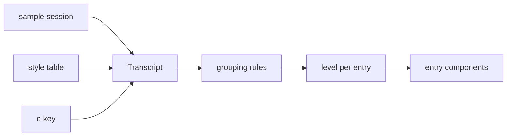

# Transcript

Lets the user compare ways the chat transcript can show a session, from Pi's full blocks to Codex's single working line, and blend them per kind of entry. Everything is explored in the gallery (`apps/gallery`).

## Agreed

- One typed sample session holds every kind of entry; every style renders the same session.
- A style is a table: each kind gets a level for the working phase and for the finished phase, plus grouping rules.
- Harness entries show or hide with a gallery-wide `d` key, saved in the bookmark like theme and size.
- Build order: work entries (thinking, tool calls) first.
- Expansion: component pages get collapsed and expanded states; the full-screen sample has one row expanded.
- A failed tool call always opens to show its error, even at the `line` level.
- A turn is a prompt and a reply. The prompt is a raised band with an accent bar; once it scrolls past the top, a copy stays pinned there.
- A long prompt shows two lines ending in `…`; a click opens and closes it, pinned copy included.

## Liminal style (agreed)

A fourth style, built beside Full, Folded and Quiet. It shows three things: that work is happening, the assistant's words between actions, and the answer.

- While working, one live line shows the current action in the present tense, with the elapsed time once a call passes 3s.
- Thinking shows on the live line as `∴ Thinking` with the thought in faint italic, and is gone once it ends.
- The live line does not reuse the header's glide or the eighth-block fade; a running mark breathes between the dim and bright step of its hue.
- Messages between actions stay as muted prose; the answer is in the base color.
- A finished turn shows `Worked for 2m 5s · 1 file changed` before the answer.
- The `worked` line opens to the turn's work log: prose alternating with one line per step.
- A step is the work between two prose entries or questions; thinking adds its time but is not counted; edits lead with their +/− counts.
- Edits, reads, runs and searches never show outside the live line and the work log; failures the assistant recovers from show only in the log.
- Checks keep only the turn's last run, as one line; a running check shows on the live line.
- Questions and permission requests always show in full.

## References studied

| Harness | Shape | Where |
| --- | --- | --- |
| Pi | Every tool draws a call block and a result block, same shape for all | `renderCall` / `renderResult` in Pi's extension docs |
| Grok Build | One line per action, expandable to its output | `crates/codegen/xai-grok-pager-render/src/render/` |
| Codex | One live working line; interim messages replaced; `Worked for 2m 5s` before the final message | `codex-rs/tui/src/history_cell/separators.rs` |
| Tau | Entry and reminder kinds, checkpoint, dreaming | `src/session/Entry.ts`, `src/session/Reminder.ts`, `src/core/internal/context/memory/` |

## Kinds

| Category | Kinds | Hidden unless `d` |
| --- | --- | --- |
| Conversation | user, steering, assistant (interim, final) | no |
| Work | thinking; tool call per tool (read, edit, run, search, checks, ask question), each running, done or failed; permission request | no |
| Memory | checkpoint with handoff note, short-term note, dreaming pass | yes |
| Harness | reminder by kind, nudge, instructions update, folder listings | yes |
| Media | image attached by the user or read by a tool | no |
| Session | compaction, error, turn summary | no |

## Shape



| Level | Draws | Like |
| --- | --- | --- |
| `full` | The whole block: call and result | Pi |
| `line` | One line; expandable to its block | Grok Build |
| `live` | Only while it is the current action, then gone | Codex |
| `latest` | One line for only the last entry of its kind in the reply | Liminal checks |
| `hidden` | Nothing | |

Grouping folds neighboring entries of a kind into one line, such as several reads into `Explored`. It beat separate renderers per style: a blend changes table rows instead of adding code.

Starting styles: **Full** (Pi), **Folded** (Grok Build), **Quiet** (Codex).

## Gallery

| Place | Entry | States |
| --- | --- | --- |
| Components → Transcript | one per kind | one per level it supports, collapsed and expanded |
| Screens → Transcript | the sample session | each style, working and finished |
| Screens → Chat | the chat screen | the transcript in Folded (built) |
| Tokens → Sample | each palette | the transcript in Folded (built) |

The transcript is the only conversation component; the old `chat/Conversation.tsx`, `Message.tsx` and `ToolCall.tsx` are gone.

## Step 1: work entries (built)

```text
apps/gallery/src/transcript/
  entries.ts        Entry union: user, thinking, interim, answer, worked, tool calls; Outcome running/done/failed
  sample.ts         the sample session, working and finished; each tool done, running and failed
  levels.ts         Phase, Level, DrawnLevel, GroupRule, Style
  styles.ts         Full, Folded, Quiet; the Explored group rule
  fold.ts           a turn as rows: entries, or neighboring tool calls folded into a group
  Transcript.tsx    picks each row's level for its turn's phase and draws it
  Thinking.tsx, ToolCall.tsx, Group.tsx, Worked.tsx
  results/          one face per tool: verb, present-tense verb, subject, summary, body
  galleryEntries.tsx  Components → Transcript and Screens → Transcript
```

- `worked` (`Worked for 2m 5s`) is an entry kind so Quiet can show it; Full and Folded hide it.
- Group rules name tool kinds only.
- A running call reads in the present tense (`Running`); `live` is its bare line.
- The `d` key waits for the harness kinds, since there is nothing to show with it yet.

## Step 2: Liminal style (built)

```text
apps/gallery/src/transcript/
  levels.ts       Level adds `latest`; GroupRule: kinds, heading (label or tally), inner rules; Style may name a work log style
  styles.ts       STEP; Liminal and its work log style, Liminal log
  fold.ts         folds any entry kind, not only tool calls
  tally.ts        a step's line in words: current action, edits first, the rest, thought time, failures
  Group.tsx       label line or tally line; what sits under it comes in as children
  Reply.tsx       draws a finished reply in the work log style once its `worked` line is open
  Prose.tsx       takes the role: muted between actions, base for the answer
  Worked.tsx      time and changed-file count
  StatusMark.tsx  the status mark; running breathes
```

- A running outcome carries its seconds so far; `worked` carries the changed-file count.
- Components → Transcript → Group shows Explored and each step state; Screens → Transcript adds Liminal working, finished, and finished with the work log open.

## Open

- Whether Quiet should show the answered question once the turn is done.
- The settle from live to done is drawn as two static brightness levels; the change between them needs a live session to animate.
- Rows open from the sample's open ids; clicking the `worked` line, a step or an action to open it is not wired yet.

## Transcript 2.0 (built, awaiting review)

A ground-up second take, beside the first, played as a live turn in the gallery. Brightness follows importance, and what is newest is brightest.

- While working, the tip of the turn is one live line: a turning arc and the action in the present tense with a band of light sweeping across it; elapsed time after 3s.
- Under the live line, what the action produces, gone when it ends: thinking as three fading italic lines that rise and thin out, a command's newest two output lines, the diff an edit writes, checks ticking off.
- Work reads like Grok Build's folded rows: everything the assistant says is full-brightness text, and all its work is gray rows between, so the two never blur. Prose and rows share one left edge, with a blank line between blocks.
- Between two things the assistant said, the work folds into one row per group: a mark, the verb in bold, what it worked on, and detail in brackets (`◆ Thought for 4s`, `◈ Explored kernel/test, 2 files, 1 search`, `◈ Edited kernel/test, 2 files`, `◆ Ran bun test kernel`, `◆ Ran checks (all passed)`). Reads and searches in a row join one group; so do edits in a row. `◈` marks a group of several actions, `◆` a single one.
- Everything the assistant says, between actions or as its answer, is Markdown (`<markdown>`, markers concealed) in the normal text color, arriving a whole word at a time. The assistant talks out loud between stretches of work.
- Work dims once it is left behind: a stretch of work fades to its dim colors over 600ms once the assistant next speaks, and all of it dims once the turn's work is over. `◇ Worked for` is drawn dim from the start. Only the stretch being worked on is at the brighter gray.
- Only failures have color: `(failed)` or `(lint failed)` in the danger color. No green counts or check marks.
- A group of several actions opens on a click to one row per action (`◆ Read …`, `◆ Search … (2 hits)`, `◆ Edit … (+1 -1)`); a thought opens to its text. Past turns fold the same way.
- While a group goes on, it is the live line in the present tense (`Exploring kernel/test, 2 files`), and settles into its row once the next thing starts.
- Thinking streams in with its newest characters warming up from the background; the rest of the word being written is laid out unseen, so words never jump lines.
- Questions follow Tau's `/qna`: the run ends by drafting a form, shown only as the live line `Drafting questions`. The user answers in the composer, which the form takes over; the transcript does not show the form being answered.
- Once drafted, the form settles under the worked line into one line: `? <title>  4 questions for you`.
- The user's answers are the next prompt, in the prompt's raised band with the accent bar: each question muted, `→ answer` in the user's voice, `as suggested` or `own answer` beside it, `suggested <answer>` under it when the user chose another, notes left on options as `└ note on <option>`, and Additional context last.
- The form has a title, which Tau's `ask_question` does not take yet.
- The composer's question form (`apps/gallery/src/chat/`: `formState.ts`, `QuestionForm.tsx`, `FormTabs.tsx`, `ChoiceTab.tsx`, `WriteTab.tsx`, `Suggested.tsx`) replaces the input and keeps the model line and key hints. It shows the title, then tabs (`1 ✓  2  3  4  context`, the tab in view on the selected surface, unanswered ones faint), then the tab in view. A select or yes/no tab lists options as rows with `○`/`●` marks and aligned descriptions; a select ends in an `Other…` row that becomes a field; notes hang under options as `└ note`, and an open note is a field there. A written-answer tab and the optional context tab have a `›` field. The suggested answer and its reason close a question's tab. Questions can be skipped: sending with a question open sends it as skipped, with no warning, and the Answers band shows `→ skipped` in faint text. Gallery: Components → Chat → Composer, the `Questions, …` states.
- The turn ends in one gray row, `◇ Worked for 34s`, inking in as the work ends, then the answer with code in the accent.

```text
apps/gallery/src/transcript2/
  script.ts    a turn: a prompt (text or answers), timed beats (think, say, act), then a close (answer or questions)
  questions.ts how a question and its answer read
  workGroups.ts  work between two things said, gathered into groups
  wording.ts   how a group reads as a row, past or present tense
  frame.ts     what shows at one moment: blocks, tip, ending
  play.ts      frameAt(script, ms): pure, shared by playback, held moments and tests
  ink.ts       streaming thought as colored runs
  shimmer.ts   the live line's light band
  useClock.ts  looping time for anything that moves
  Turn.tsx, Tip.tsx, LiveLine.tsx, Vapor.tsx, details.tsx, Answers.tsx, WorkRows.tsx, Asked.tsx, WorkedFor.tsx, Said.tsx
  Conversation.tsx, Playback.tsx, galleryEntries.tsx
```

Gallery: Screens → Transcript 2.0 → Session (Playing, Finished); Components → Transcript 2.0 → Turn, held at each moment.
