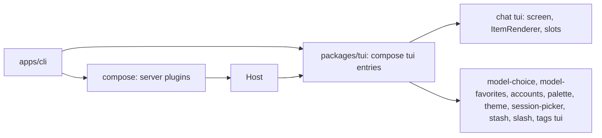
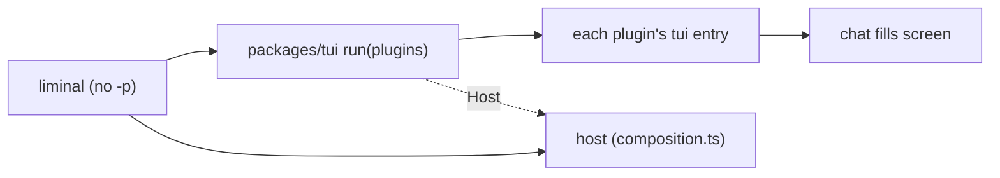
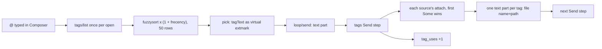
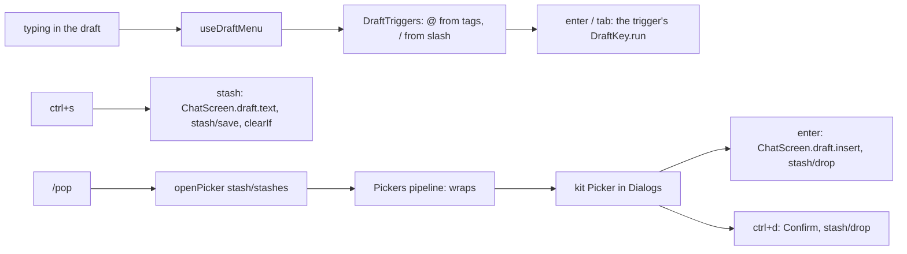
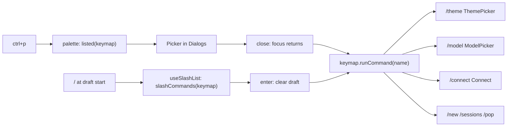

# Plan: milestone 2, the TUI

The session view, `packages/tui`, and the `tui` entries of `chat`, `palette`, `theme`, `model` and `accounts`. Work list: [plugins/tui.md](../plugins/tui.md). Designs: `apps/gallery`, plan in [_archive/gallery.md](_archive/gallery.md).

## Systems

| System | Change |
| --- | --- |
| `packages/client` | Expands: the session view beside `Host` |
| `packages/tui` | Adds the renderer, slots, the bridge between Effect and Solid, and the UI kit |
| `packages/plugins/chat` | Adds the chat screen as a `tui` entry |
| `packages/plugins/{palette,theme}` | Adds the command palette and theme switching |
| `packages/plugins/{model,accounts,loop,session}` | Expands: `tui` entries for the model picker and `/connect`; RPC for paging, loop state with the queue, and the session list |
| `apps/cli` | Expands: the TUI by default, `--model`, `--session` |

## Today

How a frontend reads a session now (`apps/cli/src/print.ts`):

| Step | What does it |
| --- | --- |
| Open a session | `SessionRpc` `session/open` |
| Send input | `LoopRpc` `loop/send` with a `session/message` event |
| Follow it | `SessionRpc` `session/live`: saved events after a `seq`, then deltas and new events |
| Know the turn ended | A `loop/turn-end` event |
| Show text | Decode each item with its kind's `EventKind.decode` |

Event kinds a viewer sees today: `session/message`, `session/notice`, `loop/turn-start`, `loop/step-start`, `loop/step-end`, `loop/turn-end`, `loop/interrupted`, and the records `system-prompt` and `tool-definitions` log. Deltas: `loop/reply` (text, reasoning, tool input, tool calls, retries) and `loop/tool-done`.

Prior art:

| Source | How it turns events into state, and loads screens |
| --- | --- |
| `archive/packages/frontend` | Its own slot tree and part loader, about 700 lines; each part declared the slots it needed |
| `archive/packages/plugins/chat/src/tui/transcript-state.ts` | The chat screen's own fold: entries into transcript items, tool runs grouped |
| OpenCode `packages/client/src/solid/data.ts` | One 2,000-line switch over every event kind into a Solid store with `reconcile`; closed to plugins |
| OpenCode `packages/tui/src/plugin/` | Its own plugin API and loader for TUI plugins |

## Decisions

- **The session view is generic.** It keeps the saved events in order, the reply streaming now and whether a turn runs. Screens decode the kinds they need; `chat` builds the transcript itself, and a plugin that owns questions or actors builds those in its own `tui` entry. Plugins add event kinds, so code in `client` cannot know them all.
- **The session view is Effect-native.** Sending, cancelling and answering stay RPC calls on `LoopRpc`. `packages/tui` turns `state.changes` into a Solid store, reconciled by `seq` so unchanged rows stay mounted.
- **`running` comes from `loop`.** `loop/state` streams whether a turn runs in the session, from `loop`'s own state. The events a view holds may not reach back to the turn's start, and after a crash the log shows a turn open that nothing runs. OpenCode asks the server for active sessions the same way.
- **One `loop/state` stream.** It holds `running` now; step 7 adds the queued inputs to it instead of a separate queue RPC. Both are live state `loop` keeps per session.
- **`streaming` is every delta since the last saved event.** The view keeps them as they come, of any kind; `chat` drops the reply items before a retry. The view stays a plain list that knows nothing of how `loop` replies.
- **A failed live stream stops the view.** It logs the error and stops updating. Reconnecting from the last `seq` comes with the IPC and HTTP hosts, where connections drop.
- **The view keeps what it loads.** It opens with the latest page, adds every new event, and `loadOlder` adds the page before the oldest held, back to the first. Nothing held is dropped.
- **The transcript opens at the bottom.** Its first frame shows the latest items; it never scrolls down after loading.
- **`loop/turn-start` marks a turn's start.** It is saved in the same write as the input the turn takes; the model never sees it. Any event kind can be an input, so the log alone cannot say when a turn starts.
- **`loop/reply` streams tool input.** A `tool-input` variant carries a call's params so far, parsed from the unfinished JSON in Effect AI's `tool-params-start` and `tool-params-delta`, so a tool row draws its input as it is written with the same params shape as the finished call. Pi does the same.
- **`loop` logs steps.** `loop/step-start` (with the model id) and `loop/step-end` are saved around each model call; the model never sees them. Every step start gets an end: `finished`, `failed`, `cancelled`, or `interrupted` when Liminal stopped, as OpenCode, deepseek-harness and Pi each close every model call.
- **Frontend code shared by `tui` and `web` lives in `view.ts`.** A plugin's `src/view.ts` or `src/view/` uses no UI framework; its `tui` and `web` entries import it and the server never does. `chat`'s holds the code that builds the transcript, so the desktop app reuses it. The plugin anatomy check and lint rules learn the new fixed file.
- **Plugins add frontend exports.** Beside `./contract`, a plugin exports `./view` (no UI framework) and `./tui` (OpenTUI), later `./web`. `/contract` is importable anywhere, `/view` from `view`, `tui` and `web` code, `/tui` from `tui` code only. `contract.ts` cannot hold a tag typed with a Solid component, since servers import it.
- **Chat builds the transcript; plugins draw their own kinds.** `chat`'s `view/` builds turns and items from `session/*` and `loop/*` events in one closed function, as OpenCode's client store does; its `tui` entry holds `ItemRenderer`, keyed by event kind, as Pi's `registerMessageRenderer` is. A saved event of a kind with a renderer is an item that renderer draws. Streamed deltas show as live items until the next saved event.
- **Tool rows are not grouped.** A tool call and its result make one single-line row; consecutive tool rows sit next to each other, as in the gallery.
- **TUI and desktop share colors.** `packages/client` holds the role names, so the UI kits and `theme` import them without importing each other. `theme`'s contract holds the `Palette` type, the setting and `theme/get`, `theme/set`; its `view.ts` holds the OKLCH math, ramps, palettes and the palette-to-role mapping. Its `tui` entry builds OpenTUI's `SyntaxStyle` and fills the UI kit's color context; a later `web` entry turns role colors into CSS variables. The UI kit owns `useColor` and that context. Spacing, borders, glyphs, fonts and syntax styles belong to each frontend. OpenCode keeps separate theme code for its TUI and web app, and their theme sets have drifted.
- **Slots.** `packages/tui` has one `screen` slot (`single_winner`) that `chat` fills. `chat` has `sidebar` (`append`, sections by `order`, its own Session section first) and `composer` (`replace`). A notifications slot comes with the first plugin that fills it.
- **Dialogs are a service, not a slot.** The UI kit's `Dialogs` is a stack with `open` and `close`, drawn above the screen with the dim. `model`, `accounts` and `palette` open their pickers through it from commands.
- **`ctrl+b` toggles the sidebar below 110 columns.** It is a named command, "Toggle sidebar", listed in the palette; `escape` closes the drawer, and a footer hint shows while the sidebar is hidden. It takes `ctrl+b` from OpenTUI's textarea, where the arrow keys do the same. Crush binds `ctrl+b`; OpenCode binds `ctrl+x b`.
- **`loop/step-end` carries token usage.** A finished one holds the finish reason and the call's token counts from Effect AI's `finish` part. The sidebar's context share is the latest step's tokens over the model's `contextWindow` from the catalog. `usage` in milestone 4 prices step-ends instead of attaching counts.
- **`tui` entries are plugins.** A plugin's `tui` module default-exports a plugin made with `definePlugin`; `packages/tui` composes them with `compose` over a base layer that provides `Host`, the renderer and the slot registry. `compose` gives the load order, missing-piece errors and cleanup, so `chat` provides `ItemRenderer` and `approvals` requires it.

```ts
// packages/client
interface ViewState {
  readonly events: ReadonlyArray<SessionEvent>   // saved, oldest first
  readonly streaming: ReadonlyArray<Delta>       // every delta since the last saved event
  readonly running: boolean
}
SessionView.open(session): Effect<{ state: SubscriptionRef<ViewState>; loadOlder: Effect<void> }, E, Host | Scope>
```

```ts
// chat/src/view/index.ts
export const buildTranscript: (state: ViewState, drawn: ReadonlySet<string>) => ReadonlyArray<Turn>

// chat/src/tui/index.tsx
export const ItemRenderer: Registry<{ kind: string; component: (props: { event: SessionEvent }) => JSX.Element }>
```



| Gallery piece | Goes to |
| --- | --- |
| Primitives, `Dialog`, `Picker` | `packages/tui` UI kit |
| Header, sidebar, composer, transcript, notifications, draft menu, landing | `chat` |
| Slash menu rows | `slash` |
| Sessions picker | `session-picker` |
| Models picker, model line | `model-choice` |
| Connect dialog | `accounts` |
| Commands picker | `palette` |
| `useColor` | `packages/tui` UI kit |
| `oklch.ts`, `ramp.ts`, `palettes.ts`, `roles.ts` | `theme` `view.ts`; role names in `packages/client` |
| `syntax.ts`, `theme.tsx` | `theme` `tui` entry |

## Build order

1. `loop` events. 2. Session view in `packages/client`. 3. Plugin anatomy: `./view`, `./tui`, `view.ts`. 4. `packages/tui`. 5. `theme`. 6. `chat`, with `liminal` opening the TUI: 6a the screen, 6b `@` tags and saving stashes. 7. `palette`, model picker, `/connect`, saved sessions, queue and pull-back, the stash list.

## Step 1: `loop` events

Print mode's `--json` shows the new events with no change to `apps/cli`.

```text
packages/plugins/loop/
  README.md            the new events and the tool-input delta
  src/contract.ts      TurnStarted, StepStarted, StepEnded; ReplyDelta gains tool-input
  src/sessions.ts      a write that opens a turn puts TurnStarted first
  src/turn.ts          logs StepStarted, then the reply with StepEnded; a failed or cancelled step's end
  src/reply.ts         keeps the finish part and each call's input text; publishes tool-input
  src/partial-json.ts  new: best-guess params from unfinished JSON text
  src/recovery.ts      closes a step a crash left open
```

```ts
// contract.ts; Response is effect/ai's
export const TurnStarted = defineEvent("loop/turn-start", Schema.Struct({}))
export const StepStarted = defineEvent("loop/step-start", Schema.Struct({ model: ModelId }))
export const StepEnded = defineEvent("loop/step-end", Schema.Union([
  Schema.Struct({ outcome: Schema.Literal("finished"), reason: Response.FinishReason, usage: Response.Usage }),
  Schema.Struct({ outcome: Schema.Literals(["failed", "cancelled", "interrupted"]) }),
]))
// ReplyDelta gains; id is the tool call's id, params the input so far, whole
Schema.Struct({ type: Schema.Literal("tool-input"), id: Schema.String, name: Schema.String, params: Schema.Json })

// partial-json.ts
export const parsePartial: (text: string) => Schema.Json  // {} until something parses
```

None of the three events has a converter, so the model never sees them.

| Where a turn opens (`sessions.ts`) | Write |
| --- | --- |
| `send` on an idle session | `[TurnStarted, input]` |
| `release` after `Turns.fold`, inputs waiting | `[TurnStarted, ...inputs]` |
| `endTurn`, not answered, inputs waiting | `[TurnEnded]`, then `[TurnStarted, ...inputs]` |
| `endTurn`, answered, inputs waiting | `[...inputs]`: the same turn goes on |
| `takeSteers` | `[...steers]` |

`take` gains `opens: boolean`, which puts `TurnStarted` first.

```text
step (turn.ts)
  sync system prompt and tool list; run BeforeCall hooks
  request = request(session)
  append [StepStarted { model: request.model }]
  reply = streamReply(request), on failure append [StepEnded failed], on interrupt [StepEnded cancelled]
  append [message when it has parts, StepEnded finished { reason, usage }]
  no calls: run TurnEnd hooks, answered
  reason is length: fail the calls, else run them

streamReply (reply.ts), state { reply, inputs: call id -> { name, text }, finish: Option<FinishPart> }
  tool-params-start: inputs += id -> { name, text: "" }
  tool-params-delta: text += delta; publish tool-input { id, name, params: parsePartial(text) }
  finish: finish = the part
  retry: state starts over
  returns { message, finish }

parsePartial (partial-json.ts)
  scan text, tracking open strings, objects and arrays
  cut a half-written key or a value with no start, and a trailing comma or colon
  close the open string, then each open object and array, innermost first
  JSON.parse; {} when it still fails

closeUnfinished (recovery.ts)
  a turn is open when a TurnStarted follows the last TurnEnded
  a StepStarted after the last StepEnded since the last TurnEnded: StepEnded interrupted before the notice
```

- A reply that ends with no finish part logs `StepEnded` finished with reason `unknown` and empty usage.
- On a cancel, `reply.ts` logs `loop/interrupted` first, then the step logs `StepEnded` cancelled.
- `truncated` goes: it is `finish.reason === "length"`.
- `reply.ts`'s private `fold` becomes `addDelta`, so "fold" means only `Turns.fold`.
- Pi parses with the `partial-json` package; OpenCode keeps a 280-line copy of it. Ours covers what a tool's params need: objects, arrays, strings, numbers, `true`, `false`, `null`.

## Step 2: session view

No screen uses it until step 4; a scratch script checks it by hand.

```text
packages/client/
  README.md               the session view
  src/host.ts             Host and inMemory, moved from index.ts
  src/session-view.ts     new: open, ViewState, addItem, addOlder
  src/index.ts            exports Host, inMemory, SessionView
packages/plugins/session/src/{contract,index}.ts   session/page RPC
packages/plugins/loop/src/
  contract.ts             LoopState, Inbox.state, the loop/state RPC
  sessions.ts             states in a SubscriptionRef; state(session) stream
  index.ts                the loop/state handler
```

```ts
// session contract: SessionRpc gains
Rpc.make("session/page", {
  payload: { session: SessionId, before: Schema.optional(Seq) },
  success: Schema.Array(SessionEvent),
  error: Schema.Union([SessionNotFound, SessionStoreFailed]),
})

// loop contract: LoopRpc gains; the current state first, then each change
export const LoopState = Schema.Struct({ running: Schema.Boolean })
Rpc.make("loop/state", { payload: { session: SessionId }, success: LoopState, stream: true })

// packages/client/src/session-view.ts, exported as SessionView
export interface ViewState {
  readonly events: ReadonlyArray<SessionEvent>  // saved, oldest first: the latest page and older pages loaded
  readonly streaming: ReadonlyArray<Delta>      // every delta since the last saved event
  readonly running: boolean
}
export interface SessionView {
  readonly state: SubscriptionRef<ViewState>
  readonly loadOlder: Effect<void, SessionNotFound | SessionStoreFailed>
}
export const open: (session: SessionId) =>
  Effect<SessionView, SessionNotFound | SessionStoreFailed, Host | Scope>
```

```text
open(session)
  sessionRpc, loopRpc = host.client(SessionRpc), host.client(LoopRpc)
  latest = session/page { session }
  state = SubscriptionRef { events: latest, streaming: [], running: false }
  fork in scope: session/live { session, after: last seq or 0 }, each item: state = addItem(state, item)
  fork in scope: loop/state { session }, each: state.running = running
  a forked stream that fails logs the error; the view stops updating

addItem(state, item)                  pure
  saved event, seq above the last held: events += item, streaming = []
  saved event, seq held already: state
  delta: streaming += item

loadOlder
  first held seq is 1, or nothing held: done
  older = session/page { session, before: first seq }
  events = older with seq below the first held, then events

loop/state (sessions.ts)
  SubscriptionRef.changes(states), running = Option.isSome(state.running), Stream.changes
```

- `live` after the page's last `seq` catches up on events saved between the two calls, so nothing is lost.
- `streaming` matches the deltas `session` keeps for a viewer that joins mid-reply, so a view opened late sees the same.
- A screen knows there is more history when `events[0].seq` is above 1.

## Step 3: plugin anatomy

Tooling only; the first `view.ts` and `tui` entry come with `theme` in step 5.

```text
tools/lint/plugin-entries.ts     PluginEntry gains "view"; src/view.ts file, src/view/ folder
tools/lint/plugin-rules.ts       plugin-imports by entry; entry-isolation by table; new view-imports
tools/lint/plugin-rules.test.ts  cases for each
.oxlintrc.json                   turns on liminal/view-imports
tools/checks/plugin-anatomy.ts   "./view" export; folder targets
tools/checks/fixtures/           good: a ./view export, a tui folder; broken: messages updated
docs/instructions/plugins.md     Checked section
```

Which other plugins' exports each importer may use (`plugin-imports`):

| Importer | `/contract` | `/view` | `/tui` | `/web` |
| --- | --- | --- | --- | --- |
| contract, plugin, test, other files | yes | | | |
| view code | yes | yes | | |
| tui code | yes | yes | yes | |
| web code | yes | yes | | yes |
| `packages/client`, `packages/tui` | yes | | | |

Which of its own entries a file may import with a relative path (`entry-isolation`):

| From | May import |
| --- | --- |
| plugin | plugin; tui and web only with `import()` |
| view | view |
| tui | tui, view |
| web | web, view |

Contract and test files stay outside the table, as now.

```ts
// plugin-rules.ts
const allowedSubpaths: ReadonlyMap<PluginEntry, ReadonlySet<string>>  // the first table
const reaches: ReadonlyMap<PluginEntry, ReadonlySet<PluginEntry>>      // the second table

/** View code uses no UI framework. */
export const viewImports  // in view code: bans solid-js, @opentui/*, @shanepadgett/liminal-tui

// plugin-anatomy.ts: each export and the files it may point to
const entryFiles = new Map([
  [".", ["./src/index.ts"]],
  ["./contract", ["./src/contract.ts"]],
  ["./view", ["./src/view.ts", "./src/view/index.ts"]],
  ["./tui", ["./src/tui.tsx", "./src/tui/index.tsx"]],
  ["./web", ["./src/web.tsx", "./src/web/index.tsx"]],
])
```

- A folder entry's export points to its `index` file.
- The guide in `docs/guides/plugins.md` gains `tui` entries in step 4, when a plugin can ship one.

## Step 4: `packages/tui`

One step: the runtime (renderer, entries, slots, bridge, dialogs) and the UI kit copied from the gallery, checked by hand with a scratch `tui` entry.

```text
packages/tui/
  package.json        exports "."; dependencies @opentui/core, @opentui/solid, @opentui/keymap, solid-js;
                      peers effect, liminal-core, liminal-client
  README.md
  src/index.ts        run, Slots, defineSlot, SlotView, screen, Dialogs, Colors, useColor, useRun, useWatch, useSessionView, kit
  src/run.ts          loads tui entries, composes them over the base, renders the root, waits for quit
  src/base.ts         the base plugin: Host, Renderer, Slots, Dialogs
  src/root.tsx        the root plugin: requires Colors, renders screen slot and dialog layer
  src/slots.tsx       SlotHandle, defineSlot, Slots, SlotView over OpenTUI's registry
  src/dialogs.tsx     the Dialogs stack and its layer
  src/bridge.ts       useRun, useWatch, useSessionView: Effect into Solid
  src/colors.ts       Colors, useColor, useSyntax, useMix
  src/kit/            primitives, Overlay, Dialog, Picker, copied from apps/gallery
packages/plugins/theme/
  package.json, README.md, src/contract.ts   Palette types only; the rest in step 5
  src/index.ts        a plugin with no services, since every plugin package has one
```

```ts
// run.ts
export const run: (plugins: ReadonlyArray<AnyPlugin>) =>     // AnyPlugin now exported from core
  Effect<void, CompositionError | EntryInvalid, Host>          // own scope: the terminal is restored first
class EntryInvalid extends Schema.TaggedError  // { plugin }: its tui entry does not default-export a plugin

// slots.tsx
interface SlotHandle<Props> { readonly name: string; readonly mode: SlotMode }
const defineSlot: <Props extends object>(name: string, mode: SlotMode) => SlotHandle<Props>
class Slots extends Context.Service<Slots, {
  readonly fill: <P>(slot: SlotHandle<P>, component: (props: P) => JSX.Element, order?: number) =>
    Effect<void, never, Scope>   // unregisters when the scope closes
}>
function SlotView<P>(props: { slot: SlotHandle<P>; children?: JSX.Element } & P): JSX.Element
const screen: SlotHandle<{}>    // "screen", single_winner

// dialogs.tsx: sync, since key handlers open them
class Dialogs extends Context.Service<Dialogs, {
  readonly open: (dialog: () => JSX.Element) => () => void   // returns close
  readonly close: () => void                                 // closes the top one
}>

// colors.ts: provided by theme's tui entry
type RoleColor = (role: RoleName) => string     // RoleName from liminal-client
class Colors extends Context.Service<Colors, {
  readonly color: Accessor<RoleColor>; readonly syntax: Accessor<SyntaxStyle>
  readonly mix: (from: string, to: string, amount: number) => string  // OKLCH math stays in theme
}>

// bridge.ts: in components
useRun(): <A, E>(effect: Effect<A, E, Host | Dialogs>) => void            // failure logged
useWatch<A>(stream: Stream<A>, initial: A): Accessor<A>                   // stops with the component
useSessionView(session): { state: ViewState (Solid store, reconciled by seq), loadOlder: () => void }
```

```text
run(plugins)
  entries = each plugin with entries.tui: import it, default export must be a plugin, else EntryInvalid
  renderer = acquireRelease(createCliRenderer({ exitOnCtrlC: false }), destroy)
  compose([base(host, renderer), ...entries, root]) missing Colors: CompositionError
  wait until the renderer is destroyed

base(host, renderer)                                plugin, provides Host, Renderer, Slots, Dialogs
  registry = createSolidSlotRegistry(renderer, {})

root                                                plugin, requires Host, Colors, Slots, Dialogs, Renderer
  runner = FiberSet.makeRuntime, in the composition's scope
  render(<Services runner colors dialogs><KeymapProvider>
           <SlotView slot={screen}>no screen</SlotView>
           <DialogLayer />          top dialog in an Overlay; escape closes it
         </KeymapProvider></Services>)
  ctrl+c: "Quit", destroys the renderer; chat takes it over in step 6

a tui entry (tui.tsx)
  export default definePlugin({ name, provides, requires: [Slots, ...], layer: Layer.effectDiscard(
    Effect.gen: slots = yield* Slots; yield* slots.fill(screen, () => <ChatScreen />)) })
```

- The gallery keeps its own code and stays free to change; `packages/tui` copies what it takes, and neither imports the other.
- A component reaches its plugin's services through its layer's closure, and the base's through `useRun`.
- `root` is the last plugin, so it renders after every entry fills its slots, and a composition without a theme fails to start.
- `liminal` loads `packages/tui` with `import()` after `@opentui/solid/preload`, so `.tsx` compiles wherever it runs; that wiring comes with step 6.

## Step 5: `theme`

The theme plugin's server, its shared color code and its `tui` entry, which provides `Colors`.

```text
packages/plugins/theme/src/
  contract.ts       Palette, Step, RampSpec, RampName (exist); ThemeSetting, ThemeRpc, ThemeFailed
  index.ts          the plugin: declares the setting, serves ThemeRpc
  view/index.ts     PALETTES, DEFAULT_PALETTE, paletteOf(id), roleColors(palette), mixHex
  view/oklch.ts     copied from apps/gallery/src/theme/oklch.ts
  view/ramp.ts      copied from ramp.ts, its types now from the contract
  view/palettes.ts  copied from palettes.ts: liminal, afterhours, heure-bleue, conservatory, barbican
  view/roles.ts     copied from roles.ts: each RoleName's ramp and step
  tui/index.tsx     the tui entry: provides Colors
  tui/syntax.ts     copied from syntax.ts
```

```ts
// contract.ts
const ThemeSetting = Setting.make("theme", Schema.Struct({ palette: Schema.optionalKey(Schema.String) }))
class ThemeFailed extends Schema.TaggedError  // { message }: settings unreadable or unwritable
const ThemeRpc = RpcGroup.make(
  Rpc.make("theme/get", { success: Schema.UndefinedOr(Schema.String), error: ThemeFailed }),
  Rpc.make("theme/set", { payload: { palette: Schema.String }, error: ThemeFailed }),  // global file
)

// view/index.ts: framework-free, shared with a later web entry
const paletteOf: (id: string | undefined) => Palette     // unknown or missing id: DEFAULT_PALETTE
const roleColors: (palette: Palette) => (role: RoleName) => string
```

```text
theme plugin                      requires Settings, DeclaredSettings; serves ThemeRpc

theme tui entry                   requires Host, Renderer; provides Colors
  saved = theme/get               a failure logs a warning and uses DEFAULT_PALETTE
  palette = signal(paletteOf(saved))
  Colors.of({
    color:  () => roleColors(palette()), cached per palette id
    syntax: () => SyntaxStyle per palette id, made on first use, destroyed when the scope closes
    mix:    mixHex
  })

apps/cli composition              gains theme, so theme/get answers once the TUI opens in step 6
```

- `RoleName` moves from theme's contract to `packages/client/src/colors.ts`. `packages/tui` imported it from theme while theme's `tui` entry imported `packages/tui`, a package cycle.
- Plugins may import `packages/client`, so a `tui` entry reaches `Host` and the role names; `.fallowrc.jsonc` allows it.
- The gallery keeps its theme files; `theme` copies them.
- The theme picker comes in step 7, with the command palette and an interactive `Picker`; step 7 also settles how a pick reaches `Colors`.

## Step 6: `chat`

Two commits. 6a: the chat screen, transcript, sidebar, a plain composer and `liminal` opening the TUI. 6b: `@` file tags with `git ls-files` completion, and stashes. Slash commands come in step 7.



- `liminal` with no `-p` opens the TUI; `--help` prints help. `composition.ts` exports its plugin list beside `host`, and `run(plugins)` gets `Host` from `host`.
- The screen starts on Landing. The first send calls `session/open`, then `loop/send`, and the screen switches to the header and transcript. Quitting before a send saves nothing.
- Composer keys: `enter` sends and `shift+enter` adds a line. While a turn runs, `enter` steers, `tab` queues a follow-up (both `loop/send` with its `mode`) and `esc` stops it (`loop/cancel`).
- `ctrl+c` clears the draft when there is one, and quits otherwise. Chat's binding replaces the root's "Quit".
- No model line under the composer until step 7, when frontends can ask for the main model.
- Chat builds and draws the transcript for `session/*` and `loop/*` events in one closed function, as OpenCode's client store does; base plugins stay free of frontend code. Other plugins draw their own saved event kinds by adding an `ItemRenderer` for the kind, as Pi's `registerMessageRenderer` does.
- The transcript shows inputs, replies, tool rows and notices, never reasoning. While a turn runs and nothing is inking in (no reply text or tool input streaming), the kit's `Spinner` shows under the turn: the face with the scrambled words stands in for thinking and other work.
- Replies draw Mermaid code blocks as diagrams: chat copies the gallery's `diagrams.ts` and depends on `beautiful-mermaid`.

### 6a code

```text
packages/plugins/chat/
  package.json, README.md      exports ., ./view, ./tui; entries.tui; no contract, nothing imports one
  src/index.ts                 the plugin: no services, so its tui entry loads
  src/view/index.ts            Item, Turn, buildTranscript, contextUsed, isWriting
  src/tui/index.tsx            the tui entry: provides ItemRenderer; fills screen, sidebar, composer
  src/tui/slots.ts             ItemView, ItemRenderer, the sidebar and composer slots
  src/tui/ChatScreen.tsx       screen state, session view, turns, ctrl+c and ctrl+b
  src/tui/Layout.tsx           layout, copied from gallery screens/Chat.tsx
  src/tui/Landing.tsx, Header.tsx, Sidebar.tsx, Composer.tsx    copied from gallery components/chat; Composer binds its keys
  src/tui/Turn.tsx, Reply.tsx, WorkRow.tsx, Notice.tsx, stream.ts, diagrams.ts   copied from gallery components/transcript; Turn draws each item kind
packages/tui/src/root.tsx      keeps ctrl+c "Quit" only while no plugin fills the screen
packages/tui/src/slots.tsx     a fill's component runs untracked
apps/cli/src/composition.ts    exports plugins beside host; gains chat
apps/cli/src/tui.ts            registers Solid's transform, then run(plugins) with host
apps/cli/src/main.ts           no flags: tui
apps/cli/package.json          gains @opentui/solid, liminal-tui, liminal-chat
packages/plugins/directories/  DirectoriesRpc: directories/workspace
packages/plugins/model/        ModelRpc: model/main
```

```ts
// view/index.ts: framework-free; decodes with Schema.decodeOption, skipping data its schema rejects
type Item =
  | { kind: "input"; id: string; text: string }                          // a steer or later input in the turn
  | { kind: "reply"; id: string; text: string; isLive: boolean }
  | { kind: "tool"; id: string; name: string; params: Json; status: "running" | "done" | "failed"; isLive: boolean }
  | { kind: "notice"; id: string; level: "info" | "warning" | "error"; text: string }
  | { kind: "event"; id: string; event: SessionEvent }                    // another plugin's kind, drawn by its ItemRenderer
interface Turn { readonly id: string; readonly input: string | undefined; readonly items: ReadonlyArray<Item> }
const buildTranscript: (state: ViewState, drawn: ReadonlySet<string>) => ReadonlyArray<Turn>   // drawn: kinds with a renderer
const contextUsed: (state: ViewState) => number | undefined   // input tokens of the latest finished loop/step-end
const isWriting: (state: ViewState) => boolean                // the last delta is reply text or tool input

// tui/index.tsx
interface ItemView { readonly kind: string; readonly component: (props: { event: SessionEvent }) => JSX.Element }
class ItemRenderer extends Registry.Service<ItemRenderer, ItemView>()("chat/ItemRenderer") {}
```

```text
buildTranscript(state, drawn): one closed switch, saved events first, then deltas
  loop/turn-start               → start a Turn
  session/message user          → the Turn's input, or an input item when it has one
  session/message assistant     → reply per text part (id seq:index); tool per tool-call part (id call id)
  loop/interrupted              → the same, for the reply a cancel cut short
  session/message tool results  → the tool (id call id): done or failed
  session/notice                → notice
  loop/turn-end cancelled       → notice "Stopped."
  a kind in drawn               → event item
  loop/reply text delta         → live reply (id key), its text appended
  loop/reply reasoning delta    → nothing
  loop/reply tool-input, call   → live tool (id call id), its params inking in
  loop/reply retry              → drops the live items; a retry notice
  loop/tool-done                → the tool (id call id): done or failed
  anything else                 → nothing; kinds such as loop/step-start never show
  an item with an id seen before in its Turn replaces it in place; a saved event clears the deltas, so live items go
```

```mermaid
sequenceDiagram
  participant cli as liminal
  participant tui as packages/tui run
  participant chat as chat tui entry
  participant host as Host
  cli->>tui: run(plugins), host provided
  tui->>chat: build entry: provide ItemRenderer, fill screen
  chat->>chat: Landing until the first send
  chat->>host: session/open, then loop/send
  chat->>host: SessionView.open(session) via useSessionView
  host-->>chat: ViewState; buildTranscript; draw each Turn
```

- Screen state: `{ kind: "landing" } | { kind: "session"; session: SessionId }`.
- Header: the wordmark and diagonals; a title shows once `session-name` (milestone 4) sets one.
- Sidebar Session section: the folder, the Git branch and the context share, through two new RPCs:

```ts
// directories contract: the branch is read from <workspace>/.git/HEAD; none outside a repository
Rpc.make("directories/workspace", { success: Schema.Struct({ folder: Schema.String, branch: Schema.optional(Schema.String) }) })
// model contract: the main role's model and its window; step 7's model picker builds on this group
Rpc.make("model/main", { success: Schema.Struct({ model: ModelId, contextWindow: Schema.optional(Schema.Int) }), error: ModelNotFound | SettingsInvalid })
```

- Context share: input tokens from the latest `loop/step-end` over `contextWindow`; no percentage without a window.
- Sidebar and composer slots: `defineSlot<{ session: SessionId; state: ViewState }>("chat/sidebar", "append")` and `defineSlot<{ running: boolean; send(text, mode?); cancel(); screenHints }>("chat/composer", "replace")`, exported from chat's `./tui`. Chat fills them with its own Session section and Composer.
- The chat screen returns one `<box>` around its landing-or-session switch: OpenTUI's `Slot` draws a fill again from fresh state whenever the element it returns changes.
- Spinner: under the last Turn while `running` and the last delta is not a reply text or tool-input delta.
- Quit: chat's `ctrl+c` calls `renderer.destroy()` through `Renderer`, which `run` waits on.
- Deletes: the root's `ctrl+c` "Quit" while a plugin fills the screen; `liminal` with no flags no longer prints help.

### 6b

Three commits: the drawer fix, `@` tags, stashes.

- Drawer: `escape` closes the sidebar drawer, through the drawer's own binding as `Shown` in `dialogs.tsx` does. While the drawer is closed on a narrow screen, the composer hints add `ctrl+b sidebar`.
- A tag sends the file's contents with the message, as OpenCode (`core/src/session/prompt.ts` `readFileAttachment`) and Crush (`ui.go` `insertFileCompletion`) do. Long files are cut to a window with a note on how much is left, as Pi's `read` does (2000 lines or 50 KB, `[Showing lines X-Y of Z…]`) and the archive's `tools-read` `lineWindow` did. The message gains a text part per tag: `model`'s `Part` has no file part.
- The `@` list shows files and folders, with folders taken from the file paths (OpenCode `filesystem/search.ts`, archive `files/server/tags.ts`); picking a folder inserts `@dir/`, `tab` opens it.
- Files the user tags often and recently rank higher (OpenCode `prompt/frecency.tsx`).
- Tag sources are a registry, so later features such as references add their own `@` rows (archive `TagSources`, deepseek-harness `InputTriggerSource`).
- Stashes: a SQLite table with one list per workspace folder, behind chat RPCs (archive `inbox/server/stashes.ts`). `ctrl+s` stashes the draft and clears the composer.
- 6b builds the stash table, the chat RPCs that save, list and delete stashes, and `ctrl+s`. The stash list, picking and `ctrl+d` come in step 7 with the palette and `/pop`, the only ways to open the list. Picking a stash replaces an empty draft and is added after a draft with text, then leaves the list. `ctrl+d` deletes a stash after a confirm dialog, which the kit gains (OpenCode `dialog-stash.tsx`, archive `inbox/tui/stash.tsx`).
- The list comes from `git ls-files --cached --others --exclude-standard`, ranked with `fuzzysort`; frecency is a SQLite table, scored as OpenCode does: uses / (1 + days since last use), multiplying the match score.
- A new `tags` plugin owns the registry, the list RPC, frecency and the `loop/Send` step that adds file contents; workspace files are its first source. Print mode expands tags too. Chat imports `tags/contract`; stashes stay in chat.
- A file tag sends at most 2000 lines or 50 KB, with a note such as `[lines 1-2000 of 5400 not all shown]`; milestone 3's `read` reuses the same window function. A binary file sends a one-line note. A folder tag sends a listing one level deep, at most 200 names.
- Later: line ranges such as `@file#10-20` (OpenCode only) and picture tags (need milestone 3's image results).

### 6b tags code

```text
packages/plugins/tags/
  package.json        peers: core, effect, loop, session, directories, sqlite
  README.md
  src/contract.ts     TagRow, TagSource, TagSources, TagsRpc, tagText, tagsIn, windowOf
  src/index.ts        plugin: registry, rpc, Send step, workspace source
  src/workspace.ts    git ls-files, folders, attach (window, binary note, listing)
  src/uses.ts         frecency table and score
  src/migrations.ts   tags_migrations: 0001 tag_uses
packages/plugins/chat/src/tui/
  TagMenu.tsx         the @ list under the composer, from the gallery's SlashMenu
  tags.ts             useTagList: tag at the cursor, ranking, keys, extmarks
  Composer.tsx        opens TagMenu on @, inserts picks as virtual extmarks
apps/cli/src/composition.ts   adds tags
```

```ts
// tags/contract.ts
export const TagRow = Schema.Struct({
  kind: Schema.Literals(["file", "folder"]),
  tag: Schema.String,            // text after @; a folder ends in /
})
export const ListedTag = Schema.Struct({ ...TagRow.fields, frecency: Schema.Number })  // 0 when never sent
export interface TagSource {
  readonly rows: Effect.Effect<ReadonlyArray<TagRow>>
  /** The text part `tag` adds to a message; none when this source does not know it. */
  readonly attach: (tag: string) => Effect.Effect<Option.Option<string>>
}
export class TagSources extends Registry.Service<TagSources, TagSource>()("tags/TagSources") {}
export class TagsRpc extends RpcGroup.make(
  Rpc.make("tags/list", { success: Schema.Array(ListedTag) }),
) {}
export const Attached: Attribute<number>                 // tags/attached: parts the tags added
export const attachedOf: (attributes: Attributes) => number
export const tagText: (tag: string) => string          // @path, or @"path" with spaces
export const tagsIn: (text: string) => ReadonlyArray<string>
export const windowOf: (content: string) => string     // 2000 lines or 50 KB, then the note
```



- The Send step reads only user `session/message` inputs. Each distinct tag found by `tagsIn` in its text parts adds one text part `<file name="path">\n…\n</file>`, as Pi's `file-processor.ts` does. A tag no source knows stays plain text. A read failure adds `<file name="path">could not be read</file>`, so the step never fails the send.
- Workspace source: `git ls-files` runs in the workspace folder through `ChildProcessSpawner` on each `rows`; folders come from the file paths. Outside a git repository it has no rows, and `attach` still reads any path under the folder.
- Binary: a NUL byte in the first 8 KB, as git checks.
- `tag_uses (folder, tag, uses, last_used)`; the Send step updates it, so frecency counts tags actually sent.
- Composer keys while the list is open: up and down move, enter tags the row, tab opens a folder or tags anything else, esc closes the list until the cursor leaves the tag (archive `inbox/tui/tags.ts`). The list opens on `@` at the start or after whitespace (Crush `ui.go`).
- The step sets `tags/attached` on the message to the number of parts it added; `buildTranscript` leaves those parts out of the shown input.
- Folder tags add `<folder name="path/">` with one name per line, folders ending in `/`, up to 200.
- Docs: `docs/plugins/coding.md` and the `tools-files` row in `architecture.md` lose `@` tags; `architecture.md` gains a `tags` row.

### 6b stashes code

```text
packages/plugins/chat/
  package.json         ./contract export
  src/contract.ts      Stash, StashesFailed, ChatRpc
  src/index.ts         plugin: migrate, ChatRpc handlers over SqlClient, per workspace folder
  src/migrations.ts    chat_migrations: 0001 stashes
  src/tui/Composer.tsx ctrl+s: chat/stash, then clears the draft
```

```ts
// chat/contract.ts
export const Stash = Schema.Struct({ id: Schema.Int, text: Schema.String, createdAt: Schema.Int })
export class StashesFailed extends Schema.TaggedError<…>()("StashesFailed", { message: Schema.String }) {}
export class ChatRpc extends RpcGroup.make(
  Rpc.make("chat/stash", { payload: { text: Schema.String }, error: StashesFailed }),
  Rpc.make("chat/stashes", { success: Schema.Array(Stash), error: StashesFailed }),  // newest first
  Rpc.make("chat/unstash", { payload: { id: Schema.Int }, error: StashesFailed }),
) {}
```

- `stashes (id, folder, text, created_at)`, unique on `(folder, text)`: stashing the same text again keeps one row (archive `stashes.ts`).
- `ctrl+s` with a blank draft declines, so the key passes on. The draft clears only once `chat/stash` succeeds; a failure is logged and the draft stays.
- The hints gain `ctrl+s stash`.

## Step 7: commands, pickers, saved sessions, queue

7a is three commits, 7b one:

1. 7a-1: the four shared extension points, and moving stashes, `@` and `/` into `stash`, `tags` and `slash`.
2. 7a-2: `model-choice` and `model-favorites`.
3. 7a-3: the palette, `/theme`, `/connect`, `session-picker` and print mode's `--session`.
4. 7b: queued inputs in `loop/state` and pulling one back.

- TUI commands are OpenTUI keymap commands with extra fields: `title`, `category`, `slash: { name, aliases? }`. The palette and the `/` menu read `keymap.getCommandEntries()`, which gives the commands reachable now and their keys (OpenCode `tui/src/context/keymap.tsx` and `component/prompt/autocomplete.tsx`, archive `sdk/src/tui/commands.ts`).
- `loop`'s `Commands`, slash commands that run on the agent side, waits for milestone 5, where `/commit` and `/compact` first need it. Every step 7 command is a TUI action.
- The sessions list shows each session by the first line of its first user message, as Pi's `session-manager.ts` `firstMessage` does. The header shows no title until `session-name` sets one.
- `packages/tui`'s base makes the keymap and provides it as a `Keymap` service; `root.tsx` uses the same one. A plugin's `tui` layer adds its commands with `keymap.registerLayer`, removed when the TUI's scope closes (archive `sdk/src/tui/commands.ts` `register`). Components keep `useBindings` for keys that belong to them.
- The kit's `Picker` keeps its own query and selection, handles up, down and enter, and takes `onSelect`, `onMove` and `actions`, extra keys such as `ctrl+d` (archive `SelectDialog`, OpenCode `DialogSelect`).
- Theme picker: moving the selection previews the palette, enter saves it with `theme/set`, esc puts back the one before (OpenCode `dialog-theme-list.tsx`). Switching stays inside `theme`'s `tui` entry.
- Keys: `ctrl+p` opens the palette (OpenCode, Crush, the gallery's landing). The `/` menu opens only when `/` is the draft's first character (OpenCode `autocomplete.tsx`). `ctrl+o` opens the sessions list and `ctrl+n` starts a new session (gallery). `/model` has no key: most terminals send `ctrl+m` as enter.
- "New session" (`ctrl+n`, `/new`) goes back to the landing screen; the next send starts a session.

| Command | Added by | Gallery design |
| --- | --- | --- |
| Palette (`ctrl+p`) | `palette` `tui` entry | `Commands.states.tsx` |
| `/theme` | `theme` `tui` entry | none |
| `/model`, the model line | `model-choice` `tui` entry, new plugin | `Models.states.tsx`, `Composer.tsx` |
| Favorites, `ctrl+f` in `/model` | `model-favorites` `tui` entry, new plugin | none |
| `/connect` | `accounts` `tui` entry, new | `Connect.states.tsx` |
| `/sessions` (`ctrl+o`) | `session-picker` `tui` entry, new plugin | `Sessions.states.tsx` |
| `ctrl+s`, `/pop` | `stash` `tui` entry, new plugin, moved out of `chat` | none |
| `/new`, Toggle sidebar | `chat` `tui` entry | none |
| The `/` trigger | `slash` `tui` entry, new plugin | `SlashMenu.tsx` |
| The `@` trigger | `tags` `tui` entry, moved out of `chat` | none |

- Choosing a model is its own plugin, `model-choice`: the per-session pick, the default, the `/model` picker and the model line. The `main` role moves out of `model` into it as its default; `model` keeps `small` and the classifier, and loses `model/main` and `RoleModel`. `loop` builds each request's model from it the way it builds the system prompt, tool list and messages from `system-prompt`, `tool-definitions` and `history`.
- Each session has its own model, kept as an event in the session log; a turn uses the session's latest pick (DeepSeek `session-controller/src/model-selection-projection.ts` `model/selection`, Pi `model_change`). A pick waits in `model-choice`'s `tui` entry until the next send, which carries it as a `model-choice/pick` attribute through chat's send pipeline; `model-choice` wraps `loop`'s `Send` and logs a `model-choice/pick` event before that input, then drops the attribute. Print mode's `--model` sets the same attribute. Only a send writes to the database (archive `agent-loop` `pick`, held in memory until a turn starts; DeepSeek `pending`). The model line shows the waiting pick, else the session's model.
- `ctrl+d` in the model picker makes the selected model the default, saved at `model-choice.default` in the global settings file. Every new session starts on the default; with no default, a new session starts on the model the newest turn in any session used (archive `agent-loop` `defaults`).
- `shift+tab` moves the session's thinking level to the next one its model takes (`ModelDetails.thinking`), as a pick that waits for the next send like a `/model` pick; the model line shows it (archive `agent-loop` `ctrl+t`). It lives in `model-choice`, because a thinking level is part of a `ModelChoice`.
- Favorites are their own plugin, `model-favorites`, which wraps the `/model` picker's rows. `ctrl+f` in the model picker adds the selected model to `model-favorites` in the global settings file, or takes it out, and the picker stays open. Favorites sit in a Favorites section above the providers, each with its provider's name in the detail; the default model's row is tagged `default` (archive `agent-loop/src/tui/models.ts` `modelOptions`, `server/favorites.ts`).
- A command's picker is data: the command gives its rows and what a pick does, and `packages/tui` draws the dialog (DeepSeek `ui-commands/src/client/contract.ts` `PopupSelectSpec`). Multi-step flows such as `/connect` keep their own dialog.
- `@` and `/` share one list of draft triggers: each trigger is a character, its rows for the typed query and what a pick does; the draft menu draws whichever trigger is open (DeepSeek `ui-input-trigger`).
- Each feature someone might drop or do differently is its own plugin: `model-choice`, `model-favorites`, `stash`, `session-picker`, `slash`, and the `@` trigger in `tags`.
- Shared extension points that connect them:
  - Picker rows pipeline in `packages/tui`, keyed by picker name; any plugin can wrap a picker's rows and actions to reorder, regroup or add keys.
  - Draft trigger list in chat's `/tui` export; plugins add triggers.
  - Chat screen service in chat's `/tui` export: the session on screen or none, showing a session, reading and inserting the draft.
  - Send pipeline in chat's `/tui` export; plugins wrap an outgoing input to attach attributes, as `model-choice` and `tags` do.

### 7a-1 code

The keymap service, the picker pipeline, the draft trigger list and the chat screen service, and the three plugins that use them first: `stash`, `slash` and `tags`' `@` trigger.

```text
packages/tui/src/
  base.ts             makes the keymap and the Pickers pipeline; provides Keymap and Pickers
  commands.ts         Command fields (title, category, slash, hint), registerCommands, slashCommands, hints
  pickers.ts          PickerSpec, Pickers, openPicker
  dialogs.tsx         open remembers the focused renderable; closing focuses it again
  root.tsx            uses Keymap from base
  kit/Picker.tsx      keeps query and selection; up, down, enter, esc and the spec's actions
  kit/Confirm.tsx     a question; enter confirms, esc cancels
packages/plugins/chat/src/
  index.ts            no layer of its own; tui entry only
  contract.ts, migrations.ts   deleted: stashes move to stash
  tui/screen.ts       ChatScreen service: the session on screen, show, start new, the draft
  tui/triggers.ts     DraftTrigger, DraftTriggers registry
  tui/draft-menu.ts   useDraftMenu: finds the open trigger's token, loads it, keys, picks
  tui/DraftMenu.tsx   TagMenu made general: label, detail, matches, the trigger's hints
  tui/Composer.tsx    attaches its textarea to ChatScreen; draws DraftMenu; loses ctrl+s
  tui/ChatScreen.tsx  screen state from ChatScreen; chat.new (ctrl+n, /new)
  tui/tags.ts, TagMenu.tsx     deleted: ranking moves to tags, the menu to DraftMenu
packages/plugins/tags/src/
  tui/index.tsx       adds the @ trigger
  tui/rank.ts         fuzzysort times one plus frecency, from chat's tags.ts
  tui/marks.ts        a picked tag becomes a virtual extmark, from chat's tags.ts
packages/plugins/stash/   new
  src/contract.ts     Stash, StashesFailed, StashRpc (stash/save, stash/list, stash/drop)
  src/index.ts        stashes table per workspace folder; tui entry
  src/migrations.ts   stash_migrations
  src/tui/index.tsx   ctrl+s saves the draft; /pop opens the stashes picker
packages/plugins/slash/   new, tui entry only
  src/tui/index.tsx   adds the / trigger over slashCommands(keymap)
apps/cli/src/composition.ts   adds stash and slash
```

```ts
// packages/tui/src/pickers.ts
export interface PickerAction {
  readonly key: string; readonly label: string
  readonly run: (row: PickerRow) => void
  readonly keepsOpen?: boolean            // ctrl+f keeps the picker open; the rest close it
}
export interface PickerSpec {
  readonly name: string                   // what a wrap matches on: "stash/stashes", "model-choice/models"
  readonly title: string; readonly placeholder: string; readonly empty: string
  readonly rows: Accessor<ReadonlyArray<PickerRow>>   // a wrap may derive new rows from a signal
  readonly initial?: string
  readonly actions: ReadonlyArray<PickerAction>
  readonly onSelect: (row: PickerRow) => void
  readonly onMove?: (row: PickerRow) => void
  readonly onClose?: () => void           // closed without a pick
}
/** Every picker's spec passes through it before it opens; the terminal returns it as is. */
export class Pickers extends Pipeline.Service<Pickers, PickerSpec, PickerSpec>()("tui/Pickers") {}
export const openPicker: (spec: PickerSpec) => Effect.Effect<void, never, Pickers | Dialogs>

// packages/plugins/chat/src/tui/triggers.ts
export interface DraftToken { readonly query: string; readonly start: number; readonly end: number }
export interface DraftRow { readonly id: string; readonly label: string; readonly detail?: string; readonly matches: ReadonlyArray<number> }
export interface DraftKey {
  readonly key: string; readonly label: string
  /** Edits the draft itself: tags puts an extmark in place of the token, slash clears it. */
  readonly run: (row: DraftRow, draft: TextareaRenderable, token: DraftToken) => void
}
export interface OpenTrigger {
  readonly rows: (query: string) => ReadonlyArray<DraftRow>
  readonly keys: ReadonlyArray<DraftKey>     // enter and tab; up, down and esc belong to the menu
}
export interface DraftTrigger {
  readonly char: string
  readonly where: "any-word" | "draft-start"  // @ anywhere a word starts; / only as the draft's first character
  /** Called each time the menu opens; tags loads its list here. */
  readonly open: Effect.Effect<OpenTrigger>
}
export class DraftTriggers extends Registry.Service<DraftTriggers, DraftTrigger>()("chat/DraftTriggers") {}

// packages/plugins/chat/src/tui/screen.ts
export class ChatScreen extends Context.Service<ChatScreen, {
  readonly session: Accessor<SessionId | undefined>   // undefined on the landing screen
  readonly show: (session: SessionId) => void
  readonly startNew: () => void                       // back to landing; nothing is saved
  readonly draft: {
    readonly text: Accessor<string>
    readonly insert: (text: string) => void           // after the draft, a blank line between
    readonly clearIf: (text: string) => void          // clears only if the draft still holds text
  }
  /** The composer in the slot hands over its textarea; the last attach wins. */
  readonly attach: (draft: TextareaRenderable) => void
}>()("chat/Screen") {}
```



- `ChatScreen` is made in chat's `tui` layer with Solid signals; the screen component reads and sets the same signals, so `show` and `startNew` work from any plugin's command.
- `ctrl+s` and `/pop` are `stash`'s commands through `registerCommands`; `ctrl+s` declines with an empty draft, so the key passes on.
- Commands gain a `hint` field, a short label. The hints under the draft are the composer's own (`enter`, `shift+enter`), then each command reachable now that has a `hint`, in the order `keymap.getCommandEntries()` gives them: layer order, as `@opentui/keymap` `createCommandCatalogService` builds it. A hint goes away when its command cannot run.
- A trigger's key edits the draft itself through the textarea and the token's place.
- `stash` takes the `stashes` table from chat under its own `stash_migrations`; the local database is deleted once.
- `fuzzysort` moves from chat to `tags` and `slash`; chat's `tags` and `model` dependencies go if nothing else uses them.

### 7a code

The parts below predate the `model-choice` plugin, the plugin splits and the shared extension points in Step 7, and change to match them.

```text
packages/tui/src/
  base.ts             makes the keymap; provides Keymap; Dialogs gets the renderer
  commands.ts         Command fields (title, category, slash), registerCommands, listed, slashCommands
  dialogs.tsx         open remembers the focused renderable; closing focuses it again
  root.tsx            uses Keymap from base
  kit/Picker.tsx      keeps query and selection; onSelect, onMove, actions
  kit/Confirm.tsx     a question with enter to confirm, esc to cancel
  kit/SecretInput.tsx typed and pasted text drawn as dots, read with useKeyboard and usePaste
packages/plugins/palette/            new
  src/index.ts        plugin with no layer of its own; tui entry
  src/tui/index.tsx   ctrl+p: Picker over `listed`, enter runs the command
packages/plugins/theme/src/tui/
  index.tsx           palette signal gains its setter; registers /theme
  ThemePicker.tsx     preview on move, theme/set on enter, restore on close
packages/plugins/model/src/
  contract.ts         ListedModel, model/list, model/role, model/set
  index.ts            handlers; a revision SubscriptionRef that model/set bumps
  tui/index.tsx       registers /model
  tui/ModelPicker.tsx Picker by provider; tab switches role
packages/plugins/accounts/src/
  sign-in.ts          openUrl opens the browser, then sends OpenUrl
  tui/index.tsx       registers /connect
  tui/Connect.tsx     vendor Picker, login Picker, SignIn dialog
packages/plugins/session/src/
  contract.ts         SessionSummary, SessionLog.list, session/list
  migrations.ts       sessions.folder
  store.ts            open stores the workspace folder; list query
packages/plugins/chat/src/tui/
  ChatScreen.tsx      chat.new (ctrl+n, /new), chat.sessions (ctrl+o, /sessions); categories
  Sessions.tsx        sessions Picker: day sections, relative times
  Stashes.tsx         /pop Picker; ctrl+d asks with Confirm, then chat/unstash
  DraftMenu.tsx       TagMenu made general: label, detail, matches; @ and / both use it
  slash.ts            useSlashList: the / menu's rows and keys
  Composer.tsx        / menu; chat.pop (/pop); the model line, watching model/role main
  Sidebar.tsx         watches model/role main
apps/cli/src/connect.ts   loses openBrowser; OpenUrl only prints the link
```

Removed or replaced: `model/main` becomes `model/role`; `TagMenu.tsx` becomes `DraftMenu.tsx`; the kit `Picker` loses its `query` and `selected` props; `root.tsx` no longer makes the keymap.

```ts
// packages/tui/src/commands.ts
declare module "@opentui/keymap" {
  interface Command {
    readonly title?: string
    /** The palette's section; a command without one stays out of the palette. */
    readonly category?: string
    /** The / menu's name; a command without one stays out of the / menu. */
    readonly slash?: { readonly name: string; readonly aliases?: ReadonlyArray<string> }
  }
}
export class Keymap extends Context.Service<Keymap, OpenTuiKeymap>()("tui/Keymap") {}
/** Adds the layer's commands and keys until the plugin's scope closes. */
export const registerCommands: (layer: Layer) => Effect.Effect<void, never, Keymap | Scope>
export interface Listed { readonly name: string; readonly title: string; readonly category: string; readonly keys: string }
export const listed: (keymap: OpenTuiKeymap) => ReadonlyArray<Listed>        // reachable, with a category
export interface Slash { readonly name: string; readonly command: string; readonly title: string }
export const slashCommands: (keymap: OpenTuiKeymap) => ReadonlyArray<Slash>  // reachable, one row per name and alias

// packages/tui/src/kit/Picker.tsx
export interface PickerRow { id; title; detail?; section? }               // as now
export interface PickerAction { readonly key: string; readonly label: string; readonly run: (row: PickerRow) => void }
export function Picker(props: {
  title: string; placeholder: string; empty: string
  rows: ReadonlyArray<PickerRow>
  initial?: string                       // the row selected first; else the first row
  onSelect: (row: PickerRow) => void
  onMove?: (row: PickerRow) => void
  actions?: ReadonlyArray<PickerAction>  // extra keys; the hints list them
})
export function Confirm(props: { title: string; question: string; action: string; onConfirm: () => void })

// session/contract.ts
export const SessionSummary = Schema.Struct({
  id: SessionId,
  title: Schema.String,            // first line of the first user message, else "(no messages)"
  updatedAt: Schema.DateTimeUtc,   // the latest event, else when it opened
})
SessionLog.list: Effect.Effect<ReadonlyArray<SessionSummary>, SessionStoreFailed>  // this folder's, latest first, 100
Rpc.make("session/list", { success: Schema.Array(SessionSummary), error: SessionStoreFailed })

// model/contract.ts
export const ListedModel = Schema.Struct({
  id: ModelId, name: Schema.String,
  provider: Schema.String,                  // the provider's name, the picker's section
  contextWindow: Schema.optional(Schema.Int),
})
const RoleName = Schema.Literals(["main", "small"])
Rpc.make("model/list", { success: Schema.Array(ListedModel) })
/** The role's model now, and again after each model/set. */
Rpc.make("model/role", { payload: { role: RoleName }, success: RoleModel, error: Schema.Union([ModelNotFound, SettingsInvalid]), stream: true })
/** Writes { model } at model.<role> in the global settings file. */
Rpc.make("model/set", { payload: { role: RoleName, model: ModelId }, error: SettingsWriteFailed })
// RoleModel gains thinking: Schema.optional(Schema.String), for the model line
```



- Commands with a screen's state stay in components with `useBindings` and gain `title`, `category` and `slash`: `/new`, `/sessions`, Toggle sidebar and Quit in `ChatScreen`, `/pop` in the composer. Commands without a component, `ctrl+p`, `/theme`, `/model` and `/connect`, use `registerCommands` in their plugin's `tui` layer and run their Effects through `FiberSet.makeRuntime`, as `root.tsx` does.
- The palette reads the commands when it opens, while the composer still has focus. A pick closes the palette first, so `/pop` finds the composer focused (OpenCode `ui/dialog.tsx` `refocus`).
- `/` menu: open while the whole draft is `/` and a word; up and down move, enter clears the draft and runs the command, tab completes `/name`, esc closes until the text changes. Rows show `/name` and the command's title (gallery `SlashMenu.tsx`).
- Theme picker: rows from `PALETTES`, the saved one first. `onMove` sets the palette signal; enter runs `theme/set` and closes; closing without a pick puts the saved palette back, in `onCleanup`.
- Model picker: title `Model for main` or `Model for small`; rows from `model/list` by provider, detail the context window, `current` on the role's model; `tab` switches role; enter runs `model/set` and closes.
- `/connect`: `accounts/methods`; a vendor Picker (detail `connected`), then a Picker of each login's ways (title the login, detail the way); a list of one is skipped, as `liminal connect` does. The SignIn dialog runs `accounts/sign-in` in a fiber the dialog owns, so esc stops it, and draws the latest step: `OpenUrl` shows the link, `ShowCode` the code and link, `c` copies either with `renderer.copyToClipboardOSC52`; `Ask` an input, or `SecretInput` when secret, whose enter sends `accounts/answer`; `Waiting` and `Told` their text; `Done` closes it. A failure shows its message in the danger color (gallery `ConnectKey`, `ConnectBrowser`).
- Sessions picker: rows from `session/list` in sections Today, Yesterday and Earlier; detail `2h ago` today, `18:20` yesterday, `Oct 14` before (gallery `Sessions.states.tsx`). A pick shows that session.
- Stashes picker: rows from `chat/stashes`, detail when it was saved. Enter puts the text after the draft with a blank line between, then runs `chat/unstash`; `ctrl+d` asks with `Confirm`, then runs `chat/unstash` and drops the row (archive `inbox/tui/stash.tsx`).
- `accounts` opens the browser itself before it sends `OpenUrl`, on the machine whose local server catches the redirect (archive `logins/server/browser.ts`); a failed open sends `Told` with "Could not open the browser; open the link above." Frontends only show the link.
- `session` stores the workspace folder from `Directories` on each `open`, and `list` shows only that folder's sessions (archive `session-store` `listSessions(workspace)`, Pi per working folder, Crush per project).
- Model line: under the draft, left of the hints, `◇ model • thinking` from `model/role` `main`, the thinking part only when set (gallery `Composer.tsx`). `model/role` sends the role's model when asked and again after each `model/set`, through a revision `SubscriptionRef` in `model`; the sidebar's context share watches it too.
- Print mode `--session <id>`: sends to that session instead of opening one; an id the log does not have fails with its `SessionNotFound` message and exit code 1.
- Print mode `--model provider/model`: a `loop/model` attribute on the input; the turn that input starts uses it, read from the latest `loop/turn-start`, and later turns go back to `main`.
- `session/list` query: `sessions` left joined to `session_events` for the latest `at`, and a subquery for the first `session/message` whose `json_extract(data, '$.role')` is `user`; ordered by the latest activity (Pi `session-manager.ts` sorts by `modified`).
- Docs: `docs/usage/cli.md` keys and commands; READMEs of `palette`, `theme`, `model`, `accounts`, `session`, `chat`, `packages/tui`; `architecture.md` gains a `palette` row; `docs/plugins/tui.md` and `status.md` check off what 7a builds.

## Events in the references

| Signal | Pi | OpenCode | deepseek-harness | Liminal |
| --- | --- | --- | --- | --- |
| Turn start and end | `turn_start`, `agent_end` | `execution.started`, `.succeeded` | `turn/start`, `turn/end` | `loop/turn-start`, `loop/turn-end` |
| Step: one model call | `turn_start` per response | `step.started`, `.ended`, `.failed` | `step/start`, `step/end` | `loop/step-start`, `loop/step-end` |
| Text and reasoning as written | `message_update` | `text.delta`, `reasoning.delta` | `agent/assistant-stream` | `loop/reply` |
| Tool input as written | `message_update` with `toolcall_delta` | `tool.input.delta` | in the stream | `loop/reply` `tool-input` |
| Tool output as it runs | `tool_execution_update` | `tool.progress` | no | none |
| Retry | `auto_retry_start` | `retry.scheduled` | `assistant/attempt` | `loop/reply` retry |
| Queue | `queue_update` | `inbox.enqueued`, `.delivered`, `.cancelled` | `agent/inbox/*` | planned in `loop/state` |
| Model change | `model_change` | `model.selected` | no | none |
| Usage | `usage` | `usage.updated` | `token-meter` | `loop/step-end` |
| Compaction, rename, fork | yes | yes | yes | milestones 4 and 5, Later |

Effect AI streams tool input as `tool-params-start`, `tool-params-delta` and `tool-params-end` (`effect/ai` `Response`); `loop` publishes the first two as `tool-input`.

## deepseek-harness frontends

- Browser plugins use the same plugin framework (Cordis) as the server, and the desktop app loads the same web app.
- Framework-free layers sit under the renderer: `client/store` for state, `client/ui-slots` for slot definitions, `client/ui-conversation` for a target-neutral conversation built from events by a registry of event definitions. Only `client/ui-renderer` knows React.
- One root slot; its occupant owns the layout.

## Open

None.
