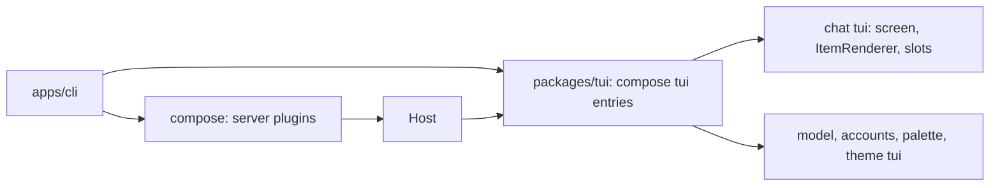

# Plan: milestone 2, the TUI

The session view, `packages/tui`, and the `tui` entries of `chat`, `palette`, `theme`, `model` and `accounts`. Work list: [plugins/tui.md](../plugins/tui.md). Designs: `apps/gallery`, plan in [_archive/gallery.md](_archive/gallery.md).

## Systems

| System | Change |
| --- | --- |
| `packages/client` | Expands: the session view beside `Host` |
| `packages/tui` | Adds the renderer, slots, the bridge between Effect and Solid, and the UI kit |
| `packages/plugins/chat` | Adds the chat screen as a `tui` entry |
| `packages/plugins/{palette,theme}` | Adds the command palette and theme switching |
| `packages/plugins/{model,accounts,loop,session}` | Expands: `tui` entries for the model picker and `/connect`; RPC for paging, the queue and the session list |
| `apps/cli` | Expands: the TUI by default, `--model`, `--session` |

## Today

How a frontend reads a session now (`apps/cli/src/print.ts`):

| Step | What does it |
| --- | --- |
| Open a session | `SessionRpc` `session/open` |
| Send input | `LoopRpc` `loop/send` with a `session/message` event |
| Follow it | `SessionRpc` `session/live`: saved events after a `seq`, then deltas and new events |
| Know the turn ended | A `loop/turn-end` event |
| Show text | Decode each item with its kind's `EventKind.decode` |

Event kinds a viewer sees today: `session/message`, `session/notice`, `loop/turn-end`, `loop/interrupted`, and the records `system-prompt` and `tool-definitions` log. Deltas: `loop/reply` (text, reasoning, tool calls, retries) and `loop/tool-done`. No event marks a turn's start.

Prior art:

| Source | How it turns events into state, and loads screens |
| --- | --- |
| `archive/packages/frontend` | Its own slot tree and part loader, about 700 lines; each part declared the slots it needed |
| `archive/packages/plugins/chat/src/tui/transcript-state.ts` | The chat screen's own fold: entries into transcript items, tool runs grouped |
| OpenCode `packages/client/src/solid/data.ts` | One 2,000-line switch over every event kind into a Solid store with `reconcile`; closed to plugins |
| OpenCode `packages/tui/src/plugin/` | Its own plugin API and loader for TUI plugins |

## Decisions

- **The session view is generic.** It keeps the saved events in order, the reply streaming now and whether a turn runs. Screens decode the kinds they need; `chat` builds the transcript itself, and a plugin that owns questions or actors builds those in its own `tui` entry. Plugins add event kinds, so code in `client` cannot know them all.
- **The session view is Effect-native.** Sending, cancelling and answering stay RPC calls on `LoopRpc`. `packages/tui` turns `state.changes` into a Solid store, reconciled by `seq` so unchanged rows stay mounted.
- **`loop/turn-start` marks a turn's start.** It is saved in the same write as the input the turn takes; the model never sees it. Any event kind can be an input, so the log alone cannot say when a turn starts.
- **`loop/reply` streams tool input.** A `tool-input` variant carries what the model has written of a call so far, from Effect AI's `tool-params-start`, `tool-params-delta` and `tool-params-end`, so a tool row inks its input in as it is written.
- **`loop` logs steps.** `loop/step-start` and `loop/step-end` are saved around each model call; the model never sees them.
- **Frontend code shared by `tui` and `web` lives in `view.ts`.** A plugin's `src/view.ts` or `src/view/` uses no UI framework; its `tui` and `web` entries import it and the server never does. `chat`'s holds the code that builds the transcript, so the desktop app reuses it. The plugin anatomy check and lint rules learn the new fixed file.
- **Plugins add frontend exports.** Beside `./contract`, a plugin exports `./view` (no UI framework) and `./tui` (OpenTUI), later `./web`. `/contract` is importable anywhere, `/view` from `view`, `tui` and `web` code, `/tui` from `tui` code only. `contract.ts` cannot hold a tag typed with a Solid component, since servers import it.
- **Plugins say which events make one transcript item.** `chat`'s `view.ts` holds `TranscriptRules`, after deepseek-harness's event definitions; its `tui` entry holds `ItemRenderer`, keyed by item kind. A part is one event, or one part of a `session/message`; parts with one item id make one item. An event no rule matches is its own item, of the event's kind. Streamed parts show as live items until saved.
- **Tool rows are not grouped.** A tool call and its result make one single-line row through `TranscriptRules`; consecutive tool rows sit next to each other, as in the gallery.
- **TUI and desktop share colors.** `theme`'s contract holds the role names, the `Palette` type, the setting and `theme/get`, `theme/set`; its `view.ts` holds the OKLCH math, ramps, palettes and the palette-to-role mapping. Its `tui` entry builds OpenTUI's `SyntaxStyle` and fills the UI kit's color context; a later `web` entry turns role colors into CSS variables. The UI kit owns `useColor` and that context and imports role names as a type. Spacing, borders, glyphs, fonts and syntax styles belong to each frontend. OpenCode keeps separate theme code for its TUI and web app, and their theme sets have drifted.
- **Slots.** `packages/tui` has one `screen` slot (`single_winner`) that `chat` fills. `chat` has `sidebar` (`append`, sections by `order`, its own Session section first) and `composer` (`replace`). A notifications slot comes with the first plugin that fills it.
- **Dialogs are a service, not a slot.** The UI kit's `Dialogs` is a stack with `open` and `close`, drawn above the screen with the dim. `model`, `accounts` and `palette` open their pickers through it from commands.
- **`ctrl+b` toggles the sidebar below 110 columns.** It is a named command, "Toggle sidebar", listed in the palette; `escape` closes the drawer, and a footer hint shows while the sidebar is hidden. It takes `ctrl+b` from OpenTUI's textarea, where the arrow keys do the same. Crush binds `ctrl+b`; OpenCode binds `ctrl+x b`.
- **`loop/step-end` carries token usage.** It holds the finish reason and the call's token counts from Effect AI's `finish` part. The sidebar's context share is the latest step's tokens over the model's `contextWindow` from the catalog. `usage` in milestone 4 prices step-ends instead of attaching counts.
- **`tui` entries are plugins.** A plugin's `tui` module default-exports a plugin made with `definePlugin`; `packages/tui` composes them with `compose` over a base layer that provides `Host`, the renderer and the slot registry. `compose` gives the load order, missing-piece errors and cleanup, so `chat` provides `ItemRenderer` and `approvals` requires it.

```ts
// packages/client
interface ViewState {
  readonly events: ReadonlyArray<SessionEvent>   // saved, oldest first
  readonly streaming: ReadonlyArray<ReplyDelta>  // the reply being written; cleared when saved or retried
  readonly running: boolean
}
SessionView.open(session): Effect<{ state: SubscriptionRef<ViewState>; loadOlder: Effect<void> }, E, Host | Scope>
```

```ts
// chat/src/view.ts
interface TranscriptRule<S> {
  readonly kind: string                              // item kind
  readonly match: (part: Part) => string | undefined // item id
  readonly start: (part: Part) => S
  readonly update: (state: S, part: Part) => S
}
export const TranscriptRules: Registry<TranscriptRule<unknown>>

// chat/src/tui.tsx
export const ItemRenderer: Registry<{ kind: string; component: Component<{ item: Item }> }>
```



| Gallery piece | Goes to |
| --- | --- |
| Primitives, `Dialog`, `Picker` | `packages/tui` UI kit |
| Header, sidebar, composer, transcript, notifications, slash menu, landing, sessions picker | `chat` |
| Models picker | `model` |
| Connect dialog | `accounts` |
| Commands picker | `palette` |
| `useColor` | `packages/tui` UI kit |
| `oklch.ts`, `ramp.ts`, `palettes.ts`, `roles.ts` | `theme` `view.ts`; role names in its contract |
| `syntax.ts`, `theme.tsx` | `theme` `tui` entry |

## Events in the references

| Signal | Pi | OpenCode | deepseek-harness | Liminal |
| --- | --- | --- | --- | --- |
| Turn start and end | `turn_start`, `agent_end` | `execution.started`, `.succeeded` | `turn/start`, `turn/end` | `loop/turn-start`, `loop/turn-end` |
| Step: one model call | `turn_start` per response | `step.started`, `.ended`, `.failed` | `step/start`, `step/end` | none |
| Text and reasoning as written | `message_update` | `text.delta`, `reasoning.delta` | `agent/assistant-stream` | `loop/reply` |
| Tool input as written | no | `tool.input.delta` | in the stream | none: a tool call arrives whole |
| Tool output as it runs | `tool_execution_update` | `tool.progress` | no | none |
| Retry | `auto_retry_start` | `retry.scheduled` | `assistant/attempt` | `loop/reply` retry |
| Queue | `queue_update` | `inbox.enqueued`, `.delivered`, `.cancelled` | `agent/inbox/*` | planned `loop/queue` |
| Model change | `model_change` | `model.selected` | no | none |
| Usage | `usage` | `usage.updated` | `token-meter` | none; planned on `loop/step-end` |
| Compaction, rename, fork | yes | yes | yes | milestones 4 and 5, Later |

Effect AI streams tool input as `tool-params-start`, `tool-params-delta` and `tool-params-end` (`effect/ai` `Response`); `loop` drops them today.

## deepseek-harness frontends

- Browser plugins use the same plugin framework (Cordis) as the server, and the desktop app loads the same web app.
- Framework-free layers sit under the renderer: `client/store` for state, `client/ui-slots` for slot definitions, `client/ui-conversation` for a target-neutral conversation built from events by a registry of event definitions. Only `client/ui-renderer` knows React.
- One root slot; its occupant owns the layout.

## Open

None.
